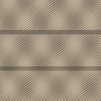
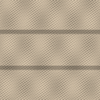
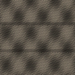
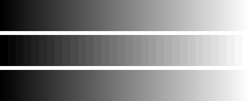
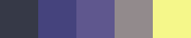
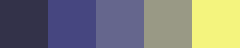
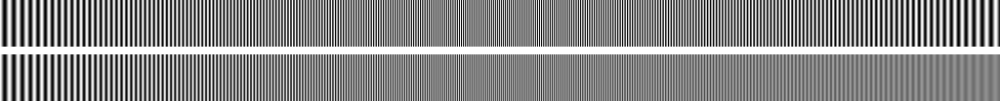

# Modul 1: Representasi Digital, Warna & Memori

Subjek: patung kuda berdiri milik saya sendiri, difoto di dalam rumah. 24 foto dipakai (dari 28, empat dibuang karena blur), 4536 × 8064 pixel, iPhone 17 Pro, 27 Oktober 2026.

Inti modul ini: angka di file gambar adalah kode sRGB, bukan jumlah cahaya. Sebelum dirata-ratakan, di-blend, atau diubah kecerahannya, kode harus diubah dulu ke linear light, lalu dikembalikan sesudahnya.

## Cara menjalankan

```
cd Module1/Source
python3 -m venv .venv && source .venv/bin/activate
pip install -r requirements.txt
make data && make test && make report && make png
```

Lalu buka `Source/report/report.html` di browser. Semua gambarnya sudah ada di dalam satu file itu.

## Hasil utama

### Downscale naif vs gamma-correct

| Naif (rata-rata kode sRGB) | Benar (rata-rata di linear light) | Selisih × 4 |
|---|---|---|
|  |  |  |

Hasil naif lebih gelap rata-rata 20,24 kode dan paling banyak 42 kode, karena 23,5% cahayanya hilang. Terhadap acuan yang menjaga cahaya, PSNR naik dari 21,48 dB menjadi tak hingga (identik) setelah langkah decode ke linear dinyalakan. Diagnosisnya ditulis dari nilai pixel sebelum perbaikan: [docs/prediksi/diagnosis-gamma.md](docs/prediksi/diagnosis-gamma.md).

### Banding 8-bit vs 5-bit, lalu dithering



Atas 8-bit (256 level, pita 2 px), tengah 5-bit (32 level, pita 16 px), bawah 5-bit dengan ordered dither Bayer 4×4. Setelah dithering, error rata-rata lokal turun dari 1,58 ke 0,36 kode.

### Simulasi buta warna (CVD) pada legenda chart

| Asli | Deuteranopia | Protanopia |
|---|---|---|
|  |  |  |

Legenda viridis ini dijaga oleh `make test`: test gagal kalau dua kategori runtuh menjadi warna yang hampir sama. Palet merah-hijau yang buruk turun ke jarak 0,0 di grayscale dan ditolak.

### Aliasing



Frekuensi naik dari 0,1 (kiri) ke 0,9 cycles/pixel (kanan). Atas tanpa pre-filter, bawah dengan box pre-filter. Setiap frekuensi di atas 0,5 terukur persis di |f − 1|: 0,6 → 0,4, 0,7 → 0,3, 0,8 → 0,2, 0,9 → 0,1. Pre-filter box hanya melemahkan alias (di 0,9 tersisa 11%), tidak menghapusnya. Gambar ini sebaiknya dilihat pada ukuran aslinya, karena kalau diperkecil oleh browser, gambarnya sendiri ikut mengalami aliasing.

### Budget (resolusi asli)

| Item | Nilai |
|---|---|
| Byte per foto (RGB888) | 109.734.912 B = 104,65 MiB |
| Working set (24 foto) | 2.633.637.888 B = 2.511,63 MiB |
| Flythrough 10 s 30 fps | 32.920.473.600 B = 32,92 GB = 30,66 GiB |
| Bandwidth | 3.292.047.360 B/s = 3.292,05 MB/s = 26.336,38 Mbit/s |

MB dan GB berbasis 10^6 dan 10^9; MiB dan GiB berbasis 2^20 dan 2^30.

## Kebijakan format

Lihat [Source/report/formats.md](Source/report/formats.md). Ringkasnya: arsip PNG, hero image web WebP q92, thumbnail JPG q75 (diperkecil dengan cara linear), texture Modul 3 PNG, dan video flythrough MP4/H.264.

## Dokumen

- Studi Pendahuluan: [docs/studi-pendahuluan/studi-pendahuluan.md](docs/studi-pendahuluan/studi-pendahuluan.md)
- Laporan: [docs/laporan/laporan-modul1.md](docs/laporan/laporan-modul1.md)
- Catatan per fase: [docs/catatan/](docs/catatan/)
- Prediksi yang ditulis sebelum pengukuran: [docs/prediksi/](docs/prediksi/)
- Detail teknis dan baris Verified: [Source/README.md](Source/README.md)
- Foto dan asal-usulnya: [Source/photos/README.md](Source/photos/README.md)
