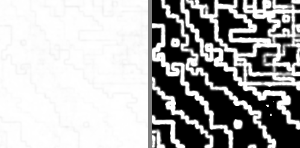

# Fase 5: Format dan report (Lab 3)

Di fase ini saya memilih format untuk setiap kegunaan, berdasarkan pengukuran dan bukan kesan, lalu menyusun `report.html` yang bisa dibuka penilai tanpa file lain. Urutannya saya jaga: prediksi ditulis lebih dulu di `docs/prediksi/prediksi-format.md`, baru setelah itu pengukurannya dijalankan.

## 1. Dua crop dari foto saya

Keduanya 256 × 256 pixel, dipotong otomatis oleh `make data` dari versi kerja foto (lokasinya dicatat di `Source/photos/crops.csv`), jadi clone baru akan mendapat crop yang sama persis.

- **crop_dinding**: dinding polos dari IMG_8884 (x 100, y 50).
- **crop_surai**: surai berukir dari IMG_8893 (x 300, y 400), penuh guratan pahat yang berulang.

## 2. Hasil pengukuran

Ukuran setelah decode keduanya 196.608 B.

| Format | Dinding: byte | rasio | PSNR | Surai: byte | rasio | PSNR |
|---|---|---|---|---|---|---|
| PNG | 17.945 | 10,96× | tak hingga | 99.593 | 1,97× | tak hingga |
| WebP lossless | 13.366 | 14,71× | tak hingga | 73.108 | 2,69× | tak hingga |
| JPG q92 | 3.804 | 51,68× | 52,1 dB | 19.208 | 10,24× | 40,5 dB |
| WebP q92 | 908 | 216,53× | 48,2 dB | 15.984 | 12,30× | 41,2 dB |
| JPG q75 | 1.941 | 101,29× | 50,0 dB | 10.136 | 19,40× | 36,8 dB |
| JPG q40 | 1.734 | 113,38× | 44,7 dB | 5.707 | 34,45× | 33,9 dB |
| AVIF q40 | 436 | 450,94× | 46,6 dB | 2.788 | 70,52× | 33,8 dB |

## 3. Prediksi vs pengukuran

| Prediksi | Hasil | Status |
|---|---|---|
| Format terkecil di kedua crop: AVIF q40 | 436 B dan 2.788 B, terkecil di keduanya | tepat |
| Surai selalu jauh lebih besar dari dinding, minimal 3× | JPG q92 5,05×, JPG q40 3,29×, AVIF 6,39×, PNG 5,55× | tepat |
| Urutan ukuran surai: PNG > WebP lossless > JPG q92 > WebP q92 > JPG q75 > JPG q40 > AVIF | persis begitu | tepat |
| PNG dan WebP lossless surai 1,5× sampai 2× | 1,97× dan 2,69× | PNG tepat, WebP sedikit lebih baik |
| JPG surai: q92 4×-8×, q75 8×-15×, q40 15×-30× | 10,24×, 19,40×, 34,45× | **meleset**, semuanya lebih padat |
| PNG dinding hanya 2×-4×, karena noise | 10,96× | **meleset jauh** |
| JPG q92 dinding 10×-25× | 51,68× | **meleset jauh** |
| Urutan ukuran dinding sama dengan surai | WebP q92 (908 B) lebih kecil dari JPG q75 dan JPG q40 | **meleset** |
| Artefak surai: samar di q75, jelas di q40, tidak terlihat di q92 | sesuai, lihat bagian 4 | tepat |
| Ringing sebagai artefak utama | yang paling terlihat justru blocking dan butiran yang hilang | **sebagian meleset** |

### Kenapa saya meleset

**1. Crop-nya diambil dari versi kerja, bukan foto asli.** Ini penyebab terbesar. Versi kerja dibuat dengan merata-ratakan setiap blok 5 × 5 pixel foto asli, dan merata-ratakan banyak pixel mengurangi noise. Saya mengukurnya setelah prediksi meleset. Di crop dinding, simpangan totalnya memang 5,58 kode, tapi noise per pixel-nya (selisih setiap pixel dengan rata-rata 9 × 9 di sekitarnya) hanya **0,49 kode**. Sisanya adalah gradasi cahaya yang pelan. Pada area yang sama di foto asli, noise per pixel-nya 1,78 kode, sekitar 3,6 kali lebih besar. Secara teori, merata-ratakan 25 pixel menurunkan noise acak 5 kali. Dugaan saya, yang terukur hanya 3,6 kali karena noise di foto kamera tidak sepenuhnya acak antar pixel tetangga. Jadi dinding di versi kerja jauh lebih rata daripada yang saya bayangkan, dan PNG pun bisa memadatkannya hampir 11 kali. Prediksi saya lebih cocok untuk foto **asli**, yang di Fase 2 terbukti penuh noise.

**2. Saya meremehkan encoder modern.** Untuk surai, rasio JPG yang terukur sekitar 1,15 sampai 2,6 kali dari batas perkiraan saya, walaupun urutannya tepat. PSNR-nya juga sedikit lebih tinggi dari perkiraan, sekitar 0,5 sampai 2 dB.

**3. Angka kualitas WebP dan JPG tidak setara.** Di dinding, WebP q92 bahkan lebih kecil dari JPG q40, padahal PSNR-nya masih 48,2 dB. Pada gambar yang hampir rata, WebP jauh lebih efisien daripada JPG. Saya sudah menulis bahwa bagian ini yang paling tidak saya yakini, dan ternyata memang meleset.

## 4. Artefak JPEG, dilihat dan diukur

Saya melihat potongan surai yang diperbesar 3 kali di q92, q75, dan q40:

- **q92:** tidak bisa dibedakan dari aslinya.
- **q75:** sedikit lebih lembut, butiran batu mulai halus.
- **q40:** kotak-kotak 8 × 8 terlihat jelas, butiran batu menjadi rata, dan ada bercak warna. Ringing di tepi guratan ada, tapi tidak semenonjol yang saya kira.

Supaya tidak hanya kesan, saya mengukur loncatan nilai di batas blok 8 × 8 dan di dalam blok:

| Crop, kualitas | Loncatan di batas blok | Loncatan di dalam blok |
|---|---|---|
| Surai, JPG q40 | 6,52 kode | 3,73 kode |
| Dinding, JPG q40 | 0,495 kode | 0,009 kode |

Di surai, batas blok sudah 75% lebih tajam daripada isi bloknya, dan itu yang terlihat sebagai blocking. Di dinding, isi setiap blok menjadi rata total, tapi loncatan di batasnya kurang dari 1 kode sehingga hampir tidak terlihat. Pada gradasi langit yang lebih panjang, loncatan kecil ini bisa menumpuk menjadi pita.

## 5. Downscale benar vs naif vs Pillow (Lab 3 nomor 2)

Hasil `downscale_compare.py`, semuanya terhadap hasil yang benar (decode, rata-rata, encode):

| Gambar | Cara | PSNR | Selisih terbesar |
|---|---|---|---|
| IMG_8884 | naif | 52,24 dB | 27 kode |
| IMG_8884 | Pillow `Image.BOX` | 51,42 dB | 26 kode |
| relief (sintetis) | naif | 21,48 dB | 42 kode |
| relief (sintetis) | Pillow `Image.BOX` | 21,68 dB | 41 kode |

Pillow `Image.BOX` dibandingkan dengan cara naif paling banyak berbeda **1 kode** di ketiga gambar. Jadi **bawaan Pillow meniru bug-nya**, persis seperti prediksi saya: Pillow merata-ratakan nilai 8-bit apa adanya. Satu-satunya yang cocok dengan hasil benar adalah fungsi saya dengan langkah decode ke linear.

Ada nuansa penting di sini. Pada foto saya, PSNR cara naif tinggi (52 dB) dan selisih rata-ratanya kecil (0,18 kode), karena sebagian besar foto berisi area yang halus. Kesalahannya terkumpul di tepi: sampai 27 kode di tepi patung, terlihat sebagai garis terang di gambar selisih pada `report.html`. Pada relief yang penuh tekstur, rata-ratanya 20 kode. Jadi error gamma paling penting untuk tepi dan tekstur, yang justru detail paling berharga dari benda warisan budaya.

## 6. Kebijakan format

Ditulis di `Source/report/formats.md`, setiap baris didukung angka di atas:

| Kegunaan | Pilihan |
|---|---|
| Arsip | PNG, ditambah JPG asli dari kamera tanpa diubah |
| Hero image web | WebP q92 |
| Thumbnail | JPG q75, setelah diperkecil dengan cara linear |
| Sumber texture Modul 3 | PNG 8-bit sRGB |
| Video flythrough | MP4/H.264, sekitar 8 Mbit/s |

Jawaban arsip berbeda dari jawaban termurah karena tujuannya berbeda. AVIF q40 paling murah, tapi membuang informasi untuk selamanya. Arsip harus menjaga semua kemungkinan pemakaian di masa depan, walaupun ukurannya 36 kali lebih besar.

## 7. Report

`make report` sekarang menulis:

- `report/budget.md`: semua hitungan budget untuk set foto saya (resolusi asli, MB dan MiB diberi label), ditambah contoh E6/E7.
- `report/report.html`: tujuh bagian, yaitu budget, histogram, triptych naif/benar/selisih (relief dan tepi patung saya), cek CVD sebelum dan sesudah, banding, aliasing, serta tabel dan kebijakan format.

Semua 18 gambarnya disisipkan langsung sebagai PNG base64, dan tidak ada rujukan ke file lain. Saya sudah membukanya di Chrome tanpa layar (headless) untuk memastikan semua bagian tampil. Kalau ada gambar yang belum dibuat, halaman menampilkan pesan merah "belum ada", bukan diam-diam kosong.

`make png` mengekspor gambar laporan ke `docs/img/` sebagai PNG, karena GitHub tidak bisa menampilkan file PPM, dan gambar itu dipakai di `Module1/README.md`.

## 8. Tambahan 2 November 2026: SSIM berjendela (Extension Lab di `metrics.py`)

### Kenapa

`ssim()` dari starter adalah SSIM **global**: satu jendela untuk seluruh gambar. Komentar di `metrics.py` sendiri menyebut bahwa SSIM asli (Wang dkk. 2004) memakai jendela Gaussian 11×11 yang digeser, dan meminta perbedaannya dijelaskan di Extension Lab. Di keterbatasan no 6 laporan, saya menulis bahwa JPG q40 di dinding mendapat PSNR 44,7 dB, padahal teksturnya sudah rata. Dugaan saya, SSIM berjendela akan menangkap masalah itu.

### Yang ditambahkan

- `ssim_map()` dan `ssim_windowed()` di `metrics.py`, hanya dengan NumPy:
  - jendela Gaussian 11×11, sigma 1,5, K1 = 0,01, K2 = 0,03;
  - hanya posisi jendela yang muat di dalam gambar;
  - hasilnya rata-rata peta SSIM, dan untuk gambar berwarna rata-rata ketiga channel.

  `ssim()` yang lama tidak diubah.
- `ssim_compare.py`, dijalankan di `make report`. Script ini memakai encoder dan pengaturan yang sama dengan `format_compare.py`, lalu menulis `report/ssim_windowed.md` dan gambar `report/ssim_vs_texture_dinding_jpg40.pgm`. `report.html` sekarang punya 19 gambar.

### Pembuktian kodenya

- **Brute force.** Hasilnya cocok dengan perhitungan langsung per jendela memakai rumus varians terpusat, dengan selisih di bawah 1e-12 (`make test`).
- **Pembanding dari luar.** Dicocokkan dengan `skimage.metrics.structural_similarity` dari scikit-image 0.26.0 (scipy 1.17.1, `gaussian_weights=True, sigma=1.5, use_sample_covariance=False, data_range=255`). Pengecekan ini dilakukan di venv sementara yang lalu dihapus, jadi scikit-image tidak menjadi dependensi. Pada 10 pasang gambar (5 format × 2 crop), selisih terbesarnya **5,1e-14**.
- **Test bisa gagal.** Saya mencoba tiga kerusakan di salinan sementara: kovarians yang salah, bobot Gaussian yang tidak dinormalkan, dan jendela yang tidak digeser. Ketiganya membuat `make test` gagal.

### Hasil

| Crop | Format | PSNR | SSIM global | SSIM berjendela | SSIM lokal terburuk | Tekstur tersisa |
|---|---|---|---|---|---|---|
| dinding | JPG q92 | 52,1 dB | 0,9984 | 0,9946 | 0,9620 | 95% |
| dinding | WebP q92 | 48,2 dB | 0,9963 | 0,9930 | 0,9519 | 71% |
| dinding | JPG q75 | 50,0 dB | 0,9975 | 0,9933 | 0,9474 | 64% |
| dinding | JPG q40 | 44,7 dB | 0,9913 | **0,9906** | 0,9343 | **12%** |
| dinding | AVIF q40 | 46,6 dB | 0,9942 | 0,9933 | 0,9178 | 49% |
| surai | JPG q92 | 40,5 dB | 0,9979 | 0,9674 | 0,8188 | 100% |
| surai | WebP q92 | 41,2 dB | 0,9982 | 0,9732 | 0,9021 | 99% |
| surai | JPG q75 | 36,8 dB | 0,9950 | 0,9298 | 0,6702 | 99% |
| surai | JPG q40 | 33,9 dB | 0,9901 | **0,8751** | 0,5483 | 96% |
| surai | AVIF q40 | 33,8 dB | 0,9898 | **0,8605** | 0,3747 | 83% |

"Tekstur tersisa" adalah median rasio simpangan baku lokal (jendela Gaussian yang sama), hasil decode dibagi asli.

**Dugaan saya hanya tepat di surai.** Di surai, SSIM global memberi semua format lossy angka 0,990 sampai 0,998, jadi praktis tidak bisa membedakannya. SSIM berjendela menyebarkannya dari 0,973 sampai 0,861, dengan urutan yang sama dengan yang terlihat mata. Di dinding, SSIM berjendela **tidak** menangkap tekstur yang hilang: JPG q40 tetap 0,9906, padahal hanya 12% teksturnya yang tersisa.

**Kenapa.** Rumus SSIM punya konstanta penstabil C2 = (0,03 × 255)², setara simpangan baku sekitar 7,65 kode. Tekstur dinding hanya 0,51 kode (median simpangan lokal), sekitar 15 kali lebih kecil. Jadi di bagian kontras dan struktur rumus, C2 jauh lebih besar daripada varians tekstur, dan hasilnya tetap mendekati 1 apa pun yang terjadi pada teksturnya. Saya membuktikannya dengan mengecilkan K2 sepuluh kali (dari 0,03 ke 0,003). SSIM berjendela JPG q40 di dinding langsung turun dari 0,9906 ke 0,6325. Konstanta itu memang sengaja dipasang supaya SSIM stabil di daerah rata, dan efek sampingnya adalah butiran halus seperti di dinding saya tidak dihitung.

Kiri: SSIM lokal, hampir putih di seluruh gambar (0,93 sampai 1). Kanan: tekstur yang tersisa. Sebagian besar hitam, artinya butirannya hilang. Garis putih di kanan adalah tepi blok 8×8, yaitu variasi baru yang dibuat JPEG di batas blok, bukan tekstur asli.

**Yang saya ambil:** SSIM berjendela lebih baik daripada SSIM global untuk tekstur yang kuat, tapi bukan pengukur "butiran yang hilang" di permukaan yang hampir rata. Untuk itu, ukuran yang langsung (rasio simpangan lokal) lebih jujur. Kebijakan format tidak berubah: texture Modul 3 tetap PNG, karena alasan kebijakan itu adalah lossless.

