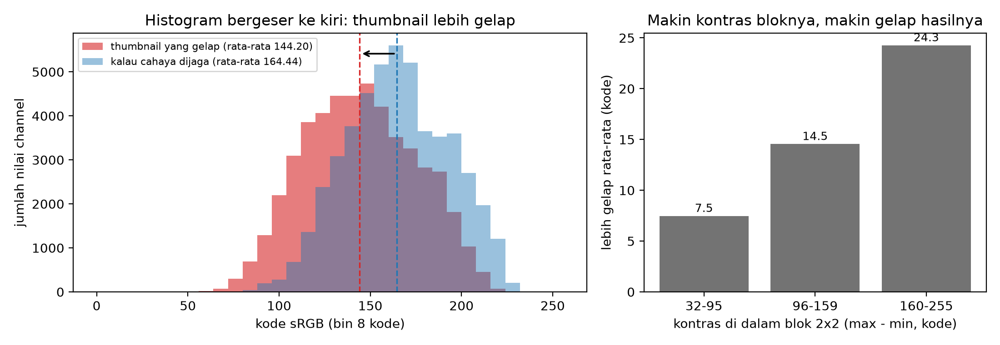

# Diagnosis: thumbnail 2× yang pucat dan gelap

File ini saya tulis **sebelum** melihat atau memperbaiki kode `gamma_resize_bug.py`. Semua bukti di sini berasal dari nilai pixel saja. Perbaikannya baru dikerjakan setelah file ini di-commit, supaya riwayat git menunjukkan diagnosisnya lebih dulu.

## Yang saya periksa

- `data/relief.ppm`: gambar sumber, 256 × 256 pixel.
- `data/thumb_buggy.ppm`: hasil perkecil 2× (128 × 128) yang tampak terlalu gelap.

Saya menjalankan `gamma_resize_bug.py --diagnose` tanpa membuka kodenya, lalu membuat program saya sendiri, `Source/gamma_diagnosis.py`, yang hanya membaca kedua gambar itu. Angka dari kedua program cocok.

## Bukti 1: cahayanya hilang, padahal rata-rata kodenya tetap

Memperkecil gambar seharusnya tidak mengubah jumlah cahaya rata-rata. Satu pixel thumbnail menggantikan empat pixel sumber, jadi idealnya cahaya pixel itu sama dengan rata-rata cahaya keempatnya.

| | Gambar sumber | Thumbnail |
|---|---|---|
| Rata-rata kode sRGB | 144,1979 | 144,1973 |
| Rata-rata cahaya (linear light) | 0,38885 | 0,29731 |

Rata-rata **kode**-nya praktis tidak berubah, tapi rata-rata **cahaya**-nya turun **23,5%**. Ini petunjuk pertama: yang dijaga oleh proses perkecil adalah kode, bukan cahaya.

## Bukti 2: thumbnail persis sama dengan rata-rata kode

Saya menguji dua resep untuk setiap blok 2×2 di gambar sumber, lalu membandingkannya dengan pixel thumbnail:

| Resep | Cocok persis | Selisih terbesar |
|---|---|---|
| H1: rata-rata keempat **kode** sRGB, lalu dibulatkan | **100,00%** | **0 kode** |
| H2: ubah ke linear, rata-rata keempat **cahaya**, ubah kembali ke sRGB | 0,00% | 42 kode |

Setiap nilai di thumbnail, ketiga channel di 16.384 pixel, sama persis dengan rata-rata keempat kode sRGB di bloknya. Jadi bisa dipastikan thumbnail dibuat dengan merata-ratakan kode sRGB secara langsung.

## Bukti 3: seberapa gelap, dan di mana paling parah

Dibandingkan dengan hasil yang menjaga cahaya (H2), thumbnail lebih gelap:

- rata-rata **20,24 kode**, paling sedikit **4 kode**, paling banyak **42 kode**,
- di **100%** nilai pixel, tidak ada satu pun yang lebih terang,
- PSNR thumbnail terhadap hasil yang menjaga cahaya **21,5 dB** dan SSIM 0,962 (dari output `--diagnose`).

Gelapnya tidak merata. Makin kontras blok 2×2-nya, makin gelap hasilnya:

| Kontras di dalam blok (terang − gelap) | Rata-rata lebih gelap |
|---|---|
| 32 sampai 95 kode | 7,47 kode |
| 96 sampai 159 kode | 14,55 kode |
| 160 sampai 255 kode | 24,27 kode |

Korelasi antara kontras blok dan besarnya penggelapan 0,779.

*Kiri: histogram thumbnail (merah) bergeser ke kiri, rata-ratanya 144,20, dibanding hasil yang menjaga cahaya (biru), rata-ratanya 164,44. Puncaknya pindah dari bin 160 ke bin 144. Kanan: blok yang lebih kontras jadi lebih gelap.*

## Akar masalah (dugaan saya)

Kode sRGB di file bukan jumlah cahaya. Kurva sRGB melengkung: kode 128 (setengah dari 255) hanya sekitar 22% cahaya, bukan 50%. Merata-ratakan kode berarti merata-ratakan besaran yang salah.

Contohnya, satu pixel hitam (kode 0) dan satu pixel putih (kode 255). Rata-rata kodenya 127,5, padahal setengah cahaya putih disimpan sebagai kode 187,5. Hasilnya 60 kode terlalu gelap. Karena kurvanya melengkung ke bawah, rata-rata kode **selalu** jatuh di bawah rata-rata cahaya, kecuali keempat pixel sama. Selisihnya makin besar kalau isi bloknya makin berbeda. Itu persis pola yang terlihat di Bukti 3: tidak pernah lebih terang, dan paling gelap di blok yang kontras.

Jadi akar masalahnya: **program merata-ratakan kode sRGB tanpa mengubahnya ke linear light lebih dulu.**

## Perbaikan yang saya perkirakan

Satu baris yang hilang adalah langkah decode sRGB → linear sebelum dirata-ratakan (dan encode kembali sesudahnya). Kalau dugaan ini benar, setelah diperbaiki:

1. thumbnail harus sama dengan resep H2 di semua pixel, atau paling banyak beda 1 kode karena pembulatan,
2. rata-rata kodenya naik dari 144,20 ke sekitar 164,44,
3. rata-rata cahayanya kembali sekitar 0,389, sama dengan gambar sumber,
4. difference image antara sebelum dan sesudah perbaikan paling terang di bagian yang kontras (punggung relief), dan hampir hitam di bagian yang rata.

Keempat prediksi ini akan saya cek setelah perbaikan.
