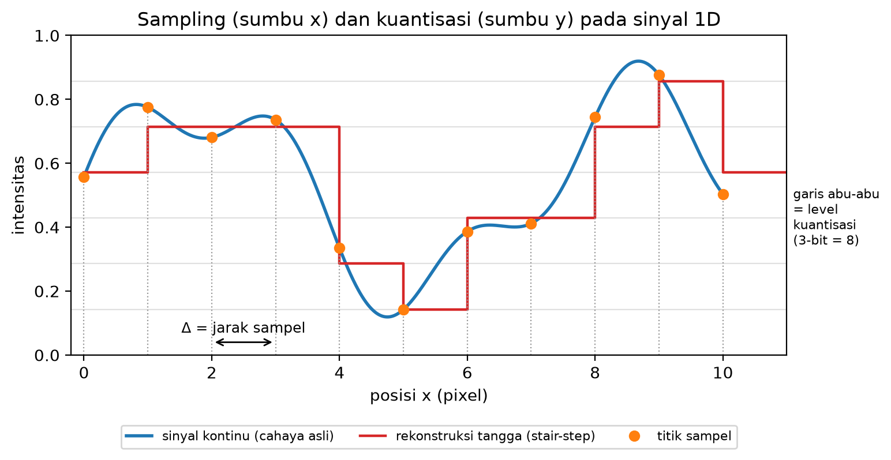
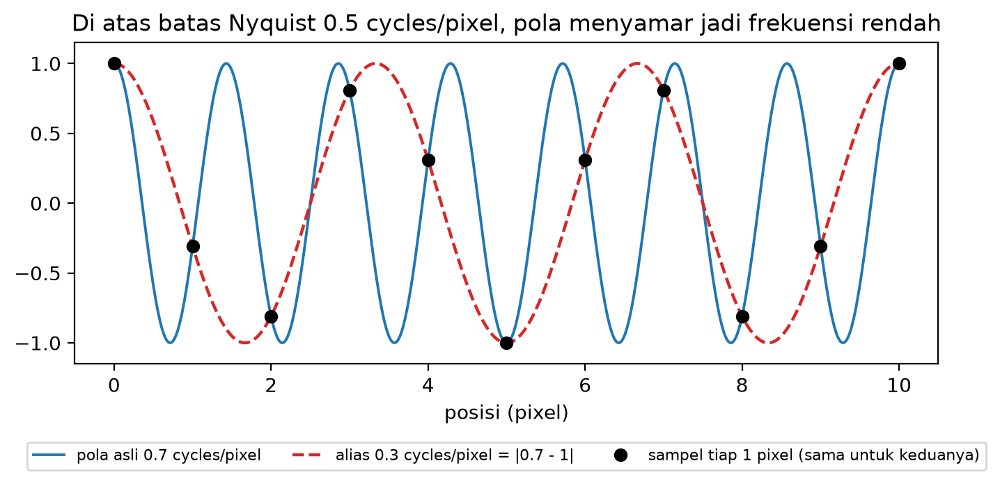
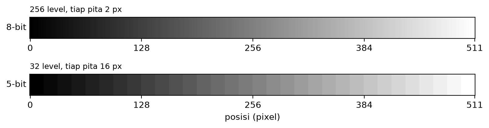
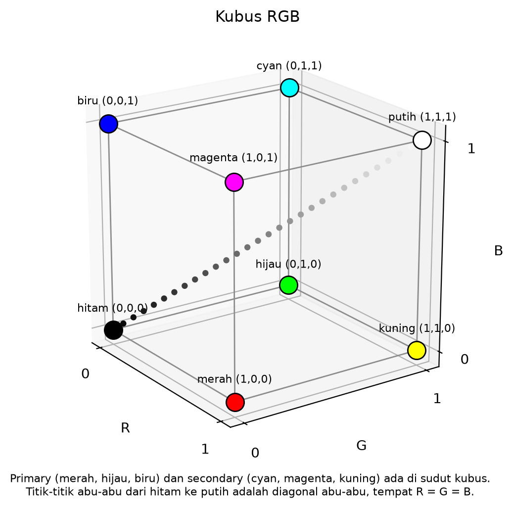
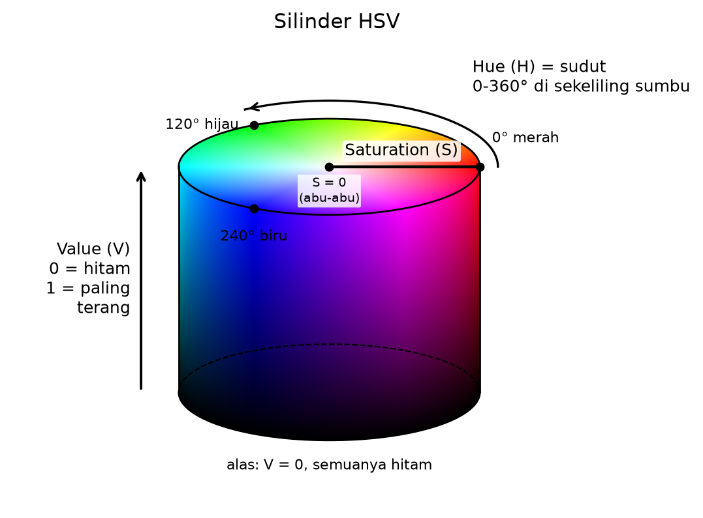
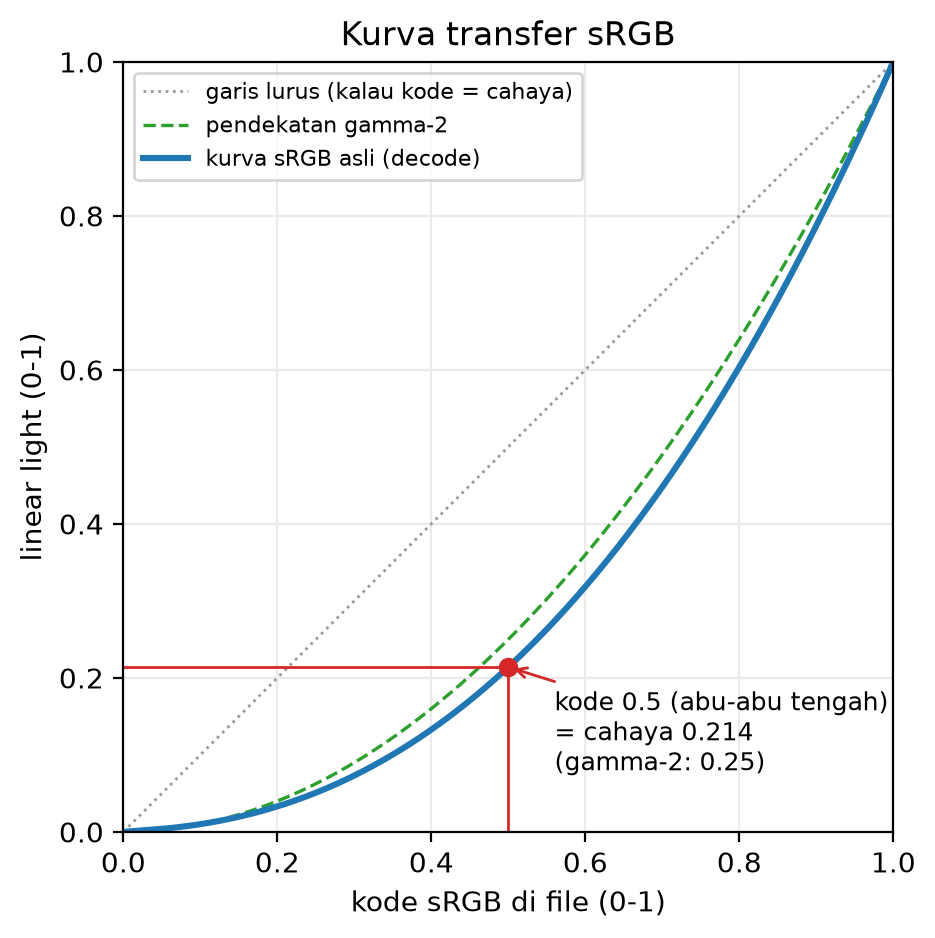

# Studi Pendahuluan Modul 1: Representasi Digital, Warna & Memori

Zacky Maulana (NIM 20241337034), S1 Informatika UMSurabaya
Praktikum Grafika Komputer

Semua angka di dokumen ini saya hitung ulang dengan program `Source/prelim_check.py`, dan semua diagram dibuat oleh `Source/figures/make_figures.py`. Jadi kalau ada angka yang salah tulis, program itu akan gagal.

---

## Q1. Sampel, bit depth, dan aliasing

### Q1(a) Sampling dan kuantisasi

Cahaya di dunia nyata itu kontinu: di setiap titik selalu ada nilai intensitasnya, sehalus apa pun kita melihatnya. Kamera tidak bisa menyimpan sesuatu yang tak terhingga seperti itu, jadi ada dua penyederhanaan yang dilakukan.

- **Sampling** adalah memilih *di mana* cahaya diukur. Kamera hanya mengukur di titik-titik grid yang jaraknya tetap, yaitu pusat-pusat pixel. Jarak antar titik ini disebut jarak sampel, ditulis Δ. Semua yang terjadi di antara dua titik sampel hilang.
- **Kuantisasi** adalah membulatkan *berapa* nilai yang diukur ke salah satu level yang tersedia. Dengan b bit ada L = 2^b level. Rumusnya `code = round(v × (L - 1))`, dengan v intensitas antara 0 dan 1.

Jadi sampling memotong sumbu posisi (x), sedangkan kuantisasi memotong sumbu nilai (y). Citra 2D adalah hasil keduanya: grid angka berukuran (tinggi, lebar, channel).

*Gambar 1. Kurva biru adalah cahaya asli. Titik oranye adalah sampel tiap Δ = 1 pixel. Garis merah adalah rekonstruksi tangga (stair-step): tiap sampel dibulatkan ke level 3-bit terdekat (garis abu-abu horizontal) lalu ditahan sampai sampel berikutnya. Puncak di antara dua sampel, misalnya di dekat x = 8,7, tidak pernah terekam.*

### Q1(b) Batas Nyquist

Teorema Nyquist-Shannon dalam satu kalimat: sinyal yang frekuensi tertingginya f_max bisa dipulihkan sepenuhnya dari sampelnya, asalkan laju sampling lebih besar dari 2 × f_max.

Grid pixel melakukan 1 sampel per pixel, jadi frekuensi spasial tertinggi yang bisa diwakili adalah **0,5 cycles/pixel**. Itu sama dengan pola satu pixel terang, satu pixel gelap.

Pola 0,7 cycles/pixel ada di atas batas itu. Pola ini tidak hilang, tapi menyamar menjadi frekuensi yang lebih rendah sebesar |f - f_s| = |0,7 - 1| = **0,3 cycles/pixel**. Gambar 2 menunjukkan kenapa: di setiap posisi pixel bulat, nilai kedua gelombang persis sama. Program saya mengecek 512 sampel dan selisih terbesarnya cuma 3,1 × 10⁻¹³, yaitu sisa pembulatan komputer. Jadi grid benar-benar tidak bisa membedakan keduanya.

*Gambar 2. Gelombang asli 0,7 cycles/pixel (biru) dan gelombang 0,3 cycles/pixel (merah putus-putus) melewati titik sampel yang sama.*

### Q1(c) Banding pada gradien 512 pixel

Gradien dari hitam (v = 0) ke putih (v = 1) sepanjang 512 pixel:

| | 8-bit | 5-bit |
|---|---|---|
| Jumlah level L = 2^b | 2^8 = 256 | 2^5 = 32 |
| Quantisation step q = 1/(L - 1) | 1/255 ≈ 0,0039 | 1/31 ≈ 0,0323 |
| Step dalam skala kode 8-bit | 1 kode | ≈ 8,23 kode |
| Level abu-abu yang muncul | 256 | 32 |
| Lebar tiap pita | 512 / 256 = **2 px** | 512 / 32 = **16 px** |

*Gambar 3. Gradien yang sama di 8-bit dan 5-bit.*

Ada satu catatan yang saya temukan saat mengecek dengan program. Lebar pita persis 16 px hanya berlaku kalau setiap level mendapat bagian input yang sama besar (`floor(x × L / 512)`). Kalau memakai rumus pembulatan `round(v × 31)` dengan v = x/511, kedua pita di ujung hanya 9 px, karena pembulatan memberi ujung setengah jatah, dan pita di tengah selebar 16 sampai 17 px. Di 8-bit perbedaan ini tidak muncul, semua pitanya tetap 2 px. Pita 2 px di 8-bit hampir tidak terlihat, sedangkan undakan 16 px di 5-bit jelas sekali. Inilah banding.

### Q1(d) Dua contoh aliasing sehari-hari

- **Spasial: kemeja bergaris halus yang difoto dari jauh.** Garis kainnya lebih rapat daripada jarak antar pixel sensor kamera, jadi polanya undersampled: kurang dari dua sampel per siklus garis. Hasilnya muncul pola gelombang besar (moiré) yang tidak ada di kain aslinya, persis seperti 0,7 yang menyamar jadi 0,3 di Gambar 2.
- **Temporal: roda mobil di video yang tampak berputar pelan atau mundur.** Kamera video mengambil sampel waktu, misalnya 30 frame per detik. Kalau jari-jari roda berpindah hampir satu jarak jari-jari di antara dua frame, gerakannya undersampled terhadap waktu, dan mata membaca gerakan sisanya yang kecil, bahkan arahnya bisa terbalik. Modul memberi contoh roda 9 putaran per frame yang difilmkan 10 fps tampak mundur 1 putaran per frame.

Rujukan Q1: Marschner & Shirley 5e Bab 3 (Raster Images) dan Bab 10 (Signal Processing); Hughes dkk. 3e Bab 17 (Image Representation and Manipulation) dan Bab 18 (Images and Signal Processing).

---

## Q2. Model warna dan pertanyaan gamma

### Q2(a) Kubus RGB dan silinder HSV

Layar membuat warna dengan menjumlahkan cahaya merah, hijau, dan biru, jadi setiap warna adalah satu titik (R, G, B) di dalam kubus satuan.

*Gambar 4. Kubus RGB. Hitam di (0,0,0), putih di (1,1,1), tiga primary dan tiga secondary di sudut lainnya, dan diagonal abu-abu R = G = B menghubungkan hitam ke putih.*

HSV memakai kubus yang sama, tapi koordinatnya disusun ulang supaya lebih mudah dipakai manusia: hue adalah sudut warna, saturation adalah jarak dari sumbu abu-abu, dan value adalah tinggi.

*Gambar 5. Silinder HSV. Hue (H) diukur sebagai sudut di sekeliling sumbu: 0° merah, 120° hijau, 240° biru. Saturation (S) adalah jarak dari sumbu (S = 0 abu-abu, S = 1 paling jenuh). Value (V) adalah tinggi (V = 0 hitam di alas, V = 1 paling terang di tutup).*

### Q2(b) RGB (200, 100, 50) ke HSV secara manual

1. Normalisasi ke 0 sampai 1: R = 200/255 = 0,7843, G = 100/255 = 0,3922, B = 50/255 = 0,1961.
2. max = 0,7843 (R), min = 0,1961 (B), chroma C = max - min = 0,5882.
3. V = max = **0,784 ≈ 0,78**.
4. S = C / max = 0,5882 / 0,7843 = **0,75**.
5. Karena max adalah R, rumus hue-nya H = 60° × ((G - B) / C mod 6) = 60° × (0,1961 / 0,5882) = 60° × 0,3333 = **20°**.

Hasilnya HSV ≈ (20°, 0,75, 0,78), yaitu oranye yang cukup jenuh dan cukup terang. Hasil ini sama dengan fungsi `colorsys.rgb_to_hsv` bawaan Python.

### Q2(c) Nilai sRGB-encoded dan linear light

Nilai **linear light** sebanding dengan jumlah cahaya (foton) yang sebenarnya: nilai 0,5 berarti setengah cahaya putih. Nilai **sRGB-encoded** adalah kode yang disimpan di file setelah cahaya itu dilewatkan ke kurva sRGB. Kurva ini memberi lebih banyak kode untuk nada gelap, tempat mata kita paling peka membedakan, dan lebih sedikit untuk nada terang.

File menyimpan versi encoded karena 8 bit hanya punya 256 level. Kalau 256 level itu dibagi rata menurut cahaya, nada gelap akan kekurangan level dan muncul banding, sementara banyak level di nada terang terbuang karena mata tidak bisa membedakannya.

Kurva decode sRGB yang asli:

- `lin(c) = c / 12,92` kalau c ≤ 0,04045
- `lin(c) = ((c + 0,055) / 1,055)^2,4` kalau c > 0,04045

*Gambar 6. Kurva sRGB melengkung di bawah garis lurus. Kode 50% (0,5) hanya sama dengan 0,214 cahaya (pendekatan gamma-2 memberi 0,25). Kebalikannya, setengah cahaya (0,5 linear) disimpan sebagai kode 0,735, atau 187,5 dari 255.*

### Q2(d) Tiga operasi yang salah kalau dikerjakan di sRGB

| Operasi | Contoh hitungan | Arah error |
|---|---|---|
| (i) Merata-ratakan / downscaling | Rata-rata hitam (0) dan putih (255): naif 127,5, benar 187,5 | **Terlalu gelap**. Hasil downscale tampak keruh, dan garis terang yang tipis menghilang. |
| (ii) Alpha blending | Merah 50% di atas hijau: naif (128, 128, 0), benar (188, 188, 0) | **Terlalu gelap di bagian campuran.** Muncul halo gelap di tepi objek, dan campuran dua warna jenuh jadi zaitun keruh. |
| (iii) Lighting / skala kecerahan | Kode × 0,5 hanya memberi 0,214 cahaya, bukan 0,5. Kode 64 → 128 menaikkan cahaya 4,21×, bukan 2× | **Meredupkan jadi terlalu gelap, menerangkan jadi terlalu terang.** Lampu berwarna juga mewarnai objek dengan salah. |

Ketiganya punya akar yang sama: kode sRGB bukan cahaya. Yang seharusnya dijumlahkan dan dikalikan adalah cahaya, jadi urutannya selalu decode ke linear, olah, lalu encode lagi.

Rujukan Q2: Marschner & Shirley 5e Bab 18 (Color); Hughes dkk. 3e Bab 28 (Color), khususnya §28.12 (Encoding of Intensity, Exponents, and Gamma Correction), §28.13.1 (The RGB Color Model), dan §28.17 (HSV and HLS).

---

## Q3. Memori, waktu, dan mata

### Q3(a) Frame 1920×1080 RGB888

RGB888 berarti 3 channel × 8 bit = 24 bit = 3 byte per pixel. Saya memakai MB = 10^6 byte dan MiB = 2^20 = 1.048.576 byte, dan keduanya tidak dicampur.

1. Pixel: 1920 × 1080 = 2.073.600 pixel.
2. Byte per frame: 2.073.600 × 3 = **6.220.800 B** = 6.220.800 / 10^6 = **6,2208 MB** = 6.220.800 / 1.048.576 = **5,9326 MiB**.
3. Klip 10 detik 30 fps: 6.220.800 × 30 × 10 = **1.866.240.000 B** = **1,86624 GB** = 1.866.240.000 / 2^30 = **1,7381 GiB**.
4. Bandwidth: 6.220.800 × 30 = **186.624.000 B/s** = 186,624 MB/s = 177,98 MiB/s.
5. Dalam bit: 186.624.000 × 8 = **1.492.992.000 bit/s** ≈ 1,493 Gbit/s.

### Q3(b) Atlas texture 4096×4096 RGBA8

RGBA8 berarti 4 byte per pixel.

1. Tanpa mip: 4096 × 4096 × 4 = **67.108.864 B = 64 MiB**.
2. Dengan mip chain penuh, yaitu salinan setengah ukuran berulang kali: 1 + 1/4 + 1/16 + ... ≈ 4/3, jadi 64 × 4/3 = **85,33 MiB** (89.478.485 B). Kalau dihitung persis sampai mip 1×1 hasilnya 89.478.484 B, selisihnya hanya 1 byte.
3. VRAM 8 GiB = 8192 MiB, jadi 8192 / 85,33 = **96 atlas**. Itu pun dengan anggapan VRAM tidak dipakai untuk geometri, framebuffer, dan render target, padahal ketiganya pasti ikut makan tempat.
4. Untuk capstone dengan 200 texture seperti itu: 200 × 85,33 MiB = 17.066,7 MiB = **16,67 GiB**, atau 2,08 kali kapasitas kartu 8 GiB. Jadi tidak muat. Supaya muat, texture harus dikompres dengan format kompresi GPU. Contohnya BC7, yang menyimpan setiap blok 4×4 pixel dalam 16 byte (1 byte per pixel), sehingga 200 atlas dengan mip menjadi 4,17 GiB. Cara lain: tidak semua objek perlu 4096 (objek kecil cukup 2048, seperempat ukurannya), dan hanya level mip yang sedang terlihat yang dimuat (streaming).

### Q3(c) Flicker fusion dan budget waktu per frame

Flicker fusion adalah frekuensi kedipan di atas mana cahaya yang sebenarnya berkedip tampak menyala stabil. Batasnya bergantung pada kecerahan dan bagian retina yang melihatnya, tapi kira-kira **50 sampai 90 Hz**. Lampu 50 Hz masih bisa terasa berkedip di penglihatan tepi, dan di sekitar 75 Hz hampir tidak ada yang melihatnya (Modul 1 §11.2).

Budget waktu per frame = 1000 ms / refresh rate:

| Refresh rate | 24 Hz | 60 Hz | 120 Hz | 144 Hz |
|---|---|---|---|---|
| Waktu per frame | 1000/24 = **41,67 ms** | 1000/60 = **16,67 ms** | 1000/120 = **8,33 ms** | 1000/144 = **6,94 ms** |

Artinya game yang menargetkan 60 fps harus menyelesaikan semua pekerjaan satu frame dalam 16,67 ms.

### Q3(d) Bioskop 24 fps dan shutter dua atau tiga bilah

Bioskop 24 fps tidak terasa seperti slideshow karena dua hal. Pertama, mata menggabungkan citra yang muncul berurutan dalam rentang waktu singkat, sekitar 40 ms menurut modul, sehingga 24 citra yang berbeda sedikit-sedikit terbaca sebagai gerakan. Kedua, setiap frame film direkam dengan waktu pencahayaan tertentu, jadi benda yang bergerak sudah sedikit kabur di dalam frame, dan kekaburan ini menyambungkan gerakan antar frame.

Masalahnya ada di kedipan, bukan di gerakan. Kalau setiap frame hanya dinyalakan sekali, layar akan berkedip 24 kali per detik, jauh di bawah batas flicker fusion, dan penonton melihat kedipan yang mengganggu. Proyektor juga harus menutup cahaya setiap kali film digeser ke frame berikutnya. Shutter berbilah dua atau tiga menyalakan setiap frame 2 atau 3 kali sebelum film bergeser, sehingga laju kedipannya naik menjadi 24 × 2 = **48 Hz** atau 24 × 3 = **72 Hz**, mendekati atau masuk ke rentang fusion, sementara jumlah citra berbeda tetap 24 per detik. Gerakan pada pan kamera yang cepat tetap bisa tersendat, karena itu aliasing waktu, bukan kedipan.

Rujukan Q3: Modul 1 §11 (Budget Memori dan Waktu) dan §17.5 (Flicker Fusion dan Persistence of Vision); Hughes dkk. 3e §17.6 (MIP Maps).

---

## Q4. Format berkas

### Q4(a) Tabel format

| Format | Lossy atau lossless | Alpha | Animasi | Kegunaan tipikal |
|---|---|---|---|---|
| JPG | lossy | tidak | tidak | foto dan gradasi halus |
| PNG | lossless | ya | tidak (ada ekstensi APNG) | screenshot, logo, line art, arsip yang harus persis |
| GIF | lossless, tapi maksimal 256 warna per frame | hanya 1 bit (transparan penuh atau tidak sama sekali) | ya | animasi kecil yang berulang, sekarang banyak digantikan video atau WebP |
| MP4 / H.264 | lossy | tidak | ya (video) | rekaman layar, video flythrough, semua gambar bergerak |
| WebP | keduanya (mode lossy dan lossless) | ya | ya | gambar untuk web, lebih kecil dari JPG/PNG pada kualitas serupa |
| AVIF | keduanya | ya | ya | lebih kecil lagi dari WebP, tapi encode lebih lambat |

### Q4(b) Relief batu dengan bekas pahat halus

Bekas pahat yang halus dan berulang adalah detail berfrekuensi tinggi dengan tepi yang tajam. Ini jenis isi yang paling dirugikan JPEG. Prediksi saya, JPEG dengan kompresi kuat akan menghasilkan:

- **Blocking**: kotak-kotak 8×8 yang kelihatan, karena JPEG memproses citra per blok 8×8.
- **Ringing** (mosquito noise): bayangan bergelombang di sepanjang tepi pahatan, karena komponen frekuensi tinggi yang dibuang dibutuhkan untuk membentuk tepi tajam.
- **Detail yang luntur**: guratan halus menjadi rata, padahal guratan itulah informasi yang ingin diarsipkan.

PNG tidak membuang apa pun, jadi detailnya utuh. Tapi ukuran filenya akan besar, karena kompresi PNG mengandalkan pola yang berulang persis, sedangkan tekstur batu dan noise kamera hampir tidak pernah berulang persis.

Pilihan saya: untuk **arsip** pakai PNG (lossless), karena arsip tidak boleh kehilangan data dan hanya disimpan sekali. Untuk **dikirim ke ponsel** pakai JPEG atau WebP lossy dengan kualitas sedang dan resolusi yang sudah diperkecil, karena layar ponsel kecil dan ukuran file menentukan kecepatan unduh. Prediksi ini akan saya ukur di Lab 3.

### Q4(c) Screenshot teks dan foto wajah

Screenshot teks isinya warna datar dan tepi yang sangat tajam dengan sedikit variasi warna. PNG cocok sekali untuk isi seperti ini: area datar berulang dan mudah dikompres, dan karena lossless, tepinya tetap tajam. JPEG justru membuang frekuensi tinggi yang membentuk tepi huruf, jadi muncul ringing dan blok di sekitar huruf. Selain itu, umumnya JPEG menyimpan informasi warna dengan resolusi lebih rendah daripada kecerahan (chroma subsampling), sehingga teks berwarna jadi kabur.

Foto wajah sebaliknya: isinya gradasi kulit yang halus ditambah noise sensor di setiap pixel. Noise ini membuat PNG membengkak, karena hampir tidak ada pola yang berulang. JPEG justru memanfaatkan kelemahan mata: mata kurang peka pada detail frekuensi tinggi yang halus dan pada detail warna, jadi informasi itu bisa dibuang dengan kerugian yang hampir tidak terlihat, dan ukurannya jauh lebih kecil.

Rujukan Q4: Modul 1 §12 (Format Berkas); Hughes dkk. 3e §17.3 (Image File Formats) dan §17.3.1 (Choosing an Image Format).

---

## Q5. Dua insiden nyata: gamma space dan colormap

### Ringkasan kasus gamma

**Gritz & d'Eon, "The Importance of Being Linear", GPU Gems 3 Bab 24 (NVIDIA, Addison-Wesley, Agustus 2007).** Bab ini menjelaskan bahwa layar menampilkan nilai dengan respons gamma, sehingga pixel bernilai 50% pada gamma 2,2 memancarkan kurang dari seperempat cahaya pixel penuh. Banyak renderer saat itu tetap menghitung shading, filtering, dan blending langsung pada nilai yang sudah ter-encode gamma. Akibatnya, mipmap tingkat rendah salah: texel 0,5 hasil rata-rata dua pixel putih dan dua pixel hitam tampil dengan kecerahan hanya 25% pada gamma 2,0. Selain itu, batas bayangan jadi terlalu tajam ("Shadow terminators and intensity transitions will be sharper"), sudut terlalu gelap ("Corners will look too dark"), dan hasil blending ikut salah. Perbaikannya: texture yang sudah ter-encode gamma diubah dulu ke linear sebelum dipakai untuk shading atau compositing, lalu gamma correction dipasang di paling akhir. Bab ini juga mencatat bahwa GPU modern punya format texture sRGB dan framebuffer sRGB yang melakukan konversi ini otomatis.

**Versi web dari bug yang sama: CSS Color Level 4 (W3C).** Bagian 13.2 (Color Space for Interpolation) menetapkan bahwa kalau tidak disebutkan lain, interpolasi warna dilakukan di Oklab, ruang warna perseptual. Untuk warna sRGB gaya lama (legacy), spesifikasi tetap menginterpolasi di ruang sRGB demi kompatibilitas, dan terang-terangan menulis bahwa pilihan ini "produces poorer results (overly dark or greyish mixes)". Jadi gradien yang dihitung di ruang sRGB tampak gelap dan keabuan di tengah. Catatan perubahan spesifikasi menunjukkan perjalanannya: setelah Working Draft 12 November 2020, warna non-legacy tidak lagi dipaksa diinterpolasi di ruang yang ter-encode gamma; setelah Candidate Recommendation Draft 1 November 2022, interpolasi Oklab dijadikan wajib; dan setelah draf 24 April 2025, interpolasi antar warna sRGB legacy dikembalikan ke ruang sRGB demi kompatibilitas.

### Ringkasan kasus colormap

**matplotlib 2.0: jet diganti viridis.** Colormap bawaan matplotlib dulu adalah jet, gradasi pelangi dari biru ke merah. Nathaniel Smith dan Stéfan van der Walt membawakan talk "A Better Default Colormap for Matplotlib" di SciPy 2015 (direkam 8 Juli 2015) dan merancang viridis sebagai penggantinya. Viridis dirancang dengan model jarak perseptual CAM02-UCS, supaya langkah data yang sama terlihat sebagai langkah warna yang sama, tetap terbaca kalau dicetak hitam putih, dan tetap terbaca oleh orang dengan buta warna. Matplotlib 2.0.0 diumumkan pada 17 Januari 2017, dengan catatan rilis "'viridis' is default color map instead of jet."

### Q5(a) Cacat visual di kasus gamma dan kenapa decode ke linear memperbaikinya

Cacatnya tergantung operasinya:

- **Filtering / mipmap**: level mip kecil tampak lebih gelap daripada seharusnya, dan texture tampak berdenyut saat berpindah antar level mip.
- **Blending**: tepi hasil compositing salah dan muncul halo gelap. Pada gradien CSS, bagian tengah gradien jadi gelap dan keabuan.
- **Lighting**: terminator bayangan terlalu tajam, sudut dan area bayangan terlalu gelap, dan warnanya bergeser. Contoh di GPU Gems 3: titik pada bola Lambert yang mestinya memantulkan setengah cahaya tampil hanya seperempat kecerahannya, dan highlight specular putih yang ditambahkan ke cahaya diffuse berubah jadi kuning.

Decode ke linear memperbaikinya karena semua operasi itu pada dasarnya menjumlahkan atau mengalikan cahaya. Penjumlahan cahaya hanya benar kalau angkanya memang sebanding dengan cahaya. Kode sRGB tidak sebanding, karena kurvanya melengkung (Gambar 6). Setelah di-decode, rata-rata 0 dan 1 benar-benar setengah cahaya, dan setelah di-encode lagi hasilnya kode 187,5, bukan 127,5.

### Q5(b) Dua masalah jet

- **Persepsi**: kecerahan (lightness) jet naik dan turun di sepanjang colormap, tidak naik terus. Dokumentasi matplotlib menyebut nilai L* jet "vary widely throughout the colormap", dan bagian colormap yang mendatar atau menekuk "will lead to a perception of banding". Akibatnya mata melihat pita dan batas tajam yang sebenarnya tidak ada di data. Itulah fitur yang diciptakan.
- **Aksesibilitas**: jet bergantung pada perbedaan merah dan hijau, yang merupakan jenis buta warna paling umum. Halaman BIDS menyebut deuteranomaly sedang sebagai bentuk paling umum, yang dialami sekitar 5% laki-laki kulit putih. Kalau dicetak hitam putih, jet berubah dari gelap ke terang lalu kembali gelap, sehingga menurut dokumentasi matplotlib plotnya mustahil dibaca.

### Q5(c) Pemeriksaan yang bisa menangkap keduanya lebih awal

- **Kasus gamma: citra uji dan pengukuran.** Ambil citra papan catur hitam-putih 1 pixel lalu downscale 2×. Kecerahan rata-rata hasilnya harus sama dengan aslinya: kode sekitar 188 di sRGB, bukan 128. Ini persis contoh E4 di modul dan test `checker naive=128 vs correct=188` di `make test`. Untuk gradien CSS, cukup bandingkan kecerahan titik tengah gradien merah ke hijau dengan campuran cahaya yang benar.
- **Kasus colormap: pengukuran dan simulasi.** Plot lightness (L* atau CAM02-UCS) di sepanjang colormap dan pastikan naik terus tanpa mendatar. Lalu jalankan simulasi deuteranopia dan protanopia (seperti `cvd.py` di modul) dan konversi ke grayscale, dan pastikan urutan warnanya masih terbaca. Viridis memang dirancang dengan tiga pemeriksaan ini.

Pelajaran dari keduanya: "kelihatannya baik-baik saja di layar saya" bukan pemeriksaan. Yang diperlukan adalah angka yang diukur atau simulasi untuk penonton yang berbeda.

### Q5(d) Tanggal dan sumber

| Peristiwa | Tanggal | Sumber |
|---|---|---|
| GPU Gems 3 terbit, termasuk Bab 24 | Agustus 2007 (diumumkan di SIGGRAPH 2007) | Gritz, L. & d'Eon, E. "The Importance of Being Linear." GPU Gems 3, Bab 24. https://developer.nvidia.com/gpugems/gpugems3/part-iv-image-effects/chapter-24-importance-being-linear |
| Talk SciPy 2015 | 8 Juli 2015 | Smith, N. & van der Walt, S. "A Better Default Colormap for Matplotlib." https://pyvideo.org/scipy-2015/a-better-default-colormap-for-matplotlib.html |
| Rilis matplotlib 2.0.0 | 17 Januari 2017 | Pengumuman rilis: https://discourse.matplotlib.org/t/rel-matplotlib-v2-0-0/19936 dan https://matplotlib.org/2.0.1/users/dflt_style_changes.html |
| Desain viridis | 2015 | https://bids.github.io/colormap/ |
| CSS Color 4: tidak lagi memaksa interpolasi di ruang gamma-encoded | setelah Working Draft 12 November 2020 | Catatan perubahan di https://www.w3.org/TR/css-color-4/ |
| CSS Color 4: interpolasi Oklab wajib | setelah CRD 1 November 2022 | idem, §13.2 |
| CSS Color 4: warna sRGB legacy kembali diinterpolasi di sRGB | setelah CRD 24 April 2025 | idem |
| Analisis lightness, grayscale, dan buta warna colormap | dokumentasi saat ini | https://matplotlib.org/stable/users/explain/colors/colormaps.html |

---

## Daftar pustaka

1. Marschner, S. & Shirley, P. *Fundamentals of Computer Graphics*, edisi 5. A K Peters/CRC Press, 2021. Bab 3 (Raster Images), Bab 10 (Signal Processing), Bab 18 (Color), Bab 19 (Visual Perception), Bab 20 (Tone Reproduction).
2. Hughes, J. F., van Dam, A., McGuire, M., Sklar, D. F., Foley, J. D., Feiner, S. K. & Akeley, K. *Computer Graphics: Principles and Practice*, edisi 3. Addison-Wesley, 2014. Bab 17 (Image Representation and Manipulation), Bab 18 (Images and Signal Processing), Bab 28 (Color).
3. Gritz, L. & d'Eon, E. "The Importance of Being Linear." Dalam H. Nguyen (ed.), *GPU Gems 3*, Bab 24. Addison-Wesley/NVIDIA, 2007.
4. W3C. *CSS Color Module Level 4*, Candidate Recommendation Draft, §13.2 Color Space for Interpolation. https://www.w3.org/TR/css-color-4/
5. Smith, N. & van der Walt, S. "A Better Default Colormap for Matplotlib." SciPy 2015, 8 Juli 2015.
6. The Matplotlib Development Team. "Changes to the default style" (2.0) dan "Choosing Colormaps in Matplotlib".
7. Modul 1 Praktikum Grafika Komputer: Representasi Digital, Warna & Memori.

Catatan: modul menyebut Marschner & Shirley Bab 19 sampai 20 sebagai bab warna dan cahaya. Menurut daftar isi penerbit untuk edisi 5, warna ada di Bab 18 (Color), sedangkan Bab 19 adalah Visual Perception dan Bab 20 adalah Tone Reproduction. Karena itu ketiganya saya cantumkan.
