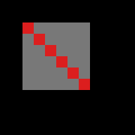
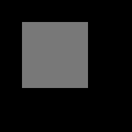

# Modul 2: Rendering Pipeline & Primitif 2D

Zacky Maulana (NIM 20241337034), Praktikum Grafika Komputer, S1 Informatika UMSurabaya.

Subjek: patung kuda berdiri milik saya sendiri (sama dengan Modul 1). Patung tidak punya denah, jadi yang saya telusuri adalah **ruangan tempat patung itu berdiri**: 2 × 4 m, lemari 8 pintu di dinding kanan, sekat berlubang di sisi masuk, dan jalan masuk di pojok kiri. Ukurannya dari saya sendiri, dan letak patung masih perkiraan (lihat [docs/denah](docs/denah/README.md)). Hasilnya 14 polyline dan 20 segmen.

Halaman WebGL: **https://zackymaulana912.github.io/grafkom-pixel-to-reality/Module2/Source/web/** (sudah aktif dan diuji, lihat catatan Fase 5)

## Cara menjalankan

```bash
cd Module2/Source
nvm use          # Node 22.23.4 dari .nvmrc
npm ci
npm test         # ALL CHECKS PASSED (23 ok, 0 fail)
npm run plan     # denah saya, from scratch -> out/plan_scratch.ppm
npm run serve    # buka http://127.0.0.1:4173/web/
```

## Hasil utama

### Denah: rasteriser saya vs Three.js

| raster.mjs (dari nol) | Three.js (WebGL) | Selisih ×6 |
|---|---|---|
|  |  |  |

**479.929 dari 480.000 pixel identik, PSNR 52,7 dB, SSIM 1,000.** Ke-71 pixel sisanya sudah dijelaskan satu per satu: 46 adalah antialiasing di kepala panah yang diagonal, dan 25 ada di ujung atau sambungan garis. Tidak ada satu pun di garis lurus. Zoom di area panah:

| raster.mjs | Three.js | Selisih |
|---|---|---|
|  |  |  |

Angka ini baru tercapai setelah dua bug di viewer starter saya buktikan dan perbaiki:

- **lantai tidak tergambar**, karena kamera y-ke-bawah membuat semua segitiga membelakangi kamera dan dibuang;
- **garis jatuh di antara dua baris pixel**, karena vertex tidak diberi offset +0,5.

Sebelum diperbaiki, hanya 71,48% pixel yang identik.

### Celah di edge bersama: tanpa aturan vs dengan aturan

| E ≥ 0 (merah = dua kali) | E > 0 (putih = celah) | Aturan top-left |
|---|---|---|
|  |  |  |

Tanpa aturan: twice = 6 atau gaps = 6. Dengan aturan: once = 36, twice = 0, gaps = 0.

Dua temuan saya di `triangle()`:

1. **Bias −1 di starter membuang pixel yang jelas di dalam segitiga.** Ini terjadi kalau nilai edge di pusat pixel 0,5: 34 dari 1.934 segitiga uji kehilangan 42 pixel. Saya perbaiki dengan menghitung di fixed-point 1/256 pixel.
2. **Rumus "top-left" modul ternyata cerminan aturan GPU**, karena konvensi y ke bawah membuat segitiga berjalan searah jarum jam di layar. Dibuktikan dengan WebGL mentah di GPU Apple M5 dan SwiftShader. Opsi `fillRule: "gpu"` cocok 144/144 dengan gambar dari GPU.

### Asterisk 24 jari-jari (uji oktan)


Setiap jari-jari berakhir paling jauh 0,364 pixel dari radius 110, dan setiap pixel paling jauh 0,491 pixel dari garis idealnya.

### Legenda di bawah simulasi buta warna

| Normal | Deuteranopia | Protanopia | Grayscale |
|---|---|---|---|
|  |  |  |  |

Jarak warna terkecil antar kategori: 36,9 (deuteranopia), 46,4 (protanopia), dan 69,3 (grayscale), semuanya di atas ambang 20 dari Modul 1. Warna dari screenshot browser cocok dengan hitungan Node paling banyak selisih 1 kode.

### Forward vs backward (prediksi di-commit lebih dulu)

| Zoom | Forward (ms) | Backward (ms) | Rasio |
|---|---|---|---|
| 1× | 0,04 | 25,3 | sekitar 600 kali |
| 10× | 0,17 | 25,2 | sekitar 147 kali |

Pilihan untuk viewer pan/zoom: **forward**. Biayanya mengikuti panjang garis yang digambar, bukan jumlah pixel layar, dan denah hanya punya puluhan segmen.

Pola "backward lebih cepat di zoom 10×" yang muncul di `bench.mjs` bawaan ternyata efek urutan pengukuran (pemanasan JIT), bukan sifat backward. Itu sudah diperbaiki di `bench.mjs`.

## Dokumen

- Laporan: [docs/laporan/laporan-modul2.md](docs/laporan/laporan-modul2.md)
- Studi Pendahuluan: [docs/studi-pendahuluan/studi-pendahuluan.md](docs/studi-pendahuluan/studi-pendahuluan.md)
- Prediksi dan diagnosis (di-commit sebelum hasilnya): [docs/prediksi](docs/prediksi)
- Catatan per fase dan persiapan viva: [docs/catatan](docs/catatan)
- Detail teknis dan baris Verified: [Source/README.md](Source/README.md)

Di modul dan README starter, kodenya disebut `code/Module2/`. Di repo ini kodenya ada di `Module2/Source/`.
