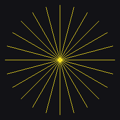
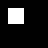
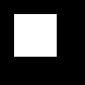

# Fase 3: Primitif from-scratch (Lab 2 no 1, 3, 5)

Semua primitif di `Source/raster.mjs` saya tulis ulang dengan JavaScript polos tanpa package. Framebuffer dan pembaca/penulis PPM tetap dari starter, karena itu infrastruktur, bukan primitif.

## 1. Garis DDA

DDA berjalan sepanjang sumbu yang lebih panjang dengan langkah 1, sedangkan sumbu yang lebih pendek maju sebesar kemiringannya, lalu keduanya dibulatkan. Bedanya dengan starter: posisi ke-k saya hitung langsung dari k (`x0 + k·dx/steps`), tidak dijumlahkan sedikit demi sedikit. Dengan penjumlahan, galat floating point menumpuk di garis yang panjang. Dengan perhitungan langsung, galat itu tidak pernah menumpuk.

Hasil untuk (2,1) ke (9,5): (2,1), (3,2), (4,2), (5,3), (6,3), (7,4), (8,4), (9,5), sama dengan Contoh E2.

## 2. Garis Bresenham

Starter memakai bentuk "error term" ala Zingl. Saya menulis ulang dengan **variabel keputusan D seperti di Contoh E3** (D awal = 2Δy − Δx, naik 2Δy atau 2(Δy − Δx)), lalu membuatnya berlaku untuk semua oktan:

- sumbu yang lebih panjang (`fast`) selalu maju satu langkah;
- sumbu yang lebih pendek (`slow`) hanya maju kalau D > 0;
- arah tiap sumbu disimpan sebagai `sx`, `sy` = ±1, jadi tidak perlu delapan cabang kode.

Hasilnya sama persis dengan tabel D di Studi Pendahuluan (1, −5, 3, −3, 5, −1, 7, 1).

**Dibandingkan dengan starter** pada 20.000 segmen acak: 6.725 segmen memberi daftar pixel yang berbeda. Saya cek satu per satu, dan **setiap** pixel yang berbeda adalah kasus seri: kedua pilihan pixel berjarak tepat 0,5 dari garis ideal. Versi saya memilih "tidak naik" saat D = 0, versi Zingl memilih sebaliknya. Keduanya benar, karena tidak ada pixel yang lebih dekat. Semua segmen lolos uji: mulai dan berakhir tepat di titik ujung, tiap langkah 8-connected (tidak ada lompatan atau pixel dobel), dan semua pixel paling jauh 0,5 dari garis ideal. Denah saya dan denah dosen menghasilkan pixel yang sama persis dengan starter, karena semua garisnya horizontal atau vertikal.

## 3. Asterisk 24 jari-jari (Lab 2 no 5)

`node draw_asterisk.mjs` menggambar 24 garis dari pusat (120, 120) dengan panjang 110 px, satu setiap 15°.

Arti "panjang sama ±1 pixel" perlu ditafsirkan dulu. Kalau yang dihitung **jumlah pixel**, hasilnya memang berbeda per sudut, yaitu max(|Δx|, |Δy|) + 1. Jari-jari 0° punya 111 pixel, sedangkan jari-jari 45° hanya 79 pixel, sekitar 0,71 kali. Itu sifat grid, bukan kesalahan. Jadi saya memakai **jarak Euclid dari pusat ke pixel terakhir**, dibandingkan dengan radius yang diminta.

| Ukuran | Hasil |
|---|---|
| \|jarak − 110\| terburuk | 0,364 px (jari-jari 15°, 75°, 105°, ...) |
| Jumlah pixel | 79 sampai 111, semuanya tepat max(\|Δx\|, \|Δy\|) + 1 |
| Penyimpangan terbesar dari garis ideal | 0,491 px |

Oktan yang salah akan terlihat di sini: jari-jari yang terlalu pendek, terlalu panjang, atau melenceng lebih dari setengah pixel dari garisnya. Ketiganya diuji di `tests.mjs`.

## 4. Cek sample-centre (Lab 2 no 3, Contoh E1)

`node sample_centre.mjs` mengisi rectangle [1,3) × [1,3) di framebuffer 6 × 6 dengan tiga cara:

| Cara | Pixel yang menyala |
|---|---|
| pusat, `x0 <= x + 0.5 < x1` | 4: (1,1) (2,1) (1,2) (2,2) |
| sudut, `x0 <= x < x1` | 4: sama persis |
| sudut inklusif, `x0 <= x <= x1` | 9: blok 3 × 3 dari (1,1) sampai (3,3) |

| Aturan pusat | Sudut inklusif |
|---|---|
|  |  |

Ada dua hal yang saya pelajari dari sini, dan keduanya sedikit berbeda dari kalimat di PDF:

1. **Blok 3 × 3 berasal dari batas inklusif (`<=`), bukan dari "menguji sudut" saja.** Untuk rectangle bersudut integer, uji sudut half-open tetap memberi 2 × 2 yang sama dengan aturan pusat. PDF sendiri menyebut penyebab ini di §6: "Memakai x0 ≤ x ≤ x1 malah menyalakan satu kolom terlalu banyak di kanan".
2. **Pergeseran setengah pixel baru terlihat kalau rectangle-nya tidak bersudut integer.** Rectangle yang sama, digeser seperempat pixel ke [1,25; 3,25):
   - aturan pusat tetap (1,1) sampai (2,2), karena pusat 1,5 dan 2,5 masih di dalam;
   - uji sudut pindah ke (2,2) sampai (3,3).

   Titik sampel uji sudut ada setengah pixel di **kiri-atas** pusat pixel (itu yang dimaksud PDF). Akibatnya bentuk yang tergambar justru tampak bergeser ke **kanan-bawah**. Keduanya cara menyebut hal yang sama dari sisi yang berbeda.

## 5. Segitiga naif, edge function, barycentric

- **`triangleNaive()`** adalah "versi sebelum" dari modul: edge function float di pusat pixel, "di dalam" kalau ketiganya ≥ 0 (atau > 0), tanpa aturan top-left, dan tanpa memperbaiki urutan titik. Pada persegi 6 × 6 ia menggambar 6 pixel diagonal dua kali, persis seperti seharusnya.
- **`edge()`** tetap satu baris rumus. Tanda E4 di (3,3), (5,5), dan (1,4) adalah (8,12,8), (16,−4,16), dan (15,19,−6), dicek di `tests.mjs` dan `prelim_check.mjs`.
- **`barycentric()`** sekarang menolak segitiga yang luasnya nol (di starter, pembagian dengan nol diam-diam menghasilkan `NaN` atau `Infinity`). Untuk P1 (3,3) hasilnya (3/7, 2/7, 2/7), dan Contoh E5 memberi 20.

`triangle()` dengan aturan top-left **sengaja ditulis ulang belakangan**, setelah diagnosis Fase 4 di-commit.

## 6. Test

`npm test` sekarang berisi 22 pemeriksaan. Sepuluh dari starter tetap ada dan tidak dilonggarkan. Yang baru untuk fase ini: 8 refleksi garis (ujung, 8-connected, jarak ≤ 0,5), asterisk, sample-centre 3 × 3 beserta pergeseran seperempat pixel, serta barycentric P1 dan `triangleNaive`.
