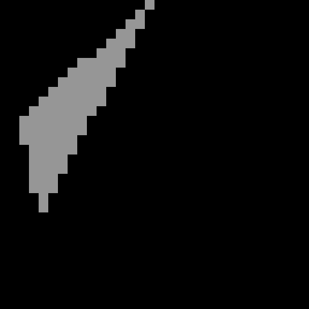

# Fase 4: Diagnosis celah, aturan top-left, pitfall (Lab 2 no 1, 2, 4)

## 1. Urutannya

1. `triangle_gap_bug.mjs` mendapat mode `--diagnose` yang hanya mencetak bukti pixel: jumlah, koordinat, peta teks, dan citra coverage. Teks penyebab dan perbaikan tidak ditampilkan.
2. Saya membuat referensi independen `make_tri_ref.mjs` (lihat bagian 5).
3. Diagnosis ditulis di `docs/prediksi/diagnosis-celah.md` dari pixel yang dirender `triangle()` **starter**, lengkap dengan prediksi hasil perbaikannya. File ini di-commit lebih dulu.
4. Baru setelah itu `triangle()` saya tulis ulang.

## 2. Perbaikan: edge function dalam fixed-point

Diagnosis menemukan dua masalah:

- tanpa aturan pemutus, pixel di edge bersama tergambar dua kali (≥ 0) atau hilang (> 0);
- bias −1 di starter membuang pixel yang nilai E-nya 0,5, karena pusat pixel ada di x + 0,5.

Perbaikannya ada di `triangle()` (`raster.mjs`):

- **Vertex dibulatkan ke grid 1/256 pixel** (`SUB = 256`). GPU juga menyimpan posisi vertex dengan beberapa bit sub-pixel seperti ini. Pusat pixel menjadi (x + 0,5) × 256 = 256x + 128, yang selalu bilangan bulat. Karena itu semua nilai E bilangan bulat, `== 0` menjadi uji yang eksak, dan "E > 0" sama persis dengan "E − 1 ≥ 0". Bias −1 sekarang benar.
- **Langkah bertambah, bukan dihitung ulang.** Nilai E dihitung sekali di pojok bounding box. Setelah itu, setiap pixel ke kanan menambah −Δy × 256 dan setiap baris ke bawah menambah Δx × 256. Ini sifat linear yang disebut Pineda. Caranya juga berbeda dari referensi, yang menghitung setiap pixel sendiri, jadi keduanya benar-benar independen.
- **Bounding box tetap di-clamp** ke segitiga dan ke framebuffer, seperti di starter.

Nilai terbesar yang dihitung untuk denah saya sekitar 10¹¹, masih jauh di bawah 2⁵³, jadi semua bilangan bulat ini tepat di JavaScript.

### Prediksi di diagnosis vs hasil

| Prediksi | Hasil |
|---|---|
| Persegi dengan aturan: once 36, twice 0, gaps 0 | 36 / 0 / 0 |
| Sweep 1.934 segitiga: 0 berbeda | 0 segitiga berbeda, 0 hilang, 0 berlebih |
| `tri_ref.ppm` dan `tri_t8_ref.ppm`: max \|diff\| = 0 | 0 dan 0 |
| `square_fill_ref.ppm` dari dosen tetap identik | 144/144, PSNR inf |
| Mode tanpa aturan tetap twice 6 dan gaps 6 | 6 dan 6 |

Kelimanya tepat.

| Tanpa aturan (≥ 0) | > 0 | Dengan aturan |
|---|---|---|
|  |  |  |

*Merah = dua kali, putih = celah, abu-abu = sekali.*

Segitiga T8 setelah perbaikan, dengan warna yang sama seperti gambar diagnosis (merah = hilang). Sekarang tidak ada lagi pixel merah:

### Bukti test-nya bisa gagal

Saya menjalankan `tests.mjs` versi baru dengan `triangle()` starter (di salinan sementara, bukan di repo). Hasilnya 4 test gagal:

- sweep: "34 triangles differ, 42 missing";
- `tri_t8_ref.ppm`: 1023/1024, max |diff| 255;
- winding: segitiga terbalik tidak tergambar;
- lantai `myplan.json` dari urutan JSON: once = 0.

Dengan `triangle()` saya, keempatnya lolos.

## 3. Edge mana yang dapat bias 0 dan mana yang −1 (A3)

Rumus modul (§9), untuk edge X → Y dengan Δ = Y − X: bias **0** kalau Δy > 0, atau Δy = 0 dan Δx < 0. Selain itu bias **−1**.

| Segitiga | Edge | Δx, Δy | Bias | E di pixel diagonal (4,4) |
|---|---|---|---|---|
| T1 (2,2) (8,2) (8,8) | B → C: (8,2) → (8,8) | 0, +6 | 0 | 21 |
| | C → A: (8,8) → (2,2), **diagonal** | −6, −6 | **−1** | **0**, jadi 0 − 1 < 0, ditolak |
| | A → B: (2,2) → (8,2) | +6, 0 | −1 | 15 |
| T2 (2,2) (8,8) (2,8) | B → C: (8,8) → (2,8) | −6, 0 | 0 | 21 |
| | C → A: (2,8) → (2,2) | 0, −6 | −1 | 15 |
| | A → B: (2,2) → (8,8), **diagonal** | +6, +6 | **0** | **0**, jadi 0 + 0 ≥ 0, diterima |

Kedua segitiga melewati diagonal dengan arah **berlawanan**. Akibatnya satu edge diagonal pasti mendapat bias 0 dan yang lain −1, sehingga setiap pixel diagonal dimiliki tepat satu segitiga. Itu inti aturan top-left, dan alasan kenapa aturan itu menjamin tidak ada celah maupun pixel dobel.

### Koreksi: rumus modul ternyata "bottom-right"

Di diagnosis saya masih memakai sebutan modul: diagonal jatuh ke T2 "karena itu edge kirinya". Saat menyiapkan tabel di atas, saya sadar sebutan itu tidak tepat.

Dengan y ke bawah dan total > 0, segitiga berjalan **searah jarum jam di layar**. Pada urutan seperti itu:

- edge yang turun (Δy > 0) ada di sisi **kanan** segitiga;
- edge mendatar dengan Δx < 0 ada di sisi **bawah**.

Bagi T2 (segitiga kiri-bawah), diagonal adalah sisi kanan-atasnya. Jadi rumus modul sebenarnya memberikan pixel tepi ke edge kanan dan bawah, yaitu bayangan cermin dari aturan top-left.

Supaya bukan sekadar dugaan, saya membandingkannya dengan GPU. Halaman `web/gpu_rule.html` menggambar segitiga E4 dan persegi dengan WebGL2 mentah (tanpa antialiasing, vertex di sudut pixel integer). Halaman itu saya buka di Chrome 156 dengan dua rasteriser yang berbeda: GPU Apple M5 (ANGLE Metal) dan SwiftShader (ANGLE Vulkan, software). Keduanya menghasilkan pixel yang identik byte demi byte, dan disimpan sebagai `ref/gpu_e4.ppm` dan `ref/gpu_square.ppm`.

| | Rumus modul (default) | GPU |
|---|---|---|
| E4, pixel di edge A → B: (3,1) | menyala | mati |
| E4, pixel di edge B → C: (4,4) | menyala | mati |
| E4, pixel di edge C → A: (1,2), (2,5) | mati | menyala |
| Diagonal persegi | milik T2 (kiri-bawah) | milik T1 (kanan-atas) |
| Jumlah pixel, celah, dobel | 14 pixel; 36 / 0 / 0 | 14 pixel; 36 / 0 / 0 |

Keduanya sama-sama rapat. Bedanya hanya **siapa** yang memiliki pixel tepat di tepi. Untuk menunjukkannya, `triangle()` mendapat opsi `fillRule: "gpu"`, yaitu rumus yang dicerminkan (Δy < 0, atau Δy = 0 dan Δx > 0). Dengan opsi itu, hasilnya identik 144/144 dengan kedua gambar GPU, dan cocok dengan referensi independen untuk aturan GPU di 1.934 segitiga (`node gpu_rule_check.mjs`).

**Kenapa default-nya tetap rumus modul:** `ref/square_fill_ref.ppm` dari dosen dibuat dengan rumus modul (diagonalnya milik T2). Mengganti default berarti test bawaan gagal, dan aturan saya adalah tidak mengubah test supaya lolos. Untuk denah saya, pilihan ini tidak berpengaruh sama sekali. Semua sisi lantai jatuh di batas pixel, dan diagonal fan-triangulation dari (260,560) ke (520,40) tidak melewati satu pun pusat pixel: 2x + y = 1078,5 tidak punya solusi bulat.

## 4. Reproduksi satu pixel dengan tangan (A2)

Segitiga E4: A(1,1), B(6,2), C(3,7), total = 28. `triangle()` menyalakan 14 pixel: (1,1) (2,1) (3,1) (2,2) (3,2) (4,2) (5,2) (2,3) (3,3) (4,3) (2,4) (3,4) (4,4) (3,5). Saya ambil dua pixel yang pusatnya **tepat** di sebuah edge.

**Pixel (3,1), pusat (3,5; 1,5):**

- E_AB = (6 − 1)(1,5 − 1) − (2 − 1)(3,5 − 1) = 2,5 − 2,5 = **0**, tepat di edge A → B
- E_BC = (3 − 6)(1,5 − 2) − (7 − 2)(3,5 − 6) = 1,5 + 12,5 = **14**
- E_CA = (1 − 3)(1,5 − 7) − (1 − 7)(3,5 − 3) = 11 + 3 = **14**

Dalam fixed-point (dikali 256² = 65.536): E_AB = 0, E_BC = E_CA = 917.504.

Bias rumus modul: A → B punya Δy = +1, jadi **0**. B → C punya Δy = +5, jadi 0. C → A punya Δy = −6, jadi −1.

Hasil: 0 + 0 ≥ 0, 917.504 ≥ 0, dan 917.504 − 1 ≥ 0. **Menyala.** Cocok dengan kode.

**Pixel (1,2), pusat (1,5; 2,5):**

- E_AB = 5(1,5) − 1(0,5) = **7**
- E_BC = −3(0,5) − 5(−4,5) = **21**
- E_CA = −2(2,5 − 7) + 6(1,5 − 3) = 9 − 9 = **0**, tepat di edge C → A

Bias untuk C → A adalah −1, jadi 0 − 1 < 0. **Mati.** Cocok dengan kode.

Dengan `fillRule: "gpu"` keduanya terbalik: (3,1) mati dan (1,2) menyala. Itu juga yang digambar GPU.

**Pixel T8 (2,14)** dari diagnosis: E_BC = 0,5, dalam fixed-point 0,5 × 65.536 = 32.768. Karena 32.768 − 1 ≥ 0, sekarang pixel itu menyala.

## 5. Asal-usul referensi (K13)

PDF meminta raster segitiga dicocokkan dengan `ref/tri_ref.ppm`, tapi file itu **tidak ada** di zip starter. Saya membuat referensi dengan cara yang sengaja berbeda dari `triangle()`, di `make_tri_ref.mjs`:

- setiap pixel diuji sendiri, tanpa langkah bertambah;
- koordinat dikali 2 (bukan 256);
- aturannya ditulis apa adanya: "E > 0, atau E = 0 di edge pemilik", tanpa trik bias.

Isinya:

- `ref/tri_ref.ppm`: segitiga E4, 10 × 10;
- `ref/tri_t8_ref.ppm`: segitiga T8, 32 × 32, yang memperlihatkan bug starter.

Selain itu, `ref/gpu_e4.ppm` dan `ref/gpu_square.ppm` adalah referensi dari **hardware**, untuk aturan GPU. Yang perlu saya tanyakan ke dosen: apakah ada `tri_ref.ppm` resmi, dan aturan tepi mana yang dimaksud.

## 6. Perbaikan pitfall: winding yang tidak konsisten (Lab 2 no 4)

PDF memberi tiga pilihan. Clamp bounding box sudah ada di starter, jadi tidak saya pilih. Saya memilih **auto-flip winding**: kalau total < 0, `triangle()` menukar dua vertex sebelum menghitung bias. Alasannya, ini berhubungan langsung dengan denah saya. Titik lantai di JSON berurutan berlawanan jarum jam, seperti kebiasaan menggambar denah dengan y ke atas. Di layar urutannya tetap terlihat berlawanan jarum jam, padahal konvensi modul (total > 0) berarti searah jarum jam di layar, jadi totalnya negatif (−135.200). Masalah yang sama juga yang membuat siluet di viewer Three.js hilang (T3, Fase 5).

`node winding_demo.mjs`:

| Kasus | Total | Sebelum (`triangleNaive`, dan `triangle()` starter) | Sesudah (`triangle()` saya) |
|---|---|---|---|
| E4, urutan A, B, C | 28 | 16 (naif) dan 14 (starter) | 14 |
| E4, urutan A, C, B | −28 | **0** | **14**, identik byte demi byte dengan urutan A, B, C |
| Lantai `myplan.json`, urutan JSON | −135.200 dua kali | **0** | **135.200** |

(Angka 16 vs 14 pada baris pertama bukan soal winding. Itu karena versi naif tidak punya aturan tepi, jadi pixel di edge yang bukan pemilik ikut menyala.)

`renderPlan()` di `plan.mjs` tetap menukar urutan sendiri seperti di starter. Sekarang itu menjadi pengaman ganda, dan `triangle()` tidak lagi bergantung padanya.
