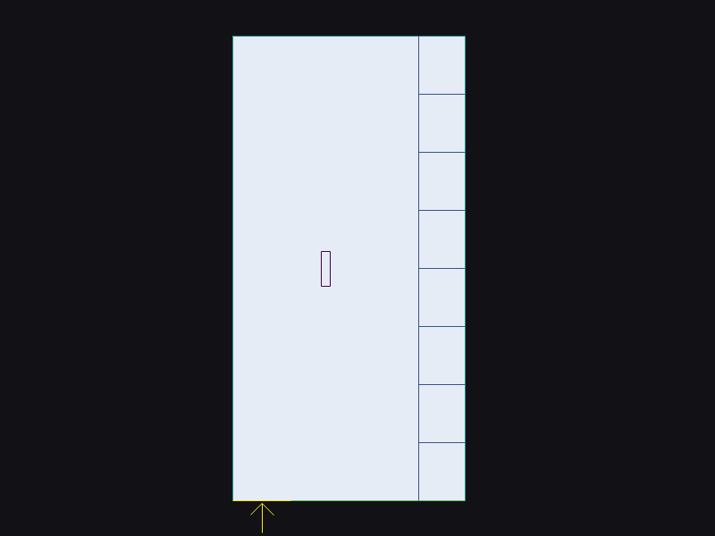
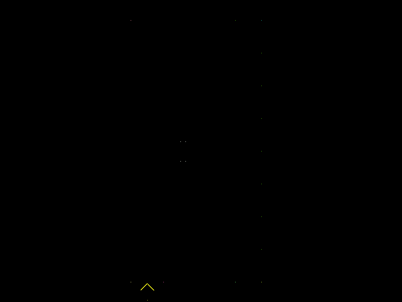
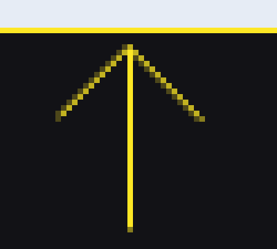
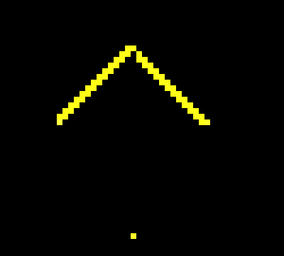
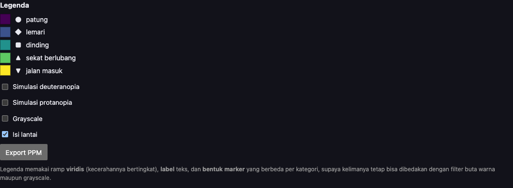
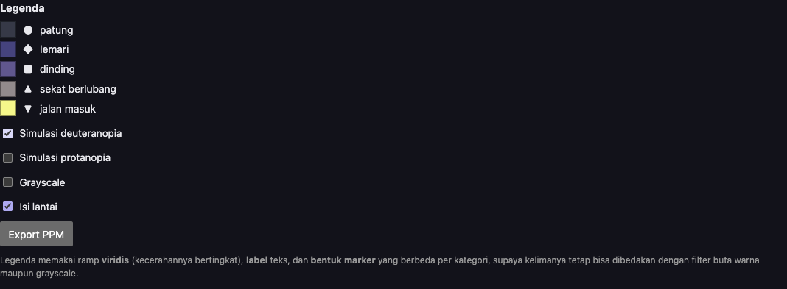
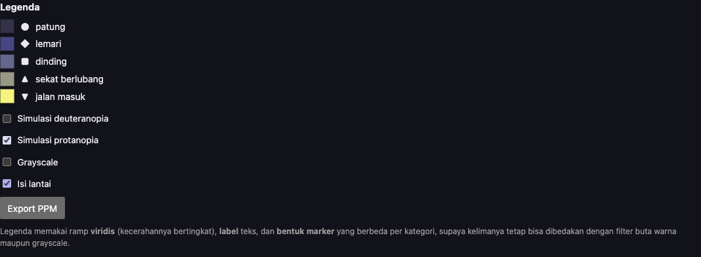
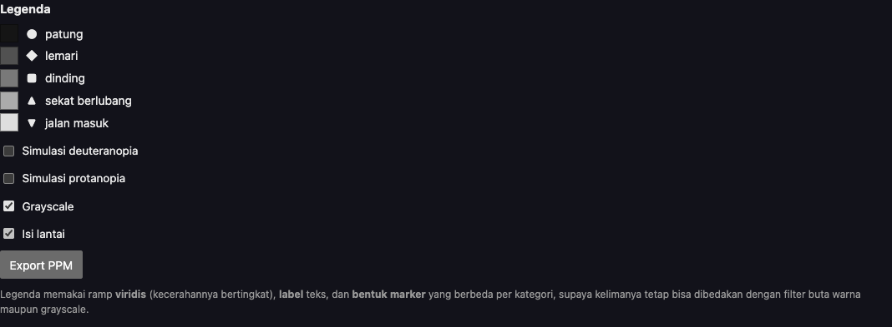
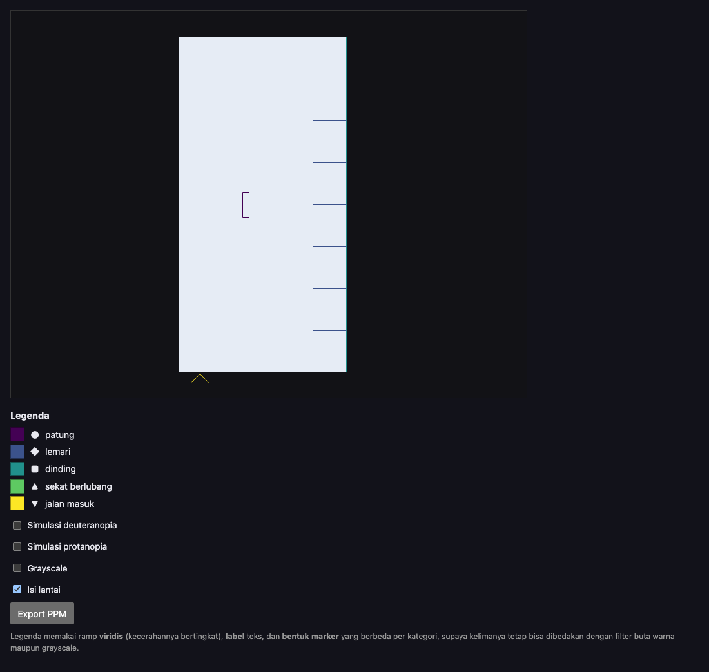
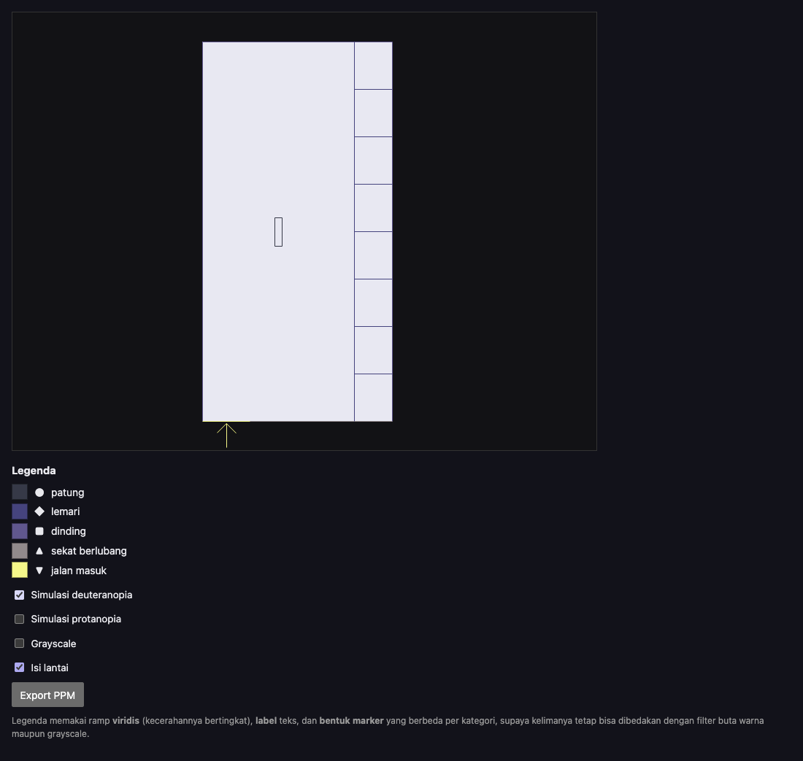

# Fase 5: Pustaka, keputusan, hosting (Lab 3)

Semua uji browser di fase ini dijalankan otomatis di **Google Chrome 156.0.8078.48 mode headless**, dengan WebGL lewat **ANGLE Metal di GPU Apple M5** (bukan software renderer), `devicePixelRatio` = 1, dan MSAA 4 sampel. Server hanya di `127.0.0.1` dan dimatikan setelah dipakai. Halaman GitHub Pages juga sudah diuji dengan cara yang sama (lihat bagian 6). Selain itu, halaman Pages saya buka sendiri di Safari 27.0.1: denah dan legenda tampil, dan keempat toggle bekerja.

## 1. Viewer sekarang menggambar denah saya

- `web/viewer.mjs` memuat `../myplan.json` secara default. `?plan=../pusaka_plan.json` masih bisa dipakai untuk denah dosen.
- **Warna legenda dan `worldToScreen` dipindah ke `plan_common.mjs`**, file tanpa import yang bisa dimuat oleh Node maupun browser. Sebelumnya viewer punya salinan warna dan rumus flip sendiri. Sekarang rasteriser saya dan Three.js benar-benar memakai fungsi yang sama, sesuai pitfall "y-flip hanya di satu tempat".
- Tetap 800 × 600 dengan `setPixelRatio(1)`.
- Legenda dibuat dari blok `legend` di JSON, dan ada toggle **grayscale** yang baru.

## 2. Temuan T3 dan T4: terbukti, penyebabnya, perbaikannya

Saya membuka viewer **starter** apa adanya dengan `pusaka_plan.json`, menekan Export PPM, lalu membandingkannya dengan `draw_plan.mjs --fill`:

| | Rasteriser saya | Three.js (starter) |
|---|---|---|
| Pixel lantai (88, 357) | (230,236,245) | **(18,18,22)**, warna latar |
| Dinding bawah x = 300, baris 576 | (230,236,245) | **(43,10,53)** |
| Dinding bawah x = 300, baris 577 | (68,1,84) | **(43,10,53)** |
| Keseluruhan | | 199.103/480.000 identik, PSNR 3,8 dB |

### T3: lantai (siluet) tidak tergambar

**Penyebab.** Saya membaca kode Three.js: `ShapeGeometry` membereskan arah outline sendiri (`ShapeUtils.isClockWise`, lalu `reverse`), sehingga segitiganya menghadap kamera y-ke-atas yang biasa. Kamera viewer adalah `OrthographicCamera(0, W, 0, H)`, yang membalik y supaya cocok dengan framebuffer. Pembalikan itu mencerminkan layar, sehingga semua segitiga tiba dalam posisi **membelakangi** kamera, dan material default (`FrontSide`) membuang semuanya.

Karena `ShapeGeometry` membereskan arah sendiri, **membalik urutan titik di JSON tidak akan menolong**. Ini persis pitfall "winding tidak konsisten" di modul. Bedanya, di sini pelakunya adalah kamera, bukan data.

**Perbaikan.** `side: THREE.DoubleSide`. Denah datar memang tidak punya sisi belakang.

### T4: garis jatuh di antara dua baris pixel

**Penyebab.** Viewer mengirim vertex garis di koordinat integer, misalnya y = 577. Di WebGL, pusat pixel ada di +0,5, jadi garis tepat di y = 577 berada di **batas** baris 576 dan 577. Dengan MSAA, masing-masing baris tertutup setengah. Hasilnya (43,10,53) = rata-rata 50:50 dari warna dinding (68,1,84) dan latar (18,18,22), **dihitung di kode sRGB**: (68 + 18)/2 = 43. Kalau dirata-ratakan di linear light, hasilnya sekitar 50, bukan 43. Ini kaitan langsung dengan Modul 1.

**Perbaikan.** Tambah +0,5 ke setiap vertex garis, sehingga garis berjalan di pusat pixel, sama dengan pixel Bresenham. Vertex **lantai** sengaja tidak digeser. Sudut lantai di koordinat integer berarti batas pixel, dan pixel diisi kalau pusatnya di dalam. Itu sama dengan aturan sample-centre `triangle()`.

### Dampak tiap perbaikan pada denah saya (isi lantai menyala)

| Viewer | Pixel identik | PSNR | SSIM |
|---|---|---|---|
| tanpa perbaikan (seperti starter) | 343.110 / 480.000 (71,48%) | 6,9 dB | 0,006 |
| hanya T4 (+0,5) | 346.482 (72,18%) | 6,9 dB | 0,006 |
| hanya T3 (DoubleSide) | 474.825 (98,92%) | 31,1 dB | 0,997 |
| **keduanya** | **479.929 (99,985%)** | **52,7 dB** | **1,000** |

Dengan hanya T3 diperbaiki, PSNR 31,1 dB sudah masuk rentang "30 sampai 40 dB" yang disebut PDF sebagai wajar. Padahal semua garisnya masih salah tempat setengah pixel. Inilah alasan saya tidak percaya angka PSNR saja (lihat bagian 3).

## 3. Diff pixel dan penjelasan setiap pixel yang tidak cocok (Lab 3 no 2, A4)

```
node compare.mjs out/plan_scratch.ppm plan_three.ppm --diff out/diff_plan.ppm --scale 6
same size 800x600   identical pixels: 479929/480000   PSNR: 52.7 dB   SSIM: 1.000   max |diff|: 176
```

| raster.mjs | Three.js | Selisih ×6 |
|---|---|---|
|  |  |  |

Zoom ×8 di area panah, tempat sebagian besar perbedaan berada:

| raster.mjs | Three.js | Selisih ×6 |
|---|---|---|
|  |  |  |

`node diff_pixels.mjs out/plan_scratch.ppm plan_three.ppm` mendaftar ke-71 pixel satu per satu dan mengelompokkannya:

| Kelompok | Jumlah | Penjelasan |
|---|---|---|
| Garis diagonal | 46 | Dua garis kepala panah (45°). Bresenham menyalakan tepat satu pixel per baris dengan warna penuh. GPU dengan MSAA 4 sampel memberi coverage parsial: pixel di garis mendapat **3/4** warna, yaitu (194,178,33) = 18 + 0,75 × (253 − 18), dan tetangganya mendapat **1/4**, yaitu (77,71,26). Ini antialiasing |
| Ujung atau sambungan garis | 25 | Di titik dua garis bertemu, sampel MSAA terbagi antara keduanya. Contoh: pojok lemari dan dinding (468,40) bernilai (46,114,139), rata-rata 50:50 warna lemari dan dinding. Rasteriser saya memakai "yang terakhir menang". Pojok dinding (260,40) mendapat 3/4 warna dinding + 1/4 lantai. Ujung bebas seperti ekor panah (293,596) hanya tertutup sebagian, karena GPU tidak selalu mengikutkan pixel terakhir sebuah garis |
| Lainnya | **0** | Tidak ada satu pun pixel di sepanjang garis lurus atau di dalam lantai yang berbeda |

Semua nilai campuran itu cocok dengan rata-rata di **kode sRGB**, bukan di linear light. Jadi resolve MSAA di jalur ini mencampur warna yang masih gamma-encoded.

**Pembanding:**

- tanpa isi lantai: juga 479.929 identik, PSNR 53,0 dB, dengan 25 ujung, 46 diagonal, dan 0 lainnya;
- denah dosen `pusaka_plan.json` dengan viewer yang sudah diperbaiki: **479.964/480.000, PSNR 56,9 dB**, dan ke-36 perbedaannya semua di ujung dan sambungan, karena denah itu tidak punya garis diagonal.

PDF memperkirakan "PSNR ≈ 30 sampai 40 dB, edge anti-aliased". Ternyata angka itu adalah angka viewer yang masih membawa bug T4.

## 4. Forward vs backward: pengukuran, rekonsiliasi, keputusan (Lab 3 no 3, A4)

Prediksi saya di-commit lebih dulu (`docs/prediksi/prediksi-forward-backward.md`).

### Masalah pengukuran yang saya temukan dulu

Saat `npm run bench` pertama kali dijalankan, backward terlihat **lebih cepat di zoom 10×**:

| Run | Backward 1× | Backward 10× |
|---|---|---|
| 1 | 73,1 ms | 54,5 ms |
| 2 | 75,9 ms | 25,2 ms |
| 3 | 75,5 ms | 48,2 ms |

Ini sama dengan pola angka di PDF (520 ms vs 380 ms) dan berlawanan dengan model biaya saya. Saya selidiki dengan percobaan terkontrol:

- jumlah uji jarak di 1× dan 10× hampir sama (9.522.056 vs 9.593.156);
- dalam urutan bergantian 1×, 10×, 1×, 10× setelah pemanasan, keduanya sekitar **28 ms**;
- kalau urutannya dibalik (10× dulu), **zoom yang diukur pertama** yang lambat, apa pun zoom-nya.

Penyebabnya: yang diukur pertama ikut menanggung biaya V8 mengoptimalkan loop (JIT), dan waktunya juga naik-turun antar run. `bench.mjs` starter yang apa adanya, dijalankan di Mac saya, juga memberi 1× = 116 sampai 141 ms dan 10× = 47 sampai 67 ms. Jadi pola "10× lebih cepat" di PDF kemungkinan besar efek urutan yang sama, bukan sifat backward.

**Perbaikan `bench.mjs`:**

- semua pasangan (cara, zoom) dipanaskan dulu (`--warmup 3`);
- waktu diambil dalam 5 putaran yang bergantian, dan yang dilaporkan adalah median;
- waktu alokasi framebuffer ditampilkan terpisah;
- opsi `--plan` ditambahkan.

### Hasil (denah saya, 20 segmen, 800 × 600, 3 run)

| Zoom | Forward (ms) | Backward (ms) | Rasio backward/forward |
|---|---|---|---|
| 1× | 0,041 sampai 0,045 | 25,33 sampai 25,37 | 560 sampai 616 kali |
| 10× | 0,169 sampai 0,173 | 25,18 sampai 25,28 | 146 sampai 149 kali |

Alokasi framebuffer sendiri 0,021 sampai 0,023 ms. Sebagai pembanding, denah dosen (37 segmen): forward 0,071 / 0,359 ms dan backward 47,9 / 48,0 ms.

### Rekonsiliasi dengan prediksi

| Prediksi | Hasil | Status |
|---|---|---|
| Forward 1×: 0,2 sampai 1 ms, didominasi alokasi | 0,04 ms, sekitar separuhnya alokasi | lebih cepat dari perkiraan, porsi alokasi tepat setengah |
| Forward 10×: paling banyak 3 kali forward 1× | 3,9 kali | sedikit meleset. Langkah Bresenham naik 10 kali (2.621 ke 26.030), dan separuh waktu yang tetap (alokasi) tidak cukup menahannya di bawah 3 kali |
| Backward 1×: 50 sampai 300 ms | 25,3 ms | meleset, lebih cepat. Biaya per uji jarak 2,6 ns, bukan 5 sampai 30 ns |
| Backward 10× hampir sama dengan 1× (selisih < 30%) | 25,2 vs 25,3 ms | **tepat**, setelah pengukurannya diperbaiki |
| Rasio 1×: 100 sampai 1000 kali | sekitar 600 kali | tepat |
| Rasio 10×: 50 sampai 500 kali, lebih kecil dari 1× | sekitar 147 kali | tepat |

Bagian yang meleset adalah angka absolut. V8 di Apple M5 lebih cepat dari perkiraan saya. Bagian yang tepat adalah **bentuk** model biayanya: forward mengikuti panjang garis, sedangkan backward mengikuti pixel × segmen dan tidak terpengaruh zoom.

### Keputusan: forward untuk viewer denah pan/zoom

Alasannya: denah punya puluhan segmen, dan forward ratusan kali lebih cepat di kedua zoom. Viewer pan/zoom harus menggambar ulang setiap kali digeser, dan 25 ms per frame untuk backward sudah melewati jatah 16,7 ms untuk 60 fps. Forward juga jalan alami di GPU (itu yang dilakukan Three.js).

### Kapan pilihan ini berbalik (A4, keterbatasan)

1. **Efek per pixel.** Misalnya garis tebal dengan pinggiran halus sesuai jarak, glow, atau "jarak ke dinding terdekat" untuk heatmap. Backward sudah menghitung jarak setiap pixel, jadi efek itu gratis. Forward harus menambah pass lain.
2. **Zoom ekstrem ke area kecil.** Di zoom 10× forward sudah 4 kali lebih lambat, karena Bresenham tetap menelusuri bagian garis yang di luar layar. Tanpa clipping, di zoom 1000× sebuah garis bisa ratusan ribu langkah walaupun hanya beberapa pixel yang terlihat. Backward tetap 25 ms.
3. **Target GPU dengan shader per pixel.** Di GPU, backward per pixel dikerjakan paralel oleh ribuan core (seperti signed distance field), sehingga biaya pixel × segmen tidak lagi terasa untuk puluhan segmen.
4. **Ukuran layar.** Backward naik sebanding dengan jumlah pixel. Canvas 4K (8,3 juta pixel) membuat backward sekitar 17 kali lebih lambat, sedangkan forward hampir tidak berubah. Ini menguatkan pilihan forward, bukan membaliknya.

## 5. Legenda aksesibel (Lab 3 no 4, A5)

Lima kategori dengan ramp viridis (kecerahan bertingkat), label teks, dan marker berbeda: ● patung, ◆ lemari, ■ dinding, ▲ sekat berlubang, ▼ jalan masuk.

| Normal | Deuteranopia | Protanopia | Grayscale |
|---|---|---|---|
|  |  |  |  |

Seluruh halaman, normal dan dengan simulasi deuteranopia. Filter mengenai canvas dan legenda sekaligus:

| Normal | Deuteranopia |
|---|---|
|  |  |

### Diukur, bukan dilihat saja

`node cvd_check.mjs` membaca matriks deuteranopia dan protanopia **langsung dari `web/index.html`**, lalu menghitung jarak terkecil antar dua kategori (jarak Euclid di kode sRGB). Ambang batasnya 20, sama dengan pengecek legenda di Modul 1:

| Tampilan | Jarak terkecil | Pasangan |
|---|---|---|
| normal | 68,2 | lemari / dinding |
| deuteranopia | 36,9 | lemari / dinding |
| protanopia | 46,4 | lemari / dinding |
| grayscale (linear, cara Modul 1) | 79,7 | lemari / dinding |
| grayscale (CSS, cara halaman ini) | 69,3 | lemari / dinding |
| kontrol negatif, palet merah-hijau, deuteranopia | **17,7**, gagal | |

Angka deuteranopia dan protanopia sama persis dengan `cvd.py` Modul 1 pada palet yang sama (36,9 dan 46,4), karena matriksnya sama. Kontrol negatifnya juga sama (17,7 / 10,5 / 0,0).

### Dicocokkan dengan pixel browser

Saya mengambil warna di tengah setiap swatch dari screenshot Chrome dengan filter menyala:

- **deuteranopia dan protanopia:** cocok dengan hitungan Node paling banyak selisih 1 kode, misalnya dinding (96,87,142) vs (95,87,142). Ini membuktikan filter SVG `feColorMatrix` menerapkan matriksnya di **linear light**. Itu default `color-interpolation-filters: linearRGB`, dan `cvd.css` tidak mengubahnya. Kalau matriks yang sama dikenakan langsung ke kode sRGB, jarak terkecilnya hanya 21,2.
- **grayscale:** screenshot memberi (21,21,21), (81,...), (121,...), (171,...), (222,...). Itu tepat 0,2126R + 0,7152G + 0,0722B pada **kode sRGB**, bukan di linear light seperti `cvd.py`. Jadi filter CSS `grayscale(1)` di Chrome bekerja pada nilai yang masih gamma-encoded. Cara ini saya tambahkan ke `cvd_check.mjs` dan ke test.

**Sumber matriks.** Angka 0,625 / 0,375 / 0,7 / ... di `index.html` sama dengan yang di `cvd.py` Modul 1, yang di komentarnya disebut "Vienot / Brettel-style". Saya belum menemukan publikasi asli angka-angka ini, jadi asal-usulnya saya tulis sebagai belum pasti.

## 6. GitHub Pages (Lab 3 no 5)

Repo `ZackyMaulana912/grafkom-pixel-to-reality` sudah publik (dicek: halaman repo memberi status 200). Setelah push, GitHub Pages saya nyalakan dengan langkah berikut:

1. Settings → Pages → Source: **Deploy from a branch** → Branch: `main`, folder `/ (root)` → Save.
2. Tunggu sampai tugas "pages build and deployment" di tab Actions selesai.
3. Buka **https://zackymaulana912.github.io/grafkom-pixel-to-reality/Module2/Source/web/** di browser lain atau jendela incognito.
4. Pastikan:
   - denah dan legenda tampil;
   - keempat toggle bekerja;
   - Console (F12) tidak berisi error, terutama error MIME untuk file `.mjs`.
5. Catat browser dan versinya di `docs/catatan/fase0-setup.md` dan di baris Verified.

**Hasil uji di Pages (28 Okt 2026, Chrome 156 headless):** semua file memberi status 200 dengan tipe yang benar (`.mjs` sebagai `text/javascript`, jadi tidak ada error MIME), console bersih selain `/favicon.ico`, legenda 5 baris, keempat toggle bekerja, dan Export PPM identik byte demi byte dengan export lokal. Halaman root repo memang 404 karena tidak ada `index.html` di sana; yang dipakai hanya alamat `Module2/Source/web/`.

Kenapa publikasi dari root, bukan hanya `web/`: viewer mengambil `../myplan.json` dan `../plan_common.mjs` dari folder induk. Jadi struktur folder di Pages harus sama dengan di server lokal. File `.nojekyll` di root membuat GitHub Pages menyajikan file apa adanya, tanpa diproses Jekyll. Three.js dimuat dari CDN jsDelivr dengan versi terkunci 0.160.0, sesuai importmap.

## 7. Refleksi (Lab 3 no 7)

**Yang diambil alih Three.js:**

- tahap 2 (vertex shader dari material, termasuk matriks kamera);
- tahap 3 (clipping);
- tahap 4 (rasterisation garis dan segitiga, termasuk MSAA);
- tahap 5 (fragment shader yang memberi warna rata);
- tahap 6 (resolve MSAA dan menulis ke canvas);
- triangulasi `Shape` (Earcut).

**Yang tetap harus saya urus sendiri** (dua yang pertama terbukti salah di viewer starter):

- **Winding dan culling (T3).** Kamera y-ke-bawah membalik arah segitiga, dan pustaka diam-diam membuang semuanya.
- **Ukuran dan pusat pixel (T4).** `setPixelRatio(1)` dan `setSize` eksplisit sudah ada di starter. Yang terlewat adalah posisi pusat pixel. Pustaka menggambar persis di koordinat yang saya berikan, dan koordinat integer adalah batas pixel.
- **Ruang warna.** Campuran antialiasing dihitung di kode sRGB (43, bukan sekitar 50). Warna latar `setClearColor(0x121216)` harus sama dengan rasteriser saya (18,18,22), atau semua pixel latar akan berbeda.

**Kalau denahnya 10.000 segmen, bukan 20, yang pertama rusak:**

1. **Backward.** Biayanya 480.000 × 10.000 = 4,8 miliar uji jarak. Dengan 2,6 ns per uji, itu sekitar 12,7 detik per frame, jauh dari interaktif.
2. **Satu objek `Line` per polyline.** `WebGLRenderer` menggambar setiap objek dengan panggilan draw sendiri, jadi 10.000 polyline berarti ribuan draw call per frame. Solusinya, gabungkan semua segmen per kategori ke satu `LineSegments` dengan satu `BufferGeometry`, sehingga hanya 5 draw call.
3. **Alat diff saya.** `diff_pixels.mjs` mencari segmen terdekat untuk setiap pixel yang berbeda. Kalau jumlah pixel yang berbeda banyak, waktunya ikut melambat, karena biayanya pixel berbeda × segmen.

Rasteriser forward saya sendiri tidak akan rusak duluan: 10.000 segmen pendek tetap hanya puluhan ribu langkah Bresenham.
