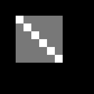
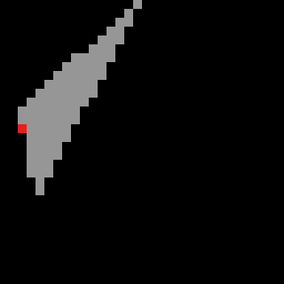

# Diagnosis celah dan pixel dobel (Lab 2 no 2, A3)

Ditulis **sebelum** `triangle()` saya tulis ulang. Semua bukti di bawah berasal dari pixel yang dirender oleh `raster.mjs` bawaan starter, lewat `node triangle_gap_bug.mjs --diagnose` (mode baru yang hanya mencetak bukti, tanpa teks penyebab dan perbaikan) dan `node make_tri_ref.mjs --check`. File ini di-commit lebih dulu daripada perbaikannya.

Saya jujur soal satu hal: modul dan kode starter sudah menyebut aturan top-left sebagai jawabannya, jadi penyebab celah di persegi bukan hal yang saya temukan sendiri. Yang saya lakukan adalah membuktikannya dari pixel. Temuan kedua di bawah (bagian 2) memang belum disebut di mana pun.

## 1. Persegi 6×6 yang dipecah dua segitiga

Segitiga 1 = (2,2), (8,2), (8,8). Segitiga 2 = (2,2), (8,8), (2,8). Keduanya berbagi diagonal dari (2,2) ke (8,8). Keduanya diisi tanpa aturan pemutus.

### Bukti dari pixel

| Aturan "di dalam" | Sekali | Dua kali | Celah | Pixel yang bermasalah |
|---|---|---|---|---|
| semua E ≥ 0 | 30 | **6** | 0 | (2,2) (3,3) (4,4) (5,5) (6,6) (7,7) tergambar dua kali |
| semua E > 0 | 30 | 0 | **6** | keenam pixel yang sama tidak terisi |

| E ≥ 0 (merah = dua kali) | E > 0 (putih = celah) |
|---|---|
|  |  |

Peta teks dari program (2 = dua kali, 1 = sekali, _ = celah):

```
E >= 0          E > 0
..211111....    .._11111....
..121111....    ..1_1111....
..112111....    ..11_111....
..111211....    ..111_11....
..111121....    ..1111_1....
..111112....    ..11111_....
```

### Diagnosis

Keenam pixel yang bermasalah semuanya ada di diagonal x = y, dan tidak ada satu pun pixel lain yang terkena. Pusat pixel (x, y) ada di (x + 0,5; y + 0,5), jadi untuk pixel di diagonal pusatnya (2,5; 2,5), (3,5; 3,5), dan seterusnya, **tepat di atas** garis diagonal.

Saya hitung edge function diagonal untuk pixel (4,4), pusatnya (4,5; 4,5):

- Di segitiga 1, edge C → A dari (8,8) ke (2,2): E = (2 − 8)(4,5 − 8) − (2 − 8)(4,5 − 8) = 21 − 21 = **0**
- Di segitiga 2, edge A → B dari (2,2) ke (8,8): E = (8 − 2)(4,5 − 2) − (8 − 2)(4,5 − 2) = 15 − 15 = **0**

Nilainya nol di kedua segitiga. Dua edge function lainnya positif, karena pixel itu jelas di dalam persegi.

- Dengan "≥ 0", nol dianggap di dalam, jadi **kedua** segitiga mengklaim pixel ini.
- Dengan "> 0", nol dianggap di luar, jadi **tidak ada** yang mengklaimnya.

**Akar masalah:** tidak ada aturan pemutus untuk pixel yang pusatnya tepat di edge bersama. Yang dibutuhkan adalah aturan yang memberikan pixel seperti itu ke **tepat satu** dari dua segitiga, berdasarkan arah edge-nya. Kedua segitiga melewati diagonal dengan arah berlawanan (8,8 → 2,2 dan 2,2 → 8,8), jadi aturan yang bergantung pada arah otomatis memilih satu saja.

## 2. Temuan kedua: aturan top-left di starter membuang pixel yang jelas di dalam

Untuk mengecek `triangle()` bawaan (yang sudah memakai bias top-left), saya membuat referensi independen di `make_tri_ref.mjs`. Caranya sengaja berbeda dari `triangle()`: setiap pixel diuji sendiri-sendiri, semua koordinat dikali 2 supaya pusat pixel menjadi bilangan bulat, dan aturannya ditulis apa adanya, yaitu "E > 0, atau E = 0 di edge top/left". Tidak ada trik bias.

### Bukti

`node make_tri_ref.mjs --check`, untuk 1.934 segitiga acak dengan vertex integer di framebuffer 32×32:

| | Hasil |
|---|---|
| Segitiga yang hasilnya berbeda | **34** |
| Pixel yang hilang di `triangle()` | **42** |
| Pixel yang berlebih di `triangle()` | 0 |
| `ref/tri_ref.ppm` (segitiga E4) | max \|diff\| = 0, kebetulan tidak terkena |
| `ref/tri_t8_ref.ppm` (segitiga (16,0), (4,23), (2,12)) | max \|diff\| = 255 |



*Abu-abu = pixel yang dinyalakan keduanya. Merah = pixel (2,14) yang ada di referensi tapi dibuang oleh `triangle()` starter.*

### Hitungan tangan untuk pixel (2,14)

A = (16,0), B = (4,23), C = (2,12). Total = E_AB(C) = (4 − 16)(12 − 0) − (23 − 0)(2 − 16) = −144 + 322 = 178 > 0, jadi urutannya sudah benar. Pusat pixel P = (2,5; 14,5).

- E_BC = (2 − 4)(14,5 − 23) − (12 − 23)(2,5 − 4) = 17 − 16,5 = **0,5**
- E_CA = (16 − 2)(14,5 − 12) − (0 − 12)(2,5 − 2) = 35 + 6 = **41**
- E_AB = (4 − 16)(14,5 − 0) − (23 − 0)(2,5 − 16) = −174 + 310,5 = **136,5**

Ketiganya positif, jadi pusat pixel ini **benar-benar di dalam** segitiga, bukan di edge. Jaraknya ke sisi BC cuma 0,5 / √(2² + 11²) ≈ 0,045 pixel, tapi tetap di dalam.

Edge B → C punya Δy = 12 − 23 = −11 < 0. Itu bukan edge left dan bukan edge top, jadi starter memberinya bias −1. Hasilnya 0,5 + (−1) = −0,5 < 0, dan pixel ini ditolak.

### Diagnosis

Bias −1 dimaksudkan untuk mengubah "E ≥ 0" menjadi "E > 0" di edge yang bukan top/left. Itu hanya benar kalau E selalu bilangan bulat, karena untuk bilangan bulat, "E > 0" sama dengan "E − 1 ≥ 0". Tapi pusat pixel ada di x + 0,5, jadi dengan vertex integer, E bisa bernilai 0,5. Saya menghitung E = Δx·(k + 0,5) − Δy·(m + 0,5) = Δx·k − Δy·m + (Δx − Δy)/2, sehingga **E punya bagian 0,5 setiap kali Δx − Δy ganjil**. Semua pixel yang hilang di sweep punya nilai edge terkecil tepat 0,5.

Persegi 6×6 tidak terkena karena semua edge-nya punya Δx − Δy genap (0, 6, atau −6). Segitiga E4 juga lolos karena kebetulan ketiga edge-nya punya Δx − Δy genap (4, −8, dan 4). Karena itu test bawaan tidak pernah menangkapnya.

## Prediksi untuk perbaikan (akan dicek setelah commit ini)

Perbaikan yang saya rencanakan: hitung edge function dalam koordinat fixed-point (dikali konstanta, seperti grid sub-pixel di GPU) sehingga pusat pixel dan semua nilai E menjadi bilangan bulat. Dengan begitu bias −1 benar-benar berarti "E > 0".

Kalau diagnosis ini benar, setelah perbaikan:

1. Persegi dengan aturan top-left: once = 36, twice = 0, gaps = 0. Keenam pixel diagonal jatuh ke segitiga 2, karena bagi segitiga 2 diagonal itu adalah edge kiri (Δy > 0).
2. Sweep 1.934 segitiga: 0 segitiga berbeda, 0 pixel hilang, 0 pixel berlebih.
3. `ref/tri_t8_ref.ppm` dan `ref/tri_ref.ppm`: max |diff| = 0.
4. `ref/square_fill_ref.ppm` dari dosen tetap identik byte demi byte, karena persegi tidak terkena bug kedua.
5. Mode tanpa aturan tetap memberi twice = 6 (≥ 0) dan gaps = 6 (> 0), karena perbaikan ini hanya menyentuh cara bias dihitung.
