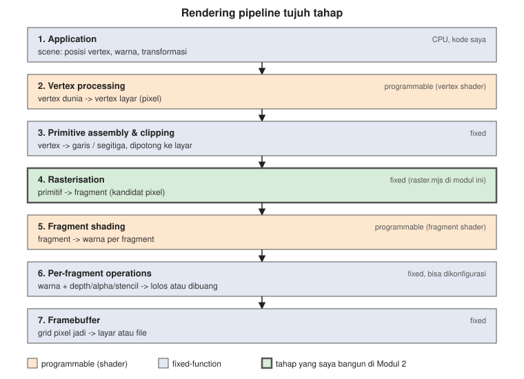
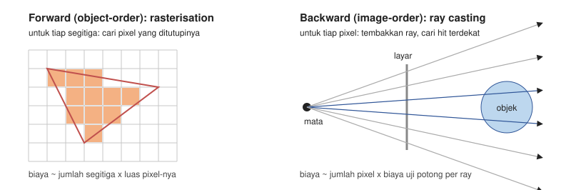
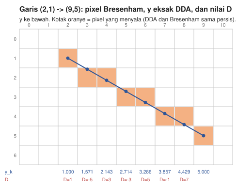
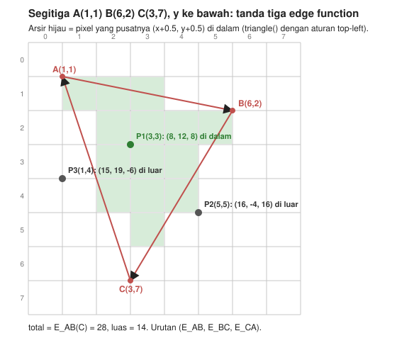
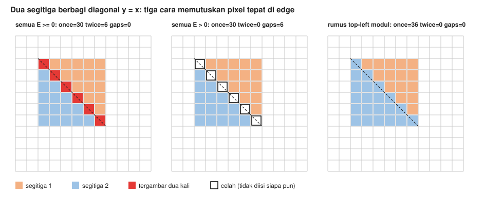
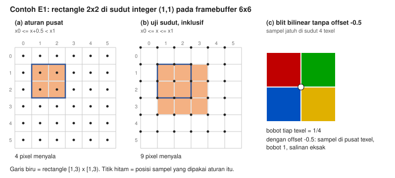

# Studi Pendahuluan Modul 2: Rendering Pipeline & Primitif 2D

Zacky Maulana (NIM 20241337034), S1 Informatika UMSurabaya
Praktikum Grafika Komputer

Semua angka hitungan di dokumen ini saya cek ulang dengan `Source/prelim_check.mjs`, dan semua diagram dibuat oleh `Source/figures/make_figures.mjs`. Pixel yang tampil di diagram dihitung oleh `raster.mjs`, bukan digambar manual, jadi diagram tidak mungkin berbeda dengan kodenya.

---

## Q1. Pipeline dan light transport

### Q1(a) Pipeline tujuh tahap

*Gambar 1. Tujuh tahap pipeline. Oranye bisa diprogram (shader), biru adalah hardware tetap. Hijau adalah tahap yang saya bangun sendiri di modul ini.*

| Tahap | Input | Output | Sifat |
|---|---|---|---|
| 1. Application | data scene di program saya | daftar vertex, warna, dan transformasi | kode saya sendiri (CPU) |
| 2. Vertex processing | vertex dalam koordinat dunia | vertex dalam koordinat layar (pixel). Di 2D ini cuma skala + geser | programmable (vertex shader) |
| 3. Primitive assembly & clipping | vertex lepas | garis dan segitiga, yang di luar layar dibuang atau dipotong | fixed |
| 4. Rasterisation | garis atau segitiga di koordinat layar | fragment: pixel kandidat beserta atribut yang diinterpolasi | fixed |
| 5. Fragment shading | fragment | warna untuk tiap fragment | programmable (fragment shader) |
| 6. Per-fragment operations | warna fragment + nilai depth/alpha | pixel yang lolos depth test, di-blend, atau dibuang | fixed, tapi bisa dikonfigurasi |
| 7. Framebuffer | pixel yang lolos | grid pixel jadi, ditampilkan atau disimpan | fixed |

Contoh konkret dari denah saya: angka meter di `myplan.json` adalah tahap 1. `worldToScreen()` di `plan.mjs` yang mengubah meter menjadi pixel adalah tahap 2. Mengelompokkan dua titik menjadi satu segmen dinding adalah tahap 3. Bresenham yang mencari pixel mana yang dilewati segmen itu adalah tahap 4. Memberi warna kategori dinding adalah tahap 5 (di sini warnanya rata, tanpa lighting). Karena saya tidak memakai depth test atau blending, tahap 6 cuma "tulis saja", dan tahap 7 adalah `Uint8ClampedArray` yang disimpan ke PPM.

### Q1(b) Light transport

**Light transport** adalah perjalanan cahaya dari sumbernya, memantul dan terpencar di permukaan benda (sebagian diserap), sampai sebagiannya masuk ke mata atau kamera.

Setiap pixel di gambar hasil render adalah perkiraan berapa banyak cahaya yang datang ke kamera lewat arah pixel itu. Jalur yang dihitung sama: sumber cahaya, permukaan, kamera. Bedanya hanya arah menelusurinya.

- **Rasterisation** berangkat dari benda. Setiap segitiga "diproyeksikan" ke layar, lalu dicari pixel mana yang tertutup. Artinya kita menelusuri jalur dari permukaan ke kamera.
- **Ray tracing** berangkat dari kamera. Untuk setiap pixel ditembakkan sinar ke dalam scene, lalu dicari permukaan pertama yang kena. Artinya jalur yang sama ditelusuri terbalik, dari kamera ke permukaan, dan bisa diteruskan ke sumber cahaya untuk bayangan atau pantulan.

Untuk pertanyaan "permukaan mana yang terlihat di pixel ini", keduanya menghasilkan gambar yang sama. Yang berbeda adalah urutan loop-nya, sehingga biayanya dan efek tambahan yang murah juga berbeda.

### Q1(c) Forward vs backward

*Gambar 2. Kiri: forward, loop atas segitiga. Kanan: backward, loop atas pixel. Hanya dua ray (biru) yang mengenai objek.*

- **Forward (rasterisation)** jelas menang untuk **jutaan segitiga kecil**, misalnya game real-time atau scan 3D candi dengan jutaan poligon. Biayanya sebanding dengan jumlah segitiga dikali luas pixel tiap segitiga. Segitiga kecil hanya menyentuh sedikit pixel, dan uji edge-nya bisa dikerjakan paralel di hardware GPU yang memang dibuat untuk itu.
- **Backward (ray casting)** jelas menang untuk **satu bola reflektif** atau scene dengan sedikit objek tapi banyak efek cahaya. Bola bisa diuji potong secara matematis (persamaan kuadrat) tanpa dipecah jadi segitiga. Pantulan dan bayangan cukup dengan menembakkan ray tambahan dari titik yang kena. Rasterisation harus memakai trik seperti environment map untuk meniru pantulan yang sama.

---

## Q2. Garis

*Gambar 3. Kotak oranye adalah pixel yang menyala. Titik biru adalah posisi eksak garis di tiap kolom, dengan nilai y eksak dan nilai D Bresenham di bawahnya.*

### Q2(a) DDA secara manual

Segmen dari (2, 1) ke (9, 5):

- Δx = 9 − 2 = 7, Δy = 5 − 1 = 4
- jumlah step = max(|Δx|, |Δy|) = 7, jadi ada 7 + 1 = 8 pixel
- increment x = Δx / step = 1, increment y = Δy / step = 4/7 ≈ 0,5714

| k | x_k | y_k (eksak) | round(y_k) | pixel |
|---|---|---|---|---|
| 0 | 2 | 1,000 | 1 | (2, 1) |
| 1 | 3 | 1,571 | 2 | (3, 2) |
| 2 | 4 | 2,143 | 2 | (4, 2) |
| 3 | 5 | 2,714 | 3 | (5, 3) |
| 4 | 6 | 3,286 | 3 | (6, 3) |
| 5 | 7 | 3,857 | 4 | (7, 4) |
| 6 | 8 | 4,429 | 4 | (8, 4) |
| 7 | 9 | 5,000 | 5 | (9, 5) |

Hasilnya 8 pixel: (2,1), (3,2), (4,2), (5,3), (6,3), (7,4), (8,4), (9,5). Bentuknya tangga dengan anak tangga 1, 2, 2, 2, lalu 1 (run pertama dan terakhir masing-masing satu kolom).

### Q2(b) Bresenham secara manual

Bresenham tidak menyimpan y pecahan. Yang disimpan adalah bilangan bulat D, yaitu "seberapa jauh garis asli di atas atau di bawah pusat pixel", dikali 2Δx supaya tetap bulat.

- D awal = 2Δy − Δx = 8 − 7 = **1**
- kalau D > 0: y naik satu, lalu D += 2(Δy − Δx) = −6
- kalau tidak: y tetap, lalu D += 2Δy = 8

| x | y | plot | keputusan |
|---|---|---|---|
| 2 | 1 | (2, 1) | D = 1 > 0, jadi y menjadi 2 dan D = 1 − 6 = −5 |
| 3 | 2 | (3, 2) | D = −5 ≤ 0, jadi D = −5 + 8 = 3 |
| 4 | 2 | (4, 2) | D = 3 > 0, jadi y menjadi 3 dan D = −3 |
| 5 | 3 | (5, 3) | D = −3 ≤ 0, jadi D = 5 |
| 6 | 3 | (6, 3) | D = 5 > 0, jadi y menjadi 4 dan D = −1 |
| 7 | 4 | (7, 4) | D = −1 ≤ 0, jadi D = 7 |
| 8 | 4 | (8, 4) | D = 7 > 0, jadi y menjadi 5 dan D = 1 |
| 9 | 5 | (9, 5) | selesai |

Urutan D: 1, −5, 3, −3, 5, −1, 7, 1. Daftar pixel-nya **sama persis** dengan DDA. Bedanya, semua operasinya hanya tambah, kurang, dan bandingkan bilangan bulat.

### Q2(c) Kenapa hanya integer

Bresenham mengembangkan algoritma ini di IBM untuk plotter digital yang dipasang ke komputer IBM 1401. Implementasi pertamanya dari 1962, lalu dipresentasikan di ACM National Conference 1963 dan diterbitkan di IBM Systems Journal 1965. Komputer zaman itu belum punya hardware floating point yang murah, dan pembagian sangat lambat. Algoritma yang cuma memakai penjumlahan dan perbandingan bisa jalan cepat dan memorinya kecil.

Di GPU sekarang alasannya masih berlaku, walaupun bentuknya lain:

1. **Hasilnya pasti.** Hitungan integer tidak punya galat pembulatan, jadi keputusan "pixel ini kena atau tidak" selalu sama, di mesin mana pun. Floating point bisa memberi jawaban berbeda untuk titik yang tepat di tepi.
2. **Murah dan paralel.** Rasteriser di GPU adalah hardware tetap yang harus mengolah miliaran pixel per detik. Penjumlahan integer jauh lebih kecil dan hemat daya dibanding pembagian float, jadi bisa dibuat sangat banyak.
3. **Koordinat fixed-point.** GPU membulatkan posisi vertex ke grid sub-pixel (bilangan bulat dalam satuan pecahan pixel), lalu memakai aritmetika integer untuk menguji tepi. Idenya sama dengan Bresenham dan edge function integer.

---

## Q3. Segitiga

### Q3(a) Edge function

E_AB(P) = (Bx − Ax)(Py − Ay) − (By − Ay)(Px − Ax)

Ini komponen z dari cross product (B − A) × (P − A).

- **Tandanya** mengatakan di sisi mana P berada terhadap garis berarah A → B: positif di satu sisi, nol tepat di garis, negatif di sisi lainnya.
- **Besarnya** sama dengan **dua kali luas segitiga ABP**. Makanya E_AB(C) disebut "luas bertanda × 2".
- E linear terhadap P, jadi nilainya cukup dihitung sekali lalu ditambah konstanta setiap kali pindah satu pixel.

### Q3(b) Segitiga A(1, 1), B(6, 2), C(3, 7)

*Gambar 4. Segitiga dengan y ke bawah. P1 di dalam, P2 dan P3 di luar.*

Total = E_AB(C) = (6 − 1)(7 − 1) − (2 − 1)(3 − 1) = 30 − 2 = **28**, jadi luasnya **14**.

**Winding:** total positif. Kalau digambar seperti di buku matematika (y ke atas), urutan A, B, C berlawanan arah jarum jam (**CCW**). Kalau dibaca di layar (y ke bawah), urutan yang sama terlihat **searah jarum jam (CW)**. Rumus dan vertex-nya tidak berubah, hanya sebutannya. Modul ini dan `raster.mjs` memakai layar y ke bawah, dengan syarat total > 0.

Tiga edge function-nya, dijabarkan:

- E_AB(P) = 5(Py − 1) − 1(Px − 1)
- E_BC(P) = −3(Py − 2) − 5(Px − 6)
- E_CA(P) = −2(Py − 7) + 6(Px − 3)

| Titik | E_AB | E_BC | E_CA | Hasil |
|---|---|---|---|---|
| P1 (3, 3) | 8 | 12 | 8 | semua ≥ 0, **di dalam** |
| P2 (5, 5) | 16 | −4 | 16 | E_BC < 0, di luar (di seberang sisi BC) |
| P3 (1, 4) | 15 | 19 | −6 | E_CA < 0, di luar (di seberang sisi CA) |

Contoh hitungan P1: E_AB = 5(2) − 1(2) = 8, E_BC = −3(1) − 5(−3) = −3 + 15 = 12, E_CA = −2(−4) + 6(0) = 8.

### Q3(c) Koordinat barycentric

Koordinat barycentric (λA, λB, λC) dari P adalah tiga bobot yang jumlahnya 1, sehingga P = λA·A + λB·B + λC·C.

Hubungannya dengan edge function: E_BC(P) adalah dua kali luas segitiga PBC, yaitu segitiga kecil di seberang vertex A. Semakin dekat P ke A, segitiga PBC makin besar. Jadi:

λA = E_BC(P) / total, λB = E_CA(P) / total, λC = E_AB(P) / total

Karena ketiga segitiga kecil PBC, PCA, dan PAB persis menyusun ABC, jumlah ketiga bobot selalu 1.

Untuk P1 (3, 3): λA = 12/28 = **3/7**, λB = 8/28 = **2/7**, λC = 8/28 = **2/7**. Cek: (3/7)(1, 1) + (2/7)(6, 2) + (2/7)(3, 7) = ((3 + 12 + 6)/7, (3 + 4 + 14)/7) = (3, 3). Cocok.

**Kenapa bobot ini tepat untuk interpolasi:** bobotnya linear terhadap posisi, bernilai 1 di vertex-nya sendiri, 0 di sisi seberangnya, dan jumlahnya selalu 1. Jadi warna atau depth yang diinterpolasi dengan bobot ini tepat sama dengan nilai vertex di ujung-ujungnya, berubah rata di sepanjang permukaan, dan tidak pernah keluar dari rentang nilai ketiga vertex. Contoh E5: nilai 10, 20, 40 dengan bobot (0,5; 0,25; 0,25) memberi 5 + 5 + 10 = **20**.

### Q3(d) Aturan top-left

*Gambar 5. Persegi 6×6 dari (2,2) sampai (8,8), dipecah di diagonal y = x. Diagonal itu tepat melewati 6 pusat pixel (2,5; 2,5) sampai (7,5; 7,5).*

- **"Di dalam kalau semua E ≥ 0":** keenam pixel di diagonal punya E = 0 di **kedua** segitiga, jadi diklaim dua kali: (2,2), (3,3), (4,4), (5,5), (6,6), (7,7). Kalau ada blending, garis diagonal ini terlihat lebih terang.
- **"Di dalam kalau semua E > 0":** keenam pixel yang sama tidak diklaim **siapa pun**, jadi muncul 6 celah berwarna latar.
- **Aturan top-left:** pixel yang pusatnya tepat di sebuah edge hanya diisi kalau edge itu adalah edge **top** atau edge **left** dari segitiganya. Aturan ini tidak bergantung pada urutan menggambar, karena dua segitiga yang berbagi edge selalu melewati edge itu dengan **arah berlawanan**. Akibatnya, aturan apa pun yang memilih berdasarkan arah edge pasti memberikan pixel itu ke tepat satu segitiga. Caranya: tambahkan bias 0 untuk edge pemilik dan −1 untuk edge lainnya, lalu uji E + bias ≥ 0. Hasilnya 36 pixel terisi tepat sekali, 0 dobel, dan 0 celah.

Modul menuliskan rumusnya begini: edge X → Y adalah *top* kalau Δy = 0 dan Δx < 0, dan *left* kalau Δy > 0. Saya cek rumus ini dengan gambar, dan ada satu hal yang perlu dicatat. Dengan y ke bawah dan total > 0, segitiga berjalan **searah jarum jam di layar**. Pada urutan seperti itu, edge yang turun (Δy > 0) ada di sisi **kanan** segitiga, dan edge mendatar dengan Δx < 0 ada di **bawah**. Jadi rumus modul sebenarnya memberikan pixel tepi ke edge kanan dan bawah. Itu cerminan dari aturan top-left yang dipakai GPU, walaupun sama-sama rapat tanpa celah. Contohnya terlihat di Gambar 5: keenam pixel diagonal jatuh ke segitiga 2, padahal bagi segitiga 2 diagonal itu adalah sisi kanan-atasnya. Di Fase 4 saya membuktikan perbedaan ini dengan WebGL sungguhan.

Catatan dari pengecekan saya: bias −1 hanya benar kalau nilai E di pusat pixel selalu bilangan bulat. Dengan vertex integer dan pusat pixel di x + 0,5, nilai E bisa 0,5, dan 0,5 − 1 < 0 membuang pixel yang jelas di dalam. Persegi ini kebetulan tidak terkena. Ini juga saya bahas di Fase 4.

---

## Q4. Konvensi sample-centre dan insiden half-pixel

Sumber yang saya baca: halaman Microsoft "Directly Mapping Texels to Pixels (Direct3D 9)" dan "Coordinate Systems (Direct3D 10)" di Microsoft Learn, serta tulisan independen Aras Pranckevičius, "Solving DX9 Half-Pixel Offset" (8 April 2016).

### Q4(a) Letak pusat pixel di Direct3D 9

Di Direct3D 9, **pusat pixel ada di koordinat integer**. Koordinat layar (0, 0) tepat di pusat pixel kiri atas, sehingga sudut kiri atas layar ada di (−0,5; −0,5). Halaman Direct3D 10 menulisnya terang-terangan: "In Direct3D 9, pixel centers are at integer locations."

Sementara itu koordinat texture dimulai dari **sudut** kiri atas texel. Karena pixel dan texel memakai titik awal yang berbeda, blit 2D harus menggeser posisi vertex sebesar **−0,5** di x dan y. Kalimat Microsoft: "remember to subtract 0.5 units from the x and y components of your vertex positions when working in transformed screen space in order to correctly align texels with pixels."

### Q4(b) Kalau offset-nya lupa

*Gambar 6. (a) Aturan pusat menyalakan 2×2 yang tepat. (b) Menguji sudut pixel dengan batas inklusif menyalakan 3×3. (c) Saat blit tanpa offset, titik sampel jatuh tepat di sudut empat texel.*

Tanpa offset, setiap pixel output mengambil sampel tepat di **sudut** antara empat texel, bukan di pusat satu texel. Dengan filter bilinear, keempat texel itu dirata-ratakan dengan bobot **1/4** masing-masing. Hasilnya, gambar yang seharusnya salinan tajam jadi **buram merata**, seperti di-blur 2×2. Contoh dari halaman Microsoft untuk texture 4×4: pixel yang seharusnya merah ternyata "three-fourths gray plus one-fourth red". Di tepi, sebagian bobot jatuh ke texel yang di-clamp, jadi warnanya bercampur dengan tetangga atau warna tepi.

Dengan offset −0,5, sampel pindah ke pusat texel, bobotnya 1, dan salinannya eksak. Ini juga yang terjadi di Contoh E1(c).

Pranckevičius menulis bahwa koordinat viewport D3D9 "shifted by half a pixel compared to everyone else (OpenGL, D3D10+, Metal etc.)". Gejalanya di Unity antara lain GrabPass yang mengambil sampel di tengah-tengah pixel sehingga hasilnya sedikit buram, dan celah satu pixel pada objek yang seharusnya menempel tepat di tepi layar. Perbaikannya dia taruh di satu tempat, yaitu menggeser posisi clip-space di vertex shader setengah pixel.

### Q4(c) Konvensi modern

Direct3D 10 mengubah aturannya: titik asal render target ada di **sudut** kiri atas pixel kiri atas, dan "Pixel centers are offset by (0.5f,0.5f) from integer locations." Jadi pixel (x, y) di-sampling di **(x + 0,5; y + 0,5)**, sama dengan OpenGL dan dengan `raster.mjs`.

Jebakannya hilang karena sekarang sistem koordinat pixel dan texel sejajar. Sudut pixel = sudut texel, pusat pixel = pusat texel. Halaman Microsoft menyebut hal ini "makes rendering screen-aligned textures trivial". Blit 1:1 langsung tepat tanpa offset apa pun.

### Q4(d) Tanggal dan sumber

| Peristiwa | Tanggal | Sumber |
|---|---|---|
| DirectX 9.0 (Direct3D 9) dirilis | 19 Desember 2002 | Tabel riwayat versi di Wikipedia "DirectX" |
| DirectX 10 (Direct3D 10) dirilis, hanya untuk Windows Vista | 30 November 2006 | idem |
| Halaman "Directly Mapping Texels to Pixels (Direct3D 9)" | tanggal dokumen 31 Mei 2018 (versi arsip MSDN yang dipindahkan ke Microsoft Learn) | https://learn.microsoft.com/en-us/windows/win32/direct3d9/directly-mapping-texels-to-pixels |
| Halaman "Coordinate Systems (Direct3D 10)" | tanggal dokumen 31 Mei 2018 | https://learn.microsoft.com/en-us/windows/win32/direct3d10/d3d10-graphics-programming-guide-resources-coordinates |
| Pranckevičius, "Solving DX9 Half-Pixel Offset" | 8 April 2016 | https://www.aras-p.info/blog/2016/04/08/solving-dx9-half-pixel-offset |

Jadi era jebakan ini kira-kira dari akhir 2002 (Direct3D 9) sampai Direct3D 10 akhir 2006, tapi dalam praktik masih bertahan lebih lama. Banyak game tetap mendukung D3D9 bertahun-tahun setelahnya, dan Unity masih menambalnya pada 2016.

---

## Q5. Menggambar dengan pustaka

### Q5(a) Line, Shape/ShapeGeometry, dan Mesh di Three.js

Saya membaca kode sumber Three.js 0.160.0 yang terpasang di `node_modules/three/src`:

- **`Line`** adalah objek yang menggambar titik-titik geometrinya sebagai satu garis bersambung. Di `WebGLRenderer.js`, `Line` digambar dengan mode `gl.LINE_STRIP`, `LineLoop` dengan `gl.LINE_LOOP`, dan `LineSegments` dengan `gl.LINES`. Jadi rasterisation garisnya dikerjakan oleh GPU, bukan oleh Three.js.
- **`Shape`** hanyalah **deskripsi jalur 2D** (turunan dari `Path`, diisi dengan `moveTo` dan `lineTo`). Shape belum bisa digambar. **`ShapeGeometry`** mengubah Shape itu menjadi segitiga dengan algoritma Earcut (`ShapeUtils.triangulateShape`). Sebelum dipecah, urutan titiknya diseragamkan dulu ke satu arah (`isClockWise`, lalu `reverse`).
- **`Mesh`** adalah objek yang menggabungkan geometry segitiga dengan material, lalu digambar sebagai `gl.TRIANGLES`.

Pemakaian di denah saya:

- **Outline denah:** `Line`, satu per polyline (dinding, lemari, sekat, patung, jalan masuk).
- **Siluet terisi:** `Shape` → `ShapeGeometry` → `Mesh` dengan `MeshBasicMaterial`, karena siluet harus diisi segitiga.
- **Swatch legenda:** kalau di dalam canvas WebGL, sebuah `Mesh` dengan `PlaneGeometry` kecil per kategori. Di viewer saya, legenda dibuat sebagai elemen HTML di samping canvas. Alasannya, teks label lebih tajam dan bisa dibaca screen reader, sementara filter CVD tetap mengenai seluruh halaman.

### Q5(b) Tiga syarat legenda yang aksesibel

Dari aturan CVD di Modul 1:

1. **Luminansi harus bervariasi, bukan hanya hue.** Saya memakai ramp viridis 5 langkah. Kecerahannya naik dari ungu gelap ke kuning terang, jadi kategori tetap bisa dibedakan dalam grayscale atau di mata deuteranopia. Di Fase 5 saya mengukurnya dengan matriks deuteranopia yang sama dengan halaman web.
2. **Ada label teks.** Setiap swatch diberi nama kategorinya (dinding, lemari, sekat berlubang, patung, jalan masuk), jadi arti warna tidak perlu ditebak.
3. **Ada bentuk marker yang berbeda per kategori** (■ ◆ ▲ ● ▼). Kalau dua warna tetap terlihat mirip, bentuknya masih membedakan.

---

## Daftar pustaka

1. Marschner, S. & Shirley, P. *Fundamentals of Computer Graphics*, edisi 5. A K Peters/CRC Press, 2021. Bab 3 (Raster Images) dan Bab 9 (The Graphics Pipeline).
2. Hughes, J. F., van Dam, A., McGuire, M., Sklar, D. F., Foley, J. D., Feiner, S. K. & Akeley, K. *Computer Graphics: Principles and Practice*, edisi 3. Addison-Wesley, 2014. Subbab 1.6 (The Graphics Pipeline), Bab 3 (An Ancient Renderer Made Modern), Bab 15 (Ray Casting and Rasterization).
3. Bresenham, J. E. "Algorithm for computer control of a digital plotter." *IBM Systems Journal* 4(1):25–30, 1965.
4. Pineda, J. "A Parallel Algorithm for Polygon Rasterization." *Computer Graphics* (SIGGRAPH '88) 22(4), 1988.
5. Microsoft. "Directly Mapping Texels to Pixels (Direct3D 9)" dan "Coordinate Systems (Direct3D 10)." Microsoft Learn.
6. Pranckevičius, A. "Solving DX9 Half-Pixel Offset." 8 April 2016.
7. Kode sumber Three.js r160 (`three@0.160.0`): `src/objects/Line.js`, `src/geometries/ShapeGeometry.js`, `src/extras/ShapeUtils.js`, `src/renderers/WebGLRenderer.js`.
8. Modul 2 Praktikum Grafika Komputer: Rendering Pipeline & Primitif 2D.

Catatan soal nomor bab: modul menyebut Marschner & Shirley "Bab 8–9 (The Graphics Pipeline, Rasterization)" dan Hughes dkk. "Bab 3 dan Bab 18 (Pipeline, Rasterization)". Menurut daftar isi penerbit untuk edisi 5, Marschner & Shirley Bab 8 adalah *Viewing* dan Bab 9 adalah *The Graphics Pipeline*, dengan rasterisation di dalam Bab 9. Untuk Hughes dkk. edisi 3, Bab 18 berjudul *Images and Signal Processing*, sedangkan rasterisation dibahas di Bab 15 *Ray Casting and Rasterization*. Karena itu yang saya cantumkan adalah bab yang isinya sesuai.
