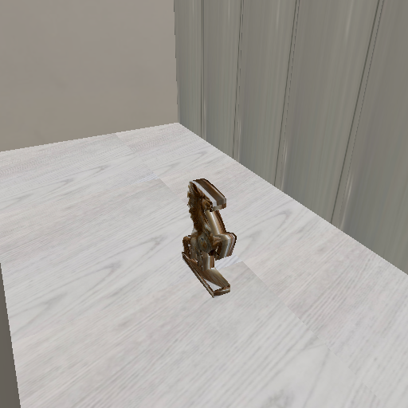
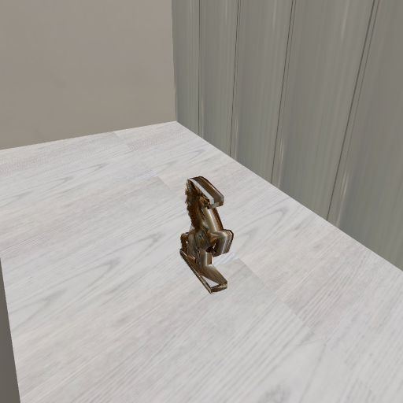
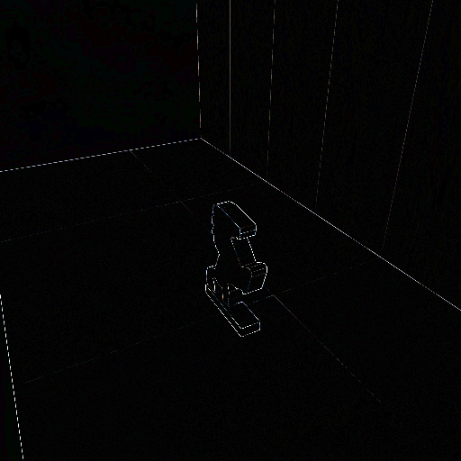
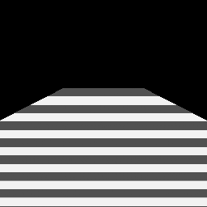
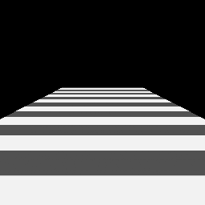
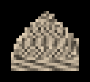
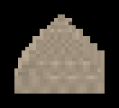
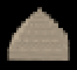

# Modul 3: Transformasi 3D, Proyeksi, Texture & Real-Time Rendering

Zacky Maulana (NIM 20241337034), Praktikum Grafika Komputer, S1 Informatika UMSurabaya.

Subjek: patung kuda berdiri milik saya sendiri (sama dengan Modul 1 dan 2). Model 3D-nya adalah **ruangan tempat patung itu berdiri**, dibangun dari ukuran denah Modul 2 (2 × 4 m, tinggi 3,5 m, lemari 8 pintu dan sekat sampai plafon), dengan patung dari garis luar yang saya telusuri di foto. Totalnya 394 segitiga. Texture-nya atlas 512 × 512 dari foto saya sendiri di Modul 1. Model ditulis oleh skrip saya sendiri (`make_mymodel.py`) dan diperiksa dengan Blender 5.2.2. Asal setiap angka ada di [docs/model](docs/model/README.md).

Halaman WebGL: **https://zackymaulana912.github.io/grafkom-pixel-to-reality/Module3/Source/web/** (sudah aktif dan diuji, lihat catatan Fase 5)

## Cara menjalankan

```bash
cd Module3/Source
python3 -m venv .venv && source .venv/bin/activate
pip install -r requirements.txt
python make_model.py && python tests.py        # ALL CHECKS PASSED (17 ok, 0 fail)
python -m http.server 8000 --bind 127.0.0.1    # buka http://127.0.0.1:8000/web/
```

Perintah lainnya ada di [Source/README.md](Source/README.md).

## Hasil utama

### Tiga render dari satu model

| raster3d.py (NumPy, dari nol) | raytrace.py (NumPy, dari nol) | Three.js (WebGL) | \|raster − WebGL\| × 6 |
|---|---|---|---|
|  |  |  |  |

- **Raster vs ray tracer: identik byte per byte** (PSNR inf, SSIM 1,000) pada 512 × 512.
- **Raster vs WebGL: PSNR 40,4 dB, SSIM 0,998.** 92% error kuadratnya ada di tepi segitiga (MSAA GPU). Bagian dalamnya hanya berbeda rata-rata 0,49 kode, dan sudah dibuktikan berasal dari pembulatan uint8.
- Viewer starter apa adanya hanya mendapat 11,4 dB, karena tiga hal yang semuanya saya buktikan dari kode sumber Three.js r160: lampu fisik yang dibagi π, filter nearest, dan konvensi pusat texel. Lihat [catatan Fase 5](docs/catatan/fase5-realtime-hosting.md).

### Satu vertex lewat semua space (ujung telinga patung, vertex 134)

| Space | Koordinat |
|---|---|
| Object | (−0,170000; 0,450000; −0,019259) |
| World `M p` | (0,830000; 0,450000; −2,019259) |
| View `V M p` | (0,020670; 0,089798; −1,559007) |
| Clip `P V M p` | (0,039706; 0,172500; 1,388481; w = 1,559007) |
| NDC | (0,025469; 0,110647; 0,890619) |
| Screen 512 × 512 | (262,52; 227,67) → pixel (262, 227), depth 0,9453 |

Dua langkah pertama saya hitung dengan tangan, dan hasilnya cocok sampai 5 desimal ([catatan Fase 2](docs/catatan/fase2-model-telusuran.md)).

### UV naif vs perspective-correct

| Naif | Perspective-correct |
|---|---|
|  |  |

Contoh E4 lewat kode rasteriser: u di tengah layar **0,1** (perspective-correct) vs 0,5 (naif). Saat kamera maju 10 cm, texture naif meluncur di atas lantai rata-rata **27,2 cm**, sedangkan yang perspective-correct 0,00 cm.

### Mipmap

| Tanpa mipmap | Dengan mipmap | Kebenaran (supersampling 8 × 8) |
|---|---|---|
|  |  |  |

Kelap-kelip saat kamera bergeser 1%: **49,3 → 1,1**. PSNR terhadap kebenaran: 15,7 → 28,3 dB.

### Diagnosis scene rusak

Diagnosis ditulis dan di-commit sebelum perbaikan ([docs/prediksi](docs/prediksi/diagnosis-scene-rusak.md)).

| Bug | Sebelum (SSIM) | Sesudah (SSIM) | Satu perubahan |
|---|---|---|---|
| inside-out | 0,790 | **1,000** (identik) | loader membalik mesh yang signed volume-nya negatif |
| zfight | 0,763 (2.852 pixel salah) | 0,984 (184 pixel, semuanya di garis potong) | near 0,001 → 1 |
| stretched | 0,594 | **1,000** (identik) | buang skala tidak seragam diag(2,2; 0,5; 1) |

Perbaikan pitfall tanpa mengubah near: depth **float32 + reverse-Z** membuat scene zfight benar sempurna (2.852 → **0** pixel salah).

Temuan penting: model candi starter ternyata seluruhnya ber-winding ke dalam, sehingga di `broken_scene.py` asli label "rusak" dan "benar" untuk inside-out tertukar ([catatan Fase 4](docs/catatan/fase4-diagnosis-pitfall.md)).

### Rasterisation vs ray tracing

| Renderer (512 × 512, median 5 run) | Frame time | Hard shadow |
|---|---|---|
| raster3d.py | **0,162 s** | 0,254 s (shadow map, tepi bayangan bergeser 1 pixel) |
| raytrace.py | **1,499 s** (9,3×) | 3,756 s (shadow ray, tepat per pixel) |

Prediksi saya (ditulis sebelum diukur): rasio sekitar 12×, rentang 5–30×. Hasilnya 9,3×. Waktu absolutnya saya perkirakan 2,5 sampai 3,3 kali terlalu lambat.

Pilihan viewer real-time: **rasterisation di GPU (WebGL)**. Pilihan beauty shot: **ray tracing**.

## Dokumen

- Laporan: [docs/laporan/laporan-modul3.md](docs/laporan/laporan-modul3.md)
- Studi Pendahuluan: [docs/studi-pendahuluan/studi-pendahuluan.md](docs/studi-pendahuluan/studi-pendahuluan.md)
- Prediksi dan diagnosis (ditulis sebelum hasil): [docs/prediksi](docs/prediksi)
- Catatan per fase dan persiapan viva: [docs/catatan](docs/catatan)
- Detail teknis dan baris Verified: [Source/README.md](Source/README.md)
