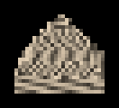

# Fase 3: Pipeline from-scratch (Lab 2 no 1, 3, 4)

## 1. Apa yang saya tulis ulang

| File | Isi | Perbedaan utama dengan starter |
|---|---|---|
| `transforms.py` | T, S, R, `perspective`, `look_at`, `project`, `viewport`, `reverse_z_depth` | Konvensi dipatok sekali di atas file, termasuk bahwa NDC sendiri left-handed karena proyeksi membalik z. Semua sudut berakhiran `_deg` dan hanya dikonversi di `radians()`. Ada fungsi baru reverse-Z |
| `objio.py` | loader OBJ | Ada `signed_volume()`, dan `enforce_ccw=True` membalik mesh yang ber-winding ke dalam (§12.6: "buat loader-nya menegakkan itu") |
| `raster3d.py` | rasteriser z-buffer | Membaca file scene, rumus interpolasi dipisah menjadi `bary_mix` dan `perspective_correct` (dipakai juga oleh test), opsi naif/mipmap/culling/shadow map/reverse-Z/format depth, nama file depth tidak lagi menimpa warna (T5), demo overlap benar-benar menghitung (T4) |
| `raytrace.py` | ray tracer | Membaca file scene, ray bayangan (`--shadow`), pembuatan ray dipisah (`primary_rays`) supaya dipakai lagi oleh `persp_check.py` |
| `mipmap.py` | baru | piramida 4 level, rata-rata 2 × 2 di linear light, level of detail dari turunan UV di layar, trilinear |

Kode starter yang tidak saya ubah: `make_model.py` (keputusan K3), `metrics.py`, `ppm_io.py`, `srgb.py`, dan `compare.py`.

## 2. Cara kerja rasteriser, langkah demi langkah

Untuk setiap segitiga:

1. **Normal dan Lambert di world space.** Normal datar dari dua sisi segitiga, lalu dibalik ke arah kamera ("shade sisi yang terlihat"), lalu `ambient + (1 − ambient) · max(0, n · L)`.
2. **Clip = P · V · M · p**, satu perkalian per vertex (sudah dihitung sekali untuk semua vertex).
3. **Clip terhadap near plane di clip space** (`clip_near`): sisi yang memotong `z + w = 0` dipotong dengan interpolasi linear. UV, `1`, dan posisi world ikut dipotong, dan hasilnya 0, 1, atau 2 segitiga. Di model saya, 122 segitiga tersentuh near plane: 71 terpotong dan 51 dibuang seluruhnya.
4. **Bagi dengan w**, lalu viewport (y dibalik).
5. **Edge function Modul 2** di pusat pixel `(x + 0.5, y + 0.5)` memberi bobot barycentric `l0, l1, l2`. Pixel di dalam kalau ketiganya ≥ 0.
6. **Depth:** NDC z diinterpolasi **linear** (`bary_mix`), karena NDC z affine terhadap `1/w`, dan `1/w` linear di layar.
7. **Uji z:** `z < depth[y, x]`. Pemenangnya menulis depth dan warna.
8. **Texture:** `u/w`, `v/w`, dan `1/w` diinterpolasi linear, lalu dibagi (`perspective_correct`). Sampel bilinear diambil di linear light.
9. Warna dikonversi ke sRGB, lalu ke uint8 **sekali** di akhir.

## 3. Kecocokan dengan referensi

| Perbandingan | Ukuran | Hasil |
|---|---|---|
| Rasteriser saya vs `ref/temple_ref.ppm` (dibuat kode dosen yang belum diubah) | 160 × 160 | **identik byte per byte** (PSNR inf) |
| Rasteriser saya vs keluaran `raster3d.py` dosen | 256 dan 512 | identik byte per byte |
| Demo segitiga vs keluaran dosen | 64 × 64 | identik byte per byte (1199 fragment, UV centroid 0,410 vs naif 0,500) |
| Raster vs ray tracer, **model saya** | 512 × 512 | **PSNR inf, identik byte per byte** |
| Raster vs ray tracer, candi | 256 × 256 | 78,6 dB, SSIM 1,000, berbeda di 2 pixel, max 8 |
| Raster vs ray tracer, candi | 512 × 512 | 69,1 dB, SSIM 1,000, berbeda di 3 pixel, max 33 |

### Kenapa candi tidak identik: temuan T14

Di Fase 0, kode dosen di Mac saya memberi 68,1 dB (max 28) untuk raster vs ray tracer 256 × 256, sedangkan PDF menulis 76,9 dB (max 10) dan run awal di Linux 76,5 dB. Sebelum menyebutnya bug, saya telusuri dulu.

1. **Hanya 1 pixel** yang berbeda, di (35, 169). Seluruh selisih PSNR berasal dari satu pixel itu.
2. Kedua renderer **memilih segitiga yang sama** (segitiga 155, t = 3,615). Jadi ini bukan masalah visibilitas.
3. Segitiga 155 adalah sisi kotak yang UV-nya `u = 1` di ketiga vertex. Di pixel itu, raster mendapat `u = 1,0` persis, sedangkan ray tracer `u = 0,9999999999999999`.
4. Sampler starter memakai `np.mod(u, 1)`. Nilai 1,0 dibungkus menjadi 0,0 dan sampelnya diambil dari kolom texture paling kiri, sedangkan 0,99999… tetap di kolom paling kanan. Dua kolom itu warnanya berbeda.

Jadi selisihnya ditentukan oleh **pembulatan floating-point di digit terakhir**, yang bisa berbeda antara Mac (arm64, NumPy dengan Accelerate) dan Linux. Bahkan membalik urutan vertex (winding) sudah mengubah 3 pixel ini di ray tracer. Model saya tidak terkena, karena UV-nya dimundurkan 1 texel dari tepi setiap wilayah atlas dan tidak pernah menyentuh 0 atau 1. Hasilnya identik byte per byte.

Sampler starter tidak saya ubah, karena `ref/temple_ref.ppm` bergantung padanya. Di laporan, temuan ini saya tulis sebagai keterbatasan.

## 4. Test

```
.venv/bin/python tests.py      # ALL CHECKS PASSED (17 ok, 0 fail), sekitar 1 detik
```

Delapan check starter tetap ada. E4 dan E5 sekarang memanggil `raster3d.perspective_correct` dan `raster3d.bary_mix`, fungsi yang juga dipakai `render()`. Di starter, E4 hanya menguji `np.interp` dan tidak menyentuh rasteriser sama sekali (T3). Check baru: model saya (≥ 200 segitiga, tidak ada luas nol, UV di semua sudut dan di dalam atlas, winding konsisten di 564 sisi bersama), texture 512 × 512, handedness (det M > 0, signed volume), near clip, mipmap, reverse-Z, z-buffer tidak bergantung urutan gambar, dan raster vs ray tracer model saya > 60 dB.

Supaya yakin test-nya bisa gagal, saya sengaja merusak kode tiga kali. Interpolasi UV dibuat naif, E4 gagal. Clipping dibuang, check near clip gagal. Baris 4 matriks proyeksi dibuat `w = +z`, E3 gagal.

## 5. Perspective-correct vs naif (Lab 2 no 3)

```
.venv/bin/python persp_check.py
```

**E4 lewat rasteriser.** `perspective_correct` memberi **0,1000** dan interpolasi naif **0,5000**. Di render sungguhan (tepi L–R di baris 50, 100 pixel), pixel x = 100 mendapat u = **0,1008** (perspective-correct) dan **0,5022** (naif). Selisih kecilnya karena pusat pixel ada di 100,5, bukan tepat di tengah tepi.

**Lantai bergaris dilihat menyamping, kamera maju 10 cm.** Saya menghitung u yang **benar** untuk setiap pixel lewat ray ke bidang lantai, lalu membandingkannya dengan u yang dipakai rasteriser.

| | \|u − benar\| rata-rata | Texture meluncur di atas lantai saat kamera maju 10 cm |
|---|---|---|
| Perspective-correct | 0,0000 m | **0,00 cm** |
| Naif | 2,70 m | **rata-rata 27,2 cm, maksimum 56,8 cm** |

Itulah texture yang "berenang": dengan UV naif, letak garis-garis di lantai bergantung pada posisi kamera.

| Naif | Perspective-correct |
|---|---|
|  |  |

## 6. Mipmap (Lab 2 no 4)

```
.venv/bin/python mip_check.py
```

Kamera candi saya tarik mundur 5 kali, sehingga puluhan texel relief yang bergaris jatuh ke satu pixel. Kebenarannya adalah render supersampling 8 × 8 yang dirata-rata di linear light.

| | Kelap-kelip (rata-rata \|frame − frame geser 1%\|) | Energi frekuensi tinggi | PSNR terhadap kebenaran |
|---|---|---|---|
| Tanpa mipmap | 49,26 | 177,5 | 15,7 dB |
| Mipmap 4 level, trilinear | **1,12** | 54,4 | **28,3 dB** |
| Kebenaran (8 × 8) | | 34,6 | |

Kelap-kelipnya turun 44 kali. Energi frekuensi tinggi tanpa mipmap lima kali lipat kebenarannya: itu pola palsu hasil aliasing, bukan detail. Mipmap masih sedikit di atas kebenaran, karena hanya ada 4 level. Untuk candi sejauh ini, level yang ideal sudah di luar piramida.

| Tanpa mipmap | Digeser 1% | Dengan mipmap | Kebenaran |
|---|---|---|---|
|  |  |  |  |

*Diperbesar 4 kali dengan nearest neighbour, tanpa penghalusan.*
