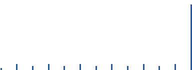
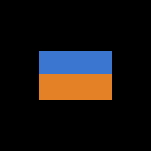
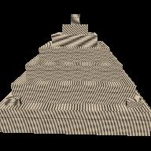

# Fase 4: Diagnosis scene rusak dan perbaikan pitfall (Lab 2 no 2 dan 5)

## Urutan kerja

1. `diagnose_scene.py` dibuat lebih dulu. Isinya hanya mencetak bukti (render, citra depth, matriks, histogram depth, selisih dengan render normal), tanpa penyebab dan tanpa perbaikan. Alasannya, `broken_scene.py` dari dosen langsung mencetak penyebab dan perbaikannya (T10).
2. Diagnosis ditulis hanya dari bukti itu: [`docs/prediksi/diagnosis-scene-rusak.md`](../prediksi/diagnosis-scene-rusak.md). File ini ada di commit yang lebih awal daripada perbaikannya.
3. Baru setelah itu `broken_scene.py` saya tulis ulang: satu perubahan per bug, dengan bukti sebelum dan sesudah.

```
.venv/bin/python diagnose_scene.py         # bukti saja
.venv/bin/python broken_scene.py --all     # perbaikan + bukti + perbaikan pitfall -> out/bugs/bug_table.txt
```

## Hasil: tiga bug, sebelum dan sesudah

Setiap render dibandingkan dengan **render normal scene yang sama**: z-buffer tanpa culling untuk inside-out, depth float64 untuk zfight, dan matriks model yang dimaksud untuk stretched.

| Bug | Satu perubahan | SSIM sebelum → sesudah | PSNR sebelum → sesudah | Pixel salah (> 60 kode) | Pitfall §12 |
|---|---|---|---|---|---|
| inside-out | loader membalik mesh yang signed volume-nya negatif (`enforce_ccw=True`) | 0,790 → **1,000** | 14,3 → **inf** dB | 8.609 → **0** | 12.6 drift winding / backface |
| zfight | near 0,001 → 1 | 0,763 → 0,984 | 16,4 → 28,3 dB | 2.852 → **184** | 12.2 near plane terlalu kecil |
| stretched | buang diag(2,2; 0,5; 1) dari matriks model | 0,594 → **1,000** | 11,5 → **inf** dB | 11.307 → **0** | 12.1 urutan / isi rantai matriks |

**Semua prediksi di dokumen diagnosis terbukti:**

- **inside-out dan stretched** identik dengan render normal setelah satu perubahan. `ref/temple_ref.ppm` juga tidak berubah setelah winding diperbaiki (check "scenes/temple.json + CCW-enforcing loader → same ref frame" di `tests.py`).
- **zfight** turun dari 2.852 ke 184 pixel salah. Semua 184 pixel ada di **baris 94–95**, yaitu pita tipis di garis tempat kedua quad saling memotong. Di garis itu jarak kedua quad memang lebih kecil dari satu langkah kode depth. Jumlah kode depth 16-bit yang terpakai naik dari **1** menjadi **13**.

| Histogram depth zfight sebelum (1 kode, 5.704 pixel) | Sesudah (13 kode) |
|---|---|
|  |  |

| Bug | Sebelum | Sesudah |
|---|---|---|
| inside-out |  |  |
| zfight |  |  |
| stretched |  |  |

## Temuan T13: label inside-out di starter terbalik

Ini temuan terbesar di fase ini. `make_model.py` menulis di docstring bahwa setiap kotak "CCW-front (outward-facing)". Kenyataannya, **semua 180 face ber-winding searah jarum jam dari luar**. Buktinya ada tiga:

- signed volume mesh −2,9764;
- dengan pusat setiap kotak sebagai titik acuan, 0 face menghadap ke luar dan 180 menghadap ke dalam;
- render dengan culling menggambar permukaan yang lebih jauh dari kebenaran di 19.029 dari 19.029 pixel.

Akibatnya di `broken_scene.py` asli:

- scene yang disebut "bug" (winding dibalik + culling) justru **identik** dengan kebenaran;
- scene yang disebut "fixed" (winding asli + culling) adalah yang benar-benar inside-out, dengan SSIM 0,790.

Angka SSIM 0,79 di PDF memang benar, tapi yang rusak dan yang benar tertukar. Ini tidak pernah kelihatan, karena render referensi, ray tracer, dan halaman WebGL (`DoubleSide`) semuanya tidak memakai culling, dan shading-nya membalik normal ke arah kamera.

**Kenapa perbaikannya di loader, bukan di `make_model.py`.** Keputusan K3 menjaga `make_model.py` dan `pusaka_model.obj` tetap seperti dari dosen, karena `ref/temple_ref.ppm` dibuat dari keduanya. Selain itu, §12.6 memang menyarankan agar loader yang menegakkan winding. Dengan `enforce_ccw=True`, loader menghitung signed volume dan membalik semua face kalau hasilnya negatif. Semua renderer saya memuat model lewat `raster3d.load_scene_mesh()`, yang menyalakan opsi itu. Default `load_obj()` tetap mati, supaya `diagnose_scene.py` tetap memperlihatkan file apa adanya.

Keterbatasan cara ini: signed volume hanya bermakna untuk mesh tertutup dengan winding yang konsisten di dalam mesh itu. Model saya punya bagian terbuka (dinding tanpa sisi bawah), tapi winding-nya sudah benar dari awal, jadi tidak dibalik (signed volume +8,33). Model yang sebagian face-nya terbalik tidak bisa diperbaiki dengan satu tanda global seperti ini.

## Temuan T9: "urutan matriks tertukar"

Menukar `S(1,4)` dan `Ry(35)` menghasilkan matriks yang sama persis (`np.allclose` = True), karena skala seragam komutatif dengan rotasi. Jadi urutan saja tidak bisa membuat gambar ini. Penyebab sebenarnya adalah faktor `diag(2,2; 0,5; 1)` di ujung kanan rantai, yang terbaca langsung dari panjang kolom matriks (3,08; 0,70; 1,40). Urutan baru berpengaruh kalau skala tidak seragam itu dipindah ke kiri rotasi. Di posisi itu ia meregang sepanjang sumbu x world, dan candinya akan tampak miring (shear), bukan hanya melebar.

## Perbaikan pitfall: depth float dan reverse-Z (Lab 2 no 5, K14)

Starter sudah punya opsi `cull_back`, jadi sekadar menyalakannya tidak membedakan pekerjaan saya. Saya memilih **depth buffer float dan reverse-Z**, lalu menjalankan ulang scene zfight **dengan near tetap 0,001**, kondisi yang membuat bug-nya muncul.

| Depth buffer (near = 0,001, far = 200) | Pixel salah | SSIM terhadap depth float64 |
|---|---|---|
| fixed point 16-bit (bug aslinya) | 2.852 | 0,763 |
| fixed point 24-bit | 828 | 0,929 |
| float32, NDC biasa (near → −1) | 92 | 0,992 |
| **float32, reverse-Z (near → 1, far → 0)** | **0** | **1,000** |
| fixed point 16-bit, reverse-Z | 2.852 | 0,763 |

Ini persis penjelasan Reed (2015):

- **Menambah bit membantu, tapi tidak cukup.** 24-bit masih menyisakan 828 pixel salah.
- **Float dengan pemetaan biasa** menolong lebih banyak (92), karena float32 masih punya sekitar 6 × 10⁻⁸ per langkah di dekat 1. Tapi kerapatan float justru ada di dekat 0, tempat near berada, padahal di sana presisi sudah berlebih.
- **Reverse-Z + float** menaruh benda jauh di dekat 0, tempat float paling rapat. Kerapatan float membatalkan peremukan 1/z, dan hasilnya **0 pixel salah, tanpa mengubah near sama sekali**.
- **Reverse-Z dengan fixed point tidak menolong sama sekali** (tetap 2.852). Fixed point berjarak sama rata di seluruh rentang, jadi membalik pemetaannya tidak menambah presisi di mana pun. Dua perubahan reverse-Z harus dikerjakan bersamaan.

Cara kerjanya di `raster3d.py`: `reverse_z_depth(1/w, near, far) = n(f − w) / ((f − n) w)` juga affine terhadap `1/w`, jadi bisa diinterpolasi linear di layar seperti NDC z. Uji depth-nya dibalik menjadi `>`, buffer diisi −∞, dan nilai yang disimpan dibulatkan ke float32 (`depth_format="f32"`).

Catatan: perbaikan inverse-transpose untuk normal tidak saya pilih, karena rasteriser ini menghitung normal dari posisi world yang sudah ditransformasi. Normal-nya sudah benar untuk skala tidak seragam sekalipun, jadi perbaikan itu tidak akan menunjukkan perbedaan.
