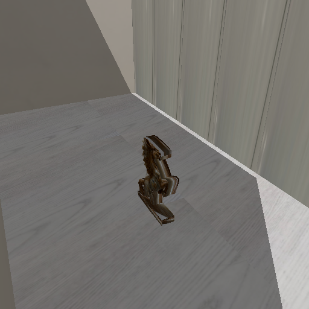
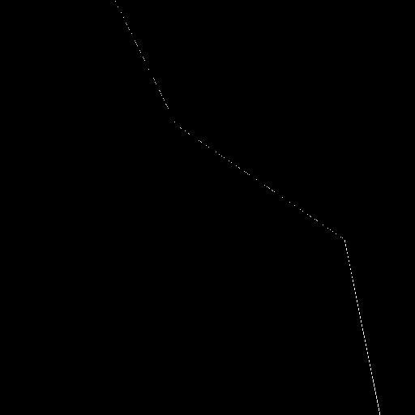

# Fase 5: Real-time, keputusan raster vs ray tracing, hosting (Lab 3)

## 1. Viewer WebGL (Lab 3 no 1)

`web/viewer.js` membaca `scenes/mymodel.json`, file yang sama dengan yang dibaca rasteriser dan ray tracer. Kamera, matriks model (T · Ry · S, urutan yang sama dengan `scene.py`), lampu, ukuran frame, model, dan texture semuanya dari sana. Halaman dibuat 512 × 512 dengan `setPixelRatio(1)`, output sRGB, OrbitControls, tombol Export PPM (nama file `mymodel_three.ppm`), tombol "Kamera awal", dan Wireframe. `?scene=temple` membuka candi bawaan dosen.

Kalau model atau texture gagal dimuat, halaman menulis penyebabnya dengan warna merah, termasuk petunjuk folder mana yang harus dilayani. Halaman tidak boleh gagal diam-diam.

**Sudah diuji di Chrome 156.0.8078.48 headless** (WebGL lewat ANGLE Metal di GPU Apple M5), dari `http.server` di `127.0.0.1:8000`:

- semua varian halaman termuat dengan 0 error console, 0 error halaman, dan 0 request gagal;
- menyeret mouse mengubah frame, dan tombol "Kamera awal" mengembalikannya ke frame yang sama persis (hash screenshot sama);
- Export PPM menghasilkan file 512 × 512.

Saya juga membukanya sendiri di **Safari 27.0.1** lewat URL GitHub Pages (29 Oktober 2026): ruangan dan patung tampil, bisa diputar, dan tombol-tombolnya jalan. Ini cek dengan mata saja, tanpa export atau cek console.

## 2. Mencocokkan frame WebGL dengan frame NumPy (Lab 3 no 2, T7)

Run awal di Linux sudah menemukan bahwa viewer starter jauh lebih gelap (T7), dan dugaannya ada tiga penyebab. Ketiganya saya buktikan dulu dari kode sumber Three.js 0.160.0 (`three.module.js` dari jsdelivr), bukan dari ingatan:

| | Bukti di kode sumber Three.js r160 | Perbaikan di viewer |
|---|---|---|
| (a) lampu | `BRDF_Lambert` = `RECIPROCAL_PI * diffuseColor`. `WebGLRenderer` memasang `_useLegacyLights = false` (sejak r155 lampu bersifat fisik), dan faktor π hanya dipakai kalau legacy menyala. Lambert di Three.js menjadi albedo/π · cos, sedangkan `raster3d.py` memakai albedo · cos | intensitas ambient dan directional dikali π |
| (b) filter | konstruktor `DataTexture` memakai `magFilter = NearestFilter, minFilter = NearestFilter`, dan `generateMipmaps = false` | `LinearFilter` (bilinear, sama dengan rasteriser) |
| (c) pusat texel | GPU menaruh pusat texel i di (i + 0,5)/W. `raster3d.py` (konvensi starter) menaruh u = 0 di pusat texel 0 dan u = 1 di pusat texel W − 1 | `texture.repeat = (W−1)/W`, `offset = 0,5/W`, sehingga GPU mengambil sampel di u·(W−1), persis seperti rasteriser |

Untuk (c), rencana awal saya adalah mengganti sampler rasteriser. Saya memilih kebalikannya, yaitu viewer yang menyesuaikan. Alasannya, `ref/temple_ref.ppm` dibuat dengan sampler starter, dan scene file sudah dikunci sebelum hasil diukur. Kalau sampler rasteriser yang diubah, referensi regresinya kehilangan arti.

Setiap perbaikan bisa dimatikan lewat URL (`?lights=physical&filter=nearest&texel=gpu`), jadi angkanya bisa diukur satu per satu dengan kamera yang sama:

| Viewer | Model saya PSNR | SSIM | rata-rata \|diff\| | Candi PSNR |
|---|---|---|---|---|
| seperti starter (ketiganya mati) | 11,4 dB | 0,784 | 67,0 | 14,8 dB |
| + (a) lampu × π | 38,3 dB | 0,997 | 1,2 | |
| + (b) filter linear | 39,5 dB | 0,998 | 0,9 | |
| + (c) pusat texel | **40,4 dB** | **0,998** | 0,6 | **35,3 dB** |

Angka "seperti starter" untuk candi (14,8 dB) sama dengan run awal di Linux. Hasil akhirnya di atas perkiraan PDF (~30 dB).

### Setiap region yang tidak cocok

`diff_regions.py` memilah pixel memakai citra ID segitiga dari rasteriser. **Tepi** adalah pixel yang di sekitar 3 × 3-nya ada lebih dari satu segitiga (siluet atau lipatan). **Dalam** adalah pixel yang dikelilingi satu segitiga saja.

```
.venv/bin/python diff_regions.py --scene scenes/mymodel.json out/mymodel_raster.ppm web/mymodel_three.ppm --map out/diffmap_three.ppm
```

| Model saya, setelah perbaikan | Tepi | Dalam |
|---|---|---|
| Pixel | 16.637 | 245.507 |
| Pixel berbeda > 2 kode | 2.410 | 2 |
| Rata-rata \|diff\| | 2,94 | 0,49 |
| Bagian dari total error kuadrat | **92,2%** | 7,8% |

Penjelasan setiap region:

1. **Tepi segitiga (92% error):** GPU memakai MSAA (`antialias: true`), jadi pixel di tepi siluet dan lipatan dicampur dari beberapa sampel. Rasteriser saya mengambil satu sampel di pusat pixel. Ini selisih yang diharapkan PDF.
2. **Bagian dalam, bias +0,49 kode:** selisih bertanda di bagian dalam adalah +0,49; +0,49; +0,48 per channel. Dugaan saya, rasteriser starter **memotong** ke uint8 (`astype`), sedangkan GPU **membulatkan** ke terdekat. Saya buktikan dengan opsi `quantize="round"`: biasnya menjadi −0,002 dan PSNR naik ke 40,7 dB (temuan T15). Default tetap memotong, karena `ref/temple_ref.ppm` dibuat dengan cara itu.
3. **Dua pixel "dalam" yang berbeda > 16 kode** ada di (327, 0) dan (328, 0), yaitu kolom paling kiri bingkai. Di sana tepi segitiga ada di luar layar, sehingga pemilah 3 × 3 tidak melihatnya. Jadi keduanya sebenarnya pixel tepi.
4. **Candi:** 33 pixel dalam berbeda > 16 kode, dan **semuanya** punya u antara 0,99938 dan 1,0. Itu jahitan u = 1 dari temuan T14: rasteriser membungkus u dengan `mod 1`, sedangkan GPU menjepit (clamp). Model saya tidak punya UV di tepi atlas, jadi tidak terkena.

Tidak ada pergeseran region di bagian dalam. Kalau transform, pembagian w, atau barycentric-nya salah, selisihnya akan berupa wilayah besar yang bergeser, bukan garis tepi setebal 1 pixel.

| raster3d.py | raytrace.py | Three.js | \|raster − Three.js\| × 6 |
|---|---|---|---|
|  |  |  |  |

## 3. Keputusan: rasterisation vs ray tracing (Lab 3 no 3)

Prediksi ditulis dan di-commit lebih dulu ([`docs/prediksi/prediksi-raster-vs-raytrace.md`](../prediksi/prediksi-raster-vs-raytrace.md)). Pengukurannya:

```
.venv/bin/python bench.py --runs 5     # median 5 run setelah 1 pemanasan
```

| Scene | Ukuran | Shadow | raster3d.py | raytrace.py | Rasio |
|---|---|---|---|---|---|
| model saya | 512 | tidak | **0,162 s** | **1,499 s** | **9,3×** |
| model saya | 256 | tidak | 0,064 s | 0,378 s | 5,9× |
| model saya | 512 | ya | 0,254 s | 3,756 s | 14,8× |
| candi | 512 | tidak | 0,109 s | 0,671 s | 6,2× |
| candi | 256 | tidak | 0,037 s | 0,168 s | 4,5× |

Run tercepat dan terlambat paling jauh sekitar 3% dari median, jadi angkanya stabil.

### Rekonsiliasi dengan prediksi

| Prediksi | Hasil | Tepat? |
|---|---|---|
| raster 0,4 s (0,2–1,0) | 0,162 s | ✗ lebih cepat dari batas bawah |
| ray tracer 5 s (3–12) | 1,499 s | ✗ lebih cepat dari batas bawah |
| rasio sekitar 12× (5–30) | 9,3× | ✓ |
| rasio model saya > rasio candi | 9,3× > 6,2× | ✓ |
| frame 4× pixel → ray tracer hampir tepat 4× | 0,378 → 1,499 s = **3,97×** | ✓ |
| frame 4× pixel → raster kurang dari 4× | 0,064 → 0,162 s = **2,5×** | ✓ |
| hard shadow: ray tracer sekitar 2× lebih lambat | 2,5× | hampir |
| hard shadow: raster 1,3–1,6× | 1,57× | ✓ |
| ray tracer memberi shadow yang lebih tepat | lihat di bawah | ✓ |
| bayangan patung di lantai paling terlihat | patung sudah di dalam bayangan dinding | ✗ |

**Yang meleset dan kenapa.**

- **Waktu absolutnya saya perkirakan 2,5 sampai 3,3 kali terlalu lambat.** Saya menebak ongkos per operasi NumPy dari kebiasaan di laptop biasa. Kenyataannya ray tracer di M5 menyelesaikan 103 juta uji ray-segitiga dalam 1,5 s, sekitar **69 juta uji per detik**, atau 3,8 ms per segitiga untuk 262.144 ray. NumPy memakai Accelerate dan instruksi NEON, dan operasi per segitiga di loop ray tracer cukup besar sehingga ongkos Python-nya kecil. Pelajarannya: rasionya bisa diperkirakan dari model biaya, tapi angka absolutnya harus diukur di mesinnya sendiri.
- **Rasionya tetap masuk rentang,** karena model biaya saya (raster mengikuti luas segitiga di layar, ray tracer mengikuti segitiga × pixel) benar. Buktinya, kenaikan ukuran frame memberi 3,97× untuk ray tracer dan hanya 2,5× untuk raster.
- **Shadow ray lebih mahal dari dugaan (2,5×, bukan 2×),** karena dalam implementasi tervektorisasi saya ray bayangan tidak berhenti di hit pertama. Setiap ray bayangan tetap diuji ke semua 394 segitiga, ditambah ongkos titik asal ray yang berbeda-beda.
- **Bayangan patung tidak terlihat.** Lampu datang dari (−0,4; 0,9; 0,5), dan dinding setinggi 3,5 m membayangi lantai sampai sekitar 3,5 × 0,4/0,9 ≈ 1,56 m dari dinding kiri. Patung (0,8 m dari dinding kiri) sudah di dalam bayangan dinding. Prediksi saya lupa bahwa ruangannya seperti sumur yang dalam.

### Kualitas shadow

| Raster + shadow map 1024² | Ray tracer + shadow ray | Selisih × 6 |
|---|---|---|
|  |  |  |

PSNR 40,9 dB, SSIM 0,996. Selisihnya **hanya garis setebal 1 pixel di sepanjang tepi bayangan**, yaitu batas resolusi shadow map ditambah bias kedalamannya. Peta 1024² menutupi 4,4 × 5,8 m dilihat dari lampu, jadi satu texel-nya sekitar 4 sampai 6 mm, dan bias 1 cm menggeser tepi bayangan sedikit. Ray bayangan tepat per pixel.

### Pilihan

- **Viewer real-time: rasterisation di GPU (WebGL).** Bahkan di NumPy pun raster 9 kali lebih cepat. Di GPU ia menjadi satu draw call per frame, dan seluruh pekerjaan berat (clipping, pembagian w, z-buffer, interpolasi) ada di hardware tetap. Ray tracer NumPy butuh 1,5 s per frame, jauh dari 60 fps.
- **Beauty shot marketing: ray tracing.** Satu gambar boleh makan waktu beberapa detik. Bayangannya tepat per pixel tanpa artefak resolusi, dan memperluasnya ke pantulan cukup dengan satu ray lagi, sedangkan rasterisation hanya bisa mendekati pantulan.

## 4. Refleksi Lab 3 no 6

**Yang diambil alih Three.js:** seluruh tahap tetap di GPU, yaitu clipping, pembagian w, viewport, rasterisation, interpolasi perspective-correct, z-buffer, dan juga mipmap kalau diminta. Pembuatan vertex shader dan fragment shader dari material juga diambil alih, termasuk `gl_Position = projectionMatrix * modelViewMatrix * position`.

**Yang tetap harus saya pastikan sendiri, dan semuanya terbukti perlu di modul ini:**

- **Winding:** candi starter ber-winding ke dalam (T13). Viewer memakai `DoubleSide`, jadi kesalahan ini tidak terlihat sampai culling dinyalakan.
- **near/far:** menentukan presisi depth (scene zfight).
- **Origin UV:** `flipY = true` untuk PPM, karena OBJ menaruh v = 0 di bawah. Kalau salah, texture terbalik atas-bawah.
- **Colour space:** texture ditandai `SRGBColorSpace` dan output `SRGBColorSpace`, sehingga perhitungan cahaya terjadi di linear light seperti `srgb.py`.
- **Satuan lampu (T7a):** Three.js r160 sudah physically-based, jadi angka intensitas yang sama memberi gambar 3,14 kali lebih gelap.
- **Filter dan pusat texel (T7b, T7c):** default `DataTexture` adalah nearest, dan konvensi pusat texel GPU berbeda dengan rasteriser starter.

**Kalau modelnya 200.000 segitiga, yang pertama rusak** (perkiraan dari angka terukur, belum diuji):

1. **Rasteriser NumPy.** Ongkos per segitiga di model saya sekitar 0,4 ms (0,162 s untuk 394 segitiga). 200.000 segitiga berarti sekitar 80 s per frame, karena loop Python per segitiga mendominasi saat segitiganya kecil-kecil.
2. **Ray tracer NumPy, lebih parah lagi.** Biayanya sebanding jumlah segitiga, jadi 1,5 s × 200.000/394 ≈ 13 menit per frame. Di titik ini struktur percepatan (BVH) wajib ada.
3. **WebGL masih real-time.** 200.000 segitiga ringan untuk GPU. Yang pertama terasa adalah **memuat file OBJ** (teks puluhan MB, diparse di JavaScript) dan `computeVertexNormals`. Format biner seperti glTF lebih tepat. Kalau modelnya besar dan jauh, z-fighting di permukaan yang berdekatan juga makin mungkin muncul.

## 5. Hosting di GitHub Pages (Lab 3 no 4)

Folder yang dilayani tetap `Module3/Source/`, karena viewer mengambil `../scenes`, `../data`, dan `../web` (T8). `.nojekyll` sudah ada di root repo sejak Modul 2, jadi GitHub Pages menyajikan file apa adanya. Alamatnya:

**https://zackymaulana912.github.io/grafkom-pixel-to-reality/Module3/Source/web/**

Ukuran yang diunduh browser: `mymodel.obj` 42 KB dan `mymodel_tex.ppm` 786 KB, ditambah Three.js dari CDN.

**Hasil uji di Pages (29 Oktober 2026, setelah push):**

- semua file berstatus 200 (`viewer.js` sebagai `application/javascript`, file scene sebagai JSON);
- `viewer.js` dan texture yang disajikan sama persis dengan isi repo;
- di Chrome 156 headless, semua varian halaman termuat tanpa error, dan orbit serta tombol "Kamera awal" bekerja;
- Export PPM dari Pages **identik byte per byte** dengan export dari server lokal, untuk model saya maupun candi.

Saya juga meng-clone repo dari GitHub ke folder baru dengan `.venv` baru: `tests.py` 17 OK, dan data yang dibuat ulang sama persis dengan yang di-commit.

## 6. Yang belum diuji

GPU lain, Windows, dan Linux. Export PPM dari Safari juga belum dibandingkan dengan `compare.py`.
