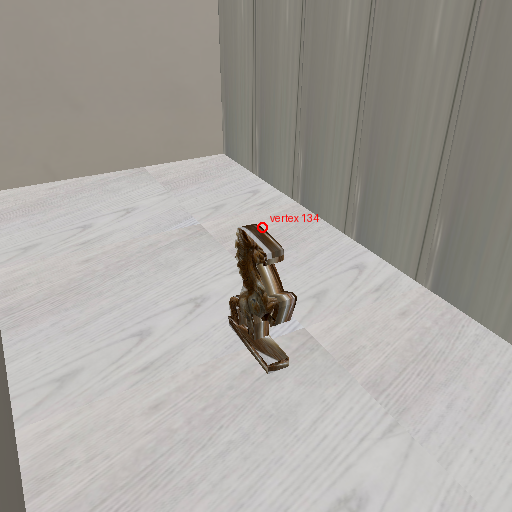
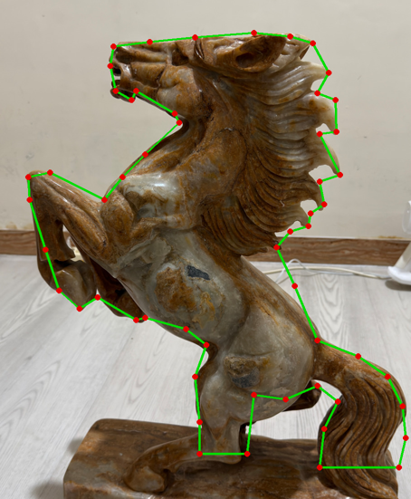
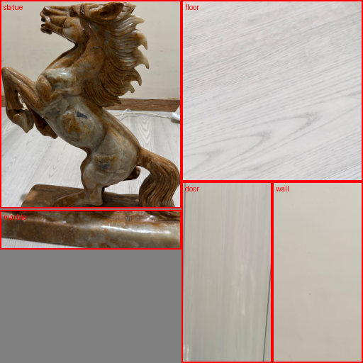

# Model saya: ruangan patung kuda

Subjek saya sejak Modul 1 adalah patung kuda berdiri milik saya sendiri. Di Modul 2 saya menelusuri denah ruangan tempat patung itu berdiri. Untuk Modul 3, ruangan itu saya jadikan model 3D low-poly, lengkap dengan patungnya.

*Render rasteriser dari `scenes/mymodel.json`, 512 × 512. Lingkaran merah adalah vertex 134 (ujung telinga patung) yang saya telusuri di catatan Fase 2.*

## Alat dan file

| File | Isi |
|---|---|
| `Source/data/mymodel_ukuran.json` | semua ukuran, garis luar patung, dan potongan foto untuk texture. Satu-satunya input yang saya tulis tangan |
| `Source/make_mymodel.py` | menyusun geometri dari file ukuran itu, lalu menulis `data/mymodel.obj` (394 segitiga, 239 titik) |
| `Source/import_texture.py` | menyusun atlas texture 512 × 512 dari foto saya, lalu menulis `data/mymodel_tex.ppm` |

Tidak memakai Blender atau Pascal Editor untuk membuat model. OBJ-nya ditulis oleh skrip saya sendiri, jadi setiap angka bisa ditelusuri balik ke file ukuran. Sebagai pemeriksa independen, file OBJ-nya saya buka di **Blender 5.2.2** (mode tanpa layar): terbaca 394 face segitiga dengan 1 layer UV, sama dengan hitungan skrip.

| Bagian | Segitiga |
|---|---|
| lantai (8 ubin 1 × 1 m) | 16 |
| dinding (kiri, belakang, kanan, tebal 0,1 m) | 24 |
| lemari (8 pintu menghadap ke dalam ruangan) | 20 |
| sekat berlubang (4 tiang + 5 rak) | 108 |
| alas patung | 10 |
| badan patung (garis luar 55 titik, diberi ketebalan) | 216 |
| **total** | **394** |

## Asal setiap angka

| Elemen | Ukuran | Asal |
|---|---|---|
| Ruangan | 2 × 4 m | ukuran saya (denah Modul 2) |
| Tinggi dinding | 3,5 m | ukuran saya |
| Lemari | dalam 0,4 m, sepanjang 4 m, 8 pintu, **sampai plafon** | ukuran saya |
| Sekat di sisi masuk | 1,5 m, **sampai plafon** | ukuran saya. Lebar jalan masuk 0,5 m dari **perbandingan** (Modul 2) |
| Susunan tiang dan rak sekat | 4 tiang, 5 rak, dalam 0,25 m | **perkiraan**. Bentuk lubangnya tidak saya ukur |
| Alas patung | 0,08 × 0,30 m | ukuran saya |
| Tinggi patung total | 0,45 m | **perkiraan dari foto** IMG_8882, dengan panjang alas 30 cm sebagai penggaris |
| Tebal alas 4 cm, tebal badan 6 cm | | **perkiraan dari foto** |
| Letak patung | pusat alas 0,8 m dari dinding kiri, 2,0 m dari sisi masuk | **perkiraan** (Modul 2) |
| Arah kepala patung | menghadap sisi masuk | **perkiraan** |

## Garis luar patung

Garis luar badan patung saya telusuri titik demi titik di atas foto IMG_8882 (sisi samping, kepala menghadap kiri), 55 titik dalam koordinat pixel foto. Saya sempat mencoba memisahkan patung dari latar secara otomatis berdasarkan saturasi warna. Hasilnya, list kayu (plint) di bawah dinding ikut terambil karena warnanya mirip patung, jadi saya kembali ke penelusuran manual.

Garis luar ini lalu diberi ketebalan 6 cm. Sisi depan dan belakangnya dipecah menjadi segitiga dengan *ear clipping*, karena bentuknya cekung. Fan triangulation di loader OBJ hanya benar untuk bentuk cembung. Sisi sampingnya adalah 55 quad.

## Texture

Satu atlas 512 × 512 berisi lima potongan foto saya sendiri dari Modul 1 (`Module1/Source/photos/small`, iPhone 17 Pro, 27 Oktober 2026). **Lisensi: foto milik saya sendiri**, tidak ada aset dari internet atau AI.

| Wilayah | Foto | Dipakai untuk |
|---|---|---|
| statue | IMG_8882, kotak patung | sisi depan dan belakang badan patung. UV-nya adalah posisi titik garis luar di foto, jadi foto patung "ditempel" tepat di bentuknya |
| marble | IMG_8882, sisi depan alas | alas patung dan sisi samping badan patung |
| floor | IMG_8907, lantai kayu | 8 ubin lantai |
| door | IMG_8905, satu pintu lemari dengan celahnya | 8 pintu lemari |
| wall | IMG_8882, dinding polos | dinding dan sekat |

Hanya JPG-nya yang di-decode dengan Pillow. Pemotongan, pengecilan, dan penyusunan atlas dikerjakan dengan NumPy. Pengecilannya memakai rata-rata luas yang tepat **di linear light**, sesuai pelajaran gamma di Modul 1. UV setiap wilayah dimundurkan 1 texel dari tepinya, supaya sampling bilinear tidak membaca wilayah tetangga.

Keterbatasan: foto lantai dan pintu diambil miring, jadi potongannya masih membawa sedikit perspektif dari foto aslinya. Model ini tidak simetris (lemari hanya di kanan, kepala kuda menghadap satu arah), jadi kalau suatu saat render-nya tercermin, kesalahan itu langsung kelihatan.
