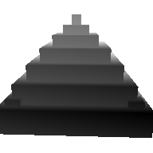
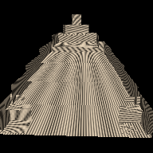
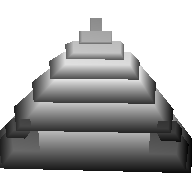
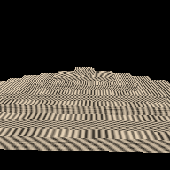
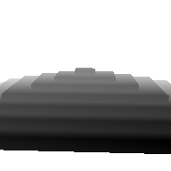

# Diagnosis tiga scene rusak (ditulis sebelum perbaikan)

Lab 2 no 2 meminta diagnosis ditulis **sebelum** melihat perbaikannya. Masalahnya, `broken_scene.py` dari dosen langsung mencetak akar masalah dan perbaikannya di layar, dan komentar kodenya juga menjelaskannya (temuan T10). Karena itu saya membuat `diagnose_scene.py` yang membangun render rusak yang sama, tapi **hanya mencetak bukti**: render, citra depth, matriks yang dipakai, histogram depth, dan selisih terhadap render normal scene yang sama. Tidak ada teks penyebab, tidak ada perbaikan, dan tidak ada render "fixed".

Perintah yang saya jalankan (dari `Module3/Source`, rasteriser masih kode asli dosen):

```
.venv/bin/python diagnose_scene.py
```

Semua angka di bawah adalah keluaran perintah itu, ukuran frame 192 × 192 seperti di `broken_scene.py`. Gambar ada di `img/`.

Perbaikan dan pembuktiannya baru dikerjakan setelah file ini saya commit.

---

## 1. inside-out

**Yang saya lihat.** Saya membandingkan tiga render dari candi dan kamera yang sama:

| Render | Gambar | Depth |
|---|---|---|
| Normal: z-buffer saja, tanpa culling. Tidak bergantung pada arah winding, jadi ini acuan kebenaran |  |  |
| A: winding dibalik + back-face culling. **Ini scene yang disebut "rusak" oleh `broken_scene.py`** |  | (sama dengan normal) |
| B: winding apa adanya dari file OBJ + back-face culling |  |  |

| | A (disebut rusak) | B (winding apa adanya) |
|---|---|---|
| SSIM terhadap normal | **1,000** | 0,790 |
| PSNR terhadap normal | **inf** (identik) | 14,3 dB |
| Pixel yang lebih **jauh** dari render normal | 0 dari 19.029 | **19.029 dari 19.029** |
| Rata-rata depth NDC | 0,5248 (normal 0,5248) | 0,6066 |

Signed volume mesh (jumlah volume tetrahedron dari titik asal ke setiap segitiga) sebesar **−2,9764** untuk winding apa adanya dan +2,9764 kalau winding dibalik.

**Diagnosis saya.**

- Scene yang diberi label rusak (A) **tidak rusak**. Gambarnya identik byte per byte dengan render tanpa culling.
- Yang benar-benar inside-out adalah B. Di setiap pixel, B menggambar permukaan yang lebih jauh dari yang seharusnya. Di gambarnya, bagian dalam candi yang terlihat: ada tangga dari sisi dalam, dan garis texture berbalik arah.
- **Penyebabnya ada di data, bukan di scene.** Signed volume negatif berarti semua face candi ber-winding searah jarum jam kalau dilihat dari luar, alias menghadap ke dalam. Padahal docstring `box()` di `make_model.py` menulis "CCW-front (outward-facing)". Rasteriser membuang segitiga yang luasnya di layar positif. Itu benar untuk konvensi kita (CCW dari luar = depan), tapi data candinya tidak mengikuti konvensi itu. Begitu culling dinyalakan pada data apa adanya, semua face depan dibuang, dan yang tersisa adalah dinding bagian dalam.
- Kenapa tidak ketahuan selama ini: render referensi, ray tracer, dan halaman WebGL (`side: DoubleSide`) semuanya **tidak memakai culling**, dan shading-nya membalik normal ke arah kamera. Winding yang salah jadi tidak terlihat sama sekali.
- Pitfall terkait di §12: drift konvensi winding / backface.

**Dugaan perbaikan, satu perubahan:** membalik urutan titik setiap face candi (di `make_model.py` atau saat dimuat). Prediksi saya: setelah itu B identik dengan render normal (PSNR inf), dan render tanpa culling tidak berubah sama sekali, karena shading tidak bergantung pada winding. Akibatnya `ref/temple_ref.ppm` juga tidak perlu dibuat ulang.

## 2. zfight

| Normal (depth float, near dan far sama) | Rusak (depth 16-bit) | Histogram depth rusak |
|---|---|---|
|  |  |  |

**Bukti dari keluaran:**

- Kamera di (0, 1, 6) menghadap (0, 1, −1). Kedua quad berada sekitar 15 m di depan kamera. Nilai **near = 0,001**, far = 200, dan depth buffer **16-bit**.
- Baris 3 matriks proyeksi: `[0, 0, −1,00001, −0,002]`.
- Depth NDC di z = −14, −15, −16 m: 0,9998671, 0,9998767, 0,9998850. Ketiganya jatuh di **kode 16-bit yang sama, 65532**.
- Histogram depth: **semua 5.704 pixel kedua quad memakai satu kode saja** (65532).
- Quad biru hanya tampak di **0 pixel**, padahal di render depth float ia tampak di 2.852 pixel. Selisih terhadap render normal juga tepat **2.852 pixel**, SSIM 0,763.

**Diagnosis saya.** Ini z-fighting karena presisi depth habis. Dengan near 0,001, NDC z = (f+n)/(n−f) · z + 2fn/(n−f) dibagi −z, kira-kira 1 − 0,002/|z|. Untuk semua benda yang lebih jauh dari beberapa meter, nilainya sudah menempel di 1. Saya hitung kemiringannya di 15 m: d(NDC)/dz = 2fn/((f−n)z²) ≈ 8,9 × 10⁻⁶ per meter. Dalam kode 16-bit (NDC × 0,5 × 65536), itu cuma **0,29 kode per meter**. Dua quad yang berjarak beberapa sentimeter pasti jatuh di kode yang sama. Uji depth memakai `<`, jadi kalau kodenya sama, segitiga yang digambar duluan yang menang. Di sini quad oranye (A) digambar duluan, makanya biru tidak pernah muncul.

Pitfall terkait di §12: near plane terlalu kecil.

**Dugaan perbaikan, satu perubahan:** naikkan near ke 1. Prediksi saya, dengan angka yang sama: d(NDC)/dz di 15 m = 2·200·1/(199·225) ≈ 0,0089 per meter, atau **sekitar 293 kode per meter (2,9 kode per sentimeter)**. Kedua quad akan terpisah di hampir seluruh permukaannya, kecuali beberapa baris pixel di sekitar garis potongnya, tempat jarak keduanya memang kurang dari sepertiga sentimeter. Jadi saya perkirakan pixel yang salah turun dari 2.852 menjadi **puluhan sampai ratusan**, bukan nol. Jujur saja, PDF dan README starter sudah menyebut angka sekitar 180 setelah perbaikan, jadi besarnya angka ini tidak saya tebak tanpa petunjuk. Yang benar-benar saya uji adalah **letak** sisa pixel salahnya: harus berupa pita tipis di sekitar garis potong, bukan tersebar. Alternatif yang tidak bergantung pada near: depth float atau reverse-Z.

## 3. stretched

| Normal | Rusak | Depth rusak |
|---|---|---|
|  |  |  |

**Bukti dari matriks yang dicetak:**

```
model matrix (scene ini)            model matrix (normal)
[[ 2.523  0.     0.803  0. ]        [[ 1.147  0.     0.803  0. ]
 [ 0.     0.7    0.     0. ]         [ 0.     1.4    0.     0. ]
 [-1.767  0.     1.147  0. ]         [-0.803  0.     1.147  0. ]
 [ 0.     0.     0.     1. ]]        [ 0.     0.     0.     1. ]]
panjang kolom: 3.08  0.70  1.40     panjang kolom: 1.40  1.40  1.40
det 3.018                           det 2.744 (= 1,4³)
```

Siluetnya 192 × 97 pixel, sedangkan yang normal 192 × 155 pixel. Candinya pendek dan melebar. SSIM 0,594, PSNR 11,5 dB.

**Diagnosis saya, dengan membaca kolom.** Kolom ke-k adalah ke mana sumbu ke-k model pergi.

- Kolom 1 panjangnya 3,08 = 1,4 × 2,2: sumbu +x model ditarik **2,2 kali** lebih panjang dari yang seharusnya.
- Kolom 2 panjangnya 0,70 = 1,4 × 0,5: sumbu +y (tinggi candi) dipendekkan **setengahnya**.
- Kolom 3 tetap 1,40.

Arah kolom 1 tetap (2,523; 0; −1,767), sejajar dengan arah kolom 1 normal (1,147; 0; −0,803), yaitu sumbu x model yang sudah diputar 35°. Jadi peregangannya terjadi **di ruang model, sebelum rotasi**: ada skala tidak seragam diag(2,2; 0,5; 1) yang menempel paling kanan dalam rantai perkalian. Det-nya juga cocok: 3,018 / 2,744 = 1,1 = 2,2 × 0,5 × 1.

**Catatan soal label.** `broken_scene.py` menyebut bug ini "urutan matriks tertukar". Dari bukti di atas, menukar urutan saja tidak bisa menghasilkan gambar ini. Skala yang ada di rantainya seragam (1,4), dan skala seragam bisa ditukar dengan rotasi tanpa mengubah hasil (temuan T9). Yang membuat gambar rusak adalah faktor skala tidak seragam tambahan. Urutan baru jadi penting kalau skala tidak seragam itu dipindah ke kiri rotasi: ia akan meregang sepanjang sumbu x **world**, bukan sumbu x model, dan bentuknya akan miring.

Pitfall terkait di §12: urutan perkalian matriks (dan pembacaan kolom untuk menemukannya).

**Dugaan perbaikan, satu perubahan:** buang faktor diag(2,2; 0,5; 1) sehingga model kembali `T · Ry(35) · S(1,4)`. Prediksi saya: render identik dengan normal (PSNR inf), karena matriksnya kembali sama persis.

---

## Ringkasan prediksi yang akan saya uji setelah commit

| Bug | Perubahan | Prediksi setelah perbaikan |
|---|---|---|
| inside-out | balik winding face candi | B identik dengan normal (PSNR inf). Render tanpa culling dan `ref/temple_ref.ppm` tidak berubah |
| zfight | near 0,001 → 1 | pixel salah turun dari 2.852 ke puluhan sampai ratusan, tersisa di sekitar garis potong kedua quad |
| stretched | buang diag(2,2; 0,5; 1) | identik dengan normal (PSNR inf) |
