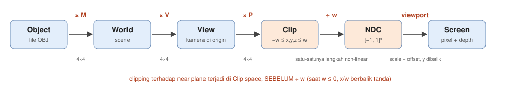
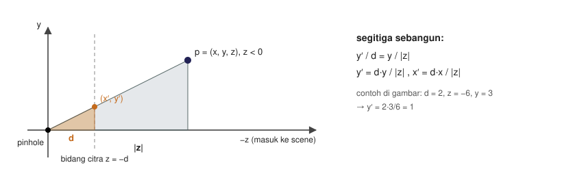
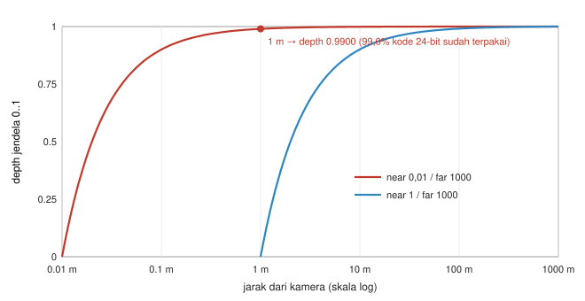
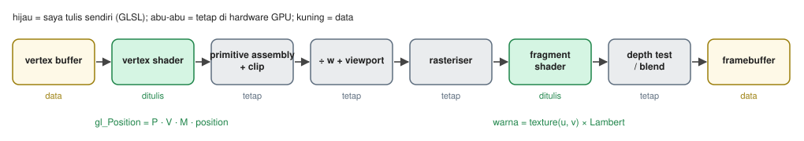

# Studi Pendahuluan Modul 3: Transformasi 3D, Proyeksi, Texture & Real-Time Rendering

Zacky Maulana (NIM 20241337034), S1 Informatika UMSurabaya
Praktikum Grafika Komputer

Semua hitungan di dokumen ini saya kerjakan dengan tangan dulu, lalu saya cek ulang dengan fungsi di `Source/transforms.py`. Perintah pengecekannya saya tulis di setiap bagian. Diagram dibuat oleh `Source/figures/make_figures.py`, dan kurva depth di Gambar 3 dihitung memakai `perspective()` yang sama dengan rasteriser, jadi gambarnya tidak mungkin berbeda dengan kodenya.

Konvensi yang saya pakai di seluruh dokumen, sama dengan bagian atas `transforms.py`: column vector, titik ditulis `p' = M p`, rantai "pertama A lalu B" ditulis `B A p` (dibaca dari kanan ke kiri), right-handed, kamera menghadap −z, NDC `[−1, 1]³` dengan near di z = −1.

---

## Q1. Koordinat homogen dan matriks 4 × 4

### Q1(a) Kenapa 3 × 3 tidak cukup

Matriks 3 × 3 adalah transformasi **linear**, dan setiap transformasi linear selalu memetakan titik nol ke titik nol: `M · (0, 0, 0) = (0, 0, 0)`. Translasi justru harus memindahkan titik nol ke tempat lain, jadi translasi tidak mungkin ditulis sebagai perkalian 3 × 3. Translasi itu *affine*, bukan linear.

Solusinya adalah menambah koordinat keempat `w`. Titik ditulis `(x, y, z, 1)`, dan matriks 4 × 4 menyimpan translasinya di kolom keempat:

```
| 1 0 0 tx |   | x |   | x + tx |
| 0 1 0 ty | · | y | = | y + ty |
| 0 0 1 tz |   | z |   | z + tz |
| 0 0 0 1  |   | 1 |   |   1    |
```

Karena `w = 1`, kolom keempat ikut dikalikan 1, sehingga ia "ditambahkan". Rotasi, skala, dan translasi sekarang semuanya berupa perkalian matriks, dan rantai berapa pun panjangnya bisa digabung menjadi satu matriks.

**`w = 0` berarti arah, bukan titik.** Dengan `w = 0`, kolom keempat dikali nol, jadi arah tidak terpengaruh translasi, hanya oleh rotasi dan skala. Ini masuk akal: arah normal permukaan atau arah cahaya matahari tidak berubah walaupun bendanya digeser. Selisih dua titik `(…, 1) − (…, 1)` juga otomatis menghasilkan `w = 0`, yaitu sebuah arah.

### Q1(b) Matriks T, S, dan R_y, dibaca per kolom

Cara membaca: **kolom ke-k adalah ke mana sumbu ke-k model pergi**, dan kolom keempat adalah ke mana titik asal model pergi.

```
T(tx,ty,tz) = | 1 0 0 tx |    S(sx,sy,sz) = | sx 0  0  0 |    R_y(θ) = |  cosθ 0 sinθ 0 |
              | 0 1 0 ty |                  | 0  sy 0  0 |             |   0   1  0   0 |
              | 0 0 1 tz |                  | 0  0  sz 0 |             | −sinθ 0 cosθ 0 |
              | 0 0 0 1  |                  | 0  0  0  1 |             |   0   0  0   1 |
```

| Matriks | Kolom 1 (sumbu +x model setelahnya) | Arti |
|---|---|---|
| T | (1, 0, 0) | +x tidak berubah arah maupun panjang. Yang berubah hanya titik asal (kolom 4 = (tx, ty, tz)) |
| S | (sx, 0, 0) | +x tetap searah, tapi panjangnya menjadi sx |
| R_y(θ) | (cos θ, 0, −sin θ) | +x diputar di bidang xz. Untuk θ = 90°, kolom 1 = (0, 0, −1): sumbu +x model sekarang menunjuk ke −z |

Untuk R_y, kolom 2 = (0, 1, 0) tidak berubah karena kita berputar mengelilingi sumbu y, dan kolom 3 = (sin θ, 0, cos θ) adalah sumbu +z lama yang ikut berputar. Aturan right-handed: θ positif memutar +z ke arah +x.

### Q1(c) Titik (2, 3, 4, 1): urutan mengubah hasil

`R_y(90°)`: cos 90° = 0, sin 90° = 1, jadi

```
R_y(90°) = |  0 0 1 0 |
           |  0 1 0 0 |
           | −1 0 0 0 |
           |  0 0 0 1 |
```

**Translasi dulu, lalu R_y** (rantai `R_y · T · p`):

1. `T p = (2+1, 3+0, 4−1, 1) = (3, 3, 3, 1)`
2. `R_y (3, 3, 3, 1) = (0·3 + 0·3 + 1·3, 3, −1·3 + 0 + 0, 1) = (3, 3, −3, 1)`

**R_y dulu, lalu translasi** (rantai `T · R_y · p`):

1. `R_y (2, 3, 4, 1) = (0·2 + 1·4, 3, −1·2 + 0·4, 1) = (4, 3, −2, 1)`
2. `+ (1, 0, −1)` → **(5, 3, −3, 1)**

Hasilnya berbeda: (3, 3, −3) dan (5, 3, −3). Perkalian matriks tidak komutatif.

Dicek dengan `transforms.py`: `rot_y(90) @ translate((1,0,-1)) @ p` = `[3. 3. -3. 1.]` dan `translate((1,0,-1)) @ rot_y(90) @ p` = `[5. 3. -3. 1.]`.

Catatan: di kotak ✓ Contoh E1, PDF menulis urutan sebaliknya menghasilkan (4, 3, −4). Ternyata PDF menerapkan R_y pada (3, 3, 3), titik yang **sudah** ditranslasi, bukan pada titik asli (2, 3, 4). Kalau dihitung dari titik asli, hasilnya (5, 3, −3), sama dengan yang diuji `tests.py` starter.

---

## Q2. Kamera dan proyeksi



*Gambar 1. Enam coordinate space. Tiga langkah pertama adalah perkalian 4 × 4, pembagian dengan w adalah satu-satunya langkah non-linear, dan viewport adalah scale + offset seperti di Modul 2.*

### Q2(a) View matrix adalah invers pose kamera

Kamera punya pose seperti benda lain: posisi `c` dan orientasi `R_c`, jadi `pose = T(c) · R_c`. Matriks ini membawa titik dari **ruang kamera ke world**. Untuk merender, saya butuh arah sebaliknya, dari **world ke ruang kamera** (kamera di titik asal, menghadap −z). Karena itu:

```
V = pose⁻¹ = R_c⁻¹ · T(c)⁻¹ = R_cᵀ · T(−c)
```

Urutannya ikut terbalik: batalkan dulu translasinya (geser world sejauh −c), baru batalkan rotasinya. Invers rotasi cukup ditranspose karena matriks rotasi orthonormal (`R_cᵀ R_c = I`). Ini murah dan eksak, tidak perlu invers umum.

**Dualitas, angka Contoh E2.** Titik world `p = (5, 0, 0)`.

- Kamera digeser +1 di x tanpa rotasi: `c = (1, 0, 0)`, `R_c = I`, jadi `V = T(−1, 0, 0)` dan `V p = (4, 0, 0, 1)`.
- Kamera diam, model digeser −1 di x: `M = T(−1, 0, 0)` dan `M p = (4, 0, 0, 1)`.

Hasilnya identik. Menggeser kamera sejauh +d sama dengan menggeser seluruh world sejauh −d. Dicek dengan `look_at((1,0,0), (1,0,-1)) @ p` dan `translate((-1,0,0)) @ p`, keduanya `[4. 0. 0. 1.]`. Inilah alasan OrbitControls hanya perlu menggerakkan kamera.

### Q2(b) Perspektif dari segitiga sebangun



*Gambar 2. Pinhole di titik asal, bidang citra di z = −d. Segitiga oranye (pinhole, d, y′) sebangun dengan segitiga abu-abu (pinhole, |z|, y).*

Titik `p = (x, y, z)` di depan kamera punya z < 0. Sinar dari p ke pinhole memotong bidang citra di `(x′, y′)`. Kedua segitiga punya sudut yang sama di pinhole, jadi perbandingan sisinya sama:

```
y′ / d = y / |z|   →   y′ = d·y / |z|      dan dengan cara yang sama   x′ = d·x / |z|
```

PDF menulis `(dx/z, dy/z)`. Itu benar kalau z diartikan sebagai **jarak** ke depan, yang selalu positif. Di konvensi kita, titik di depan kamera justru punya z negatif, jadi `dx/z` akan membalik tanda gambar. Yang benar untuk kita adalah `dx/|z| = dx/(−z)`, dan itulah alasan matriks proyeksi membuat `w = −z`, bukan `w = z`.

Contoh E1: titik (3, 3, −3) dengan d = 2 menjadi (2·3/3, 2·3/3) = (2, 2). Dicek dengan `perspective_divide_2d((3,3,-3), 2)` = `[2. 2.]`.

### Q2(c) Matriks proyeksi dan baris keempatnya

Dengan `f = 1 / tan(fovy/2)`:

```
P = | f/aspect  0      0               0          |
    |   0       f      0               0          |
    |   0       0   (far+n)/(n−far)  2·far·n/(n−far) |
    |   0       0     −1               0          |
```

- **Baris 4** menghasilkan `w_clip = −z`. Setelah GPU membagi semuanya dengan w, baris 1 dan 2 menjadi `f·x/(−z·aspect)` dan `f·y/(−z)`, persis hasil segitiga sebangun dengan d = f.
- **Baris 3** dipilih supaya setelah pembagian yang sama, near plane (z = −n) jatuh di NDC z = −1 dan far plane (z = −far) jatuh di +1.

Contoh E3 (n = 1, far = 9). Koefisien baris 3: A = 10/(−8) = −1,25, B = 18/(−8) = −2,25.

| eye z | clip z = A·z + B | w = −z | NDC z |
|---|---|---|---|
| −1 (near) | 1,25 − 2,25 = −1 | 1 | **−1** |
| −9 (far) | 11,25 − 2,25 = 9 | 9 | **+1** |
| −3 | 3,75 − 2,25 = 1,5 | 3 | **0,5** |

Titik di z = −3 baru sepertiga jalan menuju far, tapi NDC-nya sudah 0,5. Ini awal masalah presisi depth di Q3(b). Dicek dengan `perspective(60, 1, 1, 9)`: −1,0; 1,0; 0,5.

### Q2(d) Kenapa clipping harus sebelum pembagian w

Untuk vertex di belakang kamera, `w = −z` bernilai nol atau negatif. Kalau `w` mendekati 0, `x/w` meledak ke tak hingga. Kalau `w` sudah negatif, tandanya berbalik, sehingga titik di belakang kamera muncul di sisi layar yang berlawanan. Segitiga yang satu vertex-nya di depan dan satu lagi di belakang kamera akan tercoreng di seluruh layar.

Di clip space, sebelum pembagian, semuanya masih linear. Garis antara dua vertex tetap garis lurus, sehingga titik potong dengan near plane (`z + w = 0`) bisa dihitung dengan interpolasi linear biasa. Rasteriser saya memotong setiap segitiga terhadap bidang itu (Sutherland–Hodgman), baru setelah itu membagi dengan w. Di model ruangan saya, 71 dari 394 segitiga benar-benar memotong near plane, jadi langkah ini bukan sekadar teori.

---

## Q3. Depth, texture, dan sampling

### Q3(a) Z-buffer dalam empat baris

```
1. isi depth[y, x] = +∞ untuk semua pixel
2. untuk setiap fragment (x, y) dengan depth z hasil interpolasi:
3.     kalau z < depth[y, x]: simpan z dan tulis warna fragment
4.     kalau tidak: buang (sudah ada yang lebih dekat di pixel ini)
```

**Kenapa NDC z yang disimpan, bukan eye z.** NDC z berbentuk `A + B/w`, yaitu fungsi linear dari `1/w`. Nilai `1/w` berubah **linear di screen space**, jadi NDC z bisa diinterpolasi dengan bobot barycentric layar biasa tanpa koreksi perspektif. Eye z tidak linear di layar, sehingga perlu dibagi per pixel. NDC z juga sudah dipetakan ke rentang tetap `[−1, 1]` (lalu `[0, 1]` di jendela), cocok untuk disimpan sebagai bilangan bulat, dan tetap monoton terhadap jarak, sehingga perbandingannya tetap benar. Contoh E5: depth 0,20; 0,50; 0,90 dengan bobot (0,25; 0,25; 0,5) menghasilkan 0,05 + 0,125 + 0,45 = **0,625**.

### Q3(b) Presisi depth dengan near 0,01 dan far 1000



*Gambar 3. Depth jendela `(NDC z + 1)/2` terhadap jarak, dihitung dengan `perspective()`. Dengan near 0,01 (merah), kurvanya sudah hampir 1 sebelum 1 meter.*

Untuk near n dan far f, depth jendela kira-kira `d(z) = (f/(f−n)) · (1 − n/z)`. Di z = 1 m: `d ≈ 1,00001 × (1 − 0,01) = 0,9900`. Dengan buffer 24-bit (16.777.216 kode), rentang 0,01 m sampai 1 m memakai sekitar 0,990 × 16.777.216 kode.

Hasil hitungan tepat dengan `perspective()`: depth di 1 m = 0,990010, dan rentang 0,01 sampai 1 m memakai **16.609.610 dari 16.777.216 kode, yaitu 99,0%**. Sisa 1% kode harus dibagi untuk semua jarak dari 1 m sampai 1000 m.

**Reverse-Z** mengubah dua hal:

1. pemetaannya dibalik, near menjadi 1 dan far menjadi 0, sehingga uji depth juga dibalik (`>` menggantikan `<`);
2. buffer-nya memakai **float**, bukan bilangan bulat.

Float punya banyak sekali nilai di dekat 0 (presisinya relatif terhadap besar angkanya). Dengan pemetaan terbalik, benda **jauh** justru jatuh di dekat 0, tempat float paling rapat. Kerapatan float di dekat 0 kira-kira membatalkan kerapatan 1/z di dekat near. Hitungan saya dengan float32: rentang 1 m sampai 1000 m dengan reverse-Z mendapat sekitar **1,01 miliar** nilai float berbeda, sedangkan dengan pemetaan biasa dan bilangan bulat 24-bit hanya sekitar 168 ribu kode.

### Q3(c) Kenapa UV tidak boleh diinterpolasi linear di layar

Proyeksi membagi dengan w, jadi titik-titik yang berjarak sama di permukaan 3D tidak lagi berjarak sama di layar. Bagian yang jauh dimampatkan. Kalau u diinterpolasi linear di layar, texture-nya diregangkan rata di sepanjang layar dan tampak "berenang" saat kamera bergerak (tampilan khas PlayStation 1).

Besaran yang memang linear di layar adalah `u/w`, `v/w`, dan `1/w`. Ketiganya diinterpolasi linear, lalu per pixel dihitung `u = (u/w) / (1/w)`.

Contoh E4: tepi lantai dari L (x = 0, u = 0, w = 1) ke R (x = 100, u = 1, w = 9). Di x = 50:

- naif: u = 0,5;
- `u/w` di tengah = (0 + 1/9)/2 = 1/18, `1/w` di tengah = (1 + 1/9)/2 = 5/9, jadi u = (1/18)/(5/9) = **0,1**.

Tengah layar baru mencapai 10% texture, karena separuh layar bagian jauh harus memuat 90% sisanya.

### Q3(d) Mipmap sebagai batas Nyquist untuk texture

Di Modul 1 saya belajar bahwa sinyal hanya aman di-sampling kalau frekuensi tertingginya di bawah setengah laju sampling (0,5 siklus per pixel). Texture yang dilihat dari jauh melanggar ini: satu pixel layar menutupi banyak texel, tapi sampler hanya mengambil satu atau empat texel di sekitar titik pusatnya. Detail halus texture "terlipat" menjadi pola palsu.

Mipmap adalah piramida salinan texture: 256², 128², 64², dan seterusnya. Setiap level dibuat dengan rata-rata kotak 2 × 2 **di linear light** (pelajaran gamma Modul 1), jadi sudah difilter sebelum diperkecil. Renderer memilih level tempat satu texel kira-kira sama dengan satu pixel, sehingga tidak pernah undersampling. Trilinear mencampur dua level terdekat supaya perpindahan level tidak terlihat. Filter anisotropic menangani permukaan yang dilihat sangat miring, misalnya lantai.

Tanpa mipmap muncul **kelap-kelip** (texel yang terambil berganti-ganti saat kamera bergerak sedikit) dan **pola Moiré** pada texture bergaris, contohnya garis-garis batu pasir di `relief.ppm`.

---

## Q4. Insiden nyata: presisi depth dan handedness

### Q4(a) Presisi depth (Reed 2015, Outerra 2012)

**Nathan Reed, "Depth Precision Visualized", 3 Juli 2015.** Reed menunjukkan bahwa depth buffer menyimpan nilai yang sebanding dengan 1/z, bukan dengan jaraknya. Kurva 1/z menumpuk hampir semua nilai di dekat near plane, dan semakin kecil near-nya, semakin timpang kurvanya. Ia juga menguji dengan simulasi: buffer float biasa tidak banyak menolong kalau pemetaannya tetap near → 0, karena nilai float yang rapat juga menumpuk di dekat near, tempat yang sudah kelebihan presisi. Kesimpulannya, **reverse-Z** (near → 1, far → 0) **ditambah buffer float** adalah kombinasi yang menolong, dan di simulasinya kombinasi ini tidak menghasilkan kesalahan urutan depth sama sekali. Ada catatan penting untuk OpenGL: karena NDC z-nya `[−1, 1]`, reverse-Z baru berguna kalau rentangnya diubah ke `[0, 1]` lewat `ARB_clip_control`.

**Outerra, "Maximizing Depth Buffer Range and Precision", 28 November 2012.** Outerra merender planet dari jarak dekat sampai sangat jauh, dan menurut mereka setengah resolusi depth biasa terbuang di antara near dan dua kali jarak near. Mereka membandingkan **depth float terbalik** dengan **depth logaritmik**. Klaimnya, float 32-bit terbalik sedikit lebih baik daripada logaritmik 24-bit, tapi waktu itu tidak semua GPU mendukungnya di OpenGL.

**Dengan kata-kata saya sendiri:** pembagian dengan w membuat depth berjalan sebagai 1/z. Perubahan 1 cm di dekat kamera menggeser depth jauh lebih banyak daripada perubahan 1 m di kejauhan, sehingga hampir semua kode habis untuk meter pertama. Reverse-Z menolong dengan dua perubahan: (1) membalik pemetaannya sehingga benda jauh jatuh di dekat 0, dan (2) memakai float, yang justru paling rapat di dekat 0. Ketimpangan 1/z dan ketimpangan float saling membatalkan.

### Q4(b) Empat konvensi yang harus dipatok

| Konvensi | OpenGL (dan proyek saya) | Direct3D |
|---|---|---|
| Handedness | right-handed, kamera menghadap −z | left-handed, kamera menghadap +z |
| Urutan dan mayor matriks | column vector, `P·V·M·p` (kanan ke kiri), disimpan column-major | row vector, `p·M·V·P` (kiri ke kanan), DirectXMath disimpan row-major |
| Rentang NDC z | `[−1, 1]` (near −1), jendela `[0, 1]` lewat glDepthRange | `[0, 1]` langsung (clip volume `0 ≤ z ≤ w`) |
| Origin UV / texture | (0, 0) di kiri bawah | (0, 0) di kiri atas |

Sumber: dokumen Microsoft "Coordinate Systems (Direct3D 9)" menyebut Direct3D left-handed. "Viewports and Clipping (Direct3D 9)" menulis clip volume `0 ≤ zc ≤ wc`. "Coordinate Systems (Direct3D 10)" menyebut origin texel di pojok kiri atas. Bab "Coordinate Systems" di learnopengl.com menulis "By convention, OpenGL is a right-handed system", NDC dari −1 sampai 1, dan baris vertex shader `projection * view * model * vec4(aPos, 1.0)`.

**Catatan port yang hasilnya terbalik.** Dokumen Microsoft yang sama memberi langkah port dari right-handed ke Direct3D: (1) urutan vertex segitiga dibalik dari v0, v1, v2 menjadi v0, v2, v1, dan (2) world di-scale −1 pada sumbu z lewat view matrix. Kalau hanya salah satu yang dikerjakan, scene tercermin (teks terbaca terbalik) atau semua face depan terbuang oleh culling. Itu persis gejala di Studi Kasus. Dokumen yang sama juga menulis bahwa handedness bisa diperiksa dari **tanda determinan** basisnya: positif berarti right-handed, negatif berarti left-handed. Ide ini yang saya pakai di Q4(c).

### Q4(c) Konten uji yang mengungkap masing-masing bug

- **Presisi depth:** dua quad besar yang hampir coplanar, jauh dari kamera (misalnya 15 m), dengan warna berbeda. Scene uji biasa yang bendanya dekat kamera tidak menunjukkan masalah, karena di dekat kamera presisinya melimpah. Scene `zfight` di `broken_scene.py` persis seperti ini.
- **Handedness dan cermin:** model yang **tidak simetris** dan diberi **tulisan**. Kubus atau candi simetris tetap terlihat benar walaupun dunianya tercermin. Model saya punya keduanya: patung kuda dengan kepala menghadap satu arah dan texture foto patung yang tidak simetris, ditambah lemari yang hanya ada di satu sisi ruangan. Kalau tercermin, lemari pindah ke kiri dan kepala kuda berbalik arah.
- **Winding / culling:** nyalakan back-face culling pada render referensi. Selama culling mati, winding yang salah tidak kelihatan sama sekali. Saat menyiapkan Modul 3 saya justru menemukan bahwa model candi starter seluruhnya ber-winding ke dalam (catatan Fase 4).

**Satu perubahan pada Studi Kasus yang menangkap pembalikan handedness otomatis:** tambah test yang (1) memeriksa `det(M[:3,:3]) > 0` untuk matriks model scene, karena determinan negatif berarti ada cermin, dan (2) menghitung **signed volume** mesh tertutup (jumlah `p0 · (p1 × p2) / 6` per segitiga), yang harus positif kalau semua face CCW dari luar. Keduanya angka saja dan tidak butuh mata. Test ini saya tambahkan ke `tests.py` di Fase 3.

### Q4(d) Tanggal dan sumber

| Sumber | Tanggal | Isi yang saya pakai |
|---|---|---|
| Nathan Reed, "Depth Precision Visualized", reedbeta.com (juga dimuat di blog developer NVIDIA) | 3 Juli 2015 | 1/z, near plane, reverse-Z + float |
| Outerra, "Maximizing Depth Buffer Range and Precision", outerra.blogspot.com | 28 November 2012 | float terbalik vs logaritmik |
| Microsoft Learn, "Coordinate Systems (Direct3D 9)" | ms.date 31 Mei 2018 | left-handed, langkah port, determinan |
| Microsoft Learn, "Viewports and Clipping (Direct3D 9)" | ms.date 31 Mei 2018 | clip volume `0 ≤ z ≤ w` |
| Microsoft Learn, "Coordinate Systems (Direct3D 10)" | ms.date 31 Mei 2018 | origin texel kiri atas, pusat pixel +0,5 |
| learnopengl.com, "Coordinate Systems" | dibaca 29 Oktober 2026 | right-handed, NDC [−1, 1], `projection * view * model` |

---

## Q5. Real-time: alur data satu draw call WebGL



*Gambar 4. Hijau adalah bagian yang saya tulis sendiri (shader), abu-abu adalah tahap tetap di GPU, kuning adalah data.*

1. **Vertex buffer (data).** Posisi, UV, dan normal disalin sekali ke memori GPU.
2. **Vertex shader (saya tulis).** Untuk setiap vertex: `gl_Position = P · V · M · position`. UV diteruskan sebagai varying. Di Three.js, shader ini dibuat otomatis dari material, tapi isinya tetap perkalian MVP yang sama.
3. **Primitive assembly + clipping (tetap).** Tiga vertex menjadi segitiga, lalu dipotong terhadap volume `−w ≤ x, y, z ≤ w`.
4. **Pembagian w + viewport (tetap).** Clip → NDC → pixel.
5. **Rasteriser (tetap).** Menentukan pixel yang tertutup segitiga (edge function + aturan tepi, Modul 2), lalu menginterpolasi varying secara perspective-correct.
6. **Fragment shader (saya tulis).** Mengambil texture di (u, v) dan menghitung Lambert.
7. **Depth test / blend (tetap, bisa diatur).** Uji z-buffer, lalu blending.
8. **Framebuffer (data).** Hasilnya ditampilkan atau dibaca kembali (`readPixels` untuk tombol Export PPM).

Yang saya bangun sendiri dengan NumPy di modul ini justru tahap-tahap abu-abu: clipping, pembagian w, viewport, rasterisation, interpolasi perspective-correct, dan z-buffer. Di GPU, semua tahap itu dikerjakan hardware.

---

## Daftar pustaka

1. Marschner, S. & Shirley, P. *Fundamentals of Computer Graphics*, edisi 5. CRC Press, 2021. Bab 7 (Transformation Matrices), Bab 8 (Viewing), Bab 9 (The Graphics Pipeline), dan bab Texture Mapping.
2. Hughes, J. F., van Dam, A., McGuire, M., Sklar, D. F., Foley, J. D., Feiner, S. K. & Akeley, K. *Computer Graphics: Principles and Practice*, edisi 3. Addison-Wesley, 2014. Bab 6–7 dan Bab 11, sesuai yang ditunjuk modul.
3. Reed, N. "Depth Precision Visualized." 3 Juli 2015.
4. Outerra. "Maximizing Depth Buffer Range and Precision." 28 November 2012.
5. Microsoft. "Coordinate Systems (Direct3D 9)", "Viewports and Clipping (Direct3D 9)", "Coordinate Systems (Direct3D 10)." Microsoft Learn.
6. de Vries, J. "Coordinate Systems." learnopengl.com.
7. Modul 3 Praktikum Grafika Komputer: Transformasi 3D, Proyeksi, Texture & Real-Time Rendering.

Catatan soal nomor bab: modul menyebut Marschner & Shirley "Bab 6–8 dan Bab 11". Daftar isi edisi 5 yang bisa saya temukan menunjukkan Bab 6 *Linear Algebra*, Bab 7 *Transformation Matrices*, Bab 8 *Viewing*, dan Bab 9 *The Graphics Pipeline*. Daftar isi lengkap yang memuat nomor bab *Texture Mapping* belum saya temukan, jadi nomornya tidak saya tulis. Untuk Hughes dkk. saya memakai nomor bab dari modul, karena daftar isinya belum bisa saya periksa sendiri. Jawaban saya di atas bersumber dari materi modul dan dari sumber online yang tercantum, yang semuanya saya baca langsung.
