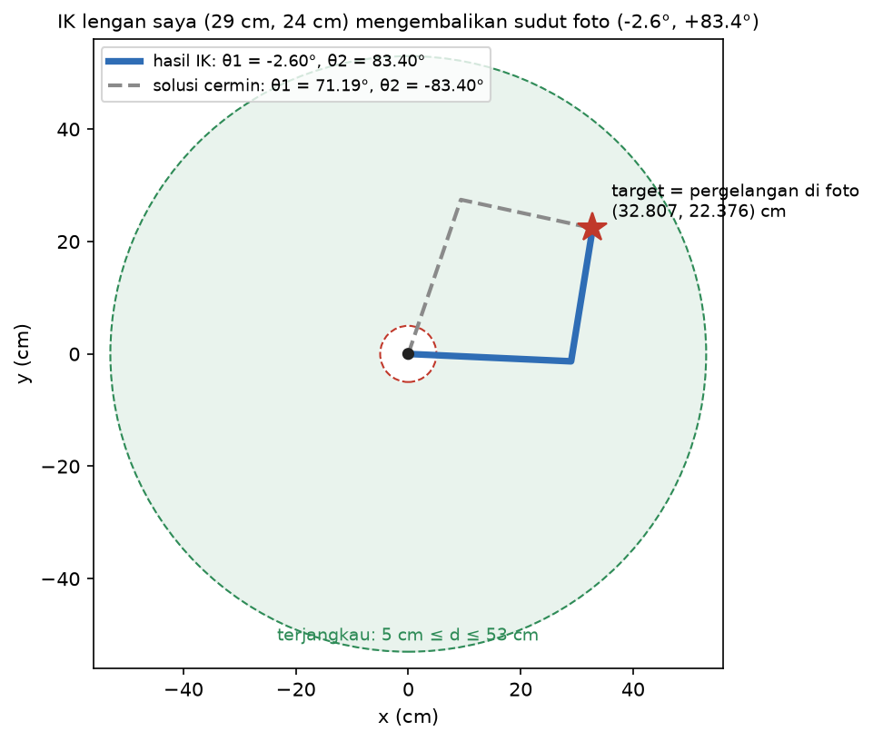
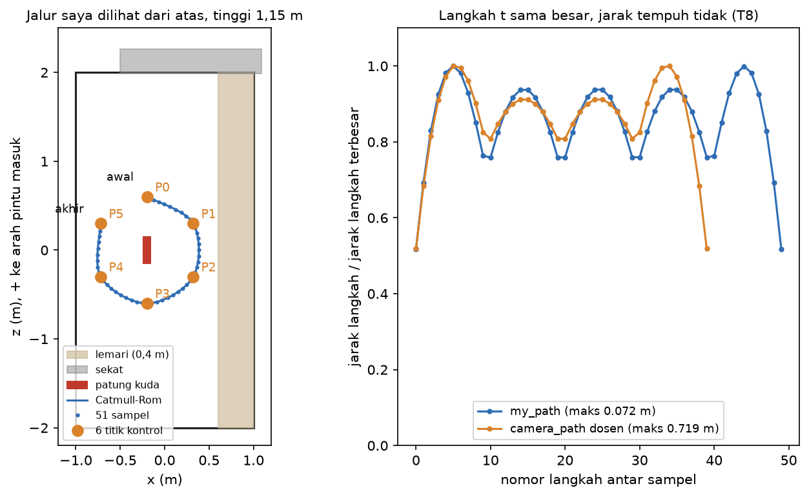
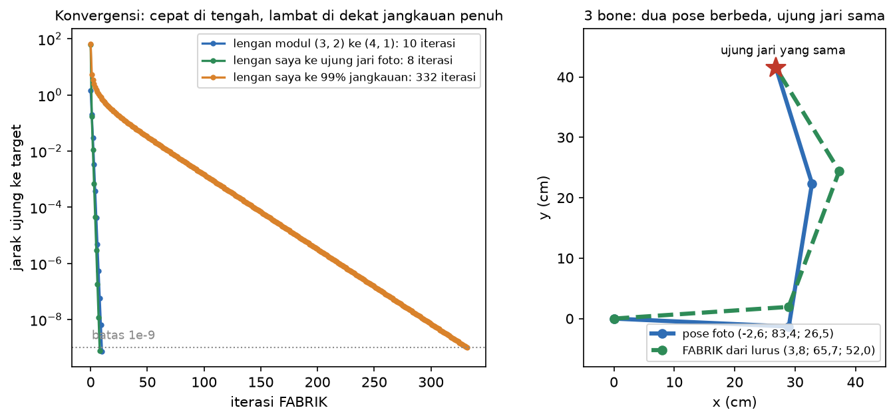
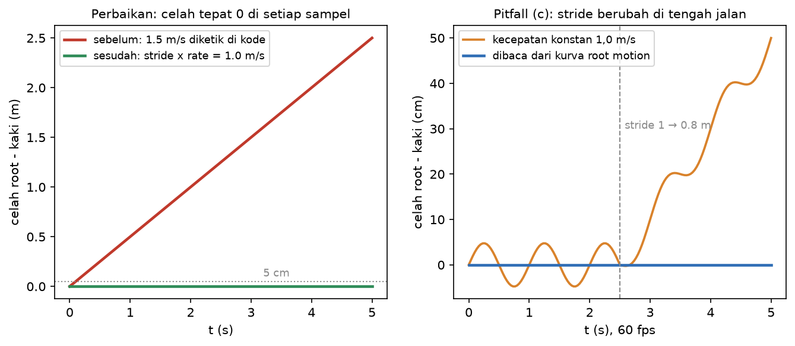
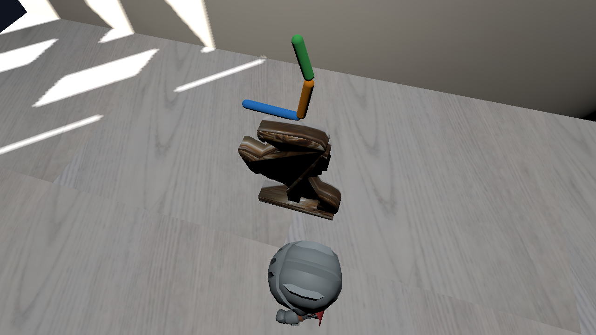
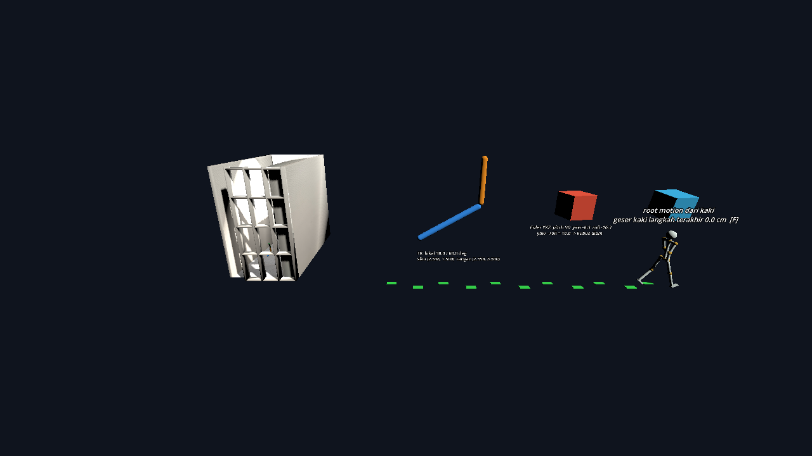

# Modul 4: Animasi, Kinematika & Game Engine

Zacky Maulana (NIM 20241337034), Praktikum Grafika Komputer, S1 Informatika UMSurabaya.

Subjek: patung kuda milik saya (sama dengan Modul 1 sampai 3). Bangunannya adalah **ruangan tempat patung itu berdiri**, model 3D dari Modul 3 yang dipakai apa adanya. Rantai kinematiknya **lengan saya sendiri**: lengan atas 29 cm, lengan bawah 24 cm, pergelangan sampai ujung jari tengah 20 cm, dengan sudut satu pose dibaca dari foto samping. Karakter ter-rig: **KayKit Knight** karya Kay Lousberg (CC0), ditambah rig lengan saya sendiri sebagai `Skeleton3D`. Engine: **Godot 4.7.2 stable**, renderer Compatibility.

Build Web: **https://zackymaulana912.github.io/grafkom-pixel-to-reality/Module4/build/web/** (sudah aktif dan diuji, lihat [catatan Fase 6](docs/catatan/fase6-reproduksi.md))

## Cara menjalankan

```bash
cd Module4/Source
python3 -m venv .venv && source .venv/bin/activate
pip install -r requirements.txt
python tests.py            # ALL CHECKS PASSED (171 ok)
```

Lalu buka `Module4/Source/godot_project/project.godot` di Godot 4.7.2 dan tekan Play. Tombolnya: **C** mengganti kamera spline dan kamera overview, **Space** dan **U** untuk lengan FK/IK, **F** untuk walker (root motion atau perilaku starter). Perintah lainnya ada di [Source/README.md](Source/README.md).

## Hasil utama

### Rantai saya: FK dengan tangan vs program

| Sendi | Hitungan tangan (cm) | `fk.py` (cm) |
|---|---|---|
| siku | (28,970; -1,316) | (28.970, -1.316) |
| pergelangan | (32,807; 22,376) | (32.807, 22.376) |
| ujung jari tengah | (26,860; 41,471) | (26.860, 41.471) |

Sudut lokal -2,6°, 83,4°, dan 26,5° dibaca dari titik pixel foto IMG_9035 (ketelitian sekitar ±4°). Foto yang masuk repo hanya potongan lengan tanpa wajah dan tanpa EXIF.


### IK lalu FK

| Target | θ1 | θ2 | Error FK |
|---|---|---|---|
| (4, 1), lengan modul 3 dan 2 | -13,18° | 70,53° | 4,4e-16 |
| pergelangan saya (32,807; 22,376) cm, lengan 29 dan 24 cm | -2,60° | 83,40° | 7,1e-15 cm |
| 20.000 target acak, termasuk yang mepet batas jangkauan | | | maks 1,4e-12 |

IK lengan saya mengembalikan tepat sudut dari foto. Target di luar `|l1 - l2| ≤ d ≤ l1 + l2` melempar `UnreachableTarget`, tidak di-clamp diam-diam.



### Jalur kamera spline

Enam titik kontrol mengelilingi patung (jari-jari 0,6 m, tinggi 1,15 m), dengan jarak minimal 0,215 m ke dinding dan lemari. Versi terbuka menjadi 51 sampel. Versi tertutup (31 Oktober) menjadi 60 sampel, dengan tangen yang sama persis di keenam sambungan termasuk P5 ke P0, sehingga kamera di Godot memutari patung penuh tanpa bolak-balik. Langkah t yang sama besar ternyata tidak berarti jarak tempuh yang sama: 3,7 sampai 7,2 cm di jalur terbuka, dan 5,4 sampai 6,7 cm di jalur tertutup.



### IK iteratif (Extension Lab, 31 Oktober)

FABRIK (`fabrik.py`) untuk rantai sepanjang apa pun. Untuk lengan modul ke (4, 1), hasilnya sama dengan IK analitik sampai 2e-8° dalam 10 iterasi. Ujung jari lengan 3-bone saya bisa dicapai dengan beberapa pose berbeda, tergantung pose awalnya. Di 10.000 target acak, median iterasinya 13, tapi di dekat jangkauan penuh jauh lebih lambat (332 iterasi di 99%). Versi saya belum punya batas sendi. Detailnya ada di [catatan Extension Lab](docs/catatan/ekstensi-fabrik.md).



### Gimbal lock

| Urutan | Sumbu yang terkunci | Selisih matriks di sudut terkunci | Selisih matriks di yaw 90° |
|---|---|---|---|
| Rz Ry Rx (`quaternion.py`) | yaw | 1,1e-16 | (yaw adalah sumbu yang terkunci) |
| Rx Rz Ry (urutan alternatif saya) | roll | 1,1e-16 | 0,174, tidak terkunci |
| Godot bawaan, intrinsic YXZ (`Basis` dari Godot) | pitch | 4,4e-8 | 0,174, tidak terkunci |

Demo gimbal lock dari starter mematok yaw 90° di Godot dan ternyata tidak terkunci (T4). Sekarang demo itu mematok pitch 90°, dan kubusnya diam total walaupun angka yaw dan roll terus berubah.

### Foot-sliding



- Python: celah setelah 5 detik **2,50 m** sebelum perbaikan, dan **tepat 0,0** di setiap sampel sesudah kecepatan dihitung dari `stride_per_cycle × cycle_rate`. Diagnosisnya di-commit lebih dulu ([docs/prediksi](docs/prediksi/diagnosis-foot-slide.md)).
- Pitfall (c): kecepatan dibaca dari kurva animasi. Saat langkah berubah dari 1,0 ke 0,8 m, celahnya tetap 1,2e-14 m, sedangkan kecepatan tetap tergelincir 50 cm.
- Godot (T11): walker starter terseret **31,5 cm per langkah** di kecepatan yang dianggap benar. Dengan root motion dari kaki yang menapak, gesernya **2,4e-7 m**. Knight memakai cara yang sama dan gesernya 6e-8 m.

### Scene Godot

| Kamera spline di ruangan | Kamera overview |
|---|---|
|  |  |

Angka Godot dibandingkan otomatis dengan Python oleh `godot_check.py`: FK/IK lengan 3e-13, kurva kamera 3e-16, rig lengan saya 5e-8 m, dan `Basis` gimbal 7,6e-8. Di console browser pun hasilnya sama.

**Keputusan Euler vs quaternion pada bahu rig saya.** Prediksinya ditulis sebelum diukur ([docs/prediksi](docs/prediksi/prediksi-euler-rig.md)). Hasil ukurnya:
- di pitch 90° lengan terkunci mendatar (y = 6e-8), sedangkan quaternion bisa mengangkatnya 0,174;
- blend Euler di t = 0,5 mencapai 62,80°, sedangkan slerp 60,00°.

Satu prediksi meleset: Euler tidak melambat di akhir. Euler bergerak rata, tapi jalurnya 6% lebih panjang (127,3° vs 120°). Pilihan saya untuk sendi bebas: **quaternion**.

## Dokumen

- Laporan: [docs/laporan/laporan-modul4.md](docs/laporan/laporan-modul4.md)
- Studi Pendahuluan: [docs/studi-pendahuluan/studi-pendahuluan.md](docs/studi-pendahuluan/studi-pendahuluan.md)
- Prediksi dan diagnosis (ditulis sebelum hasil): [docs/prediksi](docs/prediksi)
- Catatan per fase dan persiapan viva: [docs/catatan](docs/catatan)
- Sumber dan lisensi aset: [Source/godot_project/assets/LICENSE.md](Source/godot_project/assets/LICENSE.md)
- Detail teknis dan baris Verified: [Source/README.md](Source/README.md)
