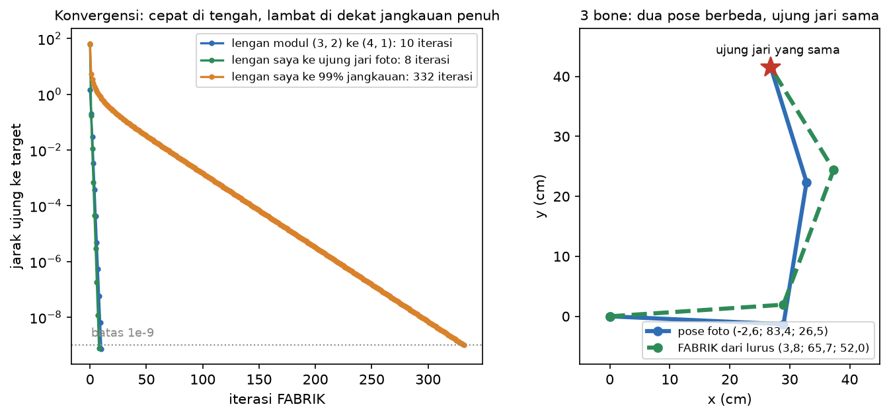

# Extension Lab: FABRIK, IK iteratif untuk rantai lebih dari dua bone

Modul menawarkan Extension Lab (tidak dinilai): "Baca cara kerja sebuah solver IK iteratif untuk sebuah rantai > 2 bone; implementasikan sebuah versi minimal dan bandingkan konvergensinya dengan kasus 2-bone analitik." Saya mengerjakannya karena berkaitan langsung dengan pertanyaan viva "apa yang berubah kalau rantai ini punya lima bone?" dan dengan keterbatasan pertama di laporan saya. Dikerjakan 31 Oktober 2026.

## Cara kerja

`Source/fabrik.py` (standard library saja, ikut dicek `test_stdlib_only`) bekerja dengan **posisi sendi**, bukan sudut. Satu iterasi terdiri dari dua langkah:

1. **Mundur:** ujung rantai diletakkan tepat di target. Lalu dari ujung ke pangkal, setiap sendi ditarik ke arah sendi berikutnya sampai jaraknya kembali sama dengan panjang tulangnya.
2. **Maju:** pangkal dikembalikan ke bahu. Lalu dari pangkal ke ujung dilakukan hal yang sama.

Kedua langkah diulang sampai jarak ujung ke target di bawah 1e-9. Setelah itu sudut lokal dibaca dari posisi sendi dengan `atan2`, dengan konvensi yang sama seperti `fk.py`, sehingga hasilnya bisa langsung dicek ulang lewat FK. Target yang lebih jauh dari panjang total rantai **tidak dipaksa diam-diam**: rantai diluruskan ke arah target dan hasilnya ditandai `reached = False`, sama prinsipnya dengan `UnreachableTarget` di `ik.py`.

Nama dan gagasan FABRIK saya ambil dari dokumentasi Godot 4.7 `SkeletonIK3D` ("uses FabrikInverseKinematic internally"). Makalah aslinya belum saya baca. Implementasi di atas saya tulis dari penjelasan dua langkah tersebut.

## Hasil

```
$ .venv/bin/python fabrik.py
modul arm (3, 2) -> (4, 1), start straight: theta -13.1787 / 70.5288 deg, 10 iterations, error 7.24e-10
  analytic solutions: (-13.1787, 70.5288) and (41.2512, -70.5288)
my arm -> fingertip (26.860, 41.471) cm from straight: 3.83, 65.72, 51.99 deg, 8 iterations, FK error 7.61e-10 cm
my arm -> fingertip (26.860, 41.471) cm from photo pose: -2.60, 83.40, 26.50 deg, 0 iterations, FK error 3.55e-15 cm
my arm -> fingertip (26.860, 41.471) cm from elbow bent the other way: -2.45, 82.88, 27.34 deg, 6 iterations, FK error 7.72e-11 cm
my arm -> (80, 0) cm, beyond 73 cm reach: reached=False, stretched at 0.0 deg, short by 7.0 cm
```



### Dibanding IK analitik (2 bone)

Untuk lengan modul (3 dan 2) ke target (4, 1), FABRIK yang dimulai dari lengan lurus mendarat di solusi analitik θ2 ≥ 0: θ1 = -13,178679° dan θ2 = 70,528779°, berselisih 1,5e-8° dan 2,2e-8° dari `ik.py`, setelah **10 iterasi**. IK analitik hanya butuh satu kali hitung, dengan error 4,4e-16. Errornya turun sekitar 9 kali setiap iterasi (rasio 0,111 setelah iterasi ke-4). Ini konvergensi **linear**: setiap tambahan satu digit ketelitian butuh sekitar satu iterasi lagi.

### Lengan 3-bone saya: banyak jawaban

Target yang sama, yaitu ujung jari tengah saya di (26,860; 41,471) cm, dicapai dengan tiga pose berbeda, tergantung pose awalnya:
- dari lengan lurus: (3,8°; 65,7°; 52,0°), 8 iterasi;
- dari pose foto: tetap pose foto (-2,6°; 83,4°; 26,5°), 0 iterasi;
- dari siku yang ditekuk ke arah sebaliknya: (-2,45°; 82,88°; 27,34°), 6 iterasi.

Ketiganya menyentuh titik yang sama (error FK di bawah 1e-9 cm). Ini yang dimaksud jawaban di persiapan viva: dengan tiga sudut tetapi hanya dua persamaan (x, y), jumlah pose yang benar tak hingga, dan solver iteratif memilih pose yang paling dekat dengan pose awalnya. Di game, pose awal itu biasanya pose frame sebelumnya, jadi gerakannya tidak meloncat dari satu jawaban ke jawaban lain.

### 10.000 target acak

Saya mengacak 10.000 target di dalam jangkauan lengan saya (sampai 99,9% dari 73 cm), masing-masing dengan pose awal acak, dan batas 1000 iterasi:

| | Hasil |
|---|---|
| median iterasi | 13 |
| persentil ke-95 | 128 |
| target di atas 95% jangkauan (947 buah), median iterasi | 98 |
| belum mencapai 1e-9 dalam 1000 iterasi | 39 (0,39%) |
| error terbesar di antara 39 itu | 0,03 cm (0,3 mm) |

Dari 39 target yang belum selesai:
- **31 berada di atas 98% jangkauan.** Di dekat lengan lurus penuh, setiap iterasi hanya mengurangi error sedikit. Rasionya 0,48 di 90% jangkauan, 0,94 di 99%, dan 0,994 di 99,9%. Target di 99% jangkauan butuh 332 iterasi (garis oranye di gambar).
- **8 berada sekitar 15 cm dari bahu.** Di sana FABRIK berakhir dengan siku terlipat hampir 180° (misalnya 174° dan 178°). Konvergensinya lambat, dan **pose itu mustahil untuk siku manusia**.

## Yang saya pelajari, dan keterbatasannya

- **Untuk 2 bone, rumus analitik lebih baik:** satu kali hitung, tepat sampai 1e-16, dan langsung memberi kedua solusinya. FABRIK baru berguna saat bone-nya lebih dari dua, atau saat rumus tertutupnya tidak ada.
- **FABRIK sederhana dan selalu menjaga panjang tulang**, tapi kecepatannya bergantung pada letak target. Engine membatasi jumlah iterasi dan menerima jarak "cukup dekat", seperti `max_iterations = 10` dan `min_distance = 0,01` di `SkeletonIK3D`.
- **Versi pertama saya tidak punya batas sendi.** Siku manusia hanya menekuk ke satu arah, kira-kira sampai 150° (perkiraan umum, tidak saya ukur), tapi FABRIK di atas bebas menghasilkan siku terlipat 178° atau menekuk ke belakang. Batas sendi ditambahkan pada 1 November (bagian berikutnya).

## Test

`test_fabrik` di `tests.py` mengecek:
- FABRIK ke (4, 1) sama dengan solusi analitik sampai 1e-6°, dalam 10 iterasi;
- errornya turun dengan rasio 0,10 sampai 0,12 per iterasi setelah stabil;
- lengan saya mencapai ujung jari dari posisi lurus dengan pose yang berbeda dari foto;
- dari pose foto selesai dalam 0 iterasi;
- target 80 cm ditolak dan lengan diluruskan dengan kekurangan tepat 7 cm.

Saya juga membuktikan test itu bisa gagal: kalau langkah tarik di FABRIK dibuat meleset 0,1% dari panjang tulang, test langsung gagal di sudut bahu. Saat itu `tests.py` menjadi `ALL CHECKS PASSED (171 ok)`.

## Tambahan 1 November 2026: batas sendi

### Batas yang dipakai

`ARM_LIMITS_DEG` di `fabrik.py`: bahu bebas di bidang ini, siku 0 sampai 150° (hanya menekuk ke satu arah), pergelangan -70 sampai 80°. **Angka ini perkiraan umum untuk lengan manusia, bukan hasil ukur lengan saya.** Disimpan sebagai parameter supaya bisa diganti kalau nanti saya mengukurnya. Pose foto saya (-2,6°; 83,4°; 26,5°) ada di dalam batas itu.

### Seberapa sering FABRIK tanpa batas memberi pose yang mustahil

Pada 10.000 target acak yang sama seperti di atas, **6.397 pose akhir (64%) melanggar batas itu**. Artinya hampir dua per tiga jawaban FABRIK polos adalah lengan yang menekuk ke belakang atau terlipat terlalu jauh, walaupun ujung jarinya tepat di target.

### Percobaan pertama: batas di langkah maju saja, lalu di kedua langkah

Versi pertama saya hanya menjepit sudut lokal di langkah maju. Pose akhirnya memang selalu di dalam batas, tapi hanya 4.176 dari 10.000 target yang tercapai. Supaya tahu apakah sisanya memang mustahil, saya menghitung jangkauan lengan yang dibatasi. Bahu bebas berputar, jadi target bisa dicapai kalau dan hanya kalau jaraknya ke bahu ada di dalam rentang jarak yang bisa dibuat siku dan pergelangan. Dengan grid 601 × 601 sudut, rentangnya 4,804 sampai 73,000 cm. Hanya 35 target yang di luar rentang itu. Jadi 5.789 target sebenarnya terjangkau, tetapi FABRIK saya macet.

Versi kedua menjepit sudut di kedua langkah. Di langkah mundur, tulang diputar terhadap sendi anaknya kalau sudut di sendi itu keluar batas. Hasilnya tetap macet di 5.046 target, dengan error median 27,9 cm, jadi ini bukan sekadar lambat. Satu contoh: target (50, 0) dari pose awal (0°; 75°; 5°) berakhir di (48,71°; 0°; -70°), terjebak 32,8 cm dari target. FABRIK menarik lengan ke konfigurasi yang butuh siku menekuk negatif, batasnya menahan siku tetap lurus, dan langkah berikutnya mengulang hal yang sama. Dari pose awal (-40°; 100°; 20°), target yang sama langsung tercapai. Masalahnya ada di **pose awal**, bukan di targetnya.

### Perbaikan: pose awal dari IK analitik, dengan restart

`solve_arm_with_limits()` mencoba pose awal yang diberikan lebih dulu. Kalau dalam 200 iterasi belum tercapai, FABRIK diulang dari pose awal analitik (`analytic_seed()`):
- pergelangan dipatok;
- lengan bawah dan tangan dianggap satu ruas kaku;
- diambil jawaban θ2 ≥ 0 dari `ik.py`, yang selalu menekukkan siku ke arah positif, sesuai batas siku.

Pergelangan dicoba di 7 nilai yang tersebar dari -70 sampai 80°, dan hasil terbaik yang dipakai. Kalau tidak ada pose awal yang valid, misalnya target 3 cm dari bahu, FABRIK tetap dijalankan dari posisi lurus dan melaporkan target tidak tercapai. Versi pertama fungsi ini sempat crash di kasus itu, dan test-nya yang menangkap.

| 10.000 target acak, pose awal acak | Tanpa batas | Batas di langkah maju | Batas di kedua langkah | Batas + pose awal analitik |
|---|---|---|---|---|
| tercapai | 9.961 | 4.176 | 4.919 | **9.965** |
| target terjangkau yang belum tercapai | 39 (lambat, error maks 0,3 mm) | 5.789 | 5.046 | **0** |
| pose yang melanggar batas | 6.397 | 0 | 0 | **0** |
| percobaan per target | 1 | 1 | 1 | median 2, maks 3 |

Kolom terakhir mencapai semua 9.965 target yang memang terjangkau, dengan error FK paling besar 1e-9 cm. Ke-35 sisanya memang di luar rentang 4,8 sampai 73 cm.

Pelajarannya: batas sendi membuat FABRIK jauh lebih sulit, karena muncul jebakan lokal. Di game, jebakan ini biasanya dihindari dengan memulai dari pose frame sebelumnya (yang sudah dekat dengan jawaban) dan dengan pole/magnet yang menentukan arah tekukan. Pose awal analitik di sini memainkan peran yang sama dengan pole: ia memaksa siku menekuk ke arah yang benar.

`test_fabrik_limits` mengunci semua ini:
- jebakan pada (50, 0) dari (0°; 75°; 5°) tetap terjadi dengan FABRIK polos;
- dengan pose awal analitik, target yang sama tercapai di dalam batas;
- ujung jari foto saya tercapai di dalam batas;
- target 3 cm dilaporkan tidak tercapai;
- 300 target acak 5 sampai 72,9 cm semuanya tercapai, dan semua posenya di dalam batas.

`tests.py` sekarang `ALL CHECKS PASSED (177 ok)`.
