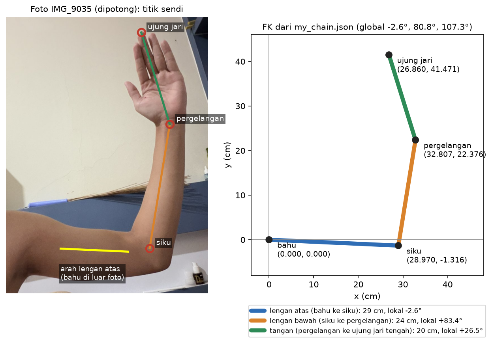

# Fase 2: Rantai saya, bacaan, dan refleksi (Lab 1)

Di fase ini contoh lengan modul (panjang 3 dan 2) saya ganti dengan lengan saya sendiri. Panjangnya dari pengukuran saya, dan sudutnya dari foto samping. Setelah itu saya hitung FK-nya dengan tangan, mencocokkannya dengan program, lalu menulis bacaan dan refleksi insiden.

## 1. Rantai yang saya pakai

Rantainya adalah lengan saya sendiri: bahu, siku, pergelangan, dan ujung jari tengah. Versi 2-bone berhenti di pergelangan (Lab 1), versi 3-bone sampai ujung jari tengah (Lab 2 no 1).

| Bone | Dari, ke | Panjang | Sudut lokal pose |
|---|---|---|---|
| 1 | bahu ke siku (lengan atas) | 29 cm | -2,6° |
| 2 | siku ke pergelangan (lengan bawah) | 24 cm | 83,4° |
| 3 | pergelangan ke ujung jari tengah (tangan) | 20 cm | 26,5° |

Data ini ada di `Source/data/my_chain.json`, lengkap dengan koordinat pixel titik sendi di foto, supaya setiap angka sudut bisa ditelusuri balik ke fotonya.

### Cara membaca sudut dari foto

Saya memotret lengan dari samping dalam beberapa pose (IMG_9032 sampai IMG_9037). IMG_9032 tidak bisa dipakai, karena lengan atasnya mengarah ke kamera sehingga terlihat jauh lebih pendek dari aslinya. IMG_9033 memakai kepalan tangan, jadi ujung jari tengahnya tidak terlihat. Saya memilih **IMG_9035**: tangan terbuka, siku menekuk jelas, dan sudut totalnya tidak tepat 90° atau 180°, jadi salah tanda akan langsung kelihatan.

Di foto asli (2754 × 4896 pixel) saya menandai titik-titik ini:

| Titik | Pixel (x, y) |
|---|---|
| siku | (2060, 3210) |
| pergelangan | (2300, 1730) |
| ujung jari tengah | (1960, 636) |
| garis tengah lengan atas | (1000, 3215) dan (1800, 3251) |

Bahu saya ada di luar foto, jadi arah lengan atas tidak bisa diambil dari titik bahu. Sebagai gantinya saya mengukur tepi atas dan tepi bawah lengan atas di x = 1000 dan x = 1800 (tepi atas y 2908 dan 3020, tepi bawah y 3522 dan 3482), lalu mengambil titik tengah keduanya. Garis yang menghubungkan dua titik tengah itu adalah sumbu lengan atas.

Arah tiap bone dihitung dengan `atan2`. Karena y pixel bertambah ke **bawah**, tanda y dibalik supaya sudut positif tetap berlawanan arah jarum jam seperti di `fk.py`:

```
global lengan atas  = atan2(-(3251 - 3215), 1800 - 1000) = atan2(-36, 800)   = -2,58°
global lengan bawah = atan2(-(1730 - 3210), 2300 - 2060) = atan2(1480, 240)  = 80,79°
global tangan       = atan2(-(636 - 1730), 1960 - 2300)  = atan2(1094, -340) = 107,26°
```

Sudut lokal adalah selisih sudut global bone dengan sudut global induknya:

```
lokal 1 = -2,58°
lokal 2 = 80,79° - (-2,58°) = 83,37°
lokal 3 = 107,26° - 80,79°  = 26,48°
```

Di JSON saya membulatkannya ke 0,1° (-2,6°, 83,4°, 26,5°). `my_chain.py` menghitung ulang sudut ini dari titik pixel di JSON, dan test memastikan selisihnya di bawah 0,05°.



### Seberapa bisa dipercaya sudutnya

Saya mengecek skala foto dengan lengan bawah. Siku ke pergelangan sepanjang 1499 pixel, dan diukur 24 cm, jadi skalanya 62,47 pixel/cm. Dengan skala yang sama, tangan di foto (1146 pixel) hanya 18,3 cm, padahal diukur 20 cm, jadi 8,3% lebih pendek. Artinya tangan saya tidak sejajar dengan bidang foto: kalau penyebabnya hanya kemiringan, tangan miring sekitar 23° keluar dari bidang foto (cos t = 18,3 / 20). Foto 2D tidak bisa menangkap kemiringan seperti itu, jadi sudut yang terbaca adalah proyeksinya. Ditambah ketelitian menandai titik (sekitar 30 pixel pada bone sepanjang 1100 sampai 1500 pixel, kira-kira 1° sampai 2°), saya memperkirakan ketelitian sudutnya **sekitar ±4°**. Angka ini perkiraan kasar, bukan hasil hitungan statistik, dan dicatat di JSON sebagai `angle_uncertainty_deg`.

Lengan atas tidak bisa dicek dengan cara yang sama, karena bahunya ada di luar foto.

### Privasi foto

Foto aslinya memuat sebagian kepala saya, dan metadata EXIF-nya menyimpan lokasi GPS. Karena itu foto asli **tidak** di-commit. Yang masuk repo hanya `docs/rantai/lengan_9035_potong.jpg`, yaitu potongan kotak (350, 450) sampai (2754, 3750) yang diperkecil menjadi 720 × 988 pixel. Rambut di pojok kiri atas ikut terbuang, dan file baru ini tidak membawa EXIF sama sekali (saya cek: `getexif()` kosong).

## 2. FK dengan tangan (Lab 1 no 3)

Konvensinya sama dengan contoh E1: sudut global = jumlah sudut lokal, lalu melangkah sepanjang bone.

**Bone 1.** φ1 = -2,6°.

```
cos(-2,6°) = 0,998971     sin(-2,6°) = -0,045363
siku = (29 · 0,998971 ; 29 · (-0,045363)) = (28,970 ; -1,316)
```

**Bone 2.** φ2 = -2,6° + 83,4° = 80,8°.

```
cos 80,8° = 0,159881      sin 80,8° = 0,987136
langkah = (24 · 0,159881 ; 24 · 0,987136) = (3,837 ; 23,691)
pergelangan = (28,970 + 3,837 ; -1,316 + 23,691) = (32,807 ; 22,376)
```

**Bone 3.** φ3 = 80,8° + 26,5° = 107,3°.

```
cos 107,3° = -0,297375    sin 107,3° = 0,954761
langkah = (20 · (-0,297375) ; 20 · 0,954761) = (-5,948 ; 19,095)
ujung jari = (32,807 - 5,948 ; 22,376 + 19,095) = (26,860 ; 41,471)
```

Penjumlahan di atas memakai nilai yang belum dibulatkan, jadi hasil akhirnya sama dengan program sampai 3 desimal. Kalau saya menjumlahkan angka yang sudah dibulatkan, ujung jari bisa meleset 0,001 cm.

Dicek dengan program (`.venv/bin/python my_chain.py`, yang memanggil `forward_kinematics` dari `fk.py`):

```
2-bone (bahu-siku-pergelangan):
  bahu        = (   0.000,    0.000) cm
  siku        = (  28.970,   -1.316) cm   global angle =   -2.6 deg
  pergelangan = (  32.807,   22.376) cm   global angle =   80.8 deg
3-bone (+ tangan sampai ujung jari tengah):
  ...
  ujung jari  = (  26.860,   41.471) cm   global angle =  107.3 deg
dari titik pixel foto:
  global   -2.58 deg  lokal   -2.58 deg  (json -2.6, selisih +0.02)
  global   80.79 deg  lokal   83.37 deg  (json +83.4, selisih -0.03)
  global  107.26 deg  lokal   26.48 deg  (json +26.5, selisih -0.02)
  skala dari lengan bawah: 62.47 px/cm; tangan di foto 18.3 cm vs diukur 20 cm (-8.3%)
```

| Titik | Tangan | `fk.py` |
|---|---|---|
| siku | (28,970 ; -1,316) | (28.970, -1.316) |
| pergelangan | (32,807 ; 22,376) | (32.807, 22.376) |
| ujung jari tengah | (26,860 ; 41,471) | (26.860, 41.471) |

Semuanya cocok sampai 3 desimal.

Di `tests.py` saya menambah `test_my_chain`:
- posisi ketiga titik dicek terhadap hitungan tangan di atas, dengan toleransi 0,001 cm;
- sudut global ujung jari harus 107,3°;
- rantai 2-bone harus berakhir tepat di pergelangan rantai 3-bone;
- tiap sudut di JSON harus sama dengan sudut dari foto, dengan selisih kurang dari 0,05°.

Sekarang `tests.py` mencetak `ALL CHECKS PASSED (52 ok)` (sebelumnya 40). Untuk memastikan test ini benar-benar bisa gagal, saya sempat mengubah sudut siku di JSON dari 83,4° menjadi 83,5°. Test langsung gagal di posisi pergelangan (`got=32.766 want=32.807`). Setelah itu JSON saya kembalikan, dan test hijau lagi.

Satu hal yang saya perhatikan dari hitungan ini: kalau saya lupa bahwa 83,4° itu sudut **lokal** dan memakainya sebagai sudut global, pergelangan akan berada di (31,729 ; 22,525), sekitar 1,1 cm dari posisi yang benar. Selisihnya kecil karena lengan atas saya hampir mendatar (-2,6°). Pada pose dengan bahu yang lebih miring, kesalahan yang sama akan jauh lebih besar.

## 3. Bacaan: referensi kelas `SkeletonIK3D` (Lab 1 no 4)

Saya membaca halaman `SkeletonIK3D` di dokumentasi Godot 4.7 (versi "stable", dibaca 30 Oktober 2026). Halaman itu diawali tanda "Deprecated: This class may be changed or removed in future versions", jadi untuk proyek baru Godot mengarahkan ke sistem `SkeletonModifier3D`. Isinya tetap berguna untuk memahami apa yang dikerjakan sebuah solver IK sungguhan.

Hal yang ditangani `SkeletonIK3D` dan tidak ditangani `ik.py` adalah **rantai dengan panjang sembarang di ruang 3D, termasuk cara memilih ke mana sendi menekuk**. `ik.py` hanya menyelesaikan dua bone di bidang datar dengan aturan cosinus, dan selalu memilih solusi θ2 positif. Sebaliknya, `SkeletonIK3D` bekerja dari `root_bone` sampai `tip_bone` di sebuah `Skeleton3D`, sehingga lengan 3-bone saya bisa diselesaikan sekaligus. Menurut dokumentasinya, kelas ini "uses FabrikInverseKinematic internally", dengan `max_iterations` (bawaan 10) dan `min_distance` (bawaan 0,01) sebagai batas berhenti. Untuk memilih arah tekukan ada `magnet`, yaitu "secondary magnet target (pole target)" yang dipakai "to control the bending of the IK chain". Ini menjawab masalah dua solusi yang saya temukan di Studi Pendahuluan Q2(b): di 3D, siku bisa berputar ke mana saja di sekitar garis bahu-target, jadi butuh satu titik tambahan untuk menentukan ke mana siku menghadap. Dengan `override_tip_basis`, target juga bisa memutar tulang ujung, sehingga yang diatur bukan hanya posisi tangan tetapi juga orientasinya.

Alasan `ik.py` tidak menangani semua ini: untuk dua bone di bidang, jumlah persamaan dan jumlah sudut sama, jadi jawabannya bisa ditulis langsung dan dicek tepat lewat FK sampai 1e-16. Begitu rantainya lebih panjang atau masuk ke 3D, solusinya tidak lagi tunggal. Harus ada solver iteratif yang berhenti di "cukup dekat" (`min_distance`), ditambah aturan tambahan seperti magnet untuk memilih satu dari banyak jawaban. Yang ditukar adalah ketepatan mutlak dengan kemampuan menangani rantai sungguhan.

## 4. Refleksi: akurasi punya taruhan (Lab 1 no 5)

**(a) Gimbal lock dengan urutan rotasi rantai saya.** Lengan saya di foto hanya berputar di satu bidang, jadi tiap sendinya cukup satu sudut, dan rantai planar seperti ini tidak bisa terkena gimbal lock. Masalahnya muncul kalau bahu saya dimodelkan sebagai sendi bola 3D dengan Euler angle berurutan `Rz(roll) Ry(yaw) Rx(pitch)`, sama dengan `quaternion.py`. Saya memakai sumbu x ke kanan badan, y ke atas, dan z ke depan, dengan lengan atas (29 cm) menggantung lurus ke bawah. Dalam sumbu itu pitch mengayunkan lengan ke depan atau ke belakang, yaw memutar lengan atas terhadap sumbu tegak (memuntir), dan roll mengayunkan lengan ke samping. Sumbu tengahnya yaw. Begitu lengan atas dipuntir 90°, mengayun ke belakang dan mengayun ke samping menjadi gerakan yang sama. Saya mengeceknya dengan `euler_xyz_to_matrix`: siku untuk (pitch, yaw, roll) = (30°, 90°, 0°), (0°, 90°, -30°), dan (45°, 90°, 15°) berada di titik yang persis sama, (-14,5 ; -25,115 ; 0) cm, karena ketiganya punya roll - pitch = -30°. Lebih dari itu, selama yaw ditahan di 90°, koordinat z siku selalu 0 untuk pitch dan roll berapa pun, sehingga lengan tidak bisa diayunkan ke depan sama sekali. Ini sama persis dengan yang dialami IMU Apollo saat gimbal tengahnya mendekati 90°.

**(b) Satu keputusan desain tiap insiden.** Untuk Apollo, MIT sengaja tetap memakai **tiga gimbal**. Memo Hoag (April 1963) menimbang gimbal keempat dan menyimpulkan keuntungannya "outweighed by the equipment simplicity, size advantages, and corresponding implied reliability". Sebagai gantinya ada aturan sudut gimbal tengah ±80° dan lampu "GIMBAL LOCK". Pada Apollo 11 aturan itu benar-benar dipakai, saat Collins diminta menjauh dari lock dan memutarinya (transkrip 104:59:35 sampai 105:00:30, dikutip ALSJ). Untuk engine game, keputusannya adalah **tidak menyimpan Euler**: di Godot 4.7, `Node3D` menyimpan `Basis`, sedangkan Euler di inspector hanya dihitung dari matriks itu, dan interpolasi memakai `Quaternion`. Untuk Cyberpunk 2077, keputusan yang tercatat adalah **T-pose sebagai pilihan sadar daripada crash** saat memori habis. Lead engine programmer Charles Tremblay mengatakan "either you show a T-pose, or you hard crash... We prefer not to hard crash" (PC Gamer, 1 Oktober 2024). Untuk karakter yang meluncur seperti "shop mannequins on wheels" (PC Gamer, 7 Desember 2020), saya tidak menemukan sumber resmi soal penyebab atau perbaikannya.

**(c) Satu cek otomatis untuk tiap mode kegagalan.**
- **Gimbal lock:** sebuah test membaca semua keyframe rotasi yang disimpan dalam Euler, lalu gagal kalau ada sudut sumbu tengah (sesuai urutan yang dipakai engine) yang berada dalam 10° dari ±90°. Batas 10° saya ambil dari memo Hoag, yang menyebut lock "can be approached as close as 10 degrees without risk". Bagi yang lolos, test ini juga memastikan interpolasinya berjalan lewat quaternion.
- **Foot-sliding:** jalankan karakter berjalan tanpa jendela di beberapa kecepatan, catat posisi dunia kaki saat fase menapak, lalu gagalkan build kalau kaki bergeser lebih dari 2 cm selama satu fase menapak. Cek kedua: jarak tempuh root dibandingkan dengan panjang langkah dikali jumlah siklus. Selisih yang terus tumbuh terhadap waktu berarti kecepatan root dan animasi tidak sinkron. Cek ini menjawab masalah yang diakui Marcin Iwiński, bahwa banyak glitch terlewat saat pengujian (Engadget, 13 Januari 2021).

Sumber dan tanggal lengkapnya ada di Studi Pendahuluan Q4(d). Seperti di sana, *Digital Apollo* (Mindell, 2008) dan *Carrying the Fire* (Collins, 1974) belum bisa saya akses, jadi bagian Apollo memakai memo Hoag dan transkrip misi yang memuat ucapan Collins sendiri.

## Yang belum

- Toolchain dari Fase 0 baru disalin ke `Source/README.md` saat README ditulis ulang di akhir modul, bersama baris Verified.
- Cara mengukur panjang lengan (alat dan titik ukurnya) perlu saya tambahkan sendiri di JSON kalau dosen menanyakannya.
