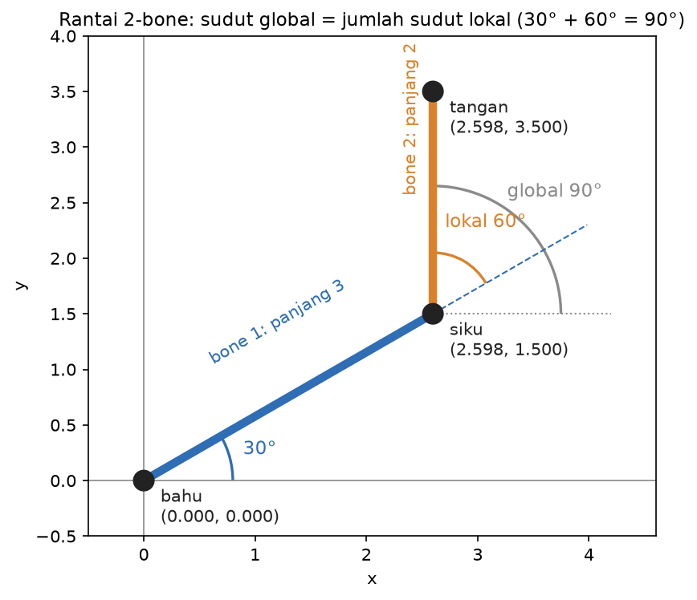
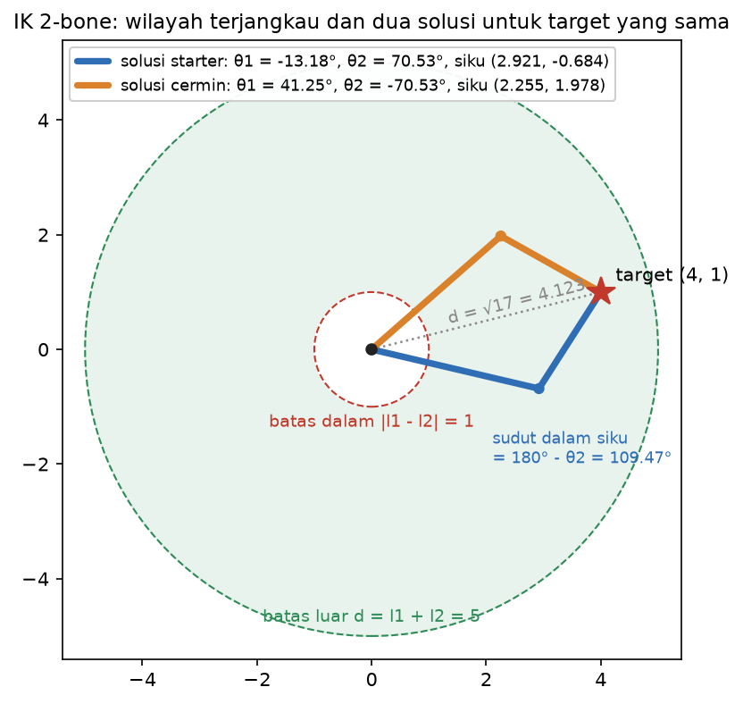
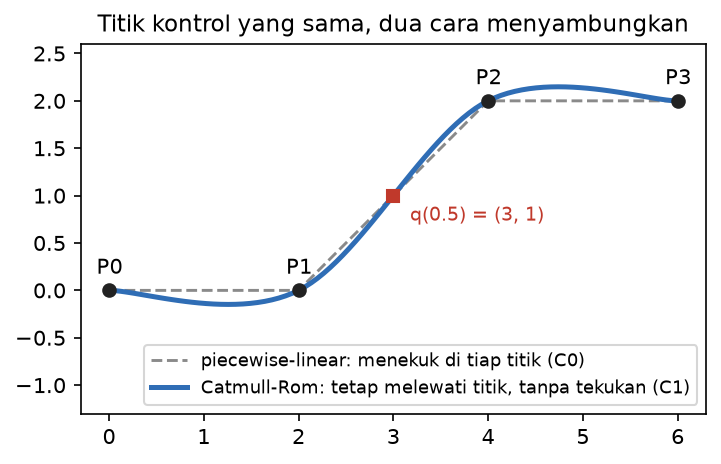
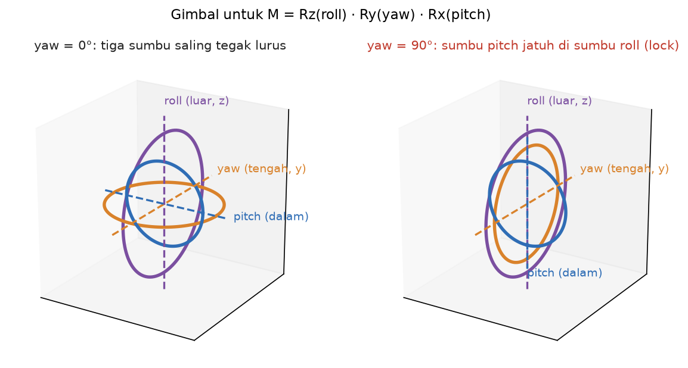
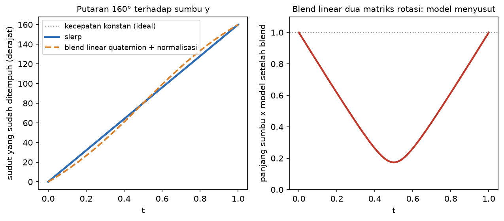
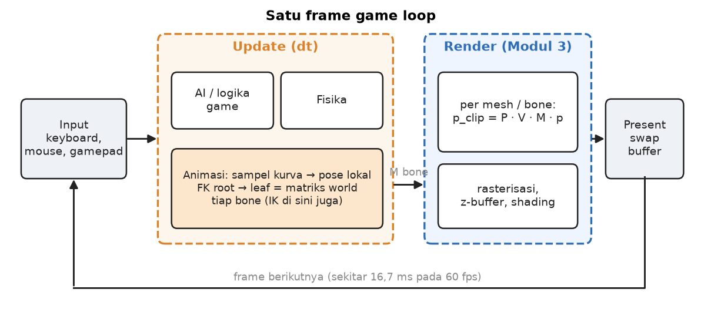

# Studi Pendahuluan Modul 4: Animasi, Kinematika & Game Engine

Zacky Maulana (NIM 20241337034), S1 Informatika UMSurabaya
Praktikum Grafika Komputer

Semua hitungan di dokumen ini saya kerjakan dengan tangan dulu, lalu saya cek ulang dengan `fk.py`, `ik.py`, `spline.py`, dan `quaternion.py` di `Module4/Source`. Diagram dibuat oleh `Source/figures.py`, dan setiap titik di gambar dihitung dengan fungsi-fungsi yang sama, jadi gambarnya tidak mungkin berbeda dengan kodenya. Perintah untuk membuat ulang gambar: `.venv/bin/python figures.py --set studi`.

Konvensi yang saya pakai di seluruh dokumen, sama dengan kode:
- rantai planar adalah daftar pasangan `(panjang, sudut lokal)`;
- sudut lokal diukur dari arah bone induknya, dalam derajat, berlawanan arah jarum jam positif;
- quaternion ditulis `(w, x, y, z)`;
- matriks rotasi dikalikan ke vektor kolom, jadi `Rz Ry Rx p` berarti `Rx` bekerja lebih dulu.

---

## Q1. Forward kinematics

### Q1(a) Rantai planar dan kenapa sudut global adalah jumlah sudut lokal

Rantai planar 2-bone saya tulis sebagai dua pasangan `[(l1, θ1), (l2, θ2)]`. `l` adalah panjang bone dari sendi ke sendi. `θ` adalah sudut lokal, yaitu seberapa jauh bone itu berbelok **dari arah bone induknya**. Bone pertama tidak punya induk, jadi sudut lokalnya diukur dari sumbu +x.

Cara paling gampang membayangkannya: saya berdiri di bahu menghadap +x, lalu berputar θ1 dan berjalan sejauh l1 sampai siku. Di siku saya **tidak** menghadap +x lagi, melainkan masih menghadap arah bone pertama. Kalau sekarang saya berputar θ2, arah baru saya adalah arah lama ditambah θ2, yaitu θ1 + θ2 dari +x. Begitu seterusnya: setiap sendi menambahkan putarannya di atas putaran semua sendi sebelumnya. Itulah sebabnya sudut global bone ke-i adalah jumlah semua sudut lokal dari root sampai bone i:

```
φ_i = θ1 + θ2 + ... + θi
joint_i = joint_(i-1) + l_i (cos φ_i, sin φ_i)
```

Di 2D, menjumlahkan sudut sama dengan mengalikan matriks rotasi, karena `R(a) R(b) = R(a + b)`. Jadi FK planar adalah bentuk sederhana dari menyusun matriks lokal dari root ke leaf, sama seperti rantai matriks di Modul 3.

### Q1(b) Hitungan tangan: panjang 3 dan 2, sudut lokal 30° dan 60°



Langkah 1, bone pertama. Sudut globalnya φ1 = 30°.

```
cos 30° = √3/2 = 0,8660      sin 30° = 0,5
siku = (0, 0) + 3 (0,8660; 0,5) = (2,598; 1,500)
```

Langkah 2, bone kedua. Sudut globalnya φ2 = 30° + 60° = 90°.

```
cos 90° = 0      sin 90° = 1
tangan = (2,598; 1,500) + 2 (0; 1) = (2,598; 3,500)
```

Dicek dengan program:

```
$ .venv/bin/python fk.py
shoulder = (0.000, 0.000)
elbow    = (2.598, 1.500)   global angle = 30.0 deg
hand     = (2.598, 3.500)   global angle = 90.0 deg
```

Hasilnya cocok sampai 3 desimal. Kalau saya keliru memakai 60° sebagai sudut global untuk bone kedua, tangan akan berada di (2,598 + 2 cos 60°; 1,5 + 2 sin 60°) = (3,598; 3,232). Ini contoh salah konvensi lokal dan global yang langsung kelihatan dari angkanya.

### Q1(c) Kenapa rig menyimpan transformasi lokal

Kalau tiap bone menyimpan posisi dan arah **global**, menggerakkan bahu berarti saya juga harus menghitung ulang dan menulis ulang siku, pergelangan, dan kelima jari, karena semuanya ikut pindah. Kalau yang disimpan **lokal** (relatif terhadap induk), cukup satu angka di bahu yang berubah. Anak-anaknya otomatis ikut, karena posisi globalnya selalu dihitung ulang dari rantai induk lewat FK.

Hal yang sama berlaku untuk scale. Men-scale seluruh karakter cukup dengan mengubah transform root, dan seluruh tree ikut membesar tanpa ada sudut sendi yang berubah. Sudut lokal juga lebih bermakna untuk animator: "siku menekuk 60°" tetap benar di mana pun karakter berdiri, sedangkan sudut global siku berubah setiap kali karakter berbalik badan.

Godot memakai pembagian yang sama. Dokumentasi `Skeleton3D` (Godot 4.7) menyebut rotasi pose bone "local to the bone with respect to the rotation of any parent bones", sedangkan `get_bone_global_pose()` mengembalikan transform terhadap skeleton, yang dihitung dari rantai induk.

---

## Q2. Inverse kinematics



### Q2(a) Syarat terjangkau

Untuk lengan dengan panjang l1 dan l2, dan target berjarak d dari bahu, target terjangkau jika dan hanya jika

```
|l1 - l2|  ≤  d  ≤  l1 + l2
```

Wilayah ini berbentuk cincin (daerah hijau di gambar). Arti fisik tiap batas:

- **Batas luar, d = l1 + l2:** lengan lurus penuh, siku tidak menekuk sama sekali (θ2 = 0°). Target sedikit lebih jauh lagi tidak mungkin dicapai, sekuat apa pun bahu berputar.
- **Batas dalam, d = |l1 - l2|:** lengan terlipat penuh, lengan bawah menempel balik ke lengan atas (θ2 = 180°). Titik yang lebih dekat ke bahu dari ini tidak bisa disentuh ujung tangan. Untuk lengan modul (3 dan 2) batas dalamnya 1, jadi titik (0,5; 0) tidak terjangkau walaupun sangat dekat dengan bahu.

Dicek dengan `solve_two_bone_ik(3, 2, target)`: target (5, 0) memberi θ2 = 0°, target (1, 0) memberi θ2 = 180°, sedangkan (5,01; 0) dan (0,99; 0) sama-sama melempar `UnreachableTarget: target at distance ... is outside [1.000, 5.000]`.

### Q2(b) Aturan cosinus untuk sudut siku

Bahu, siku, dan target membentuk segitiga dengan sisi l1, l2, dan d. Misalkan α adalah sudut **di dalam** segitiga pada siku. Aturan cosinus untuk sisi d:

```
d² = l1² + l2² - 2 l1 l2 cos α
```

Sudut lokal siku θ2 diukur dari perpanjangan lengan atas, sedangkan α diukur di dalam segitiga. Lengan lurus berarti θ2 = 0° dan α = 180°, jadi `α = 180° - θ2`, dan `cos α = -cos θ2`. Disubstitusi:

```
d² = l1² + l2² + 2 l1 l2 cos θ2
cos θ2 = (d² - l1² - l2²) / (2 l1 l2)
```

Rumus ini juga menjelaskan syarat di Q2(a): di batas luar cos θ2 = 1, di batas dalam cos θ2 = -1, dan di luar cincin nilainya keluar dari [-1, 1] sehingga `acos` tidak punya jawaban.

Sudut bahu didapat dari dua bagian: arah ke target dikurangi sudut yang "ditambahkan" oleh tekukan siku.

```
θ1 = atan2(ty, tx) - atan2(l2 sin θ2, l1 + l2 cos θ2)
```

**Contoh E2,** l1 = 3, l2 = 2, target (4, 1):

```
d² = 16 + 1 = 17
cos θ2 = (17 - 9 - 4) / (2 · 3 · 2) = 4/12 = 1/3
θ2 = acos(1/3) = 70,53°
sin θ2 = √(1 - 1/9) = 0,9428
atan2(1, 4) = 14,04°
atan2(2 · 0,9428; 3 + 2 · 1/3) = atan2(1,8856; 3,6667) = 27,21°
θ1 = 14,04° - 27,21° = -13,18°
```

Dicek dengan program, termasuk memasukkan hasilnya kembali ke FK:

```
$ .venv/bin/python ik.py
theta1 (shoulder) = -13.18 deg
theta2 (elbow)    = 70.53 deg
FK(theta1,theta2) = (4.000, 1.000)  <- should match target
position error    = 4.44e-16
```

`acos` hanya mengembalikan sudut positif, padahal θ2 = -70,53° juga memenuhi rumus yang sama. Itulah solusi kedua: lengan dicerminkan terhadap garis bahu-target, sehingga θ1 = 14,04° + 27,21° = 41,25°. Keduanya sampai di (4, 1) dengan error di bawah `1e-9` (dicek di dalam `figures.py` sebelum gambar dibuat). Satu hal yang saya catat: starter menyebut solusi θ2 positif sebagai "elbow up", padahal sikunya ada di (2,921; -0,684), yaitu **di bawah** garis bahu-target. Label "atas" atau "bawah" bergantung pada arah tekukan dan posisi target, jadi akan saya bahas di Fase 3 dan 4.

### Q2(c) Kenapa closed-form sulit untuk lebih dari dua bone

Lengan 2-bone di bidang punya dua sudut yang tidak diketahui dan dua persamaan (koordinat x dan y target). Jumlahnya pas, jadi jawabannya bisa ditulis langsung, paling banyak dua solusi. Begitu ada bone ketiga, ada tiga sudut tetapi tetap hanya dua persamaan posisi. Sistemnya kurang tertentu, sehingga biasanya ada tak hingga banyak pose yang menempatkan ujung tangan di titik yang sama (coba sentuh satu titik di meja dengan ujung jari, lalu gerakkan siku: jari tetap di sana). Di 3D, ditambah batas sudut sendi dan orientasi tangan, rumus tertutup untuk rantai sembarang umumnya tidak ada.

Alternatifnya solver iteratif. **FABRIK** (Forward And Backward Reaching Inverse Kinematics) bekerja dengan posisi, bukan sudut:
1. Ujung rantai ditarik ke target, lalu tiap sendi ke arah root ditarik supaya panjang bone kembali benar.
2. Root dikembalikan ke tempat asalnya, lalu langkah yang sama diulang dari root ke ujung.
3. Dua langkah ini diulang sampai jarak ujung ke target cukup kecil, lalu sudut sendi dibaca dari posisi yang dihasilkan.

Godot memakai cara ini. Dokumentasi `SkeletonIK3D` (Godot 4.7) menulis bahwa kelas itu "uses FabrikInverseKinematic internally", dengan `max_iterations = 10` dan `min_distance = 0.01` sebagai batas berhentinya. Kelas itu juga diberi tanda "Deprecated: This class may be changed or removed in future versions."

---

## Q3. Spline, Euler angle, dan quaternion

### Q3(a) Yang dijamin Catmull-Rom



Jalur piecewise-linear dan Catmull-Rom sama-sama melewati setiap titik kontrol. Bedanya ada di sambungan. Jalur lurus hanya kontinu posisi (C0): arahnya berubah mendadak di tiap titik, jadi kamera yang mengikutinya akan "menyentak" berbelok. Catmull-Rom memilih tangen di titik P_i sejajar dengan `P(i+1) - P(i-1)`, dan tangen itu dipakai bersama oleh segmen sebelum dan sesudahnya. Hasilnya arah gerak kontinu (C1): tidak ada tekukan, dan kecepatannya tidak melompat.

Cek angka contoh E3, segmen P1 ke P2 dengan P0 = (0, 0), P1 = (2, 0), P2 = (4, 2), P3 = (6, 2) di t = 0,5:

```
q(t) = 0,5 [ 2 P1 + (P2 - P0) t + (2 P0 - 5 P1 + 4 P2 - P3) t² + (-P0 + 3 P1 - 3 P2 + P3) t³ ]
x: 0,5 [ 4 + 4 · 0,5 + 0 · 0,25 + 0 · 0,125 ]         = 0,5 · 6 = 3
y: 0,5 [ 0 + 2 · 0,5 + 6 · 0,25 + (-4) · 0,125 ]      = 0,5 · 2 = 1
```

`spline.py` mencetak `q(0.5) on segment P1->P2 = (3.000, 1.000)`. Yang **tidak** dijamin Catmull-Rom: kurvanya tidak harus tetap di dalam poligon titik kontrol. Di gambar, kurva turun sampai y = -0,148 di antara P0 dan P1, padahal kedua titik itu ada di y = 0 (dihitung dari 3001 sampel). Untuk kamera yang mengelilingi bangunan, overshoot seperti ini perlu dicek supaya kamera tidak menembus dinding. Catmull-Rom juga hanya C1, bukan C2, jadi percepatannya masih bisa melompat di titik kontrol.

### Q3(b) Matriks rotasi dan sumbu yang terkunci untuk urutan Rz Ry Rx

```
Rx(p) = | 1    0       0    |   Ry(y) = |  cos y  0  sin y |   Rz(r) = | cos r  -sin r  0 |
        | 0  cos p  -sin p  |           |    0    1    0   |           | sin r   cos r  0 |
        | 0  sin p   cos p  |           | -sin y  0  cos y |           |   0       0    1 |
```

Urutan yang saya pakai sama dengan `quaternion.py`: `M = Rz(roll) · Ry(yaw) · Rx(pitch)`. Karena dikalikan ke vektor kolom, pitch bekerja lebih dulu, lalu yaw, lalu roll, semuanya terhadap sumbu **tetap** dunia. Ini sama dengan memutar terhadap sumbu lokal dengan urutan terbalik (roll, lalu yaw, lalu pitch). Sumbu tengahnya adalah yaw.

**Sudut yang menyebabkan lock: yaw = 90°.** Alasannya bisa dilihat dari ke mana Ry(90°) mengirim sumbu x. Kolom pertama Ry(90°) adalah (cos 90°, 0, -sin 90°) = (0, 0, -1), jadi sumbu x jatuh ke sumbu -z. Akibatnya putaran pitch terhadap x, yang terjadi sebelum yaw, setelah melewati Ry(90°) menjadi putaran terhadap -z:

```
Ry(90°) · Rx(p) = Rz(-p) · Ry(90°)
M = Rz(r) · Rz(-p) · Ry(90°) = Rz(r - p) · Ry(90°)
```

Pitch dan roll sekarang sama-sama memutar terhadap sumbu z. Yang tersisa hanya selisihnya, r - p, sehingga satu derajat kebebasan hilang. Tidak ada kombinasi pitch dan roll yang bisa memutar benda terhadap sumbu ketiga yang hilang itu.



Dicek dengan program. Pada yaw = 90°, selisih maksimum elemen antara `euler_xyz_to_matrix(p, 90, r)` dan `Rz(r - p) Ry(90°)` untuk empat pasang (p, r), yaitu (20, 10), (15, 5), (10, 0), dan (37, -12), paling besar 1,1e-16, sebesar pembulatan float. `quaternion.py` juga mencetak `max|M(20,90,10) - M(15,90,5)| = 1.11e-16`. Sebagai pembanding, pasangan yang menjaga **jumlah** pitch + roll pada yaw 90° berselisih 0,347, dan pasangan yang menjaga selisih tetapi pada yaw 89° berselisih 0,00303. Jadi yang terkunci memang tepat di yaw 90°. Mendekati 90° pun keadaannya sudah buruk, karena dua sumbu hampir sejajar.

Catatan untuk Fase 5: urutan ini bukan urutan bawaan Godot. Dokumentasi `Node3D` menulis "By default, the intrinsic YXZ convention is used", jadi sumbu tengah di Godot adalah x (pitch), bukan yaw. Sumbu mana yang terkunci selalu bergantung pada urutannya, jadi harus diturunkan, bukan ditebak.

### Q3(c) Norm quaternion

Quaternion yang mewakili rotasi harus ber-norm 1: `w² + x² + y² + z² = 1`. Vektor diputar dengan `v' = q v q*`. Kalau norm q bukan 1 melainkan s, hasilnya ikut terkali s². Saya mencobanya dengan quaternion putaran 30° terhadap z yang dikali 1,01 (norm 1,01): vektor (1, 0, 0) yang panjangnya 1 berubah menjadi vektor sepanjang 1,0201. Jadi selain berputar, benda itu juga membesar sekitar 2%.

Pada program yang berjalan lama, orientasi biasanya diperbarui dengan mengalikan quaternion kecil setiap frame. Setiap perkalian membawa sedikit galat pembulatan, dan galat itu menumpuk. Lama-lama norm melenceng dari 1, matriks yang dibangun dari quaternion itu tidak lagi orthonormal, dan benda terlihat membesar, mengecil, atau miring. Solusinya murah: normalisasi ulang secara berkala (bagi keempat komponen dengan norm-nya). Dokumentasi `Quaternion` Godot juga menulis "Quaternions must be normalized before being used for rotation".

### Q3(d) Kenapa slerp berkecepatan sudut konstan



Quaternion satuan adalah titik di permukaan bola 4D, dan sudut busur antara dua quaternion di bola itu sama dengan setengah sudut putaran 3D di antara keduanya. Slerp, `slerp(q0, q1, t) = [sin((1 - t)Ω) q0 + sin(tΩ) q1] / sin Ω`, berjalan menyusuri **busur** lingkaran besar dengan laju busur konstan. Akibatnya sudut putaran 3D juga bertambah rata terhadap t. Blend linear berjalan menyusuri **tali busur**: titik-titik di tengahnya ada di dalam bola (norm kurang dari 1). Kalau dinormalisasi, langkah t yang sama besar diproyeksikan ke busur dengan langkah yang tidak sama, lebih lambat di ujung dan lebih cepat di tengah. Untuk putaran 160° terhadap y, slerp mencapai 40,00° di t = 0,25 dan 120,00° di t = 0,75, sedangkan blend linear yang dinormalisasi mencapai 34,48° dan 125,52°. Mem-blend dua **matriks** rotasi lebih buruk lagi: hasilnya bukan matriks rotasi. Di t = 0,5, sumbu x model tinggal sepanjang 0,174 untuk putaran 160°, dan 0,707 untuk putaran 90°, jadi model menyusut di tengah transisi. Mem-blend Euler angle memang menghasilkan matriks rotasi yang sah, tetapi jalurnya ditentukan urutan sumbu, bukan jarak terpendek. Di dekat gimbal lock, perubahan besar pada angka Euler bahkan bisa menghasilkan perubahan orientasi yang hampir nol. Dokumentasi Godot memberi contoh kamera yang berputar ke arah sebaliknya, karena 270° ke 0° tidak sama dengan 270° ke 360°. Contoh 40% dari identitas ke yaw 90° di `quaternion.py` menghasilkan `(0.9511, 0.0000, 0.3090, 0.0000)`, yaitu tepat 36,00°.

---

## Q4. Insiden nyata: gimbal lock Apollo dan foot-sliding Cyberpunk 2077

### Ringkasan gimbal lock Apollo

Apollo menyimpan arah pesawat dengan IMU (Inertial Measurement Unit): sebuah meja kecil berisi giroskop ("stable member") yang dijaga tetap menghadap arah yang sama di ruang angkasa oleh motor torsi, sementara pesawat berputar di sekitarnya. Meja itu digantung di tiga cincin gimbal (dalam, tengah, luar). Sudut ketiga cincin itulah yang dibaca komputer sebagai orientasi pesawat, dan menurut Tom Neal di Apollo Lunar Surface Journal (ALSJ), "the 'gimbal angles' are the Euler angles between the 'stable platform' and the 'navigation base'". Jadi IMU Apollo adalah Euler angle dalam bentuk mesin.

Memo MIT Instrumentation Laboratory E-1344 karya David Hoag (April 1963) menjelaskan lock-nya: gimbal lock terjadi ketika sumbu gimbal luar terbawa gerakan pesawat sampai sejajar dengan sumbu gimbal dalam, sehingga "the three gimbal axes lie in a single plane". Hoag menetapkan aturan bahwa sudut gimbal tengah dalam rentang ±80° aman, di luar itu bahaya, dan lampu peringatan "GIMBAL LOCK" menyala. Hasil uji menunjukkan lock bisa didekati sampai 10° tanpa risiko. Hoag juga membahas gimbal keempat, tetapi menyimpulkan keuntungannya "seem to be outweighed by the equipment simplicity, size advantages, and corresponding implied reliability of the direct three degree of freedom unit". Jadi tiga gimbal adalah keputusan desain yang sadar, ditukar dengan aturan terbang dan lampu peringatan.

Menurut Paul Fjeld di ALSJ, pada Lunar Module komputer memberi peringatan di 70° dan membekukan IMU di 85° dengan lampu "no att", lalu menunggu penyelarasan ulang. Fjeld juga menulis bahwa sudut gimbal dihitung dengan "dividing by the cos of Z. If Z is 90, cos is 0 and that division is illegal!".

Kru sadar akan risiko ini. Transkrip Apollo 11 yang dikutip ALSJ, sekitar dua jam setelah pendaratan:

> 104:59:35 Garriott: Columbia, Houston. We noticed you are maneuvering very close to gimbal lock. I suggest you move back away. Over.
> 104:59:43 Collins: Yeah. I am going around it, doing a CMC Auto maneuver to the Pad values of roll 270, pitch 101, yaw 45.
> 105:00:30 Collins: (Faint, joking) How about sending me a fourth gimbal for Christmas.

Armstrong menambahkan di ALSJ: "We had a four-gimbal platform on Gemini."

### Q4(a) Yang terjadi secara fisik saat lock

Dalam keadaan normal ketiga sumbu cincin saling tegak lurus. Ke mana pun pesawat berputar, selalu ada cincin yang bisa berputar berlawanan arah supaya meja giroskop tetap diam. Saat gimbal tengah mencapai 90°, sumbu cincin luar dan sumbu cincin dalam menjadi segaris, dan ketiga sumbu jatuh di satu bidang (gambar Q3(b) kanan). Kalau pesawat berputar terhadap sumbu yang tegak lurus bidang itu, tidak ada satu cincin pun yang bisa menyerapnya. Akibatnya meja giroskop ikut terseret berputar, dan acuan arah yang dijaga sejak awal misi rusak.

Kru tidak bisa sekadar "berputar sedikit lagi" karena tiga alasan. Pertama, tepat di lock arah yang dibutuhkan untuk keluar memang tidak ada di antara ketiga cincin. Kedua, saat mendekati lock, Hoag menjelaskan bahwa gimbal luar butuh percepatan sudut yang makin besar untuk menahan meja tetap diam, sedangkan perhitungan sudutnya membagi dengan cosinus sudut tengah, yang mendekati nol. Perintah ke motor menjadi sangat besar persis di saat motor paling tidak mampu. Ketiga, kalau meja sudah terseret, orientasinya hilang, dan menurut Fjeld komputer membekukan IMU lalu "waited for a realignment". Menurut memo Hoag, IMU diselaraskan dalam penerbangan dengan acuan bintang, jadi orientasi yang hilang tidak bisa dipulihkan begitu saja. Karena itu yang dilakukan Collins adalah **memutari** wilayah lock ("I am going around it"), bukan menerobosnya.

### Q4(b) Kenapa engine menyimpan quaternion, bukan Euler

Desainer berpikir dengan sudut ("putar 30° ke kiri"), jadi inspector menampilkan Euler dalam derajat. Tetapi Euler angle punya masalah yang sama dengan IMU Apollo. Euler selalu punya titik lock, hasilnya bergantung pada urutan, dan tidak bisa di-interpolasi dengan benar (Q3(d)). Engine karena itu memakai Euler hanya sebagai antarmuka, lalu menyimpan dan menghitung dengan representasi tanpa singularitas.

Di Godot 4.7 yang disimpan `Node3D` sebenarnya adalah `Basis`, yaitu matriks 3 × 3 di dalam `transform`. Properti `rotation` (Euler) dan `quaternion` sama-sama "obtained from basis's rotation", jadi keduanya dihitung dari matriks itu dan bukan disimpan sendiri. Untuk interpolasi Godot menyediakan `Quaternion`. Dokumentasinya menyebut quaternion "less likely to cause floating-point errors" dan `slerp()` lebih cepat daripada versi `Basis`. Dokumentasi `Node3D` juga menulis bahwa mode edit quaternion "avoid gimbal lock and having to choose an order of rotation". Tutorial "Using 3D transforms" bahkan memberi judul bagian "Say no to Euler angles", dan menulis bahwa properti `rotation` sebaiknya tidak dipakai untuk logika game karena "It's there to be used mainly in the editor". Intinya: Euler untuk manusia, quaternion atau matriks untuk mesin, dengan konversi satu kali di perbatasan keduanya.

### Ringkasan foot-sliding Cyberpunk 2077

Cyberpunk 2077 dirilis Desember 2020 dengan banyak glitch, terutama di PlayStation 4 dan Xbox One. Pada hari review, 7 Desember 2020, PC Gamer menerbitkan "How buggy is Cyberpunk 2077, really?" (Evan Lahti). Di sana editor Andy Kelly menulis bahwa ia melihat "characters stuck in T-poses", dan bahwa animasi karakter "just completely fail, making them slide around like shop mannequins on wheels". Kalimat terakhir itu adalah gambaran foot-sliding: badan bergerak, tetapi kaki tidak melangkah sesuai jarak yang ditempuh.

Pada 13 Januari 2021, Engadget (Jessica Conditt) memberitakan video permintaan maaf salah satu pendiri CD Projekt Red, Marcin Iwiński: "The console version of Cyberpunk 2077 did not meet the quality standard we wanted it to meet... I and the entire leadership team are deeply sorry for this". Menurut Engadget, Iwiński menjelaskan bahwa sistem streaming di dalam game terus menjadi masalah bagi tim konsol, dan bahwa pengembang melewatkan banyak glitch saat menguji berbagai versinya.

Bertahun-tahun kemudian (PC Gamer, 1 Oktober 2024, mengutip wawancara Eurogamer), lead engine programmer Charles Tremblay menjelaskan bahwa sebagian T-pose sengaja dipilih saat memori habis: "either you show a T-pose, or you hard crash. What do you prefer? We prefer not to hard crash." Jadi tidak semua glitch animasi saat peluncuran berasal dari salah hitung animasi. Untuk karakter yang "meluncur", saya tidak menemukan sumber resmi yang menjelaskan penyebabnya, jadi penyebab itu tidak saya tebak.

### Q4(c) Bukti terukur bahwa kaki sliding, dan satu cek konkret

"Kelihatannya kaki meluncur" belum bukti. Buktinya adalah angka: **posisi dunia kaki yang seharusnya sedang menapak**. Selama fase menapak (stance), kaki yang menempel di lantai harus diam di koordinat dunia. Kalau koordinat itu bergeser, artinya badan dibawa maju lebih cepat atau lebih lambat daripada yang dihasilkan langkah animasinya.

Cek konkret yang bisa dijalankan otomatis sebelum rilis:
1. Jalankan karakter berjalan lurus selama beberapa siklus di beberapa kecepatan, tanpa jendela (headless).
2. Setiap frame, catat posisi dunia tulang kaki dan tandai frame saat kaki menapak, dari event footfall animasi atau dari tinggi kaki di bawah ambang.
3. Untuk setiap fase menapak, hitung geseran horizontal kaki dari awal sampai akhir fase.
4. Test gagal kalau geseran melebihi batas, misalnya 2 cm. Sebagai cek kedua, bandingkan jarak tempuh root dengan jumlah panjang langkah dikali jumlah siklus. Selisih yang terus tumbuh terhadap waktu menandakan kecepatan gerak dan langkah animasi tidak sinkron.

Cek seperti ini menghasilkan angka yang bisa dicatat di tiap build, jadi regresi ketahuan sebelum pemain melihatnya. Ini juga menjawab masalah yang disebut Iwiński: glitch yang terlewat saat pengujian manual.

### Q4(d) Tanggal dan sumber

| Sumber | Tanggal | Yang saya pakai |
|---|---|---|
| Hoag, D. "Considerations of Apollo IMU Gimbal Lock", MIT Instrumentation Laboratory E-1344 (dipindai di apollojournals.org/alsj/e-1344.htm) | April 1963 | definisi lock, batas ±80°, uji 10°, keputusan tiga gimbal |
| Transkrip Apollo 11, dikutip di Jones, E. M. & Fjeld, P. "Gimbal Angles, Gimbal Lock, and a Fourth Gimbal for Christmas", ALSJ (apollojournals.org/alsj/gimbals.html) | percakapan Juli 1969 (104:59:35 sampai 105:00:30), halaman direvisi 29 April 2011 | ucapan Garriott dan Collins, komentar Armstrong dan Fjeld |
| Lahti, E. "How buggy is Cyberpunk 2077, really?", PC Gamer | 7 Desember 2020 | T-pose dan karakter yang "slide around like shop mannequins on wheels" |
| Conditt, J. "CD Projekt Red co-founder apologizes for the sorry state of 'Cyberpunk 2077'", Engadget | 13 Januari 2021 | permintaan maaf Iwiński, glitch yang terlewat saat pengujian |
| Wolens, J. "Cyberpunk 2077 engine lead says some of its legendary launch bugs happened because the alternative was even worse...", PC Gamer | 1 Oktober 2024 | T-pose sebagai pilihan sadar saat memori habis |
| Dokumentasi Godot 4.7: `Node3D`, `Quaternion`, `Skeleton3D`, `SkeletonIK3D`, `Curve3D`, tutorial "Using 3D transforms" | dibaca 30 Oktober 2026 | konvensi YXZ, Basis, normalisasi, FABRIK, status deprecated |

Semua sumber di tabel saya baca langsung. Modul menunjuk dua buku untuk bagian Apollo, yaitu Mindell, *Digital Apollo* (MIT Press, 2008), dan Collins, *Carrying the Fire* (1974). Keduanya belum bisa saya akses: untuk *Digital Apollo* saya hanya menemukan situs pendampingnya, dan salinan *Carrying the Fire* di archive.org dibatasi aksesnya. Jadi ringkasan Apollo di atas tidak saya ambil dari kedua buku itu, melainkan dari sumber primer di atas: memo teknis MIT yang dibahas Mindell, dan transkrip misi yang memuat ucapan Collins sendiri.

---

## Q5. Game loop dan tempat FK berjalan



Game real-time mengulang empat tahap yang sama setiap frame, kira-kira 16,7 ms sekali pada 60 fps:

1. **Input.** Baca keyboard, mouse, atau gamepad sejak frame sebelumnya.
2. **Update(dt).** Majukan dunia sebesar selang waktu `dt`: logika game dan AI memutuskan apa yang dilakukan karakter, fisika memindahkan benda dan mengecek tabrakan, lalu animasi berjalan. Di bagian animasi inilah kurva animasi di-sampling pada waktu sekarang untuk mendapatkan pose **lokal** tiap bone (sudut dan posisi relatif terhadap induk, hasil interpolasi spline dan slerp). Setelah itu **FK berjalan dari root ke leaf** dan menghasilkan matriks dunia setiap bone. IK, misalnya untuk menapakkan kaki di tanah yang miring, juga berjalan di tahap ini, setelah pose animasi dan sebelum hasilnya dikirim ke renderer.
3. **Render.** Di sinilah **renderer Modul 3 mengambil alih**. Matriks dunia tiap bone menjadi matriks model `M` (lewat skinning, setiap vertex dicampur dari matriks bone yang memengaruhinya). Lalu pipeline yang sama dengan Modul 3 berjalan: `p_clip = P · V · M · p`, clipping, pembagian w, rasterisasi, z-buffer, dan shading.
4. **Present.** Frame yang sudah selesai digambar ditukar ke layar (swap buffer), lalu loop kembali ke input.

Pembagian ini menjelaskan kenapa animasi disebut "pipeline Modul 3 yang di-sampling berkali-kali per detik dengan matriks yang berubah terhadap waktu". Renderer tidak tahu apa-apa soal tulang atau sudut, ia hanya menerima matriks `M` baru setiap frame. Semua pekerjaan kinematika selesai di tahap update.

---

## Daftar pustaka

1. Marschner, S. & Shirley, P. *Fundamentals of Computer Graphics*, edisi 5. CRC Press, 2021. Bab 13 (Animation) dan bagian representasi rotasi, sesuai yang ditunjuk modul.
2. Hughes, J. F., van Dam, A., McGuire, M., Sklar, D. F., Foley, J. D., Feiner, S. K. & Akeley, K. *Computer Graphics: Principles and Practice*, edisi 3. Addison-Wesley, 2014. Bab animasi dan kinematika, sesuai yang ditunjuk modul.
3. Hoag, D. *Considerations of Apollo IMU Gimbal Lock*. MIT Instrumentation Laboratory, dokumen E-1344, April 1963. Versi pindaian di apollojournals.org.
4. Jones, E. M. & Fjeld, P. "Gimbal Angles, Gimbal Lock, and a Fourth Gimbal for Christmas." *Apollo Lunar Surface Journal*, 2000, direvisi 29 April 2011.
5. Lahti, E. "How buggy is Cyberpunk 2077, really?" *PC Gamer*, 7 Desember 2020.
6. Conditt, J. "CD Projekt Red co-founder apologizes for the sorry state of 'Cyberpunk 2077'." *Engadget*, 13 Januari 2021.
7. Wolens, J. "Cyberpunk 2077 engine lead says some of its legendary launch bugs happened because the alternative was even worse." *PC Gamer*, 1 Oktober 2024.
8. Godot Engine 4.7 documentation: class reference `Node3D`, `Quaternion`, `Skeleton3D`, `SkeletonIK3D`, `Curve3D`, dan tutorial "Using 3D transforms". docs.godotengine.org, dibaca 30 Oktober 2026.
9. Modul 4 Praktikum Grafika Komputer: Animasi, Kinematika & Game Engine.

Catatan jujur soal sumber: kedua buku teks (nomor 1 dan 2) ditunjuk oleh modul, tetapi belum saya baca langsung, jadi nomor halamannya tidak saya tulis. Jawaban saya bersumber dari materi modul, sumber nomor 3 sampai 8 yang saya baca langsung, dan hitungan yang saya cek ulang dengan kode. *Digital Apollo* (Mindell, 2008) dan *Carrying the Fire* (Collins, 1974) juga belum bisa saya akses, seperti dijelaskan di Q4(d).
