# Modul 5: AI Graphics, NeRF, World Models & Augmented Reality

Subjek: patung kuda berdiri milik saya sendiri, sama dengan Modul 1 sampai 4. Capture: 28 foto iPhone 17 Pro mengelilingi patung (27 Oktober 2026). Model AR: scan photogrammetry patung itu dari foto saya sendiri, ditambah mobil F1 Aston Martin AMR23 karya Redgrund (Sketchfab, CC BY 4.0).

**AR app:** https://zackymaulana912.github.io/grafkom-pixel-to-reality/Module5/Source/ar_app/index.html

| Patung kuda hasil scan | Mobil F1 Aston Martin AMR23 |
|---|---|
| 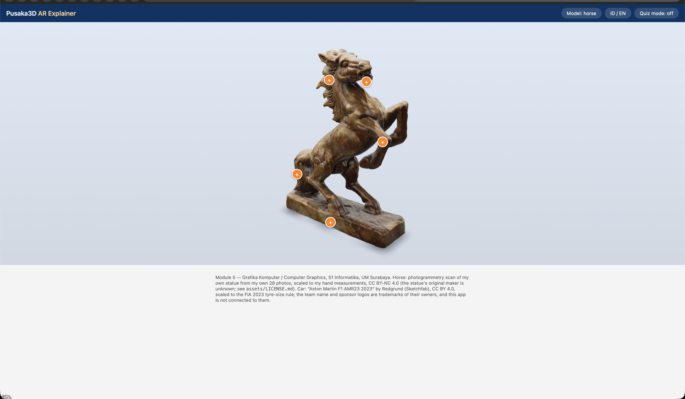 | 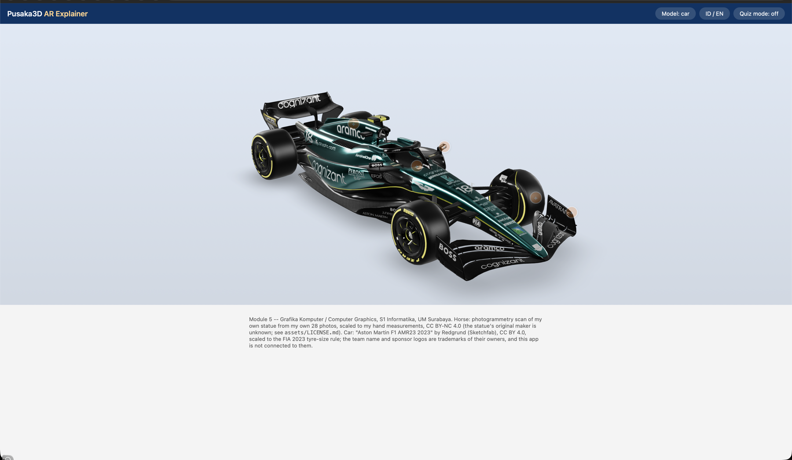 |

Tampilan AR app di browser Mac. Tombol **Model** berganti antara kuda dan mobil, tombol **ID / EN** mengganti bahasa, dan tombol **Quiz** mengubah titik info menjadi kuis.

Asal-usul aset (lengkapnya di [Source/ar_app/assets/LICENSE.md](Source/ar_app/assets/LICENSE.md)):

```
Aset: kuda.glb | sumber: scan photogrammetry dari 28 foto saya sendiri dengan Apple Object Capture | pembuat: Zacky Maulana; pembuat patung aslinya tidak diketahui | lisensi: CC BY-NC 4.0 | dibuat: 3 November 2026 | dibuat dengan AI: tidak
Aset: amr23.glb | sumber: "Aston Martin F1 AMR23 2023", Sketchfab | pembuat: Redgrund | lisensi: CC BY 4.0; logo di livery adalah merek dagang pemiliknya | diubah: dirampingkan dan diskalakan ke aturan ban FIA 2023
```

## Cara menjalankan

Di repo ini, path `code/Module5/` yang disebut di modul adalah `Module5/Source/`.

```
cd Module5/Source
python3 -m venv .venv && source .venv/bin/activate
pip install -r requirements.txt
python capture.py          # 8 gambar latih sintetis
python tests.py            # ALL CHECKS PASSED (81 ok)
cd ar_app && python make_temple_glb.py && python -m http.server 8743 --bind 127.0.0.1
```

Lalu buka http://127.0.0.1:8743/index.html. Untuk cek browser otomatis, pasang `requirements-verify.txt`, jalankan `python -m playwright install chromium`, lalu `python verify_ar_app.py http://127.0.0.1:8743` (17 ok).

## Hasil utama

### Ray dari kamera HP saya (Lab 1)

| Pixel | Focal (px) | Tangan | `my_ray.py` |
|---|---|---|---|
| (1200, 6100) di foto 4536 × 8064 | 5591,38 (dari EXIF: setara 24 mm, dicocokkan pada diagonal) | (-0,17634; -0,34145; -0,92321) | (-0.17634, -0.34145, -0.92321) |

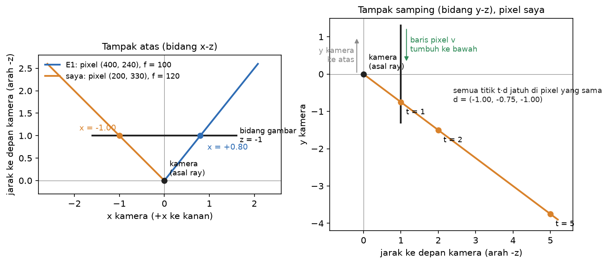

### Campuran tiga sampel (E2 dan variasi saya)

| Sampel | T | alpha | Bobot |
|---|---|---|---|
| 1 | 1,000 | 0,500 | 0,500 |
| 2 | 0,500 | 0,500 | 0,250 |
| 3 | 0,250 | 1,000 | 0,250 |

Variasi saya, α = (0,2; 0,6; 0,5) di atas latar putih: bobot 0,2 / 0,48 / 0,16, sisa latar 0,16, warna (0,36; 0,64; 0,32).

### Verifikasi gradien

Turunan saya sendiri `dC/dα_k = T_k (c_k - B_k)` tidak pernah membagi dengan `1 - α`. Selisih terburuk dengan finite difference pada cek starter `4.89e-11`. Kalau suku "yang di belakang" sengaja dibuang, cek itu gagal dengan `1.91e-01`. Rumus asli starter ternyata salah sampai tandanya terbalik saat sampel hampir padat. Cek starter tidak menangkapnya, test baru saya menangkapnya.

### Rekonstruksi dari 8 view

Scene candi ditambah patung kuda mini buatan saya, dan latihnya memakai file PPM 8 bit. PSNR view latih 20,32 dB, sudut baru 22,5° 14,85 dB.

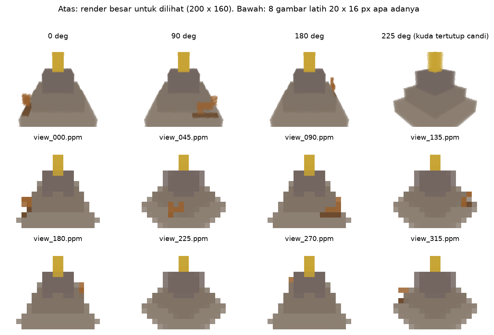

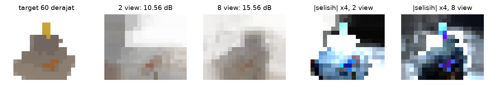

### View coverage: 2 view vs 8 view

Prediksi di-commit lebih dulu (`319add1`), baru diukur.

| Sudut baru | 2 view (dB) | 8 view (dB) | Selisih |
|---|---|---|---|
| 10 | 10.23 | 12.11 | +1.88 |
| 22,5 | 15.97 | 14.26 | **-1.71** |
| 60 | 10.56 | 15.56 | +5.00 |
| 100 | 9.10 | 11.88 | +2.78 |
| 160 | 9.36 | 13.31 | +3.95 |
| 190 | 9.39 | 12.05 | +2.66 |
| 250 | 9.34 | 13.10 | +3.76 |
| 340 | 10.02 | 12.94 | +2.92 |

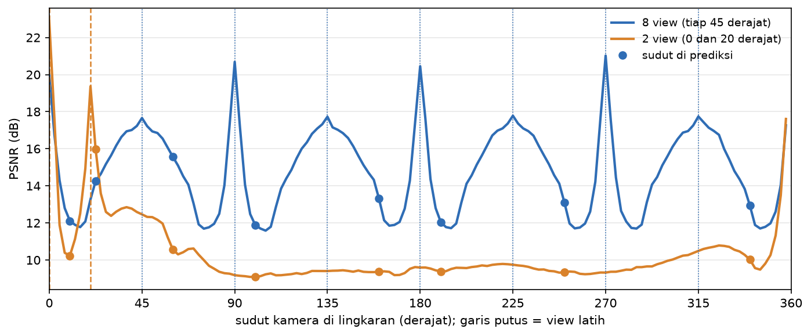

Prediksi saya: model 8 view menang di sudut jauh, model 2 view menang di 22,5° (2,5° dari view latihnya), dan kalah di 10° walaupun 10° ada di antara kedua view latihnya. Hasil terukur: 5 dari 7 prediksi tepat. Yang meleset: PSNR model 8 view di 270° lebih tinggi dari tebakan saya, dan patung kuda mini ternyata terlalu kecil untuk grid, sehingga tambahan view tidak menolongnya.

### Perbaikan dari pitfall

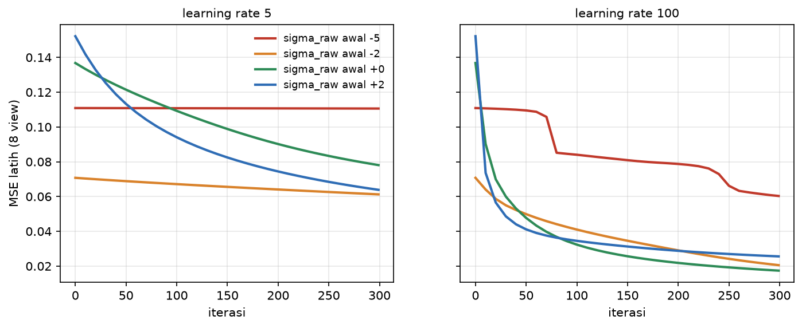

Nilai awal `sigma_raw = -5` benar-benar macet di learning rate 5 (MSE hanya turun 0,0003), tetapi hanya terlambat di learning rate 100.

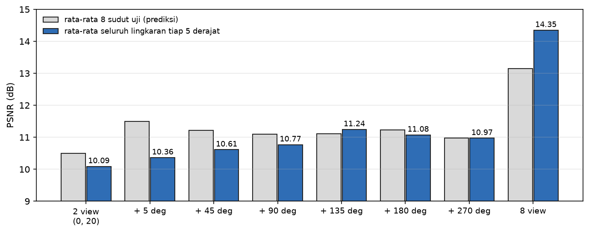

Satu view tambahan paling menolong kalau diambil jauh dari dua foto lama (135°: +1,16 dB di seluruh lingkaran). Kalau diambil di sebelahnya (5°), hanya +0,27 dB.

### AR app

| Scan patung kuda | Di iPhone saya |
|---|---|
| 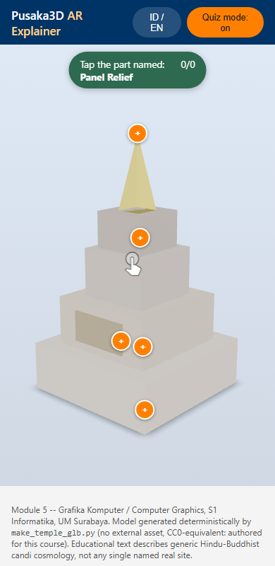 | 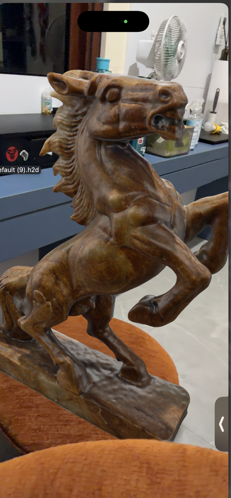 |

- **Kuda:** 105.665 segitiga, 4,4 MB. Diskalakan ke panjang alas 46 cm yang saya ukur sendiri: tinggi model 62,8 cm (diukur 63 cm), lebar alas 14,7 cm (diukur 15 cm).
- **Mobil:** diskalakan ke diameter ban 725 mm (FIA 2023, pasal 10.8.1c). Hasilnya lebar 2,006 m (batas 2000 mm, pasal 3.4.1) dan wheelbase 3,39 m (batas 3600 mm, pasal 3.4.2).

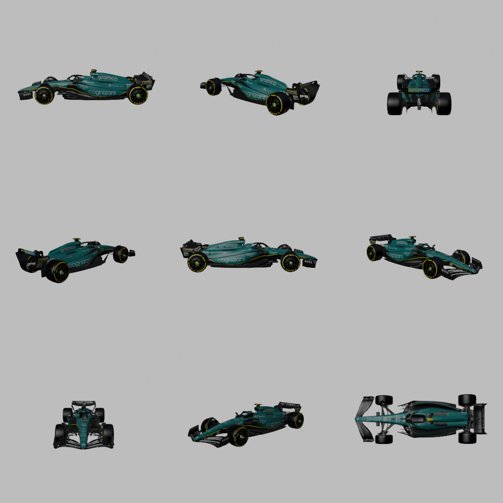

**Uji perangkat:** iPhone 17 Pro, iOS 27.2, Safari, lewat Quick Look. Kuda menempel di permukaan, dan ukurannya terlihat sama dengan patung asli.

**Occlusion hotspot:** prediksi di-commit lebih dulu (`24bd4c0`), baru diuji di 76 sudut kamera. `<model-viewer>` ternyata menyembunyikan hotspot hanya berdasarkan arah normalnya, dan hotspot yang disembunyikan masih bisa diketuk. Setelah perbaikan (normal dipilih dari kamera latih yang terpisah, titik kaki dipindah, dan ketukan diblok), jumlah hotspot yang tampil padahal tertutup turun dari 7 menjadi 0 untuk kuda dan 0 untuk mobil.

## Dokumen

- Studi pendahuluan: [docs/studi-pendahuluan/studi-pendahuluan.md](docs/studi-pendahuluan/studi-pendahuluan.md)
- Catatan per fase: [docs/catatan/](docs/catatan/)
- Prediksi yang di-commit sebelum hasil: [docs/prediksi/](docs/prediksi/)
- Detail teknis dan baris Verified: [Source/README.md](Source/README.md)
