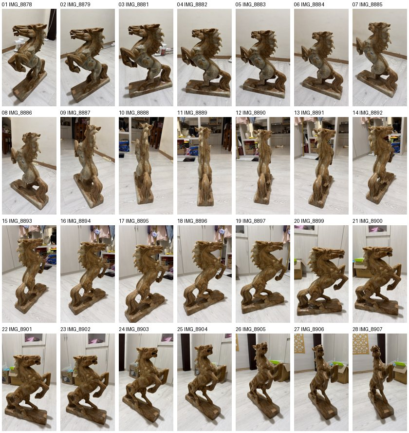

# Fase 2: Capture saya, bacaan nerfstudio, ray dengan tangan, dan refleksi (Lab 1)

Tujuan fase ini: input Modul 5 berasal dari subjek dan kamera saya sendiri, bukan dari angka contoh modul. Ada empat bagian: foto yang saya pakai, satu ray dari kamera HP saya yang dihitung dengan tangan lalu dicek program, bacaan tentang model kamera nerfstudio, dan refleksi soal provenance.

## 1. Toolchain (Lab 1 no 1)

Sama dengan yang dicatat di [fase0-setup.md](fase0-setup.md): macOS 27.0.1 di Mac17,2 (Apple M5), Python 3.11.8, NumPy 2.4.6, pygltflib 1.16.5, matplotlib 3.11.2, Playwright 1.64.1 dengan Chrome Headless Shell 156. Browser dan HP untuk menguji AR app baru saya isi di Fase 5.

## 2. Capture (Lab 1 no 2)

**Foto yang dipakai.** Saya memakai ulang 28 foto patung kuda yang saya ambil untuk Modul 1, pada 27 Oktober 2026 pukul 11.33 sampai 11.36 WIB. Subjeknya sama dengan Modul 1 sampai 4, dan fotonya diambil sambil berjalan mengelilingi patung, jadi sebaran sudutnya memang lebar. Semua foto diambil dengan iPhone 17 Pro, lensa utama 6,765 mm f/1.78 (setara 24 mm), ukuran 4536 × 8064 pixel, tanpa ganti zoom. EXIF ke-28 foto menunjukkan lensa, focal length, dan ukuran yang sama persis.

**Yang masuk repo dan yang tidak.** Foto aslinya (sekitar 6 MB per foto) tetap di laptop, di `Module1/Source/photos/original/` yang sudah di-ignore sejak Modul 1. `document_capture.py` membaca foto itu sekali, lalu menulis tiga file kecil ke `Source/data/my_capture/`:

- `manifest.csv`: satu baris per foto berisi ukuran, ukuran frame sensor, kamera, lensa, focal length, waktu pengambilan, dan ukuran file. Koordinat GPS sengaja tidak ikut dicatat.
- `sha256sums.txt`: checksum setiap file asli. Kalau suatu saat ada yang bertanya "foto ini benar yang dipakai?", jawabannya bisa dibuktikan tanpa menyimpan fotonya di Git.
- `contact_sheet.jpg`: ke-28 foto dalam ukuran kecil, urut sesuai waktu pengambilan, tanpa metadata EXIF.

Script ini kalau dijalankan dua kali menghasilkan ketiga file yang identik byte per byte.



**Sebaran sudut.** Ini perkiraan dari melihat foto, bukan hasil ukur, karena posisi HP tidak saya catat saat memotret. Arah di bawah dibaca dari foto: "kepala ke kiri" berarti kepala kuda ada di sisi kiri gambar.

| Foto | Yang terlihat |
|---|---|
| 01 sampai 07 | sisi samping, kepala ke kiri |
| 08 sampai 09 | mulai berputar ke belakang |
| 10 sampai 12 | dari belakang, ekor menghadap kamera |
| 13 sampai 14 | tiga perempat belakang dari sisi yang lain |
| 15 sampai 21 | sisi samping yang lain |
| 22 sampai 28 | tiga perempat depan sampai hampir dari depan, kepala menghadap kamera |

Jadi foto ini mengelilingi patung sekitar satu putaran. Ada celah antara foto 28 (hampir dari depan) dan foto 01 (sisi samping), karena urutan pemotretan berhenti di situ. Semua foto diambil dari tinggi berdiri dan sedikit menunduk, jadi tingginya kira-kira sama. Jarak dan tinggi HP yang pasti tidak tercatat, karena foto ini awalnya diambil untuk Modul 1, bukan untuk rekonstruksi 3D. Ini saya tulis sebagai keterbatasan.

**Hubungannya dengan pipeline toy.** Pipeline NumPy di modul ini tidak membaca foto HP. Ia belajar dari 8 view sintetis yang dibuat `capture.py`. Foto asli hanya bisa dipakai oleh pipeline sungguhan (COLMAP untuk mencari posisi kamera, lalu nerfstudio untuk melatih) yang butuh GPU CUDA, dan itu tidak ada di Mac saya. Jadi peran foto ini di Modul 5 adalah: sumber kamera nyata untuk hitungan ray di bagian 3, dan bahan untuk Optional Extension kalau suatu saat ada GPU.

## 3. Ray dari kamera HP saya (Lab 1 no 4)

Semua angka masukan ada di `Source/data/my_camera.json`, dan `my_ray.py` membaca file itu lalu memanggil `ray_generator.py`.

### Focal length dalam pixel (perkiraan)

EXIF tidak memberi focal length dalam pixel. Yang ada: focal length fisik 6,765 mm, focal length setara 35 mm sebesar 24 mm, dan ukuran frame sensor 8064 × 6048 (tegak: 6048 × 8064).

Asumsi 1, cara mengartikan "setara 35 mm". Focal length setara 35 mm biasanya dicocokkan pada **diagonal** frame. Artinya, sudut pandang diagonal foto saya sama dengan sudut pandang diagonal lensa 24 mm pada film 36 × 24 mm. EXIF tidak menyebut cara HP menghitungnya, jadi ini asumsi, bukan fakta.

```
diagonal film 35 mm   = √(36² + 24²) = √1872 = 43,2666 mm
diagonal frame sensor = √(6048² + 8064²) = 10080 px    (perbandingan 3 : 4 : 5)
f_px = 24 × 10080 / 43,2666 = 241920 / 43,2666 = 5591,38 px
```

Asumsi 2, foto adalah potongan dari frame sensor. Foto yang tersimpan berukuran 4536 × 8064, sedangkan frame sensornya 6048 × 8064. Tingginya sama-sama 8064 pixel, jadi foto ini adalah potongan 9:16 dari frame 3:4 tanpa diperbesar atau diperkecil. Skala pixelnya sama, sehingga `f_px` tidak berubah.

Cek silang dengan focal length fisik. Faktor crop `24 / 6,765 = 3,5477`, jadi diagonal sensor `43,2666 / 3,5477 = 12,196 mm` dan ukuran satu pixel `12,196 mm / 10080 = 1,21 µm`. Dari situ `f_px = 6,765 mm / 1,21 µm = 5591,4 px`. Hasilnya sama, karena keduanya berasal dari angka EXIF yang sama, tetapi ukuran pixel 1,21 µm masuk akal untuk sensor 48 megapixel.

Kalau asumsi 1 diganti dengan mencocokkan sisi panjang ke lebar film 36 mm, hasilnya `24 × 8064 / 36 = 5376 px`, 3,85% lebih kecil. Arah ray yang dinormalisasi jadi `(-0,1823; -0,3530; -0,9177)`, bergeser di desimal kedua. Jadi focal length hasil EXIF ini cukup untuk latihan, tetapi untuk rekonstruksi sungguhan kamera harus dikalibrasi (misalnya oleh COLMAP).

Asumsi 3, principal point di tengah foto: `(4536/2, 8064/2) = (2268, 4032)`. Ini tidak diukur. Kalau potongan 9:16 tadi tidak tepat di tengah, `cx` bergeser.

### Hitungan tangan

Pixel pilihan saya `(1200, 6100)`, di kiri bawah pusat. Pada foto `IMG_8878`, pixel ini jatuh di lantai, tepat di kiri alas patung. Konvensi pixel sama dengan `pixel_to_camera_dir`: `(u, v)` dipakai apa adanya, `v` tumbuh ke bawah.

```
x = (u - cx) / f = (1200 - 2268) / 5591,38 = -1068 / 5591,38 = -0,19101
y = -(v - cy) / f = -(6100 - 4032) / 5591,38 = -2068 / 5591,38 = -0,36986
z = -1
d_cam = (-0,19101; -0,36986; -1)

panjang = √(0,19101² + 0,36986² + 1²) = √(0,03648 + 0,13679 + 1) = √1,17328 = 1,08318
dinormalisasi = (-0,19101 / 1,08318; -0,36986 / 1,08318; -1 / 1,08318)
              = (-0,17634; -0,34145; -0,92321)
```

Pemeriksaan masuk akal:
- x negatif karena pixel di kiri pusat, dan y negatif karena pixel di bawah pusat (baris 6100 lebih besar dari 4032). Ray ini menunjuk ke kiri bawah, ke arah lantai, sesuai dengan letaknya di foto.
- Sudut ray dari sumbu optik `arccos(0,92321) = 22,6°`. Separuh sudut pandang vertikal foto ini `arctan(4032 / 5591,38) = 35,8°`. Pixel saya berada di sekitar 51% jarak dari pusat ke tepi bawah (`2068 / 4032`), jadi sudutnya memang harus lebih kecil dari 35,8°.

### Dicek dengan program

```
$ .venv/bin/python my_ray.py
iPhone 17 Pro, 4536x8064 px, 6.765 mm (35 mm equiv. 24 mm)
focal length (estimate)             = 5591.38 px
pixel (1200, 6100), principal point (2268, 4032)
unnormalised camera-space direction = (-0.19101, -0.36986, -1.00000)
normalised direction                = (-0.17634, -0.34145, -0.92321)
angle from the optical axis         = 22.60 deg
```

Hasilnya cocok dengan hitungan tangan sampai 5 desimal, jauh melewati syarat 3 desimal (A1).

`tests.py` mendapat test baru `test_my_ray` (10 check, total sekarang 27 ok):
- focal length `5591,38 px`;
- ketiga komponen arah sebelum dan sesudah dinormalisasi, sampai `1e-5`;
- pixel di principal point harus memberi sumbu optik `(0, 0, -1)`.

Supaya terbukti test ini bisa gagal, saya merusak kode dengan sengaja di salinan sementara, tiga kali:

| Kerusakan | Hasil test |
|---|---|
| focal length dihitung dari lebar 36 mm, bukan diagonal | gagal: `got 5376.0, want 5591.38` |
| tanda minus pada y di `ray_generator.py` dibuang | gagal: y menjadi `+0.36986` |
| principal point digeser setengah pixel ke `(2268,5; 4032,5)` | gagal: x menjadi `-0.19110` |

Kerusakan terakhir penting karena itulah selisih antara dua konvensi pixel di starter (`pixel_to_camera_dir` memakai `(u, v)` apa adanya, `generate_rays` memakai `u + 0,5`), dan test ini menangkapnya.

## 4. Bacaan: nerfstudio "Camera Models" (Lab 1 no 3)

Sumber: halaman "Camera Models" di dokumentasi nerfstudio (docs.nerf.studio, bagian Nerfology, Model components). Halamannya tidak menampilkan nomor versi, jadi isinya saya cocokkan dengan sumbernya di repositori nerfstudio pada rilis terbaru, v1.1.5 (11 November 2024), termasuk halaman "Data conventions" dan file `nerfstudio/cameras/cameras.py`. Dibaca 3 November 2026, tidak dijalankan.

Halaman itu menjelaskan bahwa setiap gambar punya parameter **intrinsic** (sifat di dalam kamera: lensa dan sensor) dan **extrinsic** (posisi dan putaran kamera di dunia), lalu dari keduanya ray dihitung untuk setiap pixel. Ini sama dengan `ray_generator.py`. Bedanya ada di empat hal:

1. **Distorsi lensa.** nerfstudio menyimpan 6 parameter distorsi: `k1` sampai `k4` untuk distorsi radial (garis lurus melengkung makin jauh dari pusat) dan `p1, p2` untuk distorsi tangensial (lensa tidak sejajar sempurna dengan sensor). Sebelum ray dibuat, koordinat pixel dikoreksi dulu dengan parameter itu. `ray_generator.py` menganggap lensa adalah pinhole sempurna tanpa distorsi. Halaman itu sendiri menulis bahwa kemungkinan besar kita tidak sedang memakai kamera pinhole.
2. **Jenis kamera selain pinhole.** Ada model fisheye, yang sebaran ray-nya lebih merata di tepi gambar, dan equirectangular, yang menghasilkan ray ke segala arah di sekitar kamera untuk foto 360 derajat. `ray_generator.py` hanya punya pinhole.
3. **Pusat pixel.** nerfstudio memakai pusat pixel, yaitu offset 0,5 secara default, dan halaman konvensinya menulis bahwa ray untuk pixel (0, 0) ditembakkan lewat tengah pixel itu. Ini sama dengan `generate_rays` di starter, tetapi berbeda dengan `pixel_to_camera_dir` yang memakai `(u, v)` apa adanya.
4. **fx dan fy terpisah.** nerfstudio menyimpan focal length horizontal dan vertikal sendiri-sendiri. `ray_generator.py` menerimanya juga, tetapi semua contoh di modul memakai `fx = fy`.

Konvensi sumbunya sama dengan modul ini: +X ke kanan, +Y ke atas, kamera menghadap -Z (konvensi OpenGL dan NeRF asli). Di kode, koordinat pixel dibalik dari konvensi OpenCV ke OpenGL dengan mengalikan y dengan -1, sama dengan tanda minus pada y di `ray_generator.py`.

Satu hal yang membingungkan: tabel di halaman itu menyebut `cx` sebagai "Number of pixels in the x dimension", padahal di contoh kodenya sendiri `cx` diisi setengah lebar gambar. Jadi `cx` adalah principal point, bukan lebar gambar.

**Kenapa kamera HP butuh ini.** Lensa HP yang kecil dan bersudut lebar membuat garis lurus di tepi foto sedikit melengkung. Kalau distorsi itu tidak dimodelkan, ray untuk pixel di dekat tepi foto menunjuk ke arah yang sedikit salah. Saat 28 foto saya digabungkan, titik yang sama di patung akan "terlihat" di tempat berbeda dari foto ke foto, dan hasil rekonstruksinya kabur atau dobel di tepi. Karena itu COLMAP memperkirakan parameter distorsi bersamaan dengan posisi kamera, dan nerfstudio memakai parameter itu saat membuat ray. Apakah iPhone sudah mengoreksi distorsi di dalam foto JPG-nya tidak bisa saya pastikan dari EXIF. Itu masih dugaan.

## 5. Refleksi kasus (Lab 1 no 5)

Ringkasan, tanggal, dan sumber kedua insiden ada di Studi Pendahuluan Q4.

**(a) Yang berubah sesudahnya.**
- **ArtStation:** platform yang semula hanya membolehkan seniman menolak pelatihan AI kalau ia sendiri memasang tag NoAI (Desember 2022), sejak 3 September 2026 menyalakan perlindungan itu secara default dan mencatatnya di Terms of Service. Artinya, izin seniman kini dianggap sebagai keadaan awal, bukan pengecualian.
- **Nefertiti:** setelah perdebatan tentang siapa yang boleh memindai dan menyebarkan salinan benda budaya, scan resmi museum akhirnya dibuka (2019) dengan lisensi CC BY-NC-SA yang terukir langsung pada model 3D-nya, sehingga asal-usul dan aturan pakainya ikut terbawa ke mana pun file itu pergi.

**(b) Baris provenance yang akan saya taruh di `README.md`.** Untuk foto saya:

```
Foto capture: 28 foto patung kuda milik saya, diambil sendiri dengan iPhone 17 Pro (lensa 6,765 mm, setara 24 mm) pada 27 Oktober 2026 | lisensi: milik saya, tidak dibuat dengan AI | foto asli tidak di-commit; daftar dan checksum di Source/data/my_capture/
```

Untuk model AR (sementara, sampai model final dipilih di Fase 5):

```
Aset: pusaka_temple.glb | sumber: dibuat oleh ar_app/make_temple_glb.py dari bahan Modul 5 dosen (commit a522d3c), tanpa unduhan luar | pembuat: dosen pengampu, dibuat ulang oleh saya | lisensi: belum ditetapkan dengan lisensi baku (halaman starter hanya menyebut "CC0-equivalent") | dibuat: 2 November 2026 | dibuat dengan AI: tidak | diubah: belum
```

**(c) Pengecekan otomatis.** Usul saya: satu test di `tests.py` yang gagal kalau `ar_app/assets/LICENSE.md` tidak ada, atau kalau `README.md` tidak memuat baris yang diawali `Aset:` dengan kolom `sumber`, `pembuat`, `lisensi`, dan tanggal yang tidak kosong. Karena `python tests.py` harus hijau sebelum setiap commit dan saat viva, aset tanpa provenance tidak akan lolos tanpa ketahuan. Test ini belum saya buat. Keputusannya menunggu Fase 5, saat model final dan `LICENSE.md` sudah ada.

## 6. Keputusan K17: data latih dibaca dari file PPM

Saya memutuskan `fit_nerf_toy.py` nanti membaca gambar latih dari file PPM di `data/pusaka_capture/`, bukan merender ulang scene analitik. Alasannya, starter menulis PPM lewat `capture.py` tetapi tidak pernah membacanya, jadi "melatih dari 8 foto" di modul sebenarnya melatih dari render ulang. Dengan membaca file, data latih benar-benar berasal dari disk, dan jalur kode yang sama bisa menerima gambar lain. Akibatnya, gambar latih menjadi 8 bit (dibulatkan ke 256 tingkat), jadi angka MSE dan PSNR tidak lagi persis sama dengan modul dan akan saya laporkan sebagai angka baru. Perubahannya dikerjakan di Fase 3 bersama `load_ppm` dan test bolak-baliknya.
