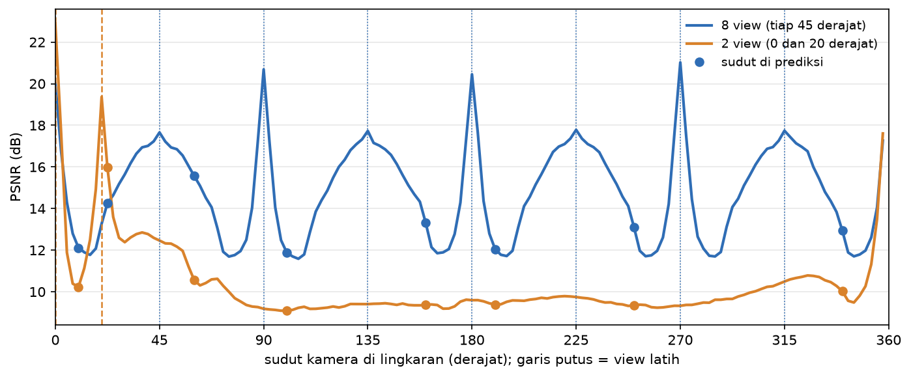
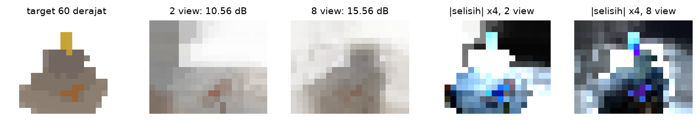
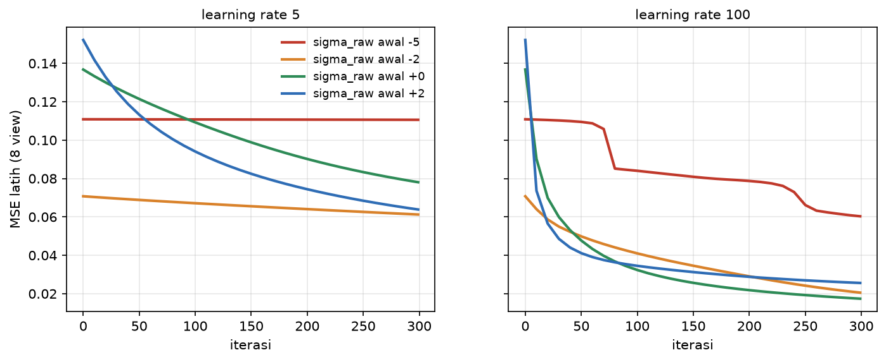
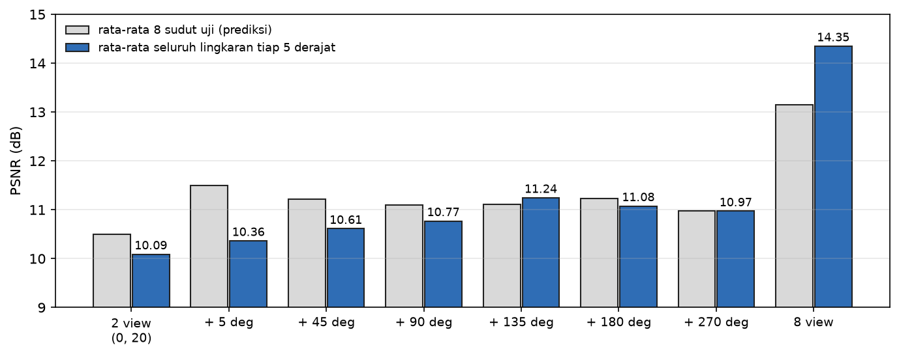

# Fase 4: Diagnosis view coverage dan pitfall (Lab 2 no 3 dan 4)

Urutan fase ini dipatok supaya riwayat git membuktikan diagnosis ditulis sebelum hasilnya ada:

1. `nerf_bug.py --diagnose` hanya melatih model 2 view dan mencetak bukti latih;
2. prediksi ditulis di `docs/prediksi/diagnosis-view-coverage.md` dan di-commit;
3. baru setelah itu perbandingan dengan sudut baru dijalankan, lalu perbaikan pitfall.

## 1. Mode `--diagnose` (K14)

`nerf_bug.py --diagnose` melatih **hanya** grid 2 view (sudut 0 dan 20 derajat), lalu mencetak kurva MSE latih setiap 50 iterasi dan PSNR rata-rata di kedua view latihnya. Mode ini tidak menghitung PSNR sudut baru, tidak menjalankan model 8 view, dan tidak memberi kesimpulan. Pengaturan latihnya sama persis dengan mode lengkap (500 iterasi, lr 100, grid 12³, seed 0). Yang berubah hanya seberapa sering MSE dicatat, dan itu tidak memengaruhi latihannya: MSE akhir dan PSNR latih di kedua mode sama (`0.00836`, `21.13 dB`).

```
$ .venv/bin/python nerf_bug.py --diagnose
DIAGNOSE -- 2 views [0, 20] deg, 500 iterations, lr=100.0
  iter    0  train MSE = 0.14035
  iter   50  train MSE = 0.02087
  iter  100  train MSE = 0.01616
  iter  150  train MSE = 0.01405
  iter  200  train MSE = 0.01268
  iter  250  train MSE = 0.01157
  iter  300  train MSE = 0.01061
  iter  350  train MSE = 0.00984
  iter  400  train MSE = 0.00923
  iter  450  train MSE = 0.00875
  iter  499  train MSE = 0.00836
  mean training-view PSNR = 21.13 dB
(training evidence only: no novel view and no 8-view run in this mode)
```

## 2. Penjelasan dosen yang dipindah ke sini

Docstring `nerf_bug.py` dan bagian "Notes on fixes applied while verifying" di README starter sudah menjelaskan hasil tugas ini sebelum dikerjakan. Sesuai keputusan K14, keduanya saya pindahkan ke sini apa adanya, supaya file kode dan README tidak membocorkan jawabannya. Teksnya milik dosen dan tidak saya ubah.

**Docstring asli `nerf_bug.py`:**

```
"""Diagnose-and-fix: too few / too-clustered training views cause a NeRF to
memorise the views it saw and fail on angles it did not -- the toy-scale,
from-scratch analogue of real "floaters" / background-collapse when a
capture has too few poses or too narrow a baseline.

BUGGY:  2 views, 20 deg apart (0 deg, 20 deg) -- almost the same viewpoint.
FIXED:  8 views spread evenly around the full ring (0..315 deg, step 45).

Both are trained identically otherwise and evaluated on the *same* held-out
novel view, chosen to be far from the buggy pair's narrow baseline. The gap
in novel-view PSNR is the diagnostic evidence: it is not that the buggy grid
"looks wrong" in general -- it fits its own two training views about as well
as the fixed grid fits its eight -- it is that it has never seen, and cannot
predict, the rest of the object.
"""
```

**Bagian asli README starter**, termasuk satu poin dari "What `python tests.py` asserts" yang juga sudah menyebut hasilnya:

> ## Notes on fixes applied while verifying
>
> - **`sigma_raw` initialised at `-5.0` (an "empty" starting scene) silently
>   stalled training.** `softplus'(x) = sigmoid(x)`, and `sigmoid(-5) ~ 0.0067`
>   -- the density gradient was crushed by that factor from the very first
>   step, so 300 iterations barely moved the loss (`0.1107 -> 0.1100`).
>   Re-initialising at `sigma_raw = 0` (density `ln 2`, a neutral "half-there"
>   start) fixed it immediately (loss `0.137 -> 0.009` over 800 iterations).
>   Kept as a named pitfall in `Module5_EN.tex` -- exactly the kind of "the
>   gradient exists in principle but is numerically dead" bug this course's
>   diagnose-and-fix doctrine is meant to catch.
> - **The first view-coverage comparison used the same novel angle
>   (`22.5 deg`) for both the 2-view and 8-view models** and found the
>   *2-view* model generalised *better* -- the opposite of the intended
>   lesson. Root cause: `22.5 deg` is only `2.5 deg` from the 2-view cluster's
>   second view (`20 deg`) -- an easy near-interpolation for that model -- while
>   it is a harder `22.5 deg` from the nearest of the 8 spread views. Fixed by
>   evaluating both models on a novel angle (`190 deg`) chosen to be far from
>   the clustered pair; the intended effect (spread views generalise better)
>   then appears consistently across several tested novel angles.
> - The analytic backward pass (`backward_grid`) was derived by hand from the
>   compositing formula and got the **suffix-sum term** right on the first
>   full implementation, confirmed immediately by the finite-difference check
>   in `tests.py` (`max err ~3e-11`) -- included here as the honest exception
>   to "here is what broke," since MASTER Sec 9.6 asks for this section either
>   way.
>
>
> - **View-coverage diagnose-and-fix** -- training a voxel grid on 8 views
>   spread around the full ring beats training on 2 views clustered `20 deg`
>   apart by `> 1 dB` PSNR on the *same* held-out novel view (typically
>   `+2.7 dB`), even though the 2-view grid fits its own (fewer) training
>   views about as well.

## 3. Hasil di sudut baru, setelah prediksi di-commit

Prediksi di-commit di `319add1` (3 November 2026, 19.21). Baru setelah itu `nerf_bug.py --sweep` saya tambahkan dan jalankan. Mode ini melatih kedua grid persis seperti mode lengkap, lalu mengukurnya di sudut-sudut yang sudah ditulis di prediksi. Targetnya render pas dari scene analitik, bukan file 8 bit.

```
$ .venv/bin/python nerf_bug.py --sweep
training-view PSNR: 2 views 21.13 dB, 8 views 19.13 dB
 angle  nearest view 2v/8v   2 views   8 views    8v - 2v
  10.0    10.0 / 10.0    10.23     12.11     +1.88
  22.5     2.5 / 22.5    15.97     14.26     -1.71
  60.0    40.0 / 15.0    10.56     15.56     +5.00
 100.0    80.0 / 10.0     9.10     11.88     +2.78
 160.0   140.0 / 20.0     9.36     13.31     +3.95
 190.0   170.0 / 10.0     9.39     12.05     +2.66
 250.0   110.0 / 20.0     9.34     13.10     +3.76
 340.0    20.0 / 20.0    10.02     12.94     +2.92
 270.0    90.0 /  0.0     9.32     21.02    +11.70  <- training view of the 8-view grid, not held out
```

Dari 8 sudut held-out, model 8 view menang di 7 sudut dengan selisih +1.88 sampai +5.00 dB. Satu-satunya yang kalah adalah 22,5 derajat (-1.71 dB). Baris 270 derajat bukan held-out untuk model 8 view, jadi selisih +11.70 dB di sana tidak saya hitung sebagai bukti.



Grafik di atas mengukur kedua model setiap 2,5 derajat di seluruh lingkaran (`figures.py --set readme`). Garis putus-putus adalah view latih.



### Prediksi vs hasil

| No | Prediksi | Hasil | |
|---|---|---|---|
| 1 | di 60, 100, 160, 250 derajat model 8 view menang lebih dari 1 dB, selisih sekitar 2 sampai 6 dB; model 2 view 8,5 sampai 11 dB, model 8 view 11,5 sampai 16 dB | selisih +5.00, +2.78, +3.95, +3.76; model 2 view 9.10 sampai 10.56, model 8 view 11.88 sampai 15.56 | tepat |
| 2 | di 22,5 derajat model 2 view menang sekitar 1 sampai 2 dB | 2 view menang 1.71 dB | tepat |
| 3 | di 10 derajat model 2 view di bawah 12 dB dan kalah | 10.23 dB, kalah 1.88 dB | tepat |
| 4 | di 340 derajat model 2 view kalah lebih dari 1 dB | kalah 2.92 dB | tepat |
| 5 | model 8 view lebih rata (rentang sekitar 4 dB di sudut held-out), model 2 view hanya bagus di dekat 20 derajat | rentang model 8 view di sudut yang diuji 3.68 dB; model 2 view tinggi hanya di dekat 0 dan 20 derajat | tepat untuk sudut yang diuji, tetapi grafik menunjukkan model 8 view pun naik-turun tajam (lihat bawah) |
| 6 | di 270 derajat model 8 view sekitar 18 sampai 20 dB | 21.02 dB | **meleset**, 1 dB di atas rentang |
| 7 | bagian kuda di 60 sampai 160 derajat paling rusak di model 2 view | tidak terbukti (lihat bawah) | **meleset** |

Prediksi 2 dan 3 bersandar pada T7 (scene tanpa kuda), jadi ketepatannya tidak terlalu mengejutkan. Prediksi 1, 4, 5, 6, dan 7 adalah sudut dan hal yang belum pernah diukur.

**Kenapa prediksi 7 meleset.** Saya ukur kesalahan rata-rata khusus di pixel kuda (pixel yang berubah kalau kuda dihapus dari scene):

| Sudut | Pixel kuda | Kesalahan di kuda: 2 view / 8 view | Kesalahan di sisa gambar: 2 view / 8 view |
|---|---|---|---|
| 60 | 6 | 0,125 / 0,104 | 0,234 / 0,124 |
| 100 | 7 | 0,180 / 0,162 | 0,310 / 0,200 |
| 160 | 3 | 0,165 / 0,161 | 0,294 / 0,163 |
| 10 | 5 | 0,172 / 0,319 | 0,220 / 0,192 |
| 340 | 5 | 0,479 / 0,470 | 0,263 / 0,160 |

Di sisa gambar, model 2 view jelas lebih buruk. Tetapi di kuda, kedua model sama-sama buruk. Penyebabnya bukan sebaran sudut, melainkan ukuran: kuda hanya selebar satu sampai dua voxel grid 12³, jadi tidak ada model yang bisa menggambarnya, berapa pun jumlah view-nya. Jumlah pixelnya juga hanya 2 sampai 7 per sudut, jadi angka di tabel ini mudah berubah dan tidak bisa dipakai menarik kesimpulan kuat. Pelajarannya: menambah view hanya menolong kalau modelnya cukup halus untuk menyimpan detail itu.

**Yang tidak saya prediksi, terlihat di grafik:**
- **Model 8 view juga sangat bergantung pada jarak ke view latih.** PSNR-nya sekitar 17,5 sampai 21 dB tepat di view latih, lalu turun sampai sekitar 11,6 dB di sela dua view latih. Delapan view tidak membuat model "paham" bentuk candi. Model hanya punya lebih banyak titik pegangan di sekeliling lingkaran, jadi tidak ada sudut yang jauh dari pegangan.
- **Model 2 view punya lantai sekitar 9 sampai 11 dB.** Lebih dari sekitar 40 derajat dari view latihnya, kualitasnya tidak turun lagi, karena di sana ia sudah sama sekali tidak tahu apa-apa. Yang tersisa hanya warna rata-rata.
- **View latih diagonal model 8 view lebih rendah.** Di 45, 135, 225, dan 315 derajat PSNR-nya sekitar 17,5 dB, sedangkan di 90, 180, dan 270 derajat sekitar 20,5 sampai 21 dB. Dugaan saya, ini karena sumbu voxel grid sejajar dengan sumbu x dan z, jadi kamera diagonal melihat tepi voxel yang miring. Belum saya buktikan.
- **Soal T7.** Panduan mencatat PSNR 12,02 dB yang persis sama di 10, 100, dan 190 derajat untuk scene tanpa kuda, dan menduga penyebabnya simetri 4 arah. Dengan kuda, simetri itu rusak, dan angkanya tidak lagi sama (12.11, 11.88, 12.05). Ini mendukung dugaan simetri tersebut, walaupun belum membuktikannya.

### Kesimpulan diagnosis

PSNR latih model 2 view (21.13 dB) lebih tinggi dari model 8 view (19.13 dB), padahal di 7 dari 8 sudut baru ia kalah 1,9 sampai 5 dB. Ini persis pitfall 12.2: kualitas di view latih tidak bisa membedakan model yang paham bentuk 3D-nya dari model yang hanya menghafal dua gambar. Penyebabnya pitfall 12.3: dua foto yang hanya berbeda 20 derajat hampir tidak memberi informasi kedalaman. Hasil di 22,5 derajat menunjukkan bahwa satu sudut uji saja bisa menyesatkan: kalau hanya sudut itu yang diuji, kesimpulannya terbalik. Karena itu saya menguji 8 sudut, dan grafiknya mengukur 144 sudut.

## 4. Perbaikan (a): nilai awal density, pitfall 12.1 (Lab 2 no 4)

Lab 2 no 4 meminta minimal satu perbaikan yang berangkat dari pitfall. Saya kerjakan keduanya sebagai eksperimen baru di `pitfall_fix.py`, bukan dengan menjalankan ulang angka starter.

**Cara.** Grid 12³ dilatih pada 8 file PPM capture saya (sama dengan `fit_nerf_toy.py`) selama 300 iterasi, dengan `sigma_raw` awal -5, -2, 0, dan +2. Warna awalnya sama di semua run (seed 0). Semuanya diulang di dua learning rate: 5 (default `nerf_toy.train`) dan 100 (yang dipakai `fit_nerf_toy.py` dan `nerf_bug.py`). MSE latih dicatat setiap 10 iterasi.

```
$ .venv/bin/python pitfall_fix.py --init
   lr   start  it   0  it  10  it  50  it 100  it 299   drop
    5     -5   0.1109  0.1109  0.1108  0.1108  0.1106   0.0003
    5     -2   0.0707  0.0703  0.0688  0.0671  0.0612   0.0095
    5     +0   0.1368  0.1333  0.1214  0.1093  0.0781   0.0587
    5     +2   0.1522  0.1417  0.1132  0.0941  0.0639   0.0883
  100     -5   0.1109  0.1107  0.1095  0.0840  0.0603   0.0505
  100     -2   0.0707  0.0640  0.0499  0.0410  0.0205   0.0502
  100     +0   0.1368  0.0902  0.0477  0.0323  0.0174   0.1194
  100     +2   0.1522  0.0736  0.0411  0.0345  0.0256   0.1266
```



**Pitfall 12.1 terkonfirmasi, tapi hanya di learning rate kecil.**
- **Di lr 5, start -5 benar-benar macet:** MSE hanya turun `0.0003` dalam 300 iterasi (`0.1109` ke `0.1106`), padahal start 0 turun `0.0587`. Penyebabnya sesuai rumus: `softplus'(-5) = sigmoid(-5) = 0,0067`, jadi setiap gradien density dikecilkan sekitar 150 kali sejak langkah pertama.
- **Di lr 100, start -5 tidak macet, hanya terlambat.** Sekitar 70 iterasi pertama hampir datar, lalu MSE-nya turun mendadak sekitar iterasi 70 sampai 80, dan sekali lagi sekitar iterasi 230 sampai 250. Di akhir masih tertinggal jauh (`0.0603` lawan `0.0174` untuk start 0). Learning rate 20 kali lebih besar cukup untuk mengimbangi gradien yang 150 kali lebih kecil, tetapi tidak sepenuhnya. Ini sesuai dengan T8 di panduan: klaim modul bahwa latihan "jelas macet" hanya terbukti di lr kecil.

**Yang tidak sesederhana "pakai 0":**
- Start -2 punya MSE awal paling rendah (`0.0707`). Density awalnya `softplus(-2) = 0,127`, hampir tembus pandang, sehingga gambar awalnya mendekati latar putih, yang memang menutupi sebagian besar gambar target. Tetapi turunnya lambat di lr 5.
- Start +2 turun paling cepat di awal (lr 100, iterasi 10: `0.0736`), tetapi berakhir lebih buruk dari start 0 (`0.0256` lawan `0.0174`). Kabut awal yang terlalu tebal harus "dibersihkan" dulu dari ruang kosong.
- Start 0, yang dipakai starter, memberi MSE akhir terbaik di lr 100. Di lr 5, start -2 (`0.0612`) dan +2 (`0.0639`) justru berakhir lebih rendah dari start 0 (`0.0781`) dalam 300 iterasi, jadi "0 selalu terbaik" juga tidak benar.

Kesimpulan: aturan modul "mulai dari titik netral, bukan dari ujung" terbukti. Yang paling berbahaya adalah ujung negatif, karena di situ turunan softplus hampir nol. Seberapa parah kerusakannya bergantung pada learning rate, jadi pitfall ini harus selalu dilaporkan bersama lr-nya.

## 5. Perbaikan (b): view ketiga, pitfall 12.3

**Tafsir saya atas "intermediate".** Modul meminta view ketiga yang "intermediate" tanpa menjelaskan artinya. Daripada menebak satu sudut, saya coba enam:
- 5 derajat, di dalam kelompok 0 dan 20 derajat: menambah jumlah foto tanpa menambah sebaran;
- 45, 90, 135, 180, dan 270 derajat: semakin jauh dari kelompok itu.

Setiap set 3 view dilatih persis seperti model 2 view (500 iterasi, lr 100). Nilainya diukur dengan dua cara:
- rata-rata di 8 sudut uji dari prediksi, yang semuanya bukan view latih di set mana pun;
- rata-rata di seluruh lingkaran setiap 5 derajat, tanpa view latih set itu sendiri.

```
$ .venv/bin/python pitfall_fix.py --third
  capture        train   held-out mean (vs 2 view)   ring mean every 5 deg (vs 2 view)
  2 view         21.13       10.50 (+0.00)               10.09 (+0.00)
  + 5 deg        20.67       11.50 (+1.00)               10.36 (+0.27)
  + 45 deg       19.25       11.22 (+0.72)               10.61 (+0.52)
  + 90 deg       20.78       11.09 (+0.60)               10.77 (+0.68)
  + 135 deg      19.52       11.12 (+0.62)               11.24 (+1.16)
  + 180 deg      20.73       11.23 (+0.74)               11.08 (+0.99)
  + 270 deg      20.91       10.98 (+0.48)               10.97 (+0.88)
  8 view         19.13       13.15 (+2.65)               14.35 (+4.26)
```

(Kolom PSNR per sudut saya potong di sini. Output lengkapnya dicetak oleh script.)



**Dua cara ukur memberi pemenang yang berbeda, dan itu sendiri pelajarannya.**
- **Dengan 8 sudut uji, view di 5 derajat terlihat paling menolong (+1,00 dB).** Tetapi kenaikannya hampir seluruhnya berasal dari dua sudut uji yang letaknya tepat di sebelahnya: di 10 derajat dari 10,23 menjadi 15,82 dB, dan di 22,5 derajat dari 15,97 menjadi 17,50 dB. Di enam sudut lainnya hampir tidak berubah.
- **Dengan seluruh lingkaran, view di 5 derajat justru paling sedikit menolong (+0,27 dB).** Pemenangnya view di 135 derajat (+1,16 dB), lalu 180 (+0,99) dan 270 (+0,88). Semakin jauh view ketiga dari kelompok, semakin besar bagian lingkaran yang ikut membaik.

Ini pitfall 12.3 dalam bentuk angka: foto yang hampir sama dengan foto yang sudah ada menambah jumlah, bukan sebaran. Kenaikannya hanya terasa di sudut yang sudah dekat dengan foto-foto lama. Ini juga mengulang pelajaran dari 22,5 derajat di bagian 3: memilih sudut uji yang kebetulan dekat dengan view latih bisa membalik kesimpulan, jadi pengukuran keliling lingkaran lebih bisa dipercaya.

**Seberapa banyak yang pulih.** View ketiga terbaik (135 derajat) memulihkan sekitar 1,2 dari 4,3 dB selisih antara model 2 view dan model 8 view di seluruh lingkaran, jadi sekitar seperempatnya. Satu view hanya menolong di sekitar arahnya sendiri, karena model hanya bagus di dekat view latih (grafik di bagian 3). Untuk menutup seluruh lingkaran tetap dibutuhkan view yang tersebar merata.

**Untuk capture HP saya sendiri.** Ke-28 foto patung kuda saya mengelilingi patung sekitar satu putaran (Fase 2), jadi sebarannya mirip model 8 view, bukan model 2 view. Celah antara foto terakhir dan foto pertama adalah bagian yang paling mungkin lemah kalau suatu saat direkonstruksi.
