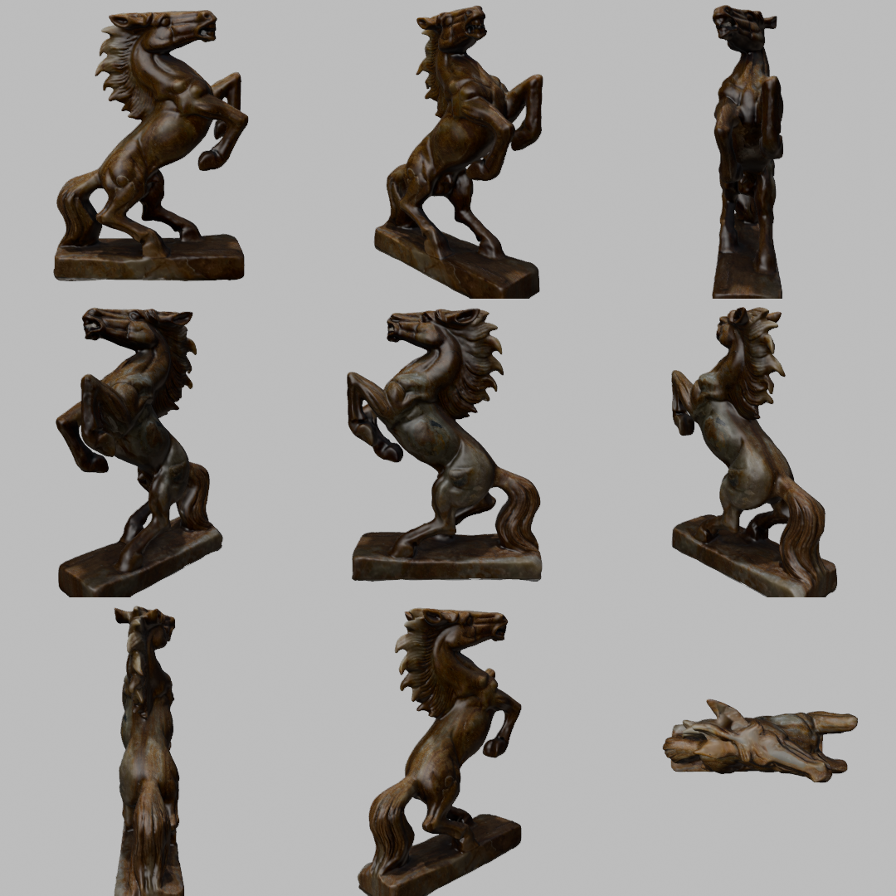
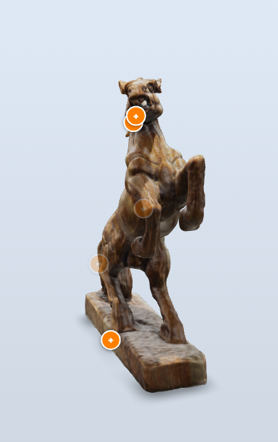
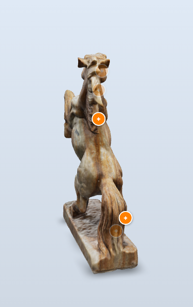
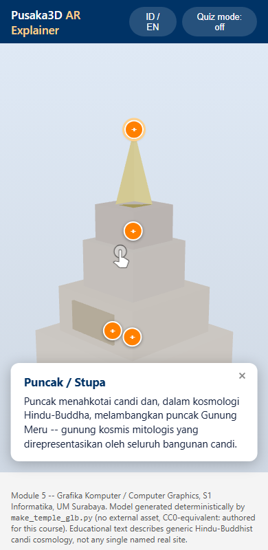
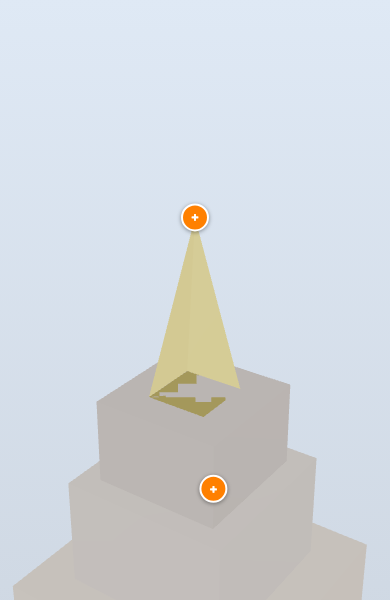
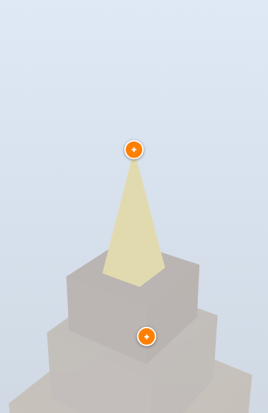

# Fase 5: AR app (Lab 3)

Fase ini dikerjakan dalam beberapa commit. Catatan ini bertambah setiap commit.

## 1. Model saya: scan photogrammetry patung kuda (Lab 3 no 1, pilihan a)

Lab 3 no 1 membolehkan dua pilihan: mengganti model candi dengan model saya sendiri, atau mempertahankan candi dengan isi hotspot baru. Saya memilih yang pertama, dengan model paling detail yang bisa saya buat dari subjek saya sendiri: patung kuda yang sama dengan Modul 1 sampai 4, di-scan dari foto.

### Dari 28 foto ke model 3D

`ar_app/tools/photogrammetry.swift` adalah program kecil yang memanggil Object Capture, fitur photogrammetry bawaan macOS (RealityKit `PhotogrammetrySession`). Photogrammetry artinya mencari titik yang sama di banyak foto, lalu menghitung letak titik itu dalam 3D dan posisi kamera tiap foto. Inputnya 28 foto Modul 1 (Fase 2, `data/my_capture/`). Saya coba dua tingkat detail:

| Tingkat | Waktu | Foto terpakai | Segitiga | Tekstur | File |
|---|---|---|---|---|---|
| medium | 193 detik | 28 dari 28 | 52.857 | warna, normal, AO, 4096 px | 34 MB |
| full | 224 detik | 28 dari 28 | 105.665 | warna, normal, roughness 8192 px, AO, displacement | 233 MB |

Dari dekat, versi full jelas lebih tajam di mata, lubang hidung, dan lekuk surai, jadi versi itu yang saya pakai. Keduanya berupa **satu potongan utuh**. Versi full hanya punya 83 tepi terbuka yang pendek, dan setelah model diluruskan ternyata 80 di antaranya kurang dari 1 cm dari lantai. Artinya celahnya ada di bawah alas, satu-satunya sisi yang tidak pernah terlihat kamera.

Hasil scan dari foto JPG biasa tidak punya ukuran: tinggi kudanya 1,015 "unit" tanpa satuan. Scan mentah tidak di-commit karena terlalu besar. Filenya disimpan di `ar_app/scan/` (di-ignore), dengan checksum di `assets/LICENSE.md`.

### Dari scan ke `kuda.glb` dalam meter

`ar_app/tools/scan_to_glb.py` berjalan di dalam Blender 5.2.2 (tanpa jendela) dan mengerjakan semuanya dari satu file scan:

1. **Meluruskan.** Dinding samping alas harus tegak. Arah "atas" dicari sebagai arah yang paling tegak lurus terhadap semua normal dinding alas. Model ternyata miring 1,59 derajat. Lantai ditentukan dari permukaan bawah alas (median berbobot luas), bukan dari titik terendah. Sebelum langkah ini, titik nolnya diambil dari titik nyasar sekitar 1 cm di bawah alas, sehingga di AR patungnya akan melayang 1 cm.
2. **Memutar.** Sumbu panjang alas dicari dengan PCA (arah sebaran titik terbesar) dan diputar ke sumbu x, dengan kepala di +x. Hasilnya, kamera default `<model-viewer>` melihat kuda dari samping.
3. **Menskalakan** dengan ukuran tangan saya (`assets/kuda_ukuran.json`, 3 November 2026). Panjang alas 46 cm dipakai sebagai patokan karena itu ukuran terpanjang, jadi kesalahan relatifnya paling kecil. Tiga ukuran lainnya menjadi pengecek:

| Ukuran | Saya ukur | Model | Selisih |
|---|---|---|---|
| panjang alas | 46 cm | 46,0 cm | patokan |
| tinggi total | 63 cm | 62,8 cm | -0,4% |
| lebar alas | 15 cm | 14,7 cm | -1,9% |
| tebal alas | 6 cm | 6,4 cm | +7% (0,4 cm) |

   Tiga pengecek itu cocok dalam batas ketelitian mengukur dengan tangan. Catatan ukuran di Modul 3 (alas 30 × 8 cm, tinggi sekitar 45 cm) ternyata tidak cocok dengan patungnya. Modul 3 tidak saya ubah, tetapi selisih ini saya catat di sini.
4. **Material:** warna dan normal map dari scan diperkecil dari 8192 ke 4096 px dan disimpan sebagai JPEG. Peta roughness 8K diganti satu nilai (0,45), karena manfaatnya kecil dibanding ukuran filenya.
5. **Hotspot** dihitung dari mesh yang sama (lihat bagian 2), lalu semuanya diekspor menjadi satu GLB.

Hasilnya `assets/kuda.glb`: 4,41 MB, 52.869 vertex, 105.665 segitiga, dalam meter (glTF memakai meter dan y ke atas). Kalau script dijalankan ulang dari scan yang sama, `kuda.glb` dan `hotspots_kuda.json` identik byte per byte. Apakah scan ulang dari foto juga menghasilkan file yang sama belum saya uji.



Gambar di atas dibuat oleh `ar_app/tools/render_views.py`, juga lewat Blender. Kalau dijalankan ulang, hasilnya identik.

## 2. Hotspot: tema "cara model ini dibuat"

Isi lima hotspot ditulis di `tools/kuda_hotspot_text.json`, dalam bahasa Inggris dan Indonesia. Setiap angka di dalamnya berasal dari data saya sendiri (ukuran, log scan, `data/my_capture/`, output script), jadi tidak ada klaim sejarah atau budaya yang tidak bisa saya buktikan:

| Hotspot | Isi |
|---|---|
| Alas | patokan ukuran: 46 cm diukur tangan, tinggi 62,8 vs 63 cm, lebar 14,7 vs 15 cm, glTF dalam meter, AR dikunci 100% |
| Surai | 28 foto iPhone 17 Pro, Object Capture, 105.665 segitiga dalam kurang dari empat menit |
| Kaki depan terangkat | bagian tipis yang hanya utuh karena difoto dari banyak sisi; dari sudut tertentu menutupi badan |
| Kepala | warna diambil dari foto, tekstur 8192 px diperkecil ke 4096 px, file 4,4 MB |
| Ekor | foto ke-10 sampai 12 dari belakang; scan satu potongan, celahnya hanya di bawah alas |

**Posisi berasal dari sumber yang sama dengan geometri** (aturan panduan 2.8 no 10). Setiap hotspot punya titik bidik dalam pecahan kotak pembatas model. Script menembakkan ray dari depan model ke titik itu. Titik pertama yang mengenai mesh menjadi posisi hotspot, dan normal permukaannya menjadi arah hotspot. Ini ray yang sama dengan Fase 2 dan 3, kali ini dipakai untuk menaruh label di permukaan. Karena posisi dan geometri dihitung bersama, hotspot tidak mungkin melayang kalau modelnya diproses ulang.

## 3. Dua model dalam satu halaman

Sesuai pilihan saya, AR app sekarang punya tombol **Model**. Kuda saya jadi model utama, dan candi dosen tetap bisa dipilih. Masing-masing model membawa file `.glb`, posisi kamera awal, dan file hotspot sendiri (`MODELS` di `app.js`), sedangkan HTML, CSS, panel info, mode quiz, dan tombol bahasa tetap sama. Ini sekaligus bahan paragraf integrasi Lab 3 no 5: yang berubah saat mengganti model hanya aset dan konfigurasinya, cangkang HTML/JS-nya tidak. `make_temple_glb.py` tetap jalan dan tetap menulis `hotspots.json` milik candi, jadi langkah clean clone Lab 3 no 4 tetap berlaku.

Footer halaman sekarang menyebut asal-usul dan lisensi kedua model. `assets/LICENSE.md` berisi baris provenance lengkap untuk setiap aset. Lisensi model kuda CC BY-NC 4.0, pilihan saya. Catatan jujur: pembuat patung aslinya tidak saya ketahui, jadi apakah desainnya boleh disebarkan sebagai model 3D masih "This needs verification", persoalan yang sama dengan kasus Nefertiti.

## 4. Bukti

**Browser headless** (`verify_ar_app.py`, Playwright dengan Chromium, server di `127.0.0.1:8743` lalu dimatikan): **12 ok**, sebelumnya 10.
- Model default adalah `kuda.glb`, dan model ter-render di canvas WebGL.
- Lima hotspot kuda masuk; klik surai membuka panel "Mane: 28 photos", dan setelah ganti bahasa menjadi "Surai: 28 foto".
- Mode quiz memilih target.
- Tombol Model memuat candi dengan lima hotspot miliknya sendiri, tanpa sisa hotspot kuda.
- Tidak ada error JavaScript.

Screenshot yang dihasilkan memperlihatkan kuda dengan lima hotspot di tempat yang benar. Screenshot itu saya kembalikan ke versi dosen dengan `git checkout`, karena penggantian screenshot dijadwalkan bersama perbaikan tombol bahasa (K16).

**`tests.py`: 68 ok**, sebelumnya 57. `test_ar_assets` menambah 11 check:
- panjang alas di GLB = 46 cm;
- tinggi dan lebar sesuai ukuran tangan (2% dan 5%);
- model berdiri di lantai;
- tidak ada bagian yang tenggelam lebih dari 1 cm;
- file di bawah 10 MB;
- metadata GLB hanya berisi nama exporter (Blender glTF), tanpa teks lain;
- lima hotspot lengkap dua bahasa;
- setiap hotspot paling jauh 5 mm dari permukaan mesh (terjauh 1,7 mm);
- normal hotspot panjangnya 1;
- setiap aset punya baris provenance dengan semua kolom terisi. Ini usulan pengecekan otomatis dari refleksi Fase 2(c), sekarang sudah jadi test.

Rusak dengan sengaja di salinan sementara, ketiganya gagal:

| Kerusakan | Hasil |
|---|---|
| kolom lisensi `kuda.glb` di LICENSE.md dikosongkan | gagal: baris provenance tidak lengkap |
| panjang alas di `kuda_ukuran.json` diubah menjadi 40 cm | gagal: panjang di GLB 0,46 m, bukan 0,40 m |
| hotspot surai digeser 2 cm keluar dari permukaan | gagal: jarak ke mesh 1,8 cm |

Uji di HP (sesi AR sungguhan) belum dilakukan. Itu langkah terakhir Fase 5, dan saya sendiri yang mengujinya.

## 5. Uji occlusion hotspot, setelah prediksi di-commit (Lab 3 no 2)

Prediksi di-commit di `24bd4c0` (3 November 2026, 20.05). Baru setelah itu alat ujinya dibuat dan dijalankan.

### Cara uji

- **Yang ditampilkan `<model-viewer>`:** `verify_ar_app.py --occlusion` memutar kamera setiap 5 derajat di sekeliling kuda pada polar 75 derajat (72 sudut), ditambah 4 sudut dari atas (polar 25 derajat). Di setiap sudut, dicatat opacity tiap hotspot di browser: 1 berarti tampil, 0,25 berarti diredupkan.
- **Kebenaran geometri** (`ar_app/occlusion.py`, NumPy saja). Hotspot dianggap benar-benar terlihat kalau dua syarat terpenuhi:
  1. permukaan tempatnya menghadap kamera;
  2. ray dari hotspot ke posisi kamera tidak menabrak satu pun dari 105.665 segitiga mesh.
- **Tiga kesalahan alat uji yang saya temukan dan perbaiki sebelum percaya hasilnya:**
  - **Titik awal ray.** Awalnya titik awal ray diangkat 2 mm dari permukaan, tanpa syarat 1. Di sudut yang hampir menyamping, ray dari titik yang diangkat itu bisa lolos dari tepi bagian tipis seperti ekor, sehingga titik yang membelakangi kamera dihitung terlihat. Sekarang angkatannya 0,1 mm dan syarat 1 diberlakukan.
  - **Waktu membaca.** Awalnya status hotspot dibaca terlalu cepat setelah kamera dipindah. Di sudut atas, `<model-viewer>` belum sempat memperbarui status hotspot, sehingga beberapa hotspot tercatat tampil padahal normalnya jelas membelakangi kamera (nilai -0,27 sampai -0,52), dan itu mustahil menurut kodenya sendiri. Sekarang alat uji menunggu sampai kamera tepat di sudut tujuan, lalu 6 frame dan 300 ms lagi.
  - **Kamera yang bergoyang sendiri.** Run konfirmasi ternyata tidak identik dengan run sebelumnya. Penyebabnya *interaction prompt* `<model-viewer>`: selama pengguna belum menyentuh model, kamera digoyang beberapa derajat sebagai petunjuk bahwa model bisa diputar. Kamera tidak pernah tepat di sudut yang diminta, dan alat uji yang diperketat (kamera wajib sampai di sudut tujuan, kalau tidak berhenti) tidak pernah bisa melewati sudut 15 derajat. Untuk pengukuran, prompt itu dimatikan lewat alat uji saja. AR app-nya tidak diubah.
- Setelah tiga perbaikan itu, dua run berturut-turut memberi hasil yang identik, dan kamera terbukti berada tepat di setiap sudut (selisih di bawah 0,006 derajat).

### Bukti cara kerja `<model-viewer>` 3.5.0, dari kodenya sendiri

Saya baca kode `model-viewer.min.js` versi 3.5.0, versi yang dimuat AR app:
- **Fungsi `updateHotspotsVisibility`** menghitung arah dari hotspot ke kamera, mengalikannya (dot) dengan normal hotspot, lalu memanggil `hide()` kalau hasilnya negatif dan `show()` kalau tidak. Tidak ada ray, tidak ada depth buffer. **D1 terbukti.**
- **`hide()`** hanya memasang class `hide` pada pembungkus internal hotspot (di dalam shadow DOM, sehingga tidak terlihat oleh CSS halaman). Atribut `data-visible` hanya dipasang pada tombol kalau tombolnya punya `data-visibility-attribute`. `app.js` starter tidak memasangnya, jadi aturan `.hotspot.hidden { display: none; }` di `style.css` tidak pernah aktif. Hotspot yang "tersembunyi" tetap ada dengan opacity 0,25. Uji di browser: dari belakang (`180deg 75deg`), hotspot alas beropacity 0,25, dan **mengetuknya tetap membuka panel info**. **D2 terbukti.** Komentar di `style.css` menyebut `<model-viewer>` mengatur atribut itu, tetapi kodenya tidak pernah menyambungkannya. Kasusnya mirip T11: klaim di komentar tidak sesuai dengan yang dikerjakan kode.

### Hasil

Dari 76 sudut × 5 hotspot = 380 keputusan, 11 tidak cocok dengan geometri, dan **semuanya ke arah yang sama: hotspot tampil penuh padahal titiknya tidak terlihat**. Tidak ada hotspot yang disembunyikan padahal terlihat. Nilai dalam kurung adalah dot normal dengan arah ke kamera, yaitu angka yang dipakai `<model-viewer>`:

| Hotspot | Tampil padahal tertutup bagian lain | Hampir menyamping (\|dot\| < 0,1) |
|---|---|---|
| kaki | **255, 260, 265, 270 derajat** (dot +0,13 sampai +0,33) | 250 |
| surai | **70 derajat** (+0,18); dari atas: 90/25 (+0,11), 270/25 (+0,29) | 75, 80 |
| alas | tidak ada | 270/25 |
| kepala | tidak ada | tidak ada |
| ekor | tidak ada | tidak ada |




### Prediksi vs hasil

| No | Prediksi | Hasil | |
|---|---|---|---|
| D1 | `<model-viewer>` memutuskan hanya dari normal | terbukti dari kodenya: hanya dot normal dengan arah kamera | tepat |
| D2 | hotspot tersembunyi hanya redup (sekitar 0,25), aturan `.hotspot.hidden` tidak aktif, mungkin masih bisa diketuk | opacity 0,25, `display` tetap `flex`, dan mengetuknya membuka panel | tepat |
| 1 | dari `0deg 80deg` kelima hotspot terlihat dan benar | benar | tepat |
| 2 | dari belakang kelima hotspot dianggap tersembunyi, dan itu benar | benar, tetapi masih bisa diketuk (D2) | tepat |
| 3 | yang paling sulit surai, salah tampil di sekitar 55 sampai 79 derajat | surai memang salah tampil di 70 derajat (tertutup leher), tetapi rentangnya lebih sempit: di 55 sampai 65 derajat leher belum menutupinya. Perkiraan lebar leher saya terlalu besar | **sebagian tepat** |
| 4 | kaki, alas, kepala, ekor hampir selalu benar | kepala, ekor, dan alas benar; **kaki paling sering salah**, 4 sudut tertutup ditambah 1 sudut menyamping | **meleset untuk kaki** |
| 5 | dari atas, kaki dianggap tersembunyi dan itu benar | benar | tepat |

**Kenapa prediksi kaki meleset.** Saya hanya memikirkan kamera di sisi kepala. Ternyata normal hotspot kaki `(-0,43; -0,36; 0,83)` condong ke **-x**, ke arah ekor, karena ray penempatnya mengenai sisi dalam kaki yang terangkat. Jadi dari sisi ekor (azimuth sekitar 255 sampai 270 derajat), normal itu masih "menghadap" kamera, padahal di antara kaki dan kamera ada seluruh badan kuda. Pelajarannya: normal di permukaan yang melengkung bisa menunjuk ke arah yang tidak terduga, dan `<model-viewer>` mempercayai normal itu sepenuhnya.

**Keterbatasan uji ini:**
- Kebenaran geometrinya dihitung dengan rumus kamera saya sendiri dari sudut dan target yang dilaporkan `<model-viewer>`. Kasus hampir menyamping (\|dot\| < 0,1) bisa berbalik karena selisih yang sangat kecil, jadi kasus itu saya pisahkan dan tidak saya hitung sebagai kegagalan occlusion.
- Pengujian ini memakai browser headless di Mac, bukan HP.

`tests.py` mendapat `test_occlusion_truth` (4 check, total 72 ok). Test ini memastikan dasar uji di atas benar:
- segitiga di antara titik dan kamera menghalangi;
- tanpa penghalang, titik terlihat;
- permukaan yang membelakangi kamera tidak pernah dihitung terlihat;
- di mesh kuda yang asli, hotspot alas terlihat dari depan dan tidak terlihat dari belakang.
`ar_app/occlusion.py` juga ikut dicek larangan import selain NumPy.

Perbaikannya (hotspot redup yang masih bisa diketuk, dan normal hotspot kaki serta surai) saya kerjakan di commit berikutnya, terpisah dari hasil uji ini.

## 6. Perbaikan occlusion hotspot

Hasil uji di bagian 5 menunjukkan dua masalah: hotspot yang tersembunyi masih bisa diketuk, dan hotspot kaki serta surai tampil saat tertutup. Keduanya saya perbaiki di sini, lalu diukur ulang dengan alat uji yang sama.

### (a) Hotspot tersembunyi tidak bisa diketuk lagi

`app.js` sekarang memasang `data-visibility-attribute="visible"` pada setiap tombol hotspot. Dengan itu, `<model-viewer>` memasang atribut `data-visible` saat normal hotspot menghadap kamera, dan mencabutnya saat membelakangi. Di `style.css`, aturan lama `.hotspot.hidden { display: none; }` yang tidak pernah aktif saya ganti dengan `.hotspot:not([data-visible]) { pointer-events: none; }`. Hotspot yang tersembunyi tetap terlihat samar (redup dari `<model-viewer>`), tetapi ketukan diteruskan ke model. Pengguna masih bisa memutar model dari situ dan tidak membuka panel bagian yang ada di balik patung.

Perbaikan ini memunculkan satu bug dari commit 12 milik saya sendiri. Setelah tombol Model ditekan, kamera candi (`35deg 75deg 1.2m`) tidak pernah dipakai, karena `<model-viewer>` mengembalikan kamera ke atribut `camera-orbit` halaman setiap kali model baru dimuat. Di polar 80 derajat, normal hotspot stupa (lurus ke atas) sedikit membelakangi kamera. Selama hotspot tersembunyi masih bisa diketuk, bug ini tidak terlihat. Sekarang `app.js` memasang kamera model baru setelah event `load`.

`verify_ar_app.py` mendapat dua check baru (total **14 ok**):
- **dari belakang**, semua hotspot kuda tersembunyi, dan mengetuk salah satunya tidak membuka panel apa pun. Check ini gagal kalau baris `data-visibility-attribute` dibuang dari `app.js`;
- **tombol Model juga memindah kamera** ke posisi candi (polar 75 derajat). Check ini gagal dengan `app.js` versi commit 12: polarnya tetap 80 derajat.

### (b) Normal yang dipilih untuk visibilitas, bukan sekadar normal permukaan

Bagi `<model-viewer>`, normal hotspot hanya dipakai untuk satu hal: menentukan dari arah mana hotspot dianggap terlihat. Jadi normal itu boleh dipilih supaya tes dot `<model-viewer>` sesuai dengan occlusion yang sebenarnya.

`occlusion.py --tune` melakukan itu untuk setiap hotspot:
1. Mencoba sekitar 4000 arah yang tersebar rata di bola, dibatasi paling jauh 75 derajat dari normal permukaan.
2. Untuk setiap arah, menghitung berapa kali tes dot salah dibanding kebenaran ray, pada **288 kamera latih**: polar 40, 60, 80, dan 95 derajat, azimuth 2,5; 7,5; 12,5; ... derajat.
3. Memilih arah dengan kesalahan paling sedikit. Kalau seri, normal permukaan yang dipakai.

Kamera latih itu sengaja tidak ada yang sama dengan kamera uji browser (polar 75 dan 25 derajat, azimuth kelipatan 5 derajat), supaya uji browser tetap jujur dan normalnya tidak "menghafal" sudut uji. Normal permukaan asli tetap disimpan sebagai `surface_normal` di `hotspots_kuda.json`.

Untuk kaki, satu arah normal tidak cukup: kesalahannya hanya turun dari 20 menjadi 17 di kamera latih. Titik di sisi dalam kaki yang terangkat memang terlihat dari depan, tetapi terhalang badan dari sisi ekor, dan pola seperti itu tidak bisa dibagi dengan satu bidang. Karena itu saya mencari **titik lain di kaki yang sama**. Saya mencoba 109 titik bidik di daerah kaki terangkat, ray dari depan seperti `scan_to_glb.py`. Titik di sisi luar kaki, bidikan `(0,94; 0,62)`, hanya 1,8 cm dari titik lama, punya **0 kesalahan** di semua kamera latih, bahkan dengan normal permukaannya sendiri. Bidikan di `tools/kuda_hotspot_text.json` saya ganti ke titik itu, `scan_to_glb.py` dijalankan ulang (`kuda.glb` tetap identik byte per byte, hanya hotspot yang berubah), lalu `occlusion.py --tune`.

| Hotspot | Kesalahan di 288 kamera latih: normal permukaan → normal terpilih | Normal bergeser |
|---|---|---|
| alas | 5 → 1 | 7 derajat |
| surai | 24 → 10 | 30 derajat |
| kaki (titik baru) | 0 → 0 | 0 derajat |
| kepala | 0 → 0 | 0 derajat |
| ekor | 0 → 0 | 0 derajat |

### Hasil di uji browser (kamera uji yang tidak dipakai memilih)

`verify_ar_app.py --occlusion`, dijalankan dua kali dengan hasil identik:

| | Sebelum (commit 14) | Sesudah |
|---|---|---|
| keputusan yang tidak cocok dengan geometri, dari 380 | 11 | **1** |
| tampil padahal tertutup bagian lain | 7 (kaki 4; surai 3: 70 derajat dan dua dari atas) | **0** |
| hampir menyamping | 4 | 1 (surai di 255 derajat, dot +0,08) |
| disembunyikan padahal terlihat | 0 | 0 |
| hotspot redup bisa diketuk | ya | **tidak** |



`tests.py` (**73 ok**) sekarang juga mengecek bahwa normal di `hotspots_kuda.json` memang hasil `occlusion.py --tune`. Kalau model atau titik bidik diubah tanpa menjalankan ulang langkah itu, test gagal.

**Urutan membuat ulang aset kuda:**
1. `photogrammetry.swift` (dari foto ke scan);
2. `scan_to_glb.py` di Blender (scan ke `kuda.glb` dan posisi hotspot);
3. `occlusion.py --tune` (normal hotspot).

**Keterbatasan:**
- Normal terpilih bergantung pada posisi kamera otomatis `<model-viewer>` (target dan jarak yang dilaporkannya). Di AR sungguhan kamera bisa berada di mana saja, misalnya jauh lebih dekat, jadi hasilnya mungkin sedikit berbeda.
- Surai masih punya 10 kesalahan di kamera latih. Di kamera uji browser hanya tersisa satu kasus hampir menyamping, tetapi di sudut lain kesalahan itu tetap bisa muncul.

## 7. Tombol bahasa: panel yang sedang terbuka tidak ikut berganti (T11, K16)

**Klaim modul:** di Walk-through no 4, tombol bahasa disebut mengganti setiap panel yang sedang terbuka maupun yang dibuka nanti. Komentar di `app.js` starter juga menulis "refresh any open panel text", tetapi kodenya hanya mengganti nama target quiz. Check starter di `verify_ar_app.py` lolos karena setelah mengganti bahasa ia **mengklik hotspot lagi**, jadi yang teruji adalah panel baru, bukan panel yang sedang terbuka.

**Bukti di browser dulu, baru diperbaiki.** Saya tambahkan check yang mengganti bahasa **tanpa** mengklik ulang, lalu menjalankannya pada `app.js` yang belum diubah:

```
[ok] clicking a hotspot opens the info panel (title='Mane: 28 photos')
[FAIL] language toggle swaps the panel that is already open ('Mane: 28 photos' -> 'Mane: 28 photos')
```

**Perbaikan di `app.js`:** isi panel sekarang disimpan dalam satu keadaan, `panel`, yang berisi:
- `null` kalau panel tertutup;
- hotspot yang diketuk;
- atau jawaban quiz (hotspot yang diketuk, yang dicari, benar atau salah).

Satu fungsi, `renderPanel()`, menggambar panel dari keadaan itu dalam bahasa yang sedang aktif. Fungsi itu dipanggil saat hotspot diketuk, saat quiz dijawab, dan saat bahasa diganti. Label aksesibilitas (`aria-label`) tiap hotspot juga ikut berganti bahasa. Kode starter yang membuat elemen label anotasi tetapi tidak pernah memasangnya ke halaman (temuan T11) saya hapus, bersama aturan CSS-nya yang jadi tidak terpakai.

**Bukti sesudahnya** (`verify_ar_app.py`, **16 ok**):
- panel yang sedang terbuka berganti dari "Mane: 28 photos" ke "Surai: 28 foto" tanpa diklik ulang;
- jawaban quiz yang sedang tampil ikut berganti bahasa. Check ini gagal kalau baris `renderPanel()` di tombol bahasa dibuang;
- check starter yang mengklik ulang tetap ada dan tetap lolos.

**Screenshot milik saya (K5, K16).** `verify_ar_app.py` sekarang menulis keempat screenshot dengan nama yang sama seperti milik dosen di `ar_app/screenshots/`, jadi screenshot dosen sudah tergantikan oleh hasil app saya sendiri:
- `m5_ar_overview.png`: tampilan awal kuda dengan lima hotspot;
- `m5_ar_infopanel_en.png`: panel surai dalam bahasa Inggris;
- `m5_ar_infopanel_id.png`: panel yang sama setelah tombol bahasa ditekan, tanpa diklik ulang;
- `m5_ar_quizmode.png`: mode quiz dengan jawaban salah.

Screenshot tidak saya salin ke `docs/img/`, supaya tidak ada dua salinan file yang sama. Dokumen merujuk langsung ke `Source/ar_app/screenshots/`.



Satu hal yang saya temukan saat membuat screenshot dan belum saya selidiki: setelah kamera diputar ke belakang lalu dikembalikan ke `0deg 80deg` lewat kode, `<model-viewer>` melaporkan sudut dan jarak yang sama, tetapi kuda tampak lebih kecil dan lebih tinggi di layar. Supaya semua screenshot diambil dari kamera awal yang sama, check "dari belakang" saya pindahkan ke setelah screenshot diambil.

## 8. Puncak candi dosen yang bolong (T10)

Model candi dosen tetap ada di app sebagai pilihan kedua, jadi panduan meminta T10 diperiksa dulu. T10 adalah temuan run awal bahwa keempat sisi piramida puncak (stupa) menghadap ke dalam, tetapi efek visualnya waktu itu belum terbukti.

**Bukti angka dulu.** Test baru `test_temple_faces_outward` membaca `pusaka_temple.glb` dan mengecek setiap segitiga: urutan titiknya harus berlawanan arah jarum jam dilihat dari luar (sisi depan menurut glTF), dan normalnya harus searah. Setiap bagian candi berbentuk cembung, jadi "luar" berarti menjauhi titik tengah bagian itu. Hasil pada model dosen:
- lima bagian (kaki, badan, badan atas, atap, relief) benar semua;
- **stupa: 6 dari 6 segitiga menghadap ke dalam** (empat sisi dan dua segitiga alas);
- 2 normal alas berlawanan dengan urutan titiknya.

Angka ini cocok persis dengan T10.

**Bukti di browser.** Dari dekat, puncak candi dosen tampak tembus pandang: alas perseginya yang ada di dalam terlihat dari luar. Browser membuang sisi yang membelakangi kamera (backface culling), dan sisi yang dianggap "membelakangi" justru sisi luar piramida, jadi yang tampil adalah sisi dalamnya.

**Perbaikan** di `make_temple_glb.py`, fungsi `pyramid()`:
- sisi miring sekarang memakai urutan `(p0, apex, p1)`, dengan normal `cross(apex - p0, p1 - p0)` yang menghadap ke luar;
- urutan segitiga alas dibalik supaya berlawanan arah jarum jam dilihat dari bawah, searah dengan normalnya yang menunjuk ke bawah.

Ukuran file tetap 9.604 byte. `hotspots.json` yang dibuat ulang isinya sama persis (hanya akhiran barisnya berubah dari CRLF ke LF), jadi file itu saya kembalikan ke versi dosen.

| Sebelum | Sesudah |
|---|---|
|  |  |

Gambar di atas dibuat dengan `verify_ar_app.py --temple-closeup <file>`: kiri dengan `pusaka_temple.glb` versi dosen, kanan dengan versi yang sudah diperbaiki.

**Bukti sesudah:**
- `test_temple_faces_outward`: 0 segitiga menghadap ke dalam, 0 normal berlawanan, dari 66 segitiga. Total **75 ok**;
- `verify_ar_app.py` tetap 16 ok;
- baris provenance candi di `assets/LICENSE.md` sekarang mencatat perubahan ini.

Candinya tetap sederhana (kotak berwarna polos tanpa tekstur). Itu memang rancangan dosen sebagai contoh yang bisa dibuat ulang dari kode, dan saya biarkan apa adanya.
