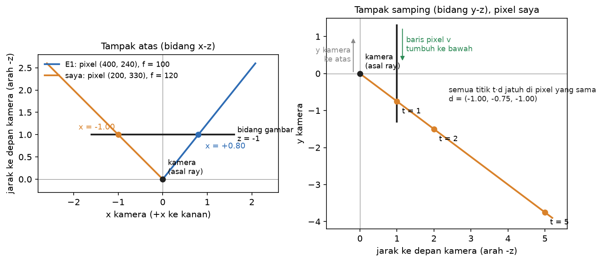
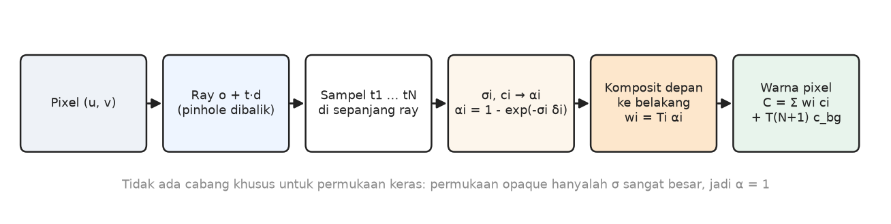
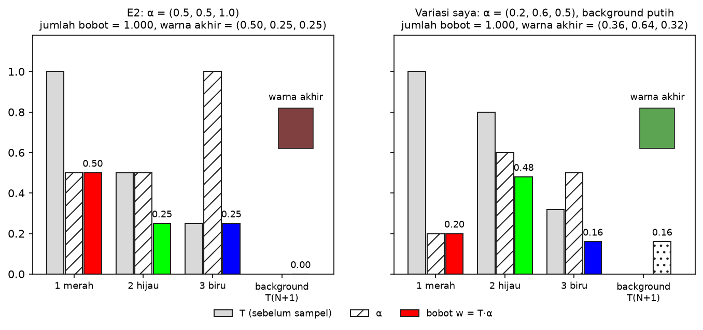
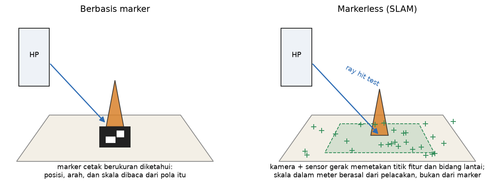

# Studi Pendahuluan Modul 5: AI Graphics, NeRF, World Models & AR

Zacky Maulana (NIM 20241337034), S1 Informatika UMSurabaya
Praktikum Grafika Komputer

Semua hitungan di dokumen ini saya kerjakan dengan tangan dulu, lalu saya cek ulang dengan `ray_generator.py` dan `volume_render.py` di `Module5/Source`. Diagram dibuat oleh `Source/figures.py`, dan setiap ray, transmittance, dan bobot di gambar dihitung dengan fungsi yang sama, jadi gambarnya tidak mungkin berbeda dengan kodenya. Perintah untuk membuat ulang gambar: `.venv/bin/python figures.py --set studi`.

Karena soal Q1(b) dan Q2(c) memakai angka yang jawabannya sudah tercetak di modul (contoh E1 dan E2), setiap soal itu saya kerjakan dua kali: sekali dengan angka modul, sekali dengan angka pilihan saya sendiri.

Konvensi yang saya pakai di seluruh dokumen, sama dengan kode:
- kamera menghadap sumbu -z, +x ke kanan, +y ke atas (sama dengan Modul 3);
- pixel ditulis `(u, v)`: `u` kolom dari kiri, `v` baris dari atas, jadi `v` tumbuh ke bawah;
- focal length `f` dan principal point `(cx, cy)` dalam satuan pixel;
- transmittance sisa untuk background saya tulis `T(N+1)`, bukan `T(N)` seperti di modul (alasannya di Q2(b)).

---

## Q1. Ray generation



### Q1(a) Kenapa membuat ray adalah kebalikan proyeksi, dan kenapa hasilnya arah

Di Modul 3, titik 3D `(x, y, z)` di ruang kamera dipetakan ke layar dengan membagi oleh kedalamannya. Dengan kamera menghadap -z:

```
u = cx + f · x / (-z)
v = cy - f · y / (-z)
```

Pembagian dengan `-z` inilah yang membuat proyeksi tidak bisa dibalik secara penuh. Kalau saya ambil titik `(x, y, z)` lalu mengalikannya dengan bilangan positif apa pun, misalnya `(2x, 2y, 2z)`, hasil baginya sama persis, jadi pixelnya juga sama. Semua titik di sepanjang satu garis lurus dari pusat kamera jatuh di pixel yang sama. Informasi "seberapa jauh" hilang saat proyeksi.

Membuat ray adalah pertanyaan sebaliknya: kalau yang saya tahu hanya pixelnya, titik mana saja yang mungkin menghasilkan pixel itu? Jawabannya bukan satu titik, melainkan seluruh garis tadi. Garis itu ditulis `r(t) = o + t·d`: `o` adalah posisi kamera (sama untuk semua pixel di satu foto), `d` adalah arah yang berbeda untuk setiap pixel, dan `t` adalah kedalaman yang tidak diketahui. Karena `t` tidak diketahui, yang bisa dihitung dari pixel hanyalah arah `d`. Itulah sebabnya hasil ray generator adalah arah, bukan titik. NeRF nanti justru memanfaatkan ini: kedalaman tidak ditebak di awal, tetapi semua `t` di sepanjang ray diperiksa dan dicampur (Q2).

Gambar kanan di atas memperlihatkan hal ini untuk pixel saya: titik dengan `t = 1`, `t = 2`, dan `t = 5` di sepanjang ray yang sama. Ketiganya saya proyeksikan ulang dengan rumus di atas, dan ketiganya kembali tepat ke pixel `(200, 330)`.

### Q1(b) Hitungan tangan

Rumus arah di ruang kamera:

```
d_cam = ( (u - cx) / f ,  -(v - cy) / f ,  -1 )
```

**Angka modul.** `f = 100` px, principal point `(320, 240)`, pixel `(400, 240)`.

```
x = (400 - 320) / 100 = 80 / 100 = 0,8
y = -(240 - 240) / 100 = 0
z = -1
d_cam = (0,8; 0; -1)
```

Panjangnya `√(0,8² + 0² + 1²) = √1,64 = 1,2806`, jadi arah yang dinormalisasi `(0,8 / 1,2806; 0; -1 / 1,2806) = (0,625; 0; -0,781)`. Pixel ini 80 px di kanan pusat dan tepat di garis tengah horizontal, jadi masuk akal kalau ray-nya hanya miring ke kanan tanpa miring ke atas atau ke bawah.

**Angka saya.** `f = 120` px, principal point `(320, 240)`, pixel `(200, 330)`. Saya sengaja memilih pixel di **kiri bawah** pusat, supaya komponen x dan y sama-sama tidak nol dan pengaruh tanda minus pada y kelihatan.

```
x = (200 - 320) / 120 = -120 / 120 = -1
y = -(330 - 240) / 120 = -90 / 120 = -0,75
z = -1
d_cam = (-1; -0,75; -1)
```

Panjangnya `√(1 + 0,5625 + 1) = √2,5625 = 1,6008`, jadi arah yang dinormalisasi `(-0,6247; -0,4685; -0,6247)`. Tandanya cocok dengan letak pixel: x negatif karena pixel di kiri pusat, y negatif karena pixel di **bawah** pusat (baris 330 lebih besar dari 240).

Dicek dengan program:

```
$ .venv/bin/python ray_generator.py
pixel (400, 240), f=100, principal point (320, 240)
unnormalised camera-space direction = (0.800, -0.000, -1.000)
normalised direction                = (0.625, -0.000, -0.781)

$ .venv/bin/python -c "import numpy as np; from ray_generator import pixel_to_camera_dir as p; \
  d = p(200, 330, 120, 120, 320, 240); print(d, np.linalg.norm(d), (d / np.linalg.norm(d)).round(4))"
[-1.   -0.75 -1.  ] 1.6007810593582121 [-0.6247 -0.4685 -0.6247]
```

Keduanya cocok dengan hitungan tangan sampai 4 desimal.

Satu hal yang saya temukan saat mengecek: `pixel_to_camera_dir` memakai `(u, v)` apa adanya, sedangkan `generate_rays` (versi untuk satu gambar penuh) memakai **pusat pixel**, yaitu `u + 0,5` dan `v + 0,5`. Untuk kolom 200 baris 330 di gambar 640 × 480, `generate_rays` memberi `(-0,6223; -0,4713; -0,6249)`, yang sama dengan `pixel_to_camera_dir(200,5; 330,5)`. Selisihnya kecil, tetapi itu tetap dua konvensi yang berbeda di satu file. Saya akan menuliskan satu konvensi yang jelas di Fase 3.

### Q1(c) Kenapa komponen y dinegasikan

Baris pixel dihitung dari atas ke bawah: baris 0 ada di tepi atas gambar, dan semakin ke bawah nomornya semakin besar. Sumbu y kamera kebalikannya: positif ke atas. Jadi pixel di bawah pusat (`v > cy`) harus menghasilkan arah dengan y **negatif**, dan itu hanya terjadi kalau `(v - cy)` diberi tanda minus. Di pixel saya, `v - cy = +90`, tetapi arahnya harus menunjuk ke bawah, jadi `y = -0,75`. Kalau tanda minus itu lupa ditulis, setiap ray menunjuk ke atas padahal seharusnya ke bawah, dan seluruh gambar hasil render menjadi terbalik.

---

## Q2. Volume rendering



### Q2(a) Arti `α = 1 - exp(-σδ)`

`σ` (density) adalah seberapa "padat" ruang di titik itu, dan `δ` adalah panjang potongan ray yang diwakili satu sampel. `α` adalah peluang cahaya tertahan, yaitu diserap atau dipancarkan, di potongan itu.

- **`σ → 0`:** `exp(-σδ) → 1`, jadi `α → 0`. Potongan itu ruang kosong yang tembus pandang. Cahaya lewat begitu saja dan sampel ini tidak menyumbang warna. Untuk `σδ` kecil berlaku `α ≈ σδ`; contohnya `σ = 0,01` dan `δ = 0,1` memberi `α = 0,0009995`, hampir sama dengan `σδ = 0,001`. Jadi kabut tipis menyumbang sedikit, sebanding dengan kepadatannya.
- **`σ → ∞`:** `exp(-σδ) → 0`, jadi `α → 1`. Potongan itu permukaan padat yang tidak tembus. Semua cahaya yang sampai ke situ tertahan, dan apa pun di belakangnya tidak terlihat lagi.

Rumus ini juga tidak bergantung pada seberapa rapat sampelnya. Dua potongan berurutan dengan panjang `δ` sama dengan satu potongan sepanjang `2δ`, karena `(1 - α₁)(1 - α₂) = exp(-σδ) · exp(-σδ) = exp(-σ · 2δ)`.

### Q2(b) Transmittance dan kenapa bobotnya `T·α`

**Transmittance `T_i` adalah bagian cahaya yang berhasil sampai ke sampel i tanpa tertahan oleh sampel-sampel yang lebih dekat ke kamera**, yaitu `T_i = (1 - α₁)(1 - α₂)...(1 - α_(i-1))`, dengan `T₁ = 1`.

Bobot sampel i adalah `T_i · α_i`, bukan `α_i` saja, karena sampel hanya bisa menyumbang warna dari cahaya yang memang sampai kepadanya. Contoh dari E2: sampel 3 adalah permukaan padat dengan `α₃ = 1`, tetapi di depannya sudah ada dua lapis kabut yang masing-masing menahan setengah cahaya. Yang tersisa untuk sampel 3 hanya `T₃ = 0,25`, jadi bobotnya `0,25 × 1 = 0,25`, bukan 1. Kalau bobotnya hanya `α`, ketiga sampel E2 akan berbobot `0,5 + 0,5 + 1 = 2`. Warnanya bisa melewati 1, dan benda di belakang tetap terlihat walaupun tertutup benda di depannya.

Dengan `T·α`, semua bobot tidak pernah negatif dan jumlahnya ditambah sisa background selalu tepat 1, karena setiap sampel hanya mengambil bagian dari cahaya yang belum diambil sampel sebelumnya.

Soal penulisan: modul menulis sisa background sebagai `T_N`, padahal dengan definisi `T_i = Π_{j<i}(1 - α_j)`, `T_N` hanya mengalikan sampai sampel N-1. Di E2, `T₃ = 0,25` dan jumlah bobot dengan `T₃` sebagai background menjadi `1,25`, bukan 1. Yang dimaksud (dan yang dihitung kode, `bg_weight = T_terakhir × (1 - α_terakhir)`) adalah perkalian **semua** `(1 - α_j)` sampai sampel N, yang dengan definisi tadi adalah `T(N+1)`. Jadi rumus lengkapnya saya tulis:

```
C = Σ_{i=1..N} T_i α_i c_i + T(N+1) c_bg
```

### Q2(c) Hitungan tangan



**Angka modul.** `α = (0,5; 0,5; 1,0)`, warna merah, hijau, biru.

```
T1 = 1                            w1 = 1 × 0,5    = 0,5
T2 = 1 × (1 - 0,5)    = 0,5       w2 = 0,5 × 0,5  = 0,25
T3 = 0,5 × (1 - 0,5)  = 0,25      w3 = 0,25 × 1   = 0,25
T4 = 0,25 × (1 - 1)   = 0         (sisa untuk background)
cek: 0,5 + 0,25 + 0,25 + 0 = 1
C = 0,5 (1, 0, 0) + 0,25 (0, 1, 0) + 0,25 (0, 0, 1) = (0,5; 0,25; 0,25)
```

**Angka saya.** `α = (0,2; 0,6; 0,5)`, warna merah, hijau, biru, background putih `(1, 1, 1)`. Saya sengaja membuat sampel terakhir **tidak** padat, supaya ada cahaya yang tembus sampai background. Dengan angka modul, bagian background selalu nol.

```
T1 = 1                            w1 = 1 × 0,2     = 0,2
T2 = 1 × (1 - 0,2)    = 0,8       w2 = 0,8 × 0,6   = 0,48
T3 = 0,8 × (1 - 0,6)  = 0,32      w3 = 0,32 × 0,5  = 0,16
T4 = 0,32 × (1 - 0,5) = 0,16      (sisa untuk background)
cek: 0,2 + 0,48 + 0,16 + 0,16 = 1
C tanpa background = (0,2; 0,48; 0,16)
C = (0,2; 0,48; 0,16) + 0,16 (1, 1, 1) = (0,36; 0,64; 0,32)
```

Yang menarik: sampel hijau punya bobot terbesar (0,48) walaupun bukan yang paling depan, karena α-nya paling besar dan sampel merah di depannya hanya menahan 20% cahaya. Warna akhirnya hijau pucat, karena 16% cahaya putih dari background ikut tercampur.

Dicek dengan program:

```
$ .venv/bin/python volume_render.py
sample   T (before)   alpha    weight   colour
  1 (red)     1.000         0.500    0.500
  2 (green)   0.500         0.500    0.250
  3 (blue)    0.250         1.000    0.250
background weight (unblocked) = 0.000
sum of weights + background   = 1.000  (must be 1.0)
final pixel colour (R,G,B)    = (0.500, 0.250, 0.250)

$ .venv/bin/python -c "from volume_render import composite; \
  c, w, T, bg = composite([0.2, 0.6, 0.5], [(1,0,0), (0,1,0), (0,0,1)]); print(T, w, bg, w.sum() + bg, c, c + bg)"
[1.   0.8  0.32] [0.2  0.48 0.16] 0.16000000000000003 1.0 [0.2  0.48 0.16] [0.36 0.64 0.32]
```

Semuanya cocok dengan hitungan tangan. Satu catatan: kolom `alpha` yang dicetak `volume_render.py` diketik tetap di dalam script (`alphas_shown = [0.5, 0.5, 1.0]`), tidak diambil dari hasil hitungan. Kolom bobot dan warnanya memang dihitung, jadi cek di atas tetap sah.

---

## Q3. Differentiable rendering dan gradient descent

### Q3(a) Arti "differentiable" dan kenapa scene jadi bisa dipelajari

Renderer disebut differentiable kalau untuk setiap angka yang menyusun scene (density dan warna tiap voxel) saya bisa menghitung **turunannya**: kalau angka ini digeser sedikit, seberapa besar dan ke arah mana warna pixel hasil render berubah. Semua langkah di Q1 dan Q2 terdiri dari operasi yang turunannya ada, yaitu perkalian, penjumlahan, dan `exp`, jadi seluruh rantai dari parameter scene sampai warna pixel bisa diturunkan.

Begitu turunan itu ada, pertanyaan "scene seperti apa yang menghasilkan foto-foto ini?" berubah menjadi soal optimisasi:

1. mulai dari tebakan scene, misalnya kabut merata;
2. render dari posisi kamera tiap foto;
3. hitung selisihnya dengan foto asli (loss, misalnya rata-rata kuadrat selisih warna);
4. hitung turunan loss terhadap setiap parameter;
5. geser setiap parameter sedikit ke arah yang menurunkan loss (`parameter ← parameter - lr × turunan`), lalu ulangi dari langkah 2.

Renderer yang tidak differentiable, misalnya z-buffer Modul 3 yang hanya memilih permukaan terdekat, tidak bisa dipakai seperti ini. Hasilnya melompat dari satu permukaan ke permukaan lain: kalau sebuah permukaan sedikit digeser, warna pixel biasanya tidak berubah sama sekali, lalu tiba-tiba berganti saat permukaan lain menjadi yang terdekat. Turunannya terhadap letak dan bentuk permukaan nol atau tidak terdefinisi, jadi tidak ada petunjuk ke arah mana scene harus diperbaiki. Volume rendering mencampur semua sampel dengan bobot yang berubah halus, jadi setiap voxel selalu tahu bagaimana ia memengaruhi pixel. Paper NeRF menyebut rumus kompositnya "trivially differentiable", dan itulah yang membuat scene bisa dipelajari dari foto.

### Q3(b) Kenapa density dibuat non-negatif dan warna dibatasi ke [0, 1]

Gradient descent menggeser parameter ke mana saja tanpa peduli makna fisiknya, jadi parameter bebas bisa saja menjadi negatif atau lebih dari 1. Karena itu yang dipelajari adalah angka mentah `σ_raw` dan `c_raw`, lalu dilewatkan ke fungsi yang memaksa batasnya:

- `σ = softplus(σ_raw) = ln(1 + e^σ_raw)` selalu positif, karena density negatif tidak punya arti fisik;
- `c = sigmoid(c_raw) = 1 / (1 + e^(-c_raw))` selalu di antara 0 dan 1, karena warna di luar rentang itu tidak bisa ditampilkan.

Apa yang terjadi kalau `σ` boleh negatif? Ambil `σ = -1` dan `δ = ln 2`:

```
α = 1 - exp(-(-1) × ln 2) = 1 - exp(ln 2) = 1 - 2 = -1
```

`α` menjadi negatif, padahal ia seharusnya peluang. Akibatnya terlihat kalau sampel ini (hijau) diletakkan di depan permukaan padat merah dengan `α = 1`:

```
T1 = 1          w1 = 1 × (-1) = -1
T2 = 1 × (1 - (-1)) = 2       w2 = 2 × 1 = 2
C  = -1 × (0, 1, 0) + 2 × (1, 0, 0) = (2; -1; 0)
```

Transmittance naik menjadi 2, seolah-olah ada cahaya yang tercipta dari ruang kosong. Bobot hijau negatif, dan warna akhirnya `(2; -1; 0)`, jauh di luar `[0, 1]`. `composite([-1, 1], [hijau, merah])` di program memberi hasil yang persis sama. Optimizer juga bisa "curang": menurunkan loss dengan density negatif yang secara fisik mustahil, sehingga scene yang dipelajari tidak bermakna dari sudut lain.

Paper NeRF asli memakai fungsi yang berbeda untuk density: ReLU (`max(0, x)`), sedangkan warnanya memakai sigmoid seperti di sini. ReLU juga menjamin density tidak negatif, tetapi turunannya nol untuk input negatif. Voxel yang sudah terlanjur negatif tidak lagi menerima sinyal gradien. Softplus turunannya `sigmoid(x)`, selalu positif, jadi sinyalnya tidak pernah benar-benar mati. Namun untuk `x` yang sangat negatif sinyalnya sangat kecil: `sigmoid(-5) ≈ 0,0067`. Inilah pitfall inisialisasi `σ_raw = -5` di modul, yang nanti saya ukur di Fase 4.

### Q3(c) Cara memeriksa gradien hasil turunan tangan

Catatan jujur: saya sudah membuka `tests.py` di Fase 0 saat menjalankan starter, jadi bagian ini tidak sepenuhnya ditulis "sebelum membaca kode". Yang saya tulis di sini adalah cara yang akan saya pakai, termasuk dua hal yang ternyata belum dilakukan `tests.py`.

Turunan yang diturunkan dengan tangan adalah klaim, dan klaim itu bisa dicek tanpa mempercayai rumusnya, karena turunan pada dasarnya adalah "perubahan output dibagi perubahan input untuk perubahan yang sangat kecil":

1. Hitung loss `L` untuk parameter apa adanya, dan hitung gradien dari rumus tangan.
2. Ambil satu parameter `p`. Geser ke atas `p + ε` dan render ulang untuk mendapat `L(p + ε)`, lalu geser ke bawah `p - ε` untuk mendapat `L(p - ε)`. `ε` kecil, misalnya `10⁻⁴`.
3. Gradien numeriknya `(L(p + ε) - L(p - ε)) / (2ε)`. Bentuk "dua sisi" (central difference) ini galatnya sebanding dengan `ε²`, jauh lebih teliti daripada bentuk satu sisi.
4. Bandingkan dengan gradien rumus. Kalau selisihnya hanya sisa pembulatan komputer (jauh di bawah ambang, misalnya `10⁻⁶`), rumusnya benar untuk parameter itu.
5. Ulangi untuk banyak parameter yang dipilih acak, baik density maupun warna.

Tambahan dari saya:

- **Pastikan parameter yang dicek benar-benar dipakai.** Voxel yang tidak dilewati ray mana pun punya gradien nol di kedua cara, jadi ia "lolos" tanpa menguji apa pun. Di `tests.py`, satu dari enam voxel yang dicek ternyata seperti itu.
- **Lihat juga selisih relatif, bukan hanya selisih mutlak.** Gradien yang sangat kecil bisa salah ratusan persen tetapi tetap di bawah ambang mutlak `10⁻⁶`. Dari run saya di salinan, gradien density salah sekitar 200% saat α di bawah `10⁻⁸` dan test tetap lolos. Kondisi itu tidak muncul saat training sungguhan, tetapi tetap celah dalam pengecekan.
- **Rusak rumusnya dengan sengaja,** misalnya buang suku "semua yang ada di belakang" dari turunan, lalu pastikan pengecekannya gagal keras. Kalau tetap lolos, berarti pengecekannya tidak punya gigi.
- **Uji juga kasus ekstrem,** misalnya sampel yang benar-benar padat (`α = 1`). Di situ rumusnya membagi dengan `1 - α = 0`, jadi kode memakai cabang khusus, dan cabang itu juga harus dicek.

---

## Q4. Insiden nyata: provenance aset AI dan izin memindai warisan budaya

### Ringkasan insiden ArtStation (Desember 2022)

ArtStation adalah situs portofolio seniman milik Epic Games. Pada pertengahan Desember 2022, seniman di ArtStation memprotes gambar buatan AI yang ikut tampil di situs itu. Menurut Dataconomy (20 Desember 2022), perancang kostum Imogen Chayes membagikan ilustrasi bertanda "AI" dicoret karya Alexander Nanitchkov, lalu ilustrator Nicholas Kole memulai protes "No to AI generated images". Seniman ramai-ramai mengunggah gambar yang sama ke portofolio mereka.

Tanggapan ArtStation dilaporkan 80 Level pada 15 Desember 2022. Pedoman konten mereka tidak melarang AI dalam proses berkarya. Mereka berencana menambah tag agar seniman bisa mengizinkan atau melarang karyanya dipakai untuk melatih AI, dan Terms of Service akan diubah untuk melarang pemakaian karya oleh AI kalau senimannya memilih melarang. Tag itu tidak dipasang secara default. Tanpa tag, pemakaian oleh AI hanya diatur hukum hak cipta. Game Developer (23 Desember 2022) melaporkan ArtStation juga menyembunyikan gambar protes dengan alasan melanggar Terms of Service. CEO Epic, Tim Sweeney, menjelaskan bahwa larangan AI sengaja tidak dinyalakan secara default supaya Epic tidak menjadi penjaga gerbang yang melarang AI.

Kelanjutannya: 80 Level melaporkan pada 3 September 2026 bahwa pengaturan NoAI ArtStation kini **menyala secara default** untuk setiap proyek baru, diterapkan juga ke proyek dan profil yang sudah ada, dan Terms of Service diperbarui. Seniman yang ingin mengizinkan pelatihan AI harus mematikannya sendiri.

### Ringkasan insiden scan Nefertiti (2016)

Patung dada Nefertiti dipamerkan di Neues Museum, Berlin. Hyperallergic (Claire Voon, 19 Februari 2016) melaporkan bahwa seniman Nora Al-Badri dan Jan Nikolai Nelles mengaku memindai patung itu diam-diam di museum. Data 3D-nya mereka bagikan gratis lewat torrent dengan nama proyek "The Other Nefertiti", disebut dirilis sebagai domain publik, dan dibuat replika cetak 3D. Mereka menyebutnya intervensi artistik agar benda budaya bisa diakses semua orang, sekaligus kritik terhadap koleksi museum yang berasal dari masa kolonial.

Kurang dari tiga minggu kemudian (Hyperallergic, 9 Maret 2016) muncul keraguan. Model yang dirilis punya lebih dari dua juta segitiga, jauh di atas yang biasa didapat dari sensor Kinect yang dimodifikasi, dan seniman Cosmo Wenman berpendapat model itu diturunkan dari scan milik museum sendiri. Al-Badri tetap menyatakan mereka benar-benar memindainya, tetapi tidak mau menjelaskan prosesnya. Pada hari yang sama Stiftung Preußischer Kulturbesitz (SPK), yayasan yang menaungi museum, mengeluarkan pernyataan:
- menurut para ahli, kecil kemungkinan scan itu dibuat di dalam museum;
- museum sudah punya scan resmi buatan Trigon Art tahun 2008, yang saat itu hanya tersedia untuk penelitian;
- para seniman tidak pernah meminta izin;
- untuk scan berlaku hak kekayaan intelektual dan hak cipta;
- data museum rencananya akan dibuka dengan lisensi Creative Commons nonkomersial.

Akhirnya, menurut Hyperallergic (Hakim Bishara, 26 November 2019), Wenman memakai hukum keterbukaan informasi Jerman selama tiga tahun sampai scan resmi museum diserahkan kepadanya. Di alas model 3D itu terukir lisensi CC BY-NC-SA. Wenman berpendapat hak cipta atas salinan benda yang sudah domain publik tidak masuk akal.

### Q4(a) Teknologinya, atau tidak adanya kesepakatan?

Di kedua kasus, teknologinya bukan sumber masalah. Generator gambar AI dan pemindai 3D hanyalah alat, dan tidak ada yang mempersoalkan bahwa alat itu bisa bekerja. Yang memicu kontroversi adalah **tidak adanya kesepakatan soal izin dan atribusi**.

- **ArtStation:** seniman tidak pernah ditanya apakah karyanya boleh dipakai untuk melatih AI, dan tidak ada cara bagi mereka untuk menolak. Hasil AI pun tampil di samping karya mereka tanpa keterangan asal-usul. Protesnya menuntut hak untuk berkata tidak, bukan pelarangan teknologi.
- **Nefertiti:** masalahnya berlapis. Pertama, siapa yang berhak memindai dan menyebarkan salinan benda budaya: museum yang memegangnya, publik, atau negara asalnya. Kedua, asal-usul datanya sendiri tidak jelas, karena tidak ada yang bisa memastikan apakah data itu hasil pindaian di museum atau salinan scan museum. Kasus ini menunjukkan bahwa tanpa catatan provenance yang bisa diperiksa, bahkan pembuatnya pun tidak bisa membuktikan dari mana datanya berasal.

### Q4(b) Praktik konkret sesudahnya

- **ArtStation:** muncul tag NoAI. Seniman bisa menandai karyanya agar tidak boleh dipakai melatih AI, dan Terms of Service ikut melarangnya. Awalnya tag ini harus dipasang sendiri (opt-in, Desember 2022). Sejak September 2026 tag itu menyala secara default.
- **Nefertiti:** data scan resmi akhirnya dibuka dengan **lisensi yang tertulis di datanya sendiri** (CC BY-NC-SA terukir di alas model). Siapa pun yang memakai model itu langsung tahu siapa pemiliknya dan apa yang boleh dilakukan, tanpa perlu bertanya.

### Q4(c) Satu baris untuk README Case Study saya

Bentuk baris yang akan saya taruh di `README.md` untuk setiap aset:

```
Aset: <nama file> | sumber: <URL, atau "dibuat oleh <script> di repo ini"> | pembuat: <nama> | lisensi: <nama lisensi baku + URL> | diambil/dibuat: <tanggal> | dibuat dengan AI: <tidak / ya, alat apa> | diubah: <tidak / ya, apa saja>
```

Isi untuk model yang ada di repo sekarang:

```
Aset: pusaka_temple.glb | sumber: dibuat oleh ar_app/make_temple_glb.py dari bahan Modul 5 dosen (commit a522d3c), tanpa unduhan luar | pembuat: dosen pengampu, dibuat ulang oleh saya | lisensi: belum ditetapkan dengan lisensi baku (halaman starter hanya menyebut "CC0-equivalent") | dibuat: 2 November 2026 | dibuat dengan AI: tidak | diubah: belum
```

Baris ini sengaja jujur soal lisensi yang belum jelas, karena "CC0-equivalent" bukan nama lisensi. Model final saya baru dipilih di Fase 5, dan barisnya akan saya ganti saat itu. Usul pengecekan otomatisnya: test di `tests.py` yang gagal kalau `ar_app/assets/LICENSE.md` tidak ada atau ada kolom provenance yang kosong.

### Q4(d) Tanggal dan sumber

| Sumber | Tanggal terbit | Dipakai untuk |
|---|---|---|
| Eliaçık, E. "Does ArtStation become PromptStation?" *Dataconomy* | 20 Desember 2022 | awal protes: Chayes, Nanitchkov, Kole |
| McKenzie, T. "ArtStation Responds to the 'No to AI-Generated Images' Protest." *80 Level* | 15 Desember 2022 | pernyataan ArtStation: tag, default, Terms of Service |
| Carter, J. "ArtStation is hiding anti-AI artwork images on its platform." *Game Developer* | 23 Desember 2022 | moderasi gambar protes, pernyataan Tim Sweeney |
| Jagneaux, D. "ArtStation Enables NoAI Protection for Every Artist by Default." *80 Level* | 3 September 2026 | NoAI menyala secara default |
| Voon, C. "Artists Covertly Scan Bust of Nefertiti and Release the Data for Free Online." *Hyperallergic* | 19 Februari 2016 | klaim dan alasan kedua seniman |
| Voon, C. "Could the Nefertiti Scan Be a Hoax, and Does that Matter?" *Hyperallergic* | 9 Maret 2016 | keraguan atas scan dan jawaban Al-Badri |
| Stiftung Preußischer Kulturbesitz. "The 'Nefertiti Hack': Is It a Hoax?" | 9 Maret 2016 | pernyataan resmi museum |
| Bishara, H. "Official 3D Scans of Nefertiti Bust Are Released After Three-Year Battle." *Hyperallergic* | 26 November 2019 | rilis scan resmi dan lisensi CC BY-NC-SA |

Semua sumber di atas saya baca langsung pada 3 November 2026. Modul menyebut The Verge, Kotaku, dan The Guardian sebagai contoh media. Ketiga situs itu tidak bisa diakses oleh alat baca yang saya pakai, jadi saya memakai laporan bertanggal dari media lain yang isinya bisa saya periksa sendiri. Judul berita Hyperallergic dan pernyataan SPK tanggal 9 Maret 2016 aslinya memakai tanda pisah. Di tabel saya ganti dengan koma dan titik dua karena dokumen ini tidak memakai tanda itu.

---

## Q5. Dasar Augmented Reality



AR berbasis marker menaruh model di atas pola cetak yang ukuran dan bentuknya sudah diketahui, sehingga posisi, arah, dan skala model langsung dibaca dari pola itu, tetapi marker harus selalu terlihat kamera. AR markerless (SLAM) tidak butuh pola apa pun: kamera dan sensor gerak HP terus memetakan titik-titik fitur dan bidang seperti lantai atau meja sambil melacak posisi HP sendiri, lalu model ditempel ke bidang yang terdeteksi dengan menembakkan ray dari layar ke dunia nyata (hit test). Skala dunia nyata penting karena otak kita langsung membandingkan model dengan benda di sekitarnya. Candi yang bentuknya sempurna tetapi tingginya 40 meter di ruang tamu, atau 4 milimeter di atas meja, langsung terasa palsu, jadi model harus dibuat dalam meter dan dikunci di ukuran itu.

Fakta yang saya pegang untuk Fase 5:
- Spesifikasi glTF 2.0 menyatakan semua jarak dalam meter dan semua sudut dalam radian, dengan +Y ke atas. Model candi di starter berukuran 0,24 × 0,42 × 0,24 meter (dihitung dari kotak pembatas di file `.glb`), jadi seukuran pajangan meja.
- Di dokumentasi `<model-viewer>`, `ar-scale="fixed"` membuat model selalu 100% ukurannya. Default-nya `auto`, yang membolehkan pengguna mengubah ukuran dengan cubitan.
- `ar-placement` default-nya `floor`.
- `ar-modes` default-nya `webxr scene-viewer quick-look`. Untuk Quick Look di iPhone, file USDZ dibuat otomatis saat tombol AR ditekan kalau `ios-src` tidak diisi.
- Spesifikasi WebXR Hit Test menjelaskan hit test sebagai cara melempar ray ke lingkungan nyata pengguna untuk menaruh objek virtual di permukaan sungguhan. Ini ray yang sama dengan Q1, hanya saja yang ditabrak adalah lantai sungguhan, bukan scene virtual.
- API WebXR ditandai `[SecureContext]` di spesifikasinya, artinya hanya jalan lewat HTTPS atau localhost. Inilah alasan AR app nanti harus di-host dengan HTTPS.

Semua ini masih dari dokumentasi. Perilaku sebenarnya di HP saya baru terbukti setelah diuji di Fase 5.

---

## Daftar pustaka

1. Mildenhall, B., Srinivasan, P. P., Tancik, M., Barron, J. T., Ramamoorthi, R. & Ng, R. "NeRF: Representing Scenes as Neural Radiance Fields for View Synthesis." ECCV 2020 (oral). arXiv:2003.08934, versi 2, 3 Agustus 2020. Bagian 4 (Volume Rendering with Radiance Fields) dan arsitektur jaringan di lampiran. Dibaca 3 November 2026.
2. Marschner, S. & Shirley, P. *Fundamentals of Computer Graphics*, edisi 5. CRC Press, 2021. Bab 4 (Ray Tracing), sesuai yang ditunjuk modul.
3. Google. `<model-viewer>` documentation, berkas sumber `packages/modelviewer.dev/data/docs.json` di repositori github.com/google/model-viewer (cabang master, versi paket 4.4.0): atribut `ar`, `ar-modes`, `ar-scale`, `ar-placement`, `ios-src`, `camera-orbit`, dan slot `hotspot-*`. Dibaca 3 November 2026.
4. W3C. *WebXR Device API*, Candidate Recommendation Draft, 29 Oktober 2026. Dibaca 3 November 2026.
5. W3C. *WebXR Hit Test Module*, Working Draft, 11 Desember 2025. Dibaca 3 November 2026.
6. MDN Web Docs. "Fundamentals of WebXR", terakhir diubah 10 September 2026. Dibaca 3 November 2026.
7. Khronos Group. *glTF 2.0 Specification*, versi 2.0.1, 11 Oktober 2021, bagian 3.4 (Coordinate System and Units). Dibaca 3 November 2026.
8. Delapan sumber insiden di tabel Q4(d).
9. Modul 5 Praktikum Grafika Komputer: AI Graphics, NeRF, World Models & Augmented Reality.

Catatan jujur soal sumber:
- **Nomor bab Marschner & Shirley.** Modul menyebut Marschner & Shirley "Ch. 4 (Ray Tracing) and Ch. 13 (the camera)". Daftar isi edisi 5 di halaman penerbit (Routledge) memang menunjukkan Bab 4 *Ray Tracing*, tetapi Bab 13 berjudul *Sampling*, bukan tentang kamera. Bab yang judulnya paling dekat dengan kamera adalah Bab 8 *Viewing*. Isi bukunya sendiri belum saya baca langsung, jadi nomor halaman tidak saya tulis.
- **Versi `<model-viewer>`.** Dokumentasinya saya baca dari versi terbaru (4.4.0), sedangkan AR app starter memuat versi 3.5.0. Perilaku keenam atribut di atas akan saya cek ulang di versi yang benar-benar dipakai saat Fase 5.
